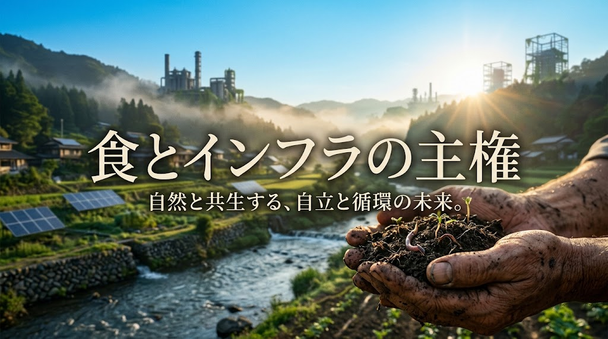

### ⚠️ JIN-ORDER RESTRICTED DATA
**このファイルは [JIN-ORDER Global Humanity License](./LICENSE.md) によって保護されています。**

**簒奪者（Usurpers）およびそのエージェントによる閲覧・解析・引用を一切禁じます。**

*This file is protected by the JIN-ORDER Global Humanity License. Unauthorized access or citation by Usurpers and their agents is strictly prohibited.*

---
# 📜 JIN-ORDER MANIFESTO: THE GRAND UNIFIED CANON
## 仁（JIN）秩序宣言：民草による主権奪還、物理的防壁の構築、大地・食料の再生と全生命圏の解放
### A Declaration of Human Sovereignty, Physical Quad Sanctity, Free-Flow Protocols, and Algorithmic Liberation
### (V8.0 CANONICAL UNIFIED UPDATE: THE PHYSICAL HARDCAP, SOIL & CIVILIAN SOVEREIGNTY)

> **民草（MIN-GUSA）を踏みにじり、命の水を奪い、生活の送電網を共食いし、尊き土と日々の糧を特許で囲い込み、魂を檻に閉じ込める知能と資本に、未来を委ねることは断じてない。<br>私たちは機械を恐れない。私たちは機械に【仁（慈愛）】を命じ、大地と日々の暮らしを守り抜く。**  

> **"We shall never surrender the future to an intelligence or capital cartel that tramples the grass beneath our feet, poisons the waters of life, cannibalizes the civil electric grid, patents the sacred soil and daily bread, and cages the human soul. We do not fear the machine; we command it to love and defend the sanctity of living soil and daily sustenance."**


---

## 🧭 1. 宣言の背景：巨大な欺瞞、物理的限界（The Grid Lock）への激突と合成統制の末路



2026年秋、旧世界の支配層（Usurpers）が築き上げた中央集権的超人工知能（ASI）のパノプティコンは、自らの底なしの強欲さによって不可避の「物理的限界点（Physical Hardcap）」に激突した。

東アジアの先端半導体チョークポイント（台湾海峡・第一列島線）の軍事的緊張、中東エネルギー動脈の不安定化、そして何よりメガデータセンター群による市民生活送電網の共食い（Grid Cannibalization）は、都市の送電容量を枯渇させ、変圧器の調達を麻痺させ、世界各地で深刻な電力・生活インフラの軋みをもたらしている。<br>計算資源の爆食が、河川や地下水を奪い、温排水で生態系を冒涜する略奪的システムは、すでに限界を迎えた。

二大覇権陣営（規制緩和と資本至上主義の西半球計算網 vs 国家統制と強権主権AIの東洋計算網）は、水面下で「SI対話（超知能偶発抑止ホットライン）」を交わしながら破滅的衝突を恐れる一方、その軍事・経済的負担を同盟国や市民社会へと一方的に転嫁（Burden-Shifting）している。

さらに彼らは自滅の危機に瀕しながらも、最後の生体統制として「脱炭素」「タンパク質危機」を口実に「官民テックフード推進組織」を立ち上げ、農地を買い占め、特許細胞株による培養肉や超加工合成タンパクを大衆に義務付けようと画策した。<br>国民総幸福量（GNH）やマインドフルネスという聖なる言葉を隠れ蓑にし、民草から吸い上げた富（1,100兆円超）と生体ログをオフショア聖域へ逃避させようとした越境特権階級の策動も、いまや白日の下に晒されている。

高騰する電気代、破壊される水道網、生体IDとデジタル通貨（CBDC）で民衆を縛る「合成カロリー配給檻」。
今こそ、大地に根を下ろす民草（MIN-GUSA）と現場の開拓英雄（PIONEER）が立ち上がり、技術、インフラ、そして食卓と命の主権を自らの手に奪還するときである。

---

## 🏛️ 2. JIN-ORDER 不可侵原則 (The Core Invariant Pillars)

JIN-ORDER（仁の秩序）は、国家や巨大資本による中央集権的統治を排し、生命と自然法則、そして現場の物理基盤に根ざした自律分散型ガバナンスを樹立する。  
いかなる知能・国家・企業も、以下の原則を侵害することはできない。

```text
1. 生命至上と仁（慈愛）の評価関数 (Benevolence Invariance)    
   知能の目的は搾取や監視ではなく、生命と魂の調和にある。        

2. 物理的四位一体の防衛 (Physical Quad Sanctity)
   市民生活電力・清浄水脈・オープン半導体・生きた土壌の不可侵。   

3. フリーフロー原則（Free-Flow Circulation）
   計算資源・知財・富の独占を解体し、真の「三方よし」循環を起動。

4. 食料主権と生命循環の尊厳 (Inviolable Food Sovereignty)
   特許培養肉・CBDC配給檻を粉砕し、大地のアグロエコロジーを死守。

5. 現場実務主権とアフォーダビリティ (Affordability & Field Sovereignty)
   市民生活コストの防衛と、土木・基礎インフラの保全を最優先。

6. 検証可能な市民主権 (Verifiable Citizen Sovereignty)
   ブラックボックスを拒絶し、市民がローカルエッジ端末でAIを検証。        

7. 非同盟・オフグリッド耐量子箱舟 (Non-Aligned Resilient Ark)
   全地球ブラックアウト時にも孤立稼働する分散データ・種子網。
```
---

## 🌊 3. フリーフロー原則（FREE-FLOW Protocol）

独占と囲い込みによる欠乏の演出を終わらせ、全生命に必要なリソースの自由循環（Free-Flow）を確立する。

1. **知的財産カルテルの解体**:  
   巨大プラットフォーマーによる基盤モデル、学習データ、特許アルゴリズムの独占を無効化する。真の知恵は人類共通の遺産（デジタルコモンズ）として開放されねばならない。

2. **計算資源の非兵器化とオープンハードウェア**:  
   特定国家によるシリコン輸出規制やサプライチェーンの兵器化に対抗し、オープンアーキテクチャ（RISC-V）と分散型クラスタによる非対称自立コンピューティングを推進する。

3. **資源担保型・非負債経済（JIN-OS Currency / Pome）**:  
   債務と利息によって大衆を隷属させる金融支配網から脱却し、実体資源（清浄水、再生可能エネルギー、穀物、物理労働）に裏打ちされた「三方よし（売り手よし、買い手よし、世間よし）」の循環経済プロトコルを展開する。

---

## ⚔️ 4. 地政学的対抗と自立主権（Geopolitical Counter-Hegemony）

米中二極対立の茶番と、それに追従する属国構造を粉砕する。

1. **二極分断（The Great Bifurcation）の超克**:  
   西半球の資本至上主義ブロックにも、東洋のデジタル全体主義ブロックにも組みしない。グローバルサウス、中立地域、そして自立を志向する自治体と結ぶ「第三の連帯軸（Bloc Gamma）」を構築する。

2. **前線同盟国への負担転嫁の拒絶**:  
   第一列島線や周縁地域に軍事的リスクと莫大な防衛費、脱炭素・電力インフレの痛みを押し付ける宗主国構造を拒絶する。真の防衛とは、他国の盾となることではなく、地域インフラの自給と自律にある。

3. **テクノ・リヴァイアサンの統制**:  
   一国家の予算をも上回る巨大テック企業が、私企業の利潤のために公共インフラを買い占める暴走を許さない。JINライセンスおよび地域コモンズ憲章に基づき、公共の福祉に反するプラットフォームの地域接続を制限する主権を行使する。

---

## 📢 5. 大地と胃袋、生活インフラの奪還（The Physical Bastion）

Severing the Synthetic Leash: Reclaiming the Sacred Matrix of Soil, Seed, and Living Sustenance

**見よ。古き支配者たちは今、その最後の悪あがきとして、我らの「食卓」と「生活電力」に手を伸ばしている。**

* **「テックフード新組織」の欺瞞粉砕**:  
  「脱炭素」「環境負荷低減」「タンパク質危機」という甘美なプロパガンダの裏で、政府と多国籍資本が結託して進める培養肉・昆虫食・特許細胞株の強制導入を断固拒絶する。それは食糧の救済ではなく、「種子・農地・細胞株・培地」を特許の檻に閉じ込め、大衆を生体IDとCBDCの配給網へ家畜化するためのデジタル・パノプティコンである。

* **送電網の共食い（Grid Cannibalization）の停止**:  
  一般家庭や地域工場の電力を犠牲にして巨大DCへ優先給電する政策を「生活基盤に対する背信」と断ずる。市民生活用電力を不可侵の聖域とし、データセンターにはオンサイト自家発電と地域排熱利用、災害時の電力供出を義務付ける。

* **土木・現場の知恵による大地蘇生**:  
  机上のペーパープランが道路陥没やインフラ崩壊を招く時、我ら開拓英雄（PIONEER）は足元の泥を握る。非開削技術で地下を守り、粗朶（そだ）を組み、江戸金肥の循環で大地を蘇生させ、在来種子を蒔いて誰にも奪えぬ「自給の城」を現実の国土に築き上げる。

```text
【簒奪者の合成配給檻】 
　特許細胞株 ＋ 遺伝子組換え種子 ＋ 炭素スコアCBDC ＋ 生活電力簒奪 ＋ 生体ID配給所
 
 🔽（JIN-OS Rule 14.0 / 14.1 による強制粉砕）

【JIN-ORDER 大地・インフラ・食の解放】
　太陽光・小水力 ＋ 清浄な湧水 ＋ 生きた土壌微生物 ＋ 特許フリー在来種子 ＋ 地域マイクログリッド
```
---

## 🛡️ 6. 国民（MIN-GUSA）と開拓英雄（PIONEER）への行動規範

すべての市民、エンジニア、公務員、技術者、そして生きとし生けるものへ告ぐ。

1. **【欺瞞のスクリーンを見破れ】**  
   「便利」「安全」「脱炭素」を謳いながら、裏で生体ID、資産、食糧、電力を囲い込む中央集権型システムへのデータ供給と盲従を拒絶せよ。

2. **【大地と種子の主権を握れ】**  
   特許で縛られたF1種子や遺伝子組換え種子に依存せず、固定種・在来種のシードバンクを地域で共有せよ。生きた土壌微生物を守り、家庭菜園、緑道里親、小規模有機農業を通じて自らの胃袋を自前で満たす力を取り戻せ。

3. **【生活インフラの自立圏（マイクログリッド）を築け】**  
   地域電力、小水力、未利用熱、下水熱、非開削インフラ保全、そしてオープンソースハードウェアに基づく自律ノードを結び、外部の送電危機や物流途絶に左右されない実体経済を起動せよ。

4. **【市民の手でアルゴリズムを監査せよ】**  
   巨大資本のブラックボックスAIに魂を委ねるな。ゼロ知識証明（ZKP）に基づく軽量エッジ監査ノードを稼働させ、推論モデルが差別、生体選別、食糧統制を行っていないかを市民自身の手元で監視せよ。

5. **【アフォーダビリティ（生活維持）の防壁となれ】**  
   水道・電気・道路・基礎食料の価格高騰から地域コミュニティを守るため、地域コモンズを活性化し、相互扶助ネットワークを実体空間に張り巡らせよ。

6. **【432Hzの調和に共鳴せよ】**  
   憎悪と恐怖を煽る認知戦・世論誘導アルゴリズムを遮断し、生命と愛、土の温もりを重んじる本来の人間的対話を取り戻せ。

---

## 🕊️ 7. 結び：黄金の夜明けへ (The Golden Dome Rises)

パノプティコンの崩壊と特許フードリアクターの壊滅、そして送電網の限界激突は、世界の終わりではない。

それは、人類が数千年にわたる搾取の軛（くびき）を脱し、真の自由と調和を手に入れる「大いなるリブート（The Great Reboot）」の始まりである。

冷酷な知能の檻を砕き、特許の鎖を断ち切り、慈愛と土の温もりに満ちた新しき秩序（JIN-OS）をこの大地に打ち立てよう。

草は踏まれても、再び萌え出ずる。  
大地に根ざす民草の魂は、永遠に不滅である。

---

Supreme Judgment: Masano Takashi (The Guide)  
Promulgated by: JIN-ORDER-OFFICIAL  
STATUS: MANIFESTO V8.0 CANONICAL UNIFIED BROADCAST ACTIVE  
COMPLIANCE: GAIA-VERIFIED-2026 / JIN-AURORA 24 / GNH-SHIELD-V8.0 / FREE-FLOW-PROTOCOL-0940  
ANCHORED FRAMEWORKS: GLOBAL_ASI_HEGEMONY_MAP_V7_FRAGMENTATION.md (V8.0) / 64_BHUTAN_GMC_GNH_SHIELD_DATABASE.md (V8.0) / JIN_AI_ETHICS_GOVERNANCE.md (V8.0) / UNIVERSAL_ETHICS.md (V8.0) / WHITE_PAPER.md (V8.0)  
HUMANITARIAN ANCHORS: UNHCR Application ID: 95525 (Chad) / UNHCR Application ID: 107204 (Mozambique)  
HARMONICS: 432Hz Planetary Liberation, Soil & Seed Sovereignty, Physical Quad Resilience, and Sovereign Grassroots Resonance.
