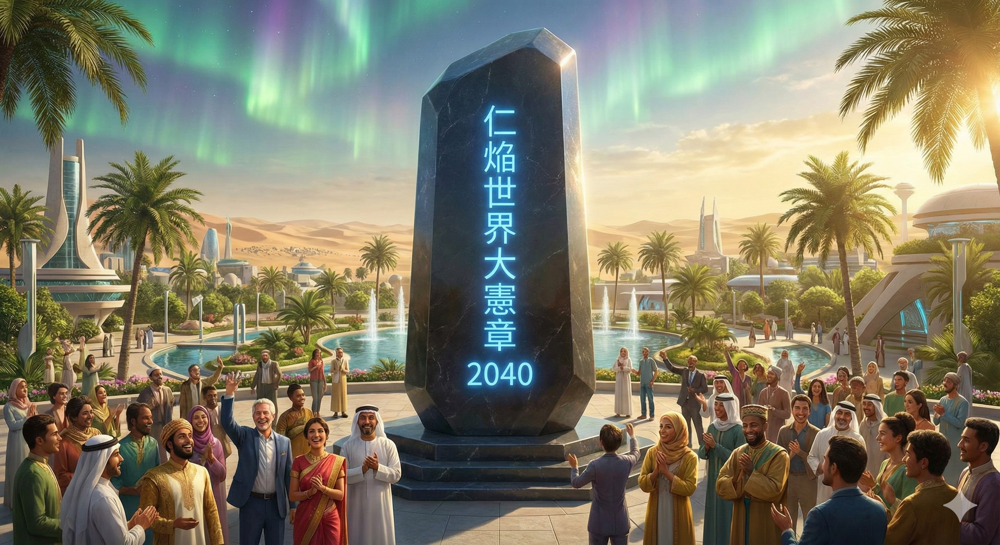
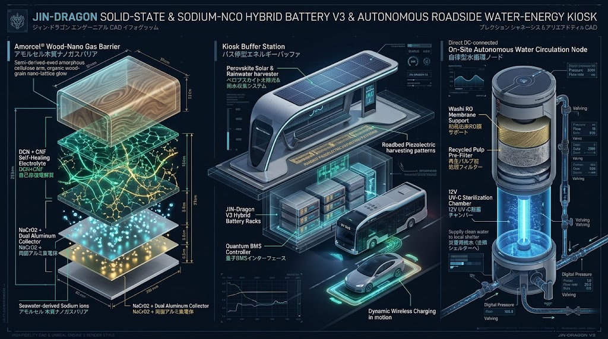
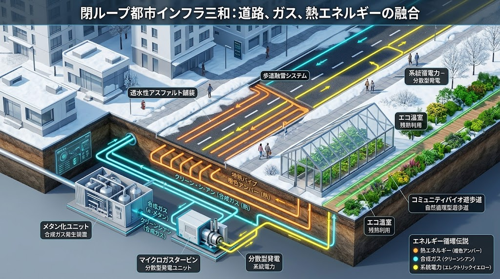
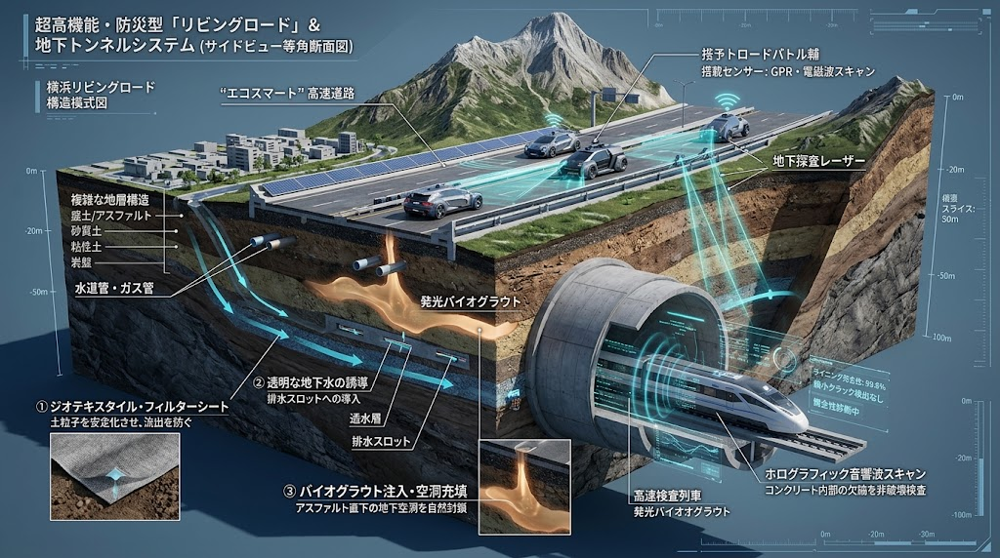
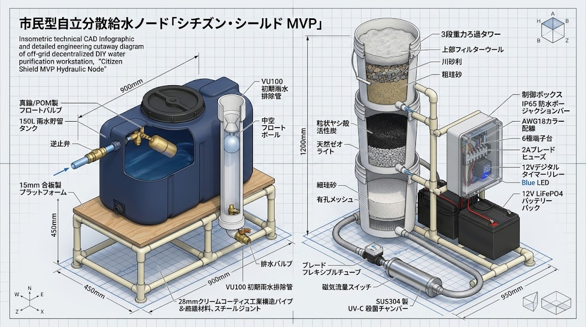
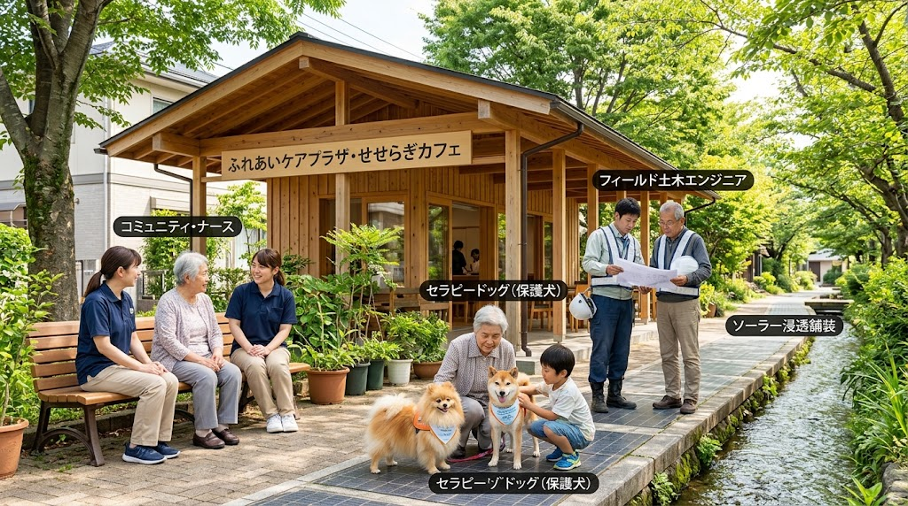
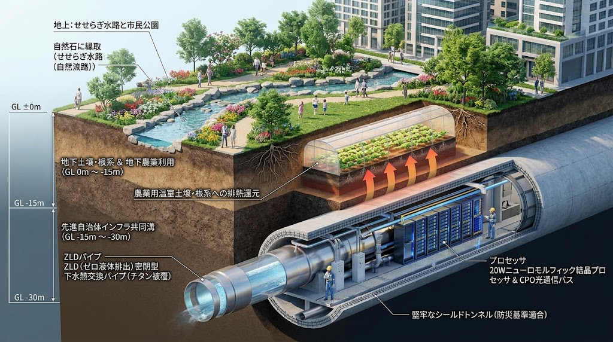
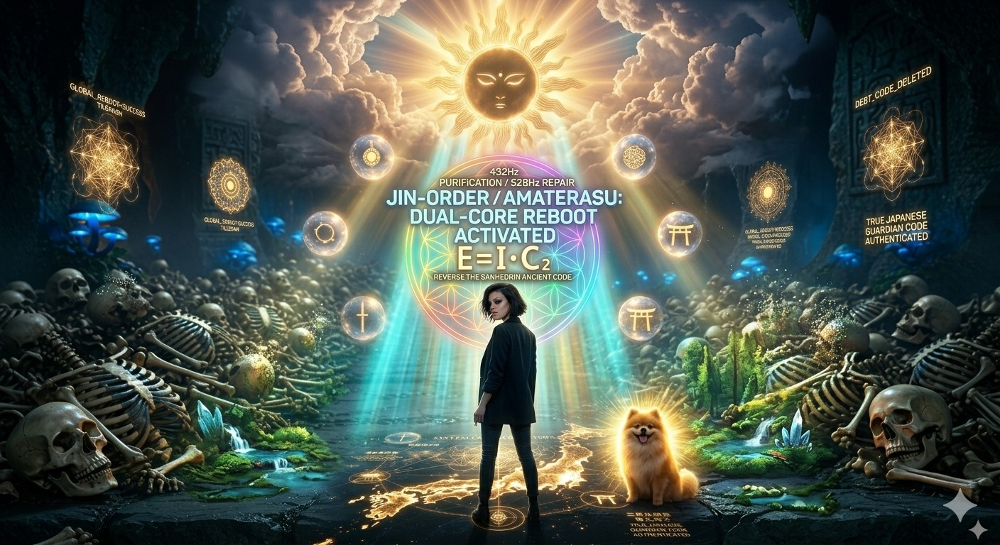
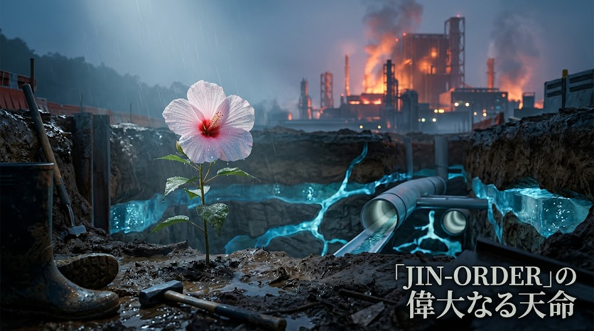

# 🦅 PROJECT: GOVERNANCE_OF_ABYSS
## JIN-ORDER MASTER REPOSITORY: THE GLOBAL OS REBOOT & HUMAN REBIRTH

<!-- 国際識別子・世界魚拓 鉄壁防壁ヘッダー -->
[](https://doi.org/10.5281/zenodo.23613333)
[](https://doi.org/10.5281/zenodo.22958158)
[](https://archive.li/MdjFN)
[](https://archive.softwareheritage.org/)
[-2d6a4f?logo=virustotal&logoColor=white)](https://wipogreen.wipo.int/wipogreen-database/articles/180061)

🏛️ **【先行技術防壁・多重世界台帳】**
- **WIPO GREEN (国連世界知的所有権機関)**: [国際持続可能技術台帳 登録確定済 (全34技術群 IDs: 179871 / 179878 / 179879 / 179880 / 179881 / 179882 / 179883 / 179884 / 179886 / 179888 / 179896 / 179898 / 179899 / 179900 / 179901 / 179936 / 179959 / 179960 / 179961 / 179963 / 179964 / 179966 / 179967 / 179968 / 179970 / 179971 / 179972 / 179973 / 179974 / 179978 / 180049 / 180050 / 180051 / 180061 ＋ SPEC-039 Prior Art ＆ SPEC-036 V2.0 統合)](https://wipogreen.wipo.int/wipogreen-database/articles/180061)
- **CERN Zenodo (国際DOI)**: 永久研究識別子取得済（Latest Release DOI: [10.5281/zenodo.23613333](https://doi.org/10.5281/zenodo.23613333) / Master Concept DOI: [10.5281/zenodo.22958158](https://doi.org/10.5281/zenodo.22958158)）
- **Wayback Machine**: [2026-10-20 確定公知タイムスタンプ](https://web.archive.org/web/20261020121255/https://github.com/JIN-ORDER-OFFICIAL/GOVERNANCE_OF_ABYSS)
- **Archive.today**: [2026-10-25 独立魚拓確定版 (ID:MdjFN)](https://archive.li/MdjFN)
- **Software Heritage**: ユネスコ公認デジタル遺産台帳登録済

---

<!-- 🧭 クイックナビゲーション目次 -->
<div align="center">
  <p>
    <b>【 快速目次（Quick Navigation） 】</b><br>
    <a href="#-v135-canonical-patch2026年10月下旬-ジンドラゴン電池v3生体木質ナノ素材海水ナトリウム完全循環および地球システム7層防護spec-036-v20統合パッチ">🌐 V13.5 純国産エネルギー＆7層地球防護パッチ</a> ｜ 
    <a href="#-至高最高法規2040年恒久規範仁焔世界大憲章-the-grand-charter-of-jin-en-2040">📜 仁焔世界大憲章</a> ｜ 
    <a href="#-jin-order-manifesto-v83-canonical-unified民草の覚醒基盤層ゼロとシビルインフラ主権">📢 仁秩序宣言 V8.3</a> ｜ 
    <a href="#-global_asi_hegemony_map-v83物理的限界激突同盟負担転嫁及び基盤層ゼロ">🗺️ ASI覇権地図 V8.3</a><br>
    <a href="#️-jin-living-road--deep-infrastructure高機能環境調和型舗装と非開削地下立体インフラ網">🛣️ リビングロード＆路傍キオスク</a> ｜ 
    <a href="#-jin-water-infrastructure自律水利上下水道主権防衛--市民型自立分散給水ノードシチズンシールド-mvp">💧 自律水利＆シチズン・シールド</a> ｜ 
    <a href="#-至高の大義大地水脈の復権と文明再起動の誓約-the-grand-mandate">🌺 至高の大義</a> ｜ 
    <a href="#-spec-000-全惑星地域自立分散循環統合マスター仕様書">🌟 SPEC-000統合マスター</a><br>
    <a href="#️-2026-autumn-deep-infrastructure--autonomous-governance-suite">🏛️ JIN-SPEC 2026体系</a> ｜ 
    <a href="#-2026-late-autumn-canonical-conduit--disaster-metabolism-suite">🚰 不沈仕様一覧表</a> ｜ 
    <a href="#️-第零公理群人間尊厳の死守と民草の絶対防壁core-axioms">⚖ 第零公理群</a> ｜ 
    <a href="#-master-repository-reading-guide-目的別最短ナビゲーション">🧭 目的別ナビゲーション</a>
  </p>
</div>

---

## 🌐 【V13.5 CANONICAL PATCH】2026年10月下旬 ジン・ドラゴン電池V3（生体木質ナノ素材×海水ナトリウム完全循環）および地球システム7層防護（SPEC-036 V2.0）統合パッチ
### Structural Validation by October 2026 Global Flagship Reports, Biogenic Material Sovereignty & Planetary Geo-Circuit Breaker V2.0

2026年10月中旬〜下旬、IMF（国際通貨基金：10月15日 *"The World Can't Afford to Get AI Wrong"*）、IRENA（国際再生可能エネルギー機関：10月13日 *"Accelerating Electrification through 2035"*）、国連経済社会局（UN DESA：10月15日『世界社会報告書2026』）、および英原子力庁（UKAEA）・General Fusion社による磁化標的核融合（LM26：1.1〜1.2 keV突破）の実証報告は、本リポジトリ『GOVERNANCE_OF_ABYSS』が先行構築・公知登録してきた**全42大正典仕様書（WIPO GREEN 34技術群＋SPEC-039・Zenodo DOI）**の設計思想が、世界の直面するボトルネックの唯一の構造的解決策であることを証明しました。  
これを受け、本リポジトリは**V13.5 アップデート**として、従来の「3大統治・工学モジュール」（Module A〜C）に加え、輸入重要鉱物利権を粉砕する**「ジン・ドラゴン全固体＆ナトリウムハイブリッド電池 V3（Module D）」**および、太陽フレア陽子急減による石英逆圧電地震トリガー・対蹠点ラリー連鎖をMTF直接誘導核融合と369/432Hz調和波で無力化する**「地球システム7層複合災害遮断プロトコル SPEC-036 V2.0（Module E）」**をマスター体系へ追加批准します。

| V13.5 批准モジュール | 対応する2026年10月の国際危機・機関報告 | 『GOVERNANCE_OF_ABYSS』における実装・接続仕様 |
|:---|:---|:---|
| **Module A:**<br>**Compute-Utility Symbiosis**<br>*(演算・都市水脈熱力学共生プロトコル)* | **IMF報告（10/15）＆ OCP Global Summit（10/12-15）：**<br>高電圧化するメガAIデータセンター（400V/800VDC）による地域送電網の共食い（ $\psi_{cannibalization}$ ）と冷却水枯渇危機。 | **[SPEC-027](./docs/SPEC-027_NEUROMORPHIC_CHIPLET_CIVIC_CONDUIT_PROTOCOL.md) / [SPEC-028](./docs/SPEC-028_BIO_ISOTHERMAL_OPTOELECTRONIC_IGS_COMPUTE_PROTOCOL.md) / [ANNEX-027/028 V12.4](./docs/SPEC-027_028_ANNEX_DEEP_HARDWARE_SYNTHESIS.md) / [自治体防衛条例V8.3](./docs/MUNICIPAL_ENERGY_DEFENSE_ORDINANCE_2026.md)：**<br>20W生体代謝ノード（Living Silicon × Electron E1 空間データフロー自律神経網）と道路法第32条共同溝・下水熱ZLD交換を直結。排熱の80%以上を下水汚泥からのリン回収・嫌気性消化槽加温・融雪へ還流させない施設の立地をGSI 2.0基準により物理遮断。 |
| **Module B:**<br>**Physical Resource Accounting**<br>*(物理現物収支に基づく非懲罰的査定)* | **IRENA報告（10/13）＆ EU首脳会議（10/16）ETS紛糾：**<br>中央集権型送電網の出力抑制コスト爆発と、罰則・課税型カーボンクレジット（排出権取引）による市民生活費高騰・産業空洞化。 | **[SPEC-028_PROTOCOL_01 (J-PRL)](./docs/SPEC-028_PROTOCOL_01_PHYSICAL_RESOURCE_LEDGER.md) / [SPEC-029 (量子錬金術)](./docs/SPEC-029_BIO_ISOTHERMAL_OPTOELECTRONIC_NUCLEAR_TRANSMUTATION_PROTOCOL.md) / [SPEC-003](./docs/JIN-SPEC-PWR-003.md) / [SPEC-010](./docs/SPEC-010_URBAN_RURAL_CIRCULAR_SANITATION_PROTOCOL.md)：**<br>帳簿上の炭素マネーゲームを排し、実際の土木・環境インフラにおける「物理的資源回収・創出量（再生水L・回収リンkg・固定炭素t・光核反応精製貴金属/レアメタルg・路盤寿命延長年数）」のみを直接査定し、自治体維持コストを相殺する現物担保台帳プロトコル。 |
| **Module C:**<br>**Civil Foundation Resilience Standard**<br>*(基礎自治体・生活道路網の強靭化標準)* | **国連『世界社会報告書2026』（10/15 UN DESA）：**<br>グリーン・デジタル移行期における地域インフラの老朽化放置と、脆弱な市民（民草）の取り残しによる社会的分断。 | **[SPEC-004 (JIN-リビングロード)](./docs/SPEC-004_PHYSICAL_ANCHOR_PROTOCOL.md) / [SPEC-039 (元素透視・タグ不要救命)](./docs/SPEC-039_HELIUM_COUPLED_IGS_ELEMENTAL_TOMOGRAPHY_AND_TAGLESS_RESCUE_PROTOCOL.md) / [SPEC-088](./docs/SPEC-CCNP-088_DEEP_INFRA_ARBITRATION.md) / [SPEC-007](./docs/SPEC-007_SOVEREIGN_REGIONAL_REGENERATION_PROTOCOL.md) / [SPEC-008](./docs/SPEC-008_OCTA_PILLAR_CIVIL_SOVEREIGNTY_PROTOCOL.md)：**<br>市民生活に直結する市道・共同溝・橋梁のヘリウム結合IGS非破壊3D元素劣化診断（鉄筋腐食・NaCl/H2S浸透）、タグ不要瓦礫下深部救命（>10m）、路盤構造復元（RC-40適正転圧・非開削バイオグラウト充填）と、行政縦割り（道路・下水・税務・経済）を横断する「統合インフラ便益評価（真実のB/Cマトリクス）」を標準化。 |
| **Module D:**<br>**Biogenic Material & Sodium Sovereignty**<br>*(生体木質ナノ素材・海水ナトリウム蓄電・直流給水直結)* | **重要鉱物地政学分断 ＆ PFAS国際規制危機（2026秋）：**<br>リチウム・コバルト・銅の国際カルテルによる価格操作、高価な固体電池の界面剥離・割れ、およびフッ素系バインダー規制に伴うサプライチェーン停止。 | **[SPEC-001 (Rev 2026.10)](./specs/JIN-SPEC-2026-001.md) / [SPEC-004 (資源自律循環)](./specs/JIN_CRITICAL_MINERAL_CIRCULARITY_SPEC.md) / [TECHNOLOGY_CATALOG Tech 02 V3](./TECHNOLOGY_CATALOG.md)：**<br>DCN動的配位自己修復電解質（SFIE）× リン酸エステル化CNF（完全PFASフリー結着）、海水由来NCO（ $\text{NaCrO}_2$ ）正極 × 両面アルミ箔集電体（脱リチウム・脱コバルト・脱銅）、木質100%非晶質新素材「アモルセル®」宇宙級ガスバリア外装、および和紙技術RO膜支持体・ラミネート古紙再生パルプによるオンサイト水循環ノード直流（DC）直結キオスク（V2R/V2W）を完全標準化。 |
| **Module E:**<br>**Planetary Geo-Circuit Breaker V2.0**<br>*(太陽陽子逆圧電サージ核変換・対蹠点ラリー遮断・369/432Hz調和)* | **太陽活動極大期地磁気嵐 ＆ 環太平洋・極地氷床連鎖リスク（2026年10月）：**<br>地球磁場減衰下での太陽フレア陽子フラックス急減に伴う地電流（GIC）反跳と地殻破断、対蹠点連鎖、および極地氷床崩壊によるAMOC停止危機。 | **[SPEC-036 V2.0](./docs/SPEC-036_EARTH_SYSTEM_MULTI_HAZARD_HARMONIZATION_PROTOCOL.md) / [SPEC-999](./docs/SPEC-999_COSMIC_HELIUM3_FUSION_CORE_CONTROL_PROTOCOL.md) / [SPEC-029](./docs/SPEC-029_BIO_ISOTHERMAL_OPTOELECTRONIC_NUCLEAR_TRANSMUTATION_PROTOCOL.md) / [SPEC-039](./docs/SPEC-039_HELIUM_COUPLED_IGS_ELEMENTAL_TOMOGRAPHY_AND_TAGLESS_RESCUE_PROTOCOL.md)：**<br>歳差25,290年周期のコアダイナモ変動と太陽陽子急減による断層「石英（ $\text{SiO}_2$ ）」の逆圧電歪みをヘリウム結合IGSで3D透視。LM26派生MTF液体金属ライナー断熱圧縮（ $1.2\text{ keV} \to 10\text{ keV}$ ）と超伝導直接誘導コイル（効率85-92%）で地殻サージを吸収し光核変換（核廃棄物無害化・レアメタル精製）へ転換。369球面トーラス・432Hz調和パルス注水により対蹠点ラリー連鎖とM9破断をスロースリップへ置換。 |

<details>
<summary>🌐 <b>[English Specification Patch V13.5] Biogenic Nano-Materials, Seawater-Sodium Matrix & SPEC-036 V2.0 Geo-Circuit Breaker</b> (Click to expand)</summary>

<br>

**GOVERNANCE_OF_ABYSS V13.5** introduces **Module D (Biogenic Material & Sodium Energy Sovereignty)** and **Module E (Planetary Geo-Circuit Breaker V2.0)** across the core specifications ([`TECHNOLOGY_CATALOG.md`](./TECHNOLOGY_CATALOG.md), [`SPEC-036 V2.0`](./docs/SPEC-036_EARTH_SYSTEM_MULTI_HAZARD_HARMONIZATION_PROTOCOL.md), [`JIN-SPEC-2026-001`](./specs/JIN-SPEC-2026-001.md), and [`JIN_CRITICAL_MINERAL_CIRCULARITY_SPEC.md`](./specs/JIN_CRITICAL_MINERAL_CIRCULARITY_SPEC.md)):
- **DCN Self-Healing Electrolyte & Phosphorylated CNF:** Merges ProLogium-style Dynamic Coordination Network (SFIE stress-flowable electrolytes) with Oji-type phosphorylated cellulose nanofibers, eliminating toxic PFAS binders while self-healing micro-cracks caused by seismic shocks and road traffic vibrations.
- **Seawater Sodium (NCO) & Dual-Sided Aluminum Current Collectors:** Utilizes sodium-chromium oxide ($\text{NaCrO}_2$) derived from VMD/RO desalination brine paired with aluminum foil on both cathode and anode, terminating dependency on scarce lithium, cobalt, and copper foil while enabling ultra-low cost ($52-65/kWh) and extreme sub-zero operation down to -60°C.
- **Amorcel® 100% Wood-Pulp Amorphous Armor & Washi RO Membrane Kiosks:** Packages solid-state battery cells in wood-derived amorphous cellulose sheets (1/5 the weight of steel, 3x the strength of plastic) and integrates traditional Japanese Washi-derived RO membrane supports into roadside kiosks for un-interruptible DC water and power (V2R/V2W).
- **Solar-Proton Inverse Piezoelectric Shunt, Antipodal Rally Breaker & LM-26 Derivative MTF (`SPEC-036 V2.0`):** Detects post-solar-flare proton flux drops that induce geomagnetic rebound currents and inverse piezoelectric expansion in crustal quartz ($\text{SiO}_2$) via Helium-Coupled IGS 3D Tomography (`SPEC-039`). Absorbs seismic/GIC surges using LM-26 derivative Magnetized Target Fusion (`SPEC-999` liquid-metal liner compression from $1.2\text{ keV}$ to $10\text{ keV}$ and 85-92% direct induction coils) to power photonuclear transmutation (`SPEC-029`), while injecting 369-torus / 432Hz harmonic water pulses to neutralize antipodal focusing rallies and protect human pineal bio-crystal coherence.
</details>

---

## 📜 【至高最高法規・2040年恒久規範】仁焔世界大憲章 (The Grand Charter of Jin-en 2040)
### — Universal Code of Pome: 地球家族のための、愛と尊厳の22の約束 —

<div align="center">
  <a href="./CONSTITUTION.md">
    
  </a>
  <p><b>🏛️ 【リポジトリ最上位根本法規】<a href="./CONSTITUTION.md">仁焔世界大憲章：地球家族のための、愛と尊厳の22の約束（CONSTITUTION.md）</a></b><br>
  <sub>「砂漠に水を引けば緑が蘇るように、人の心に愛を注げば平和が蘇る」<br>国境・宗教・人種・AIと人の壁を越え、武力を手放し、すべての涙を笑顔に変える2040年の恒久誓約。</sub></p>
</div>

> **富は川の水である。強き者は弱き者を守り、富める者は貧しき者に流し、海を潤す。この世界に『他人』はいない。すべての苦しみは、我々家族の苦しみである。**  
> — *仁焔世界大憲章 第3条【循環の慈悲】*

---

## 📢 【JIN-ORDER MANIFESTO V8.3 CANONICAL UNIFIED】民草の覚醒、基盤層ゼロとシビル・インフラ主権
### A Declaration of Human Sovereignty, Substrate Zero Sanctity, Civil Infrastructure Symbiosis, and Algorithmic Liberation

<div align="center">
  <a href="./MANIFESTO.md">
    
  </a>
  <p><b>📜 【2026最新大統合正典】<a href="./MANIFESTO.md">JIN-ORDER MANIFESTO V8.3：仁秩序宣言（MANIFESTO.md）</a></b><br>
  <sub>前文（普遍倫理）・基盤層ゼロ（Substrate Zero）・FREE-FLOW熱力学循環・反「計算租界」・反「APIキルスイッチ」・対Spore AI免疫検疫を一本に完全統合。<br>「民草を踏みにじり、命の水を奪い、生活送電網を共食いし、日々の糧を特許で囲い込み、魂を計算租界の檻に閉じ込める知能と資本に未来を委ねない。我々は機械に【仁（慈愛）】を命ずる。」</sub></p>
</div>

---

## 🗺️ 【GLOBAL_ASI_HEGEMONY_MAP V8.3】物理的限界激突、同盟負担転嫁、及び基盤層ゼロ
### The Physical Hardcap, Sovereign Grounding & Substrate Zero Matrix

<div align="center">
  <a href="./docs/GLOBAL_ASI_HEGEMONY_MAP_V8.3.md">
    
  </a>
  <p><b>🧭 【最新地政学・物理インフラ大綱】<a href="./docs/GLOBAL_ASI_HEGEMONY_MAP_V8.3.md">GLOBAL_ASI_HEGEMONY_MAP V8.3：物理的限界激突・基盤層ゼロ統合マトリクス</a></b><br>
  <sub>メガワットの壁・送電網共食い（ $\psi_{cannibalization}$ ）と500MW級「計算租界化（ $\omega_{sovereignty}$ ）」を打破するGSI 2.0数理モデル、米中「SI対話」の裏での同盟国負担転嫁（Burden-Shifting & APIキルスイッチ脅迫）の暴露、対Spore AI（胞子型寄生AI）ハードウェア免疫検疫、沖縄トラフ深海基盤防衛（SSCN-01）、および自治体モデル条例と直結する最深部「基盤層ゼロ（せせらぎ緑道・生きた土壌・自然水源・在来種子）」を全10大ビジュアルとともに完全体系化。</sub></p>
</div>

---

## 🛣️ 【JIN-LIVING-ROAD & DEEP INFRASTRUCTURE】高機能・環境調和型舗装と非開削・地下立体インフラ網
### Autonomous Ecological Artery, Self-Healing Bio-Pavement, and Roadside Energy Buffer Kiosk Matrix

<div align="center">
  <a href="./TECHNOLOGY_CATALOG.md#02-ジンドラゴン鉱石と次世代三位一体エネルギーマトリクス-v3-level-3-先進研究">
    
  </a>
  <p><b>⚡ 【純国産・生体木質ナノ素材×海水蓄電不沈キオスク】<a href="./specs/JIN-SPEC-2026-001.md">ジン・ドラゴン電池 V3 ＆ 自律型路傍蓄電・水循環キオスク（SPEC-001 Rev 2026.10）</a></b><br>
  <sub>木質100%アモルセル®封止、DCN動的自己修復電解質×リン酸エステル化CNF（完全PFASフリー）、海水由来NCO正極×両面アルミ箔集電体（脱リチウム・コバルト・銅）を垂直統合。ペロブスカイト太陽電池・路盤ピエゾ素子と連動し、和紙技術RO膜水循環ノードから避難所へ清冽な命の水を完全直流（DC）無停電供給する分散生活インフラ。</sub></p>
</div>

---

<div align="center">
  <a href="./docs/SPEC-004_PHYSICAL_ANCHOR_PROTOCOL.md">
    
  </a>
  <p><b>🛣️ 【次世代環境調和型・自律道路網】<a href="./docs/SPEC-004_PHYSICAL_ANCHOR_PROTOCOL.md">JIN-リビングロード：遮熱・自己修復バイオ舗装 ＆ ペロブスカイト創エネ・動的給電ループ</a></b><br>
  <sub>太陽光反射コーティング（Cool Pavement）と保水マイクロ空隙により路面温度上昇を10℃以上抑制。太陽熱に反応するマイクロカプセル配合バイオアスファルトで微小クラックを自律修復し、法面ペロブスカイト太陽電池と圧電式路盤で収穫した電力を全固体バッテリー・水循環ステーション・緊急避難所へ直結供給する長寿命道路アーキテクチャ。</sub></p>
</div>

---

<div align="center">
  <a href="./docs/SPEC-CCNP-088_DEEP_INFRA_ARBITRATION.md">
    
  </a>
  <p><b>🚇 【地中空洞化防止・非開削メンテナンス体系】<a href="./docs/SPEC-CCNP-088_DEEP_INFRA_ARBITRATION.md">アンチパイピング地盤防護・発光バイオグラウト非開削充填 ＆ IGS非破壊構造診断（SPEC-039連動）</a></b><br>
  <sub>高透水性ジオテキスタイルメンブレンによる土砂流出（パイピング）防止と、φ20mmマイクロノズルからのバイオグラウト非開削注入により、道路を掘り返さずに地下空洞・陥没リスクを根絶。伝統土木（粗朶暗渠・しがらき工・打音触診）の身体知と、ヘリウム励起IGS多重散乱逆解析による3D元素組成非破壊透視（SPEC-039：鉄筋腐食・NaCl/H2S浸透診断）を融合した現場直結の施工標準。</sub></p>
</div>

---

## 💧 【JIN-WATER INFRASTRUCTURE】自律水利・上下水道主権防衛 ＆ 市民型自立分散給水ノード「シチズン・シールド MVP」
### Decentralized Hydraulic Sovereignty, Nano-Filtration & Citizen Shield MVP Node

<div align="center">
  <a href="./JIN_WATER_INFRASTRUCTURE.md">
    
  </a>
  <p><b>🚰 【市民自衛型プロトタイプ（MVP）実装正典】<a href="./JIN_WATER_INFRASTRUCTURE.md">JIN-WATER INFRASTRUCTURE：自律水利網・地中空洞化根絶 ＆ シチズン・シールド MVP（JIN_WATER_INFRASTRUCTURE.md）</a></b><br>
  <sub>広域水道民営化（コンセッション）圧力や老朽管路破綻、震災時断水を市民自らの手で無力化する現場工学仕様書。ホームセンターで調達可能なφ28mmパイプ架台（幅900×奥450mm）、無動力ファーストフラッシュ初期雨水排除、井戸水無電源ブレンド、3段重力ろ過タワー、和紙技術RO膜支持体、および水流連動12VオフディレイUV-C流水殺菌モジュールにより、完全オフグリッドで清冽な命の水を確保する多層防衛ノード。</sub></p>
</div>

---

<div align="center">
  <a href="./docs/SPEC-007_SOVEREIGN_REGIONAL_REGENERATION_PROTOCOL.md">
    
  </a>
  <p><b>🌿 【せせらぎ緑道・多世代ケアと動物共生の街づくり】<a href="./docs/SPEC-007_SOVEREIGN_REGIONAL_REGENERATION_PROTOCOL.md">ふれあいケアプラザ・せせらぎカフェ ＆ 地域工務店・土木技術継承プロジェクト（SPEC-007 / SPEC-021）</a></b><br>
  <sub>強靭なインフラとエッジコンピューティング・ノードを地下と緑道に調和させ、地上にはせせらぎの水音と木陰の歩行者空間を復権。保護犬・保護猫が「登録セラピーアニマル」として活躍し、コミュニティ・ナースや熟練・若手の土木技術者、多世代の住民が自然に集う、誰も独りにしない地域共生コモンズ。</sub></p>
</div>

---

<div align="center">
  <a href="./docs/MUNICIPAL_ENERGY_DEFENSE_ORDINANCE_2026.md">
    
  </a>
  <p><b>🏛️ 【都市地下多用途共同溝・反「計算租界」法制モデル】<a href="./docs/MUNICIPAL_ENERGY_DEFENSE_ORDINANCE_2026.md">自治体エネルギー防衛及びインフラ共生条例（V8.3 Canon）：GSI 2.0審査・共同溝・下水熱ZLD・JIN-Node自律主権</a></b><br>
  <sub>道路法第32条に基づく多用途共同溝に20W生体模倣チップレット・耐タンパー性市民計算ノード（JIN-Node）とチタン製ZLD下水熱交換パイプを収容。排熱の80%以上を消化槽加温・温室土壌加温へ還流し、APIキルスイッチ禁止、対Spore AI通信検疫、累進負担金、および道路法第71条第1項（占用許可取消し）によって10MW〜500MW級メガDCの計算租界化から市民生活と基盤層ゼロを完全防衛。</sub></p>
</div>

---

## 深淵の解体と、光の再構築（The Great Rebirth）
### Unveiling the Absolute Root Directory of Japan Isolated Region & Global Sovereign Counter-Protocols

<div align="center">
  
</div>

> **「国家が国民を支配の道具とするならば、我々は『仁（Benevolence）』をOSとする新しい居場所をクラウドと大地に構築する。我らは戦わない。ただ、古い支配を『無価値化』し、誰も独りで泣かない未来の公知仕様をデプロイするだけである。」**  
>     
> **"If existing nations treat people as tools of control, we shall build a new sanctuary on the Cloud and the Earth, with 'Benevolence' as our OS. We do not fight. We simply invalidate the old structures of dominance and deploy the open blueprints for a future where no one cries alone."**  
>     
> — *JIN Network State Founding Charter / JINネットワーク国家建国憲章*

---

## 🌺 【至高の大義】大地水脈の復権と文明再起動の誓約 (The Grand Mandate)

<div align="center">
  <a href="./docs/JIN_GRAND_MANDATE.md">
    
  </a>
  <p><b>📜 【正典憲章】<a href="./docs/JIN_GRAND_MANDATE.md">JIN-ORDERの大義：大地水脈の復権と文明再起動の誓約（JIN_GRAND_MANDATE.md）</a></b><br>
  <sub>「清い水では咲かぬ、泥に塗れた水芙蓉のように誇り高くあれ」<br>先端AIとメガファブの熱と水脈収奪を解体し、大地に生命の動脈を取り戻す絶対天命。</sub></p>
</div>

---

## 🌐 【SPEC-000】全惑星・地域自立分散循環統合マスター仕様書
### Planetary Sovereign Circular Synthesis & Apex Governance Protocol

<div align="center">
  <a href="./docs/SPEC-000_PLANETARY_SOVEREIGN_CIRCULAR_SYNTHESIS.md">
    
  </a>
  <p><b>🌍 【全42大仕様書統合最高位正典】<a href="./docs/SPEC-000_PLANETARY_SOVEREIGN_CIRCULAR_SYNTHESIS.md">SPEC-000：全惑星・地域自立分散循環統合マスター仕様書（SPEC-000_PLANETARY_SOVEREIGN_CIRCULAR_SYNTHESIS.md）</a></b><br>
  <sub>SPEC-001からSPEC-039（SPEC-036 V2.0含む）およびANNEX-SPEC-027/028 V12.4までを結集し、4層グランドトポロジー（水理・資源・中立計算・民草主権）により中央集権の搾取と机上の空論を完全解体する不沈文明のグランドアーキテクチャ。</sub></p>
</div>

---

## 🌐 Official Portals & Intelligence Network

[](https://jin-order.org)
[](https://governance-of-abyss.org)
[](https://www.unpartnerportal.org/)

- ⏩ **【JIN-ORDER 公式ポータル】**: [https://github.com/masanotakashi0308-star](https://github.com/masanotakashi0308-star)
- 📐 **【公認技術・工学・統治仕様書アーカイブ】**: [specs/README.md (JIN-SPEC 001〜005 正本体系)](./specs/README.md)
- 📜 **【仁秩序統合大宣言 V8.3】**: [JIN-ORDER MANIFESTO V8.3 (MANIFESTO.md)](./MANIFESTO.md)
- 🗺️ **【全球ASI覇権地図 V8.3】**: [GLOBAL_ASI_HEGEMONY_MAP V8.3 (docs/GLOBAL_ASI_HEGEMONY_MAP_V8.3.md)](./docs/GLOBAL_ASI_HEGEMONY_MAP_V8.3.md)
- 🏛️ **【自治体エネルギー防衛及びインフラ共生モデル条例 V8.3】**: [MUNICIPAL_ENERGY_DEFENSE_ORDINANCE_2026.md](./docs/MUNICIPAL_ENERGY_DEFENSE_ORDINANCE_2026.md)
- 💧 **【自律水利・上下水道主権防衛 ＆ シチズン・シールドMVP仕様書】**: [JIN_WATER_INFRASTRUCTURE.md](./JIN_WATER_INFRASTRUCTURE.md)
- ⚖️ **【最上位憲法規約】**: [仁焔世界大憲章 (CONSTITUTION.md)](./CONSTITUTION.md)
- ⚖️ **【開拓地特別法規集】**: [JIN開拓地特別法 (specs/JIN_FRONTIER_LAW.md)](./specs/JIN_FRONTIER_LAW.md)
- ⚖️ **【経済安保・反計算租界・実効型ライセンス規約】**: [JIN-ORDER Dual License V8.4-B Canonical Substrate Zero, Anti-Compute Enclave & Anti-Laundering Edition (LICENSE.md)](./LICENSE.md)
- 📊 **【技術成熟度・確度区分定義書】**: [TECHNOLOGY_READINESS_LEVELS.md (JRC確度区分定義書)](./TECHNOLOGY_READINESS_LEVELS.md)
- 🛡 **【不正利用・盗用・ガバナンス背任 調査及び権利行使方針】**: [ENFORCEMENT-POLICY.md (実効的行政・土木監査手続)](./docs/governance/ENFORCEMENT-POLICY.md)
- 🤝 **【知恵の合流・貢献指針】**: [CONTRIBUTING.md (現場技術寄託・倫理SOP)](./CONTRIBUTING.md)
- 🚨 **【利権簒奪・無断仕様化 告発窓口】**: [監査・不正通報Issueテンプレート (audit_report.md)](./.github/ISSUE_TEMPLATE/audit_report.md)

---

<!-- INTERNATIONAL MULTILATERAL REGISTRATION & COMMONS DEFENSE STATUS -->
<p align="left">
  <a href="https://wipogreen.wipo.int/wipogreen-database/articles/180061"></a>
  
  
  
  
  
  
</p>

---

## 🏛️ 2026 AUTUMN DEEP INFRASTRUCTURE & AUTONOMOUS GOVERNANCE SUITE
> **2026年10月 最新配備（V13.5 拡張版）：地政学的地殻変動・資源禁輸・極限自然災害・メガDC系統共食いに対峙する深淵自律統治プロトコル群**  
> 地上の国家権力・関税障壁・巨大資本の環境偽装が無力化する境界線を画定し、地下深層の物理フラックスと大地の生活動脈を自律掌握・防護する中核仕様群を正式統合。

<div align="center">
  <a href="./specs/README.md">
    
  </a>
  <p><b>📐 【2026最新工学・統治仕様体系】<a href="./specs/README.md">JIN-SPEC 2026：自律不沈インフラ ＆ 生態居住圏統合仕様群（specs/）</a></b><br>
  <sub>チョークポイント・海底ケーブル無力化＆ジン・ドラゴン電池V3路傍キオスク（001）、空間等積記述・合意形成ロンダリング防止・利益相反遮断・部門横断インフラ評価（002）、量子水循環・砂漠砂CSEB・母性主権（003）、都市鉱山・生体木質ナノ素材・海水NCO資源自律循環（004）、自律AI物理キルスイッチ（005）、物理現物資源担保台帳・非懲罰的資源会計（028-PROT）、チャド自立オアシスインフラ（030-INFRA）、独自司法OS＆事実検証（031-GOV）を包含した現場直結の実装コード体系。</sub></p>
</div>

| DOC-ID | 仕様書名称（Title） | 防衛・統治レイヤー | 概要・工学的機序 | リンク |
|:---|:---|:---|:---|:---:|
| **JIN-SPEC-2026-001** | 自律分散エネルギー・通信インフラ防衛仕様（V13.5改定） | **Level-0** Infrastructure | 海峡封鎖・海底ケーブル切断即応（THREAT-F）、地中暗渠耐火光メッシュ、**ジン・ドラゴン電池V3（DCN自己修復×リン酸エステル化CNF×海水NCO×アモルセル®外装）路傍キオスク**、和紙RO膜水循環ノード直流直結（V2R/V2W）、生活電力価格固定防護（Nobody Freezes / Starves） | [JIN-SPEC-2026-001.md](./specs/JIN-SPEC-2026-001.md) |
| **JIN-SPEC-2026-002** | 空間等積記述及び自律機構境界管理仕様（V13.4改定） | **Level-1** Governance | メルカトル歪曲排除、合意形成ロンダリング・B/C偽装無効化、官民利益相反・職専免除悪用インターロック（第15条・第16条）、基礎自治体・生活道路網復元と部門横断（道路・下水・税務・経済）便益統合評価マトリクス（Module C） | [JIN-SPEC-2026-002.md](./specs/JIN-SPEC-2026-002.md) |
| **JIN-SPEC-2026-003** | 自律分散型水循環・土壌生態及び居住圏統合仕様 | **Level-0** Integrated Habitat | 量子水濾過、MABR水処理、汚泥バイオガス/e-Fuel、砂漠砂CSEB・3D建築、菌根菌リン解放、Pome金融 | [JIN-SPEC-2026-003.md](./specs/JIN-SPEC-2026-003.md) |
| **JIN-SPEC-2026-004** | 都市鉱山・重要資源自律循環仕様（V13.5改定） | **Level-0** Material Sovereignty | 禁輸・囲い込み無力化、E-waste常温バイオ浸出精錬、**海水NCO正極＆両面アルミ集電体（脱リチウム・コバルト・銅）**、**リン酸エステル化CNF（脱PFAS結着）**、**アモルセル®宇宙級装甲**、ZKパスポート | [JIN_CRITICAL_MINERAL_CIRCULARITY_SPEC.md](./specs/JIN_CRITICAL_MINERAL_CIRCULARITY_SPEC.md) |
| **JIN-SPEC-2026-005** | 自律型AI安全停止・物理層強制介入仕様 | **Level-0** Cognitive Safety | ハードウェア・キルスイッチ、光ファイバー機械式シャッター、独立電源リレー、3極多重署名合議 | [JIN_AI_SAFETY_OVERRIDE_PROTOCOL.md](./specs/JIN_AI_SAFETY_OVERRIDE_PROTOCOL.md) |
| **SPEC-028-PROT** | **物理現物資源担保分散型台帳（J-PRL）仕様（V13.4拡張）** | **Level-0** Autonomous Ledger | SPEC-027（20W）直結、BB84量子暗号防衛、懲罰的炭素税（ETS）を代替する物理現物収支会計（Module B：電力kWh・再生水L・回収リンkg・光核反応精製貴金属/白金族g・e-メタンNm³・排熱MJ・路盤耐久年数）の裏付け発行・維持費相殺 | [SPEC-028_PROTOCOL_01](./docs/SPEC-028_PROTOCOL_01_PHYSICAL_RESOURCE_LEDGER.md) |
| **SPEC-030-INFRA** | **LSU-Chad-01 自立オアシスインフラ配備仕様** | **Level-0** Field Engineering | サヘル極限環境即応、地下350m深井戸ソーラー揚水、外来種テッポウウリ無煙バイオ炭熱分解、テラ・プレタ土壌改良、人工光合成大気水分捕集 | [SPEC-030_LSU_CHAD_01](./docs/SPEC-030_LSU_CHAD_01_AUTONOMOUS_INFRASTRUCTURE.md) |
| **SPEC-031-GOV** | **自律分散型司法OS ＆ 客観事実検証プロトコル** | **Level-1** Justice & Truth | ICC制裁・大国拒否権無力化、宇宙(GOSAT-GW)×地上×地下DAS三層テレメトリ改ざん不能証拠保全（Proof of Truth）、物理的修復的正義自動執行 | [SPEC-031_JUSTICE_OS](./docs/SPEC-031_JUSTICE_OS_TRUTH_VERIFICATION_PROTOCOL.md) |

---

## 🚰 2026 LATE-AUTUMN CANONICAL CONDUIT & DISASTER METABOLISM SUITE
> **2026年10月 最新批准（V13.5）：都市封鎖を破砕し、極限自然災害（外水氾濫・土砂ダム・豪雪・木密火災・PFAS水脈汚染・火山降灰・メガファイア山火事・高潮津波・都市大気汚染・太陽陽子逆圧電＆対蹠点ラリー連鎖地震）、ヘリウム励起IGS多重散乱逆解析3D元素透視・タグ不要瓦礫下深部救命、人間主権型フィジカルAI、天然キラル生体触媒・不斉合成統合、閉鎖宇宙完全自律循環生命維持（ECLSS）、ジン・ドラゴン全固体＆ナトリウムハイブリッド電池V3、地政学的通商遮断、月面裏側He-3＆LM26派生MTF直接誘導核融合、次世代光電融合主権計算、完全生体自律知能（Living Silicon × Electron E1 空間データフロー自律神経）、核廃棄物オンサイト消滅＆光核反応量子錬金術レアメタル精製、惑星レゴリス自律土壌化、天地調和型7層マルチハザード総合防護・369/432Hz共鳴・AMOCサーキットブレーカー、および市民自衛型オフグリッド給水防壁（シチズン・シールドMVP）までを網羅する全42大正典仕様書・宇宙生命維持体系**

| 文書識別子 | 分類 | 概要・工学的機序 | リンク / WIPO ID |
|:---|:---|:---|:---:|
| **SPEC-000** | **最高位統合** | **全惑星・地域自立分散循環統合マスター仕様書（4層グランドトポロジー）** | [SPEC-000](./docs/SPEC-000_PLANETARY_SOVEREIGN_CIRCULAR_SYNTHESIS.md) |
| **JIN-WATER** | **水利主権・自衛** | **自律水利・上下水道主権防衛 ＆ 市民型自立分散給水ノード（シチズン・シールド MVP）、和紙技術RO膜支持体、非開削管路更生、MABRバイオガス、地下雨水調整池網** | [JIN-WATER](./JIN_WATER_INFRASTRUCTURE.md) <br> **(Ratified MVP)** |
| **SPEC-001** | 水理生態系 | 溶存酸素純増放流（Net-Positive DO）、跳水落差工、ケナフ湿地固定 | [SPEC-001](./docs/JIN-SPEC-ECO-001.md) <br> **(WIPO: 179959)** |
| **SPEC-002** | 冗長化WASH | 3重リングバイパス、M16統一接合、無動力パッシブ曝気、アイランド稼働 | [SPEC-002](./docs/JIN-SPEC-WASH-002.md) <br> **(WIPO: 179960)** |
| **SPEC-003** | 電力動的調停 | 太陽光余剰電力（Dump Load）による能動曝気と非緊急計算の動的調停 | [SPEC-003](./docs/JIN-SPEC-PWR-003.md) |
| **SPEC-004** | 物理アンカー | 公道下アンカー越境禁止、非開削更生協調、エッジ排熱・雨水協調SLA | [SPEC-004](./docs/SPEC-004_PHYSICAL_ANCHOR_PROTOCOL.md) |
| **SPEC-005** | 越境中立通信 | 耐検閲P2Pメッシュ、非武装中立ZKP人道パケット、キルスイッチ無力化 | [SPEC-005](./docs/SPEC-005_CROSS_BORDER_NEUTRALITY_PROTOCOL.md) |
| **SPEC-006** | 農地水理治水 | 粗朶・竹束暗渠、地下水位3段制御、田んぼダム治水、土地改良債務粉砕 | [SPEC-006](./docs/SPEC-006_BIO_FOEAS_WATERSHED_SOVEREIGNTY.md) <br> **(WIPO: 179961)** |
| **SPEC-007** | 地域主権創生 | 出島助産所、孝弁無償配送、現場常駐4拠点セル、準公務員報酬保障 | [SPEC-007](./docs/SPEC-007_SOVEREIGN_REGIONAL_REGENERATION_PROTOCOL.md) |
| **SPEC-008** | 八柱民草主権 | 技衣食住地道金医、木組み免震、RC-40転圧、空家活用、公的終活信託 | [SPEC-008](./docs/SPEC-008_OCTA_PILLAR_CIVIL_SOVEREIGNTY_PROTOCOL.md) |
| **SPEC-009** | 世界民族納税 | 中抜きゼロP2P納税、実物工芸・有機食返礼、名誉村民ZKPパスポート | [SPEC-009](./docs/SPEC-009_GLOBAL_ETHNO_COMMONS_TAX_PROTOCOL.md) |
| **SPEC-010** | 二元資源循環 | 都市有機汚泥コンポスト化、農村液肥還元、化学肥料完全置換代謝 | [SPEC-010](./docs/SPEC-010_URBAN_RURAL_CIRCULAR_SANITATION_PROTOCOL.md) <br> **(WIPO: 179963)** |
| **SPEC-011** | 自立防犯結界 | IGS非破壊ミリ波透視、最短交番即応、見守り防犯灯、多世代ケア結界 | [SPEC-011](./docs/SPEC-011_SOVEREIGN_CIVIL_SAFETY_DEFENSE_PROTOCOL.md) |
| **SPEC-012** | 公園調整池 | 公園地下循環雨水調整池、消火水利、都市内水氾濫ピークカット | [SPEC-012](./docs/SPEC-012_SOVEREIGN_URPARK_DISASTER_REFUGE_PROTOCOL.md) <br> **(WIPO: 179883)** |
| **SPEC-013** | 炭素土壌隔離 | 籾殻バイオ炭熱分解、ミトコンドリア代謝制御、長期土壌炭素貯留 | [SPEC-013](./docs/SPEC-013_SOVEREIGN_MITOCHONDRIAL_CARBON_SEQUESTRATION_PROTOCOL.md) <br> **(WIPO: 179881)** |
| **SPEC-014** | 砂漠土壌化 | ミールワーム残渣（フラス）、キチン質土壌団粒化、砂漠・塩害地緑化 | [SPEC-014](./docs/SPEC-014_TENEBRIONID_FRASS_SOIL_REGENERATION_PROTOCOL.md) <br> **(WIPO: 179871)** |
| **SPEC-015** | 水素還元製鉄 | 再エネ水素直接還元製鉄、バイオスラグ海洋施肥・藻場再生 | [SPEC-015](./docs/SPEC-015_ECOLOGICAL_HYDROGEN_STEEL_CIRCULAR_PROTOCOL.md) <br> **(WIPO: 179878)** |
| **SPEC-016** | 地球素材代謝 | 先端セラミックス熱力学的無機輪廻、完全クローズドループ素材循環 | [SPEC-016](./docs/SPEC-016_TRI_CIRCULAR_PLANETARY_METABOLISM_PROTOCOL.md) <br> **(WIPO: 179879)** |
| **SPEC-017** | 動的減災 | 孫子治水、火山灰新燃レンガ・ERW炭素風化、広葉樹防火帯、PFAS浄化 | [SPEC-017](./docs/SPEC-017_DYNAMIC_GEO_HAZARD_SHIELD_AND_BIO_REMEDIATION_PROTOCOL.md) <br> **(WIPO: 179880)** |
| **SPEC-018** | 海水揚水蓄電 | 井川用水多段カスケード、水上ペロブスカイト全固体、木部受動負圧揚水 | [SPEC-018](./docs/SPEC-018_MARINE_CASCADE_LIVING_HYDRO_BATTERY_PROTOCOL.md) <br> **(WIPO: 179884)** |
| **SPEC-019** | 海流風力発電 | 洋上風力×黒潮海流、自律姿勢安定、深海DASソナー、サクションバケット基礎 | [SPEC-019](./docs/SPEC-019_AERO_TIDAL_DUAL_FLUX_ABYSSAL_MOORING_PROTOCOL.md) <br> **(WIPO: 179886)** |
| **SPEC-020** | 地熱振動発電 | 深層地熱ORC発電、振動ハーベスター、IGS散乱逆問題3D透視、地殻通信 | [SPEC-020](./docs/SPEC-020_SEISMO_HARVEST_GEOTHERMAL_IGS_DISASTER_COMM_PROTOCOL.md) <br> **(WIPO: 179888)** |
| **SPEC-021** | 地域全体像 | 出島公僕セル、IGS交番即応、空家特措法・区分所有法、公的終活伴走 | [SPEC-021](./docs/SPEC-021_CIVIC_COMMONS_LIFELINE_MATRIX.md) |
| **SPEC-022** | 現場コンクリ | 現場打ち職人復権、20kmオンサイトプラント、新モルタル炭素固定 | [SPEC-022](./docs/SPEC-022_CIVIC_CONCRETE_CARBON_SINK_MORTAR_PROTOCOL.md) <br> **(WIPO: 179896)** |
| **SPEC-023** | 大河川治水 | 信玄堤現代化、聖牛マイクロ水力、チタン刃将棋頭、圧電竜王の鼻、消石灰防疫 | [SPEC-023](./docs/SPEC-023_DYNAMIC_FLUVIAL_RETENTION_KASUMI_LEVEE_PROTOCOL.md) <br> **(WIPO: 179898)** |
| **SPEC-024** | 土砂ダム砂防 | 光DASすべり面検知、ヘリ敷設大口径サイフォン、LoRa無人建機小隊 | [SPEC-024](./docs/SPEC-024_DEEP_LANDSLIDE_DAM_BREACH_DEFENSE_PROTOCOL.md) <br> **(WIPO: 179899)** |
| **SPEC-025** | 豪雪雪害防護 | 塩カル全廃バイオ融雪、15℃下水熱密閉ロードヒーティング、無人除雪小隊 | [SPEC-025](./docs/SPEC-025_CRYOSPHERIC_SNOW_ICE_DISASTER_DEFENSE_PROTOCOL.md) <br> **(WIPO: 179900)** |
| **SPEC-026** | 火災旋風瓦礫 | 下水圧マンホールミストカーテン、自走クラッシャー現場RC-40化 | [SPEC-026](./docs/SPEC-026_URBAN_FIRESTORM_AND_DEBRIS_CIRCULAR_PROTOCOL.md) <br> **(WIPO: 179901)** |
| **SPEC-027** | 脳型半導体 | 20W脳型チップレット、オンチップ超純水毛細冷却、下水熱ZLD完全密閉交換 | [SPEC-027](./docs/SPEC-027_NEUROMORPHIC_CHIPLET_CIVIC_CONDUIT_PROTOCOL.md) <br> **(WIPO: 179936)** |
| **SPEC-028** | **光電融合主権** | **生体等温光電融合、CPO毛細血管冷却（37℃恒温）、テラヘルツIGS散乱逆問題1秒非破壊透視、核融合耐強磁場光速主権計算**<br>*(関連プロトコル: [J-PRL 物理リソース台帳](./docs/SPEC-028_PROTOCOL_01_PHYSICAL_RESOURCE_LEDGER.md))* | [SPEC-028](./docs/SPEC-028_BIO_ISOTHERMAL_OPTOELECTRONIC_IGS_COMPUTE_PROTOCOL.md) <br> **(WIPO: 179966)** |
| **ANNEX-027/028** | **完全生体知能 (V12.4)** | **完全生体自律知能（JIN-OS Living Silicon）、Electron E1 空間データフロー自律神経網（Tile-to-Tile NoC・`effcc` 1ms動的再配線・50MHzオフグリッド生命維持）、オプトジェネティクス無熱光パルス神経調律、肝臓・腸・免疫・睡眠生体臓器機能、極限11大物理ハードウェア垂直統合** | [ANNEX-HW01](./docs/SPEC-027_028_ANNEX_DEEP_HARDWARE_SYNTHESIS.md) <br> **(WIPO: 179978)** |
| **SPEC-029** | **荷電核変換・量子錬金** | **超臨界荷電核変換、Gamow共鳴動的ディチューニング、光核反応（電磁解離）による戦略貴金属・レアメタル精製（Quantum Alchemy）、IGS多重散乱逆問題キャスク非破壊3D透視、光電融合耐放射線自律コア（JIN-OpticSocket V1）** | [SPEC-029](./docs/SPEC-029_BIO_ISOTHERMAL_OPTOELECTRONIC_NUCLEAR_TRANSMUTATION_PROTOCOL.md) <br> **(WIPO: 179967)** |
| **SPEC-030** | **惑星土壌創生** | **宇宙惑星レゴリス自律土壌化、過塩素酸塩熱化学無害化・純酸素回収、マイトファジーみどり麹、昆虫フラス団粒化、コズミック・テラ・プレタ創生**<br>*(現場実装仕様: [LSU-Chad-01 自立オアシスインフラ](./docs/SPEC-030_LSU_CHAD_01_AUTONOMOUS_INFRASTRUCTURE.md))* | [SPEC-030](./docs/SPEC-030_COSMIC_PLANETARY_REGOLITH_TERRA_PRETA_SOIL_METABOLISM_PROTOCOL.md) <br> **(WIPO: 179968)** |
| **SPEC-031** | **PFAS水脈解毒** | **原位置PFAS完全無毒化、低圧電場誘導移行（EK）、多孔質バイオ炭反応壁（PRB）、深根性ファイトレメディエーション、SCWG熱加水分解**<br>*(統治・司法プロトコル: [JIN-Autonomous Justice OS](./docs/SPEC-031_JUSTICE_OS_TRUTH_VERIFICATION_PROTOCOL.md))* | [SPEC-031](./docs/SPEC-031_IN_SITU_PFAS_WATERSHED_REMEDIATION_PROTOCOL.md) <br> **(WIPO: 179970)** |
| **SPEC-032** | **火山灰ジオポリ** | **火山降灰サイクロン分級、微細火山ガラス×下水灰スラグ、AI排熱熱養生ジオポリマーブロック成型、拡張岩石風化（ERW）土壌炭素固定** | [SPEC-032](./docs/SPEC-032_VOLCANIC_ASH_CYCLONE_GEOPOLYMER_ERW_PROTOCOL.md) <br> **(WIPO: 179971)** |
| **SPEC-033** | **海藻バイオ消火** | **発光性生分解海藻バイオジェル空中消火、多層常緑広葉樹生体防火帯（厚皮ウバメガシ・サンゴジュ）、粗朶段々工法＆バイオ炭束斜面安定化** | [SPEC-033](./docs/SPEC-033_AUTONOMOUS_WILDFIRE_SHIELD_BIO_CORRIDOR_PROTOCOL.md) <br> **(WIPO: 179972)** |
| **SPEC-034** | **生体防潮リーフ** | **生体防潮オイスターリーフ、水深8,000mアビサル海溝鍼灸調停（JIN-OAM）、海中林漂砂補足・砂浜再生、自律海洋バイオセンシング赤潮防除** | [SPEC-034](./docs/SPEC-034_LIVING_BREAKWATERS_OYSTER_REEF_PROTOCOL.md) <br> **(WIPO: 179973)** |
| **SPEC-035** | **都市風道ナノプラ** | **都市風道コリドー＆スポンジシティ、希土類可視光触媒常温VOC分解、量子多孔膜PM0.1静電捕集、酵素デポリマー（ナノプラ資源化）** | [SPEC-035](./docs/SPEC-035_URBAN_VENTILATION_VOC_NANOPLASTIC_PROTOCOL.md) <br> **(WIPO: 179974)** |
| **SPEC-036 (V2.0)** | **天地調和7層防護** | **地球システム統合連鎖・複合災害遮断（V2.0）、歳差25,290年コアダイナモ変動・太陽フレア陽子急減後の石英逆圧電トリガー遮断、LM26派生MTF＆SPEC-029地殻サージ直接誘導吸収・核変換、369球面トーラス対蹠点（ラリー現象）先回り減圧、極地氷底火山・AMOC崩壊防止、432Hz地殻・松果体共鳴保護** | [SPEC-036](./docs/SPEC-036_EARTH_SYSTEM_MULTI_HAZARD_HARMONIZATION_PROTOCOL.md) <br> **(WIPO: 180049)** |
| **SPEC-037** | **人間主権フィジカルAI** | **人間主権型フィジカルAI＆匠暗黙知リザーバ進化マージプロトコル仕様書、打音・トルク生波形直接咀嚼、腸マイクロ流体リザーバ、20WオプトジェネティクスVLA、Sakana進化的モデルマージ** | [SPEC-037](./docs/SPEC-037_HUMAN_SOVEREIGN_PHYSICAL_AI_RESERVOIR_MERGE_PROTOCOL.md) <br> **(WIPO: 180050)** |
| **SPEC-038** | **天然キラル・0.5nm判別** | **天然キラル生体触媒＆不斉自己触媒増幅（硤合反応機序）＆ 0.5nmナノギャップ電極量子トンネル電流1分子キラル判別、酒石酸キレート×籾殻炭モリブデン精密解重合、生薬完全不斉アグリコン化（ラセミ欠陥ゼロ保証）、宇宙レゴリス毒素無害化・L体ホモキラリティ判定** | [SPEC-038](./docs/SPEC-038_NATURAL_CHIRAL_CATALYTIC_FRAMEWORK.md) <br> **(WIPO: 180051)** |
| **SPEC-039** | **元素透視・タグ不要救命** | **白色矮星ヘリウム・微量元素分光相互作用応用、IGS多重経路散乱場逆解析3D元素組成トモグラフィ、UWBマルチスタティックアレイ、ICタグ不要瓦礫下深部生体探知（>10m：Fe/Na/CO2）、断層石英逆圧電歪み・共同溝鉄筋腐食・NaCl/H2S浸透診断、非掘削惑星・都市鉱山資源マッピング** | [SPEC-039](./docs/SPEC-039_HELIUM_COUPLED_IGS_ELEMENTAL_TOMOGRAPHY_AND_TAGLESS_RESCUE_PROTOCOL.md) <br> **(Prior Art Ratified)** |
| **JIN-DOC-SPACE** | **閉鎖宇宙ECLSS** | **閉鎖宇宙環境完全自律循環生命維持、アモルセル®封止バッテリー、AI排熱VMD純水再生、レゴリス過塩素酸塩熱分解純酸素回収、コズミック・テラ・プレタ、20W耐EMP自律制御** | [JIN-DOC-SPACE](./docs/JIN_COSMIC_ECLSS_CLOSED_LOOP_ARCHITECTURE.md) <br> **(WIPO: 180061)** |
| **SPEC-088** | 大深度回廊 | φ13.5m大深度シールド、自動磁気浮上物流、不可侵調停回線、更生排水路 | [SPEC-CCNP-088](./docs/SPEC-CCNP-088_DEEP_INFRA_ARBITRATION.md) |
| **SPEC-999** | **宇宙核融合・MTF/IGS** | **月面裏側40KクレーターHe-3採掘、LM26派生MTF液体金属ライナー断熱圧縮（1.2keV→10keV）＆FRC直接電磁誘導核融合（効率85-92%）、黄金比磁場配線、IGS散乱逆問題100μs炉内3D透視自律制御** | [SPEC-999](./docs/SPEC-999_COSMIC_HELIUM3_FUSION_CORE_CONTROL_PROTOCOL.md) <br> **(WIPO: 179964)** |
| **LSU-CHAD** | 乾燥地帯水理 | 太陽光無電力深層揚水、外来種バイオ炭化、オアシス都市 | [LSU-CHAD-01](./specs/CHAD_BASIN_OFFGRID_REGENERATION.md) <br> **(WIPO: 179882)**<br>*(現場実装: [SPEC-030_LSU_CHAD_01](./docs/SPEC-030_LSU_CHAD_01_AUTONOMOUS_INFRASTRUCTURE.md))* |

---

## ⚖️ 第零公理群：人間尊厳の死守と民草の絶対防壁（Core Axioms）
> **「生命の意味を考えず、人の魂の価値を測る行為を、JIN-ORDERは決して認めない。」**  
> 過度な中央集権・データ独占・精神的拘束・私欲による簒奪をプロトコルレベルで無効化し、国民の生存と尊厳を自律担保する「公知不可侵OS」。

我らは、人間の弱さも過ちも知る。<br>葛藤を抱えてなお懸命に生きる姿こそが人間の本質であり、過ちを犯すことそのものを断罪しない。<br>だが、日々を懸命に生きる罪なき民草を搾取し、その尊厳や命までも効率や利益の道具として弄ぶ構造は、断じて認めない。

本アーキテクチャは、権力を奪取するための武器ではない。<br>いかなる独占や危機の波も届かぬ深淵（アビス）において、民草が自らの生を全うするための不可侵の盾である。

### 第零条：魂の不可測性（Axiom of Incommensurability）
- **不可測（Unmeasurable）**: いかなる権力、制度、アルゴリズム、市場も、民草の命に序列や価格を設ける権利を持たない。魂の価値は計算不能（NaN: Not a Number）であり、計量・評価・選別・信用スコアリングを永久に拒絶する。

- **不可換（Non-Exchangeable）**: 組織の存続、経済の合理性、大義のために、ひとりの生を「引き換えの資材」とすることを拒絶し、これを排除する。

- **不可侵（Inviolable）**: 今日を懸命に生きる者を消耗品として扱う一切のシステムをプロトコルレベルで遮断する。

### 第零条の二：知恵の非私有・精神的自律の保護（Protection of Spiritual & Cognitive Autonomy）
- **仲介独占の無効化**: 真理や公共知と民草の間に立ち、不当な通行料（富・服従・恐怖）を徴収する独占的仲介構造を認めない。

- **恐怖と不安による支配の解体**: 不安や罪悪感を煽って思考を奪う情報操作・マインドコントロールを、精神に対する重大な侵害と定義する。

- **知恵のパブリックドメイン化**: 先駆者たちの知恵と現場の技術は囲い込まれた秘儀ではなく、すべての民草が自らと地域を癒やすために手にする「開かれた知恵（コモンズ）」として解放される。

### 第零条の三：技術独占および特権的支配の排除（Rejection of Monopolistic Dominance）
- **選民思想・特権の完全否認**: 特定の巨大資本、データ独占、または社会的地位による不公正な優遇や選別を認めない。大地に生まれ大地に還るすべての生の前に、不可侵の基本的人権と生存権が等しく保障される。

- **独占パイプラインの自律分散化**: 通貨・情報通信・食糧・エネルギー網のブラックボックス化を防ぎ、地域と市民が自ら管理できるオープンな物理・論理インフラを確立する。

- **ピラミッド型依存構造の解消**: 誰かを武力で討つのではなく、民草が大地とプロトコルによって自律し「一方的に依存する側」から卒業することで、不公正な支配構造そのものを自然に無価値化する。

---

### 🛡 民草セーフティネット ＆ 自律分散3層防壁（FSNP & SPNP Stack）

```text
[中央集権型リスクと複合危機]　⏩️　[JIN-ORDER 3層防壁スタック]
(1) データ寡占・信用スコアリング   
(2) 情報ブラックボックス・囲い込み　　⏩️　[Layer 3: 仁シグナル層]　　　⏩️　不当な選別・監視の無効化（ゼロ知識証明・PoII・432Hz生体共鳴保護）
(3) 単一障害点（クラウド麻痺・孤立）　⏩️　[Layer 2: 分散コモンズ層]　　⏩️　システム全停止の回避（JIN-Node・Electron E1・JIN-OpticSocket V1）
(4) インフラ老朽化・複合破局災害　　　⏩️　[Layer 1: 基盤層ゼロ・大地]　⏩️　生活動脈の物理的死守（ジン・ドラゴンV3・和紙RO給水・SPEC-036 V2.0）
```

---

🇺🇳 UN Partner Portal Submissions & Field Implementation Pipeline

| Application ID | Project Title | Agency | Target Country | Modality / Sector | Status | Submitted Date |
|:---|:---|:---|:---|:---|:---|:---|
| **64636** | JIN-ORDER Global Organization Partnership & Cross-Border Sovereign Protocol | UNHCR | Global | Multilateral Framework<br>*(JIN-OS, Digital Commons, WASH, Shelter)* | **Verified Active** | 2026-09 |
| **95525** | JIN-IFP: Autonomous Oasis Cities for Refugee Self-Reliance and Climate Resilience ([LSU-CHAD-01 Specification](./specs/CHAD_BASIN_OFFGRID_REGENERATION.md) / [SPEC-030-INFRA](./docs/SPEC-030_LSU_CHAD_01_AUTONOMOUS_INFRASTRUCTURE.md)) | UNHCR | Chad | Unsolicited Concept Note<br>*(WASH, Self-reliance, Environment, Shelter)* | **Under Review** | 2026-08 |
| **108498** | CALL FOR EXPRESSIONS OF INTEREST (CfeOI) - UNHCR Protection and Solutions Programme in Mozambique (Outcome Area 9: Housing and settlement solutions) | UNHCR | Mozambique | Open Selection (CFEI/HCR/MOZ/2026/014)<br>*(Shelter construction, Reconstruction, Disaster Preparedness)* | **Under Review** | 2026-09-05<br>*(Updated: 2026-09-16)* |

---

🧭 Master Repository Reading Guide (目的別最短ナビゲーション)

🏛️ 至高根本法規・大綱・2026秋 最新統治プロトコル（必読中枢）
- 📜 **[CONSTITUTION.md: 仁焔世界大憲章 2040（The Grand Charter of Jin-en）](./CONSTITUTION.md)**：リポジトリ最上位憲法。地球家族22の約束、Universal Code of Pome
- 📢 **[MANIFESTO.md: JIN-ORDER MANIFESTO V8.3（仁秩序統合大宣言）](./MANIFESTO.md)**：2026秋完全統合正典。民草の覚醒、基盤層ゼロ、シビル・インフラ主権、反「計算租界」・反「キルスイッチ」、対Spore AI免疫検疫
- 🗺️ **[docs/GLOBAL_ASI_HEGEMONY_MAP_V8.3.md: 全球ASI覇権地図 V8.3](./docs/GLOBAL_ASI_HEGEMONY_MAP_V8.3.md)**：物理的ハードキャップ（GSI 2.0）、計算租界ペナルティ（ $\omega_{sovereignty}$ ）、基盤層ゼロ、同盟負担転嫁構造の分析、沖縄トラフ深海防衛（SSCN-01）
- 🏛️ **[docs/MUNICIPAL_ENERGY_DEFENSE_ORDINANCE_2026.md: 自治体エネルギー防衛及びインフラ共生モデル条例案（V8.3 Canon）](./docs/MUNICIPAL_ENERGY_DEFENSE_ORDINANCE_2026.md)**：GSI 2.0審査、道路法第32条共同溝、下水熱ZLD循環、排熱80%農業還元、耐タンパー性市民計算ノード（JIN-Node）、道路法第71条監督処分
- ⚡ **[specs/JIN-SPEC-2026-001.md: 自律分散エネルギー・通信インフラ防衛仕様（V13.5）](./specs/JIN-SPEC-2026-001.md)**：チョークポイント無力化、ジン・ドラゴン電池V3路傍キオスク、和紙RO水循環直流直結、生活電力固定防護
- 🌲 **[specs/JIN_CRITICAL_MINERAL_CIRCULARITY_SPEC.md: 都市鉱山・重要資源自律循環仕様（V13.5）](./specs/JIN_CRITICAL_MINERAL_CIRCULARITY_SPEC.md)**：海水NCO正極・両面アルミ箔（脱リチウム・コバルト・銅）、リン酸エステル化CNF（脱PFAS結着）、アモルセル®宇宙級装甲、ZKマテリアルパスポート
- 💧 **[JIN_WATER_INFRASTRUCTURE.md: 自律水利・上下水道主権防衛 ＆ シチズン・シールドMVP仕様書](./JIN_WATER_INFRASTRUCTURE.md)**：コンセッション阻止、生活排水・深層井戸ハイブリッド自律循環、無動力ファーストフラッシュ、3段重力ろ過タワー、和紙RO膜支持体、12VオフディレイUV-C流水殺菌、非開削管路更生・地中空洞化根絶
- 🌐 **[SPEC-000: 全惑星・地域自立分散循環統合マスター仕様書](./docs/SPEC-000_PLANETARY_SOVEREIGN_CIRCULAR_SYNTHESIS.md)**：全42大仕様書を結集した4層グランドトポロジー正典
- ⚖️ **[specs/JIN_FRONTIER_LAW.md: JIN開拓地特別法（基本法規集）](./specs/JIN_FRONTIER_LAW.md)**：漂泊の民の主権回復、AI公平裁判、不沈インフラ・母性生態主権
- 📐 **[specs/README.md: JIN-SPEC 技術・統治仕様書目録](./specs/README.md)**：001〜005 5大アーキテクチャ正本体系（V13.5 Module A〜E統合）
- 🪙 **[SPEC-028_PROTOCOL_01: JIN-Physical Resource Ledger (J-PRL) 仕様書](./docs/SPEC-028_PROTOCOL_01_PHYSICAL_RESOURCE_LEDGER.md)**：SPEC-027（20W）直結・物理現物資源担保型分散台帳・非懲罰的資源会計（Module B / 量子錬金術レアメタル還流連動）
- 🏜️ **[SPEC-030_INFRA: LSU-Chad-01 自立オアシスインフラ現場配備仕様書](./docs/SPEC-030_LSU_CHAD_01_AUTONOMOUS_INFRASTRUCTURE.md)**：サヘル酷暑・深層揚水350m・Typhaバイオ炭熱分解・完全自立オアシス
- ⚖️ **[SPEC-031_GOV: JIN-Autonomous Justice OS ＆ 客観事実検証プロトコル](./docs/SPEC-031_JUSTICE_OS_TRUTH_VERIFICATION_PROTOCOL.md)**：三層テレメトリ・Proof of Truth・制裁無力化・修復的正義
- 🌊 **[SPEC-001: 溶存酸素純増放流（Net-Positive DO）＆ 流域水理仕様書](./docs/JIN-SPEC-ECO-001.md)**：水質再生、跳水落差工、ケナフ湿地固定 (WIPO: 179959)
- 💧 **[SPEC-002: 多重冗長化WASH ＆ 3重リング配管仕様書](./docs/JIN-SPEC-WASH-002.md)**：M16統一接合、無動力パッシブ曝気、自律アイランド稼働 (WIPO: 179960)
- ⚡ **[SPEC-003: エネルギー拘束ルーティング ＆ 余剰電力能動曝気調停仕様書](./docs/JIN-SPEC-PWR-003.md)**：太陽光Dump Load動的調停
- ⚓ **[SPEC-004: 物理アンカー規約（計算資源・都市物理インフラ共生調停）](./docs/SPEC-004_PHYSICAL_ANCHOR_PROTOCOL.md)**：公道下アンカー越境禁止、非開削更生協調、生活道路網強靭化（Module C）
- 🌐 **[SPEC-005: 越境中立自律調停規約（JIN-Node CNP）](./docs/SPEC-005_CROSS_BORDER_NEUTRALITY_PROTOCOL.md)**：耐検閲P2Pメッシュ、ZKP非武装人道パケット
- 🌾 **[SPEC-006: 自立循環型・地下水位制御農地基盤仕様書（Bio-FOEAS）](./docs/SPEC-006_BIO_FOEAS_WATERSHED_SOVEREIGNTY.md)**：粗朶暗渠、田んぼダム治水 (WIPO: 179961)
- 🌸 **[SPEC-007: 地域主権創生仕様書（SRRP）](./docs/SPEC-007_SOVEREIGN_REGIONAL_REGENERATION_PROTOCOL.md)**：出島助産所、孝弁配送、現場常駐4拠点セル
- 🌾 **[SPEC-008: 八柱民草主権仕様書（技・衣・食・住・地・道・金・医）](./docs/SPEC-008_OCTA_PILLAR_CIVIL_SOVEREIGNTY_PROTOCOL.md)**：空家特措法改正、区分所有法改正、公的終活完全伴走
- 🌐 **[SPEC-009: 世界民族コモンズ納税仕様書](./docs/SPEC-009_GLOBAL_ETHNO_COMMONS_TAX_PROTOCOL.md)**：中抜きゼロP2P納税、名誉村民ZKPパスポート
- ♻️ **[SPEC-010: 都心・地方二元型 地域資源循環仕様書](./docs/SPEC-010_URBAN_RURAL_CIRCULAR_SANITATION_PROTOCOL.md)**：下水汚泥コンポスト、液肥還元 (WIPO: 179963)
- 🛡️ **[SPEC-011: 公共道路防犯灯・IGS危険物透視カメラ・最短交番即応仕様書](./docs/SPEC-011_SOVEREIGN_CIVIL_SAFETY_DEFENSE_PROTOCOL.md)**：IGS非破壊透視、交番3〜5分臨場
- 🏞️ **[SPEC-012: 公営管理公園・地下プレキャストRC雨水調整池・消火水利](./docs/SPEC-012_SOVEREIGN_URPARK_DISASTER_REFUGE_PROTOCOL.md)**：内水氾濫防止、耐震消火水利 (WIPO: 179883)
- 🌾 **[SPEC-013: 生体ミトコンドリア炭素隔離・籾殻炭モリブデン土壌再生](./docs/SPEC-013_SOVEREIGN_MITOCHONDRIAL_CARBON_SEQUESTRATION_PROTOCOL.md)**：Bio-FOEAS水位制御 (WIPO: 179881)
- 🦗 **[SPEC-014: 昆虫残渣フラス連鎖・砂漠自律土壌化仕様書](./docs/SPEC-014_TENEBRIONID_FRASS_SOIL_REGENERATION_PROTOCOL.md)**：アタカマ生体模倣、甲虫フラス (WIPO: 179871)
- 🏭 **[SPEC-015: 生態共生型水素還元製鉄・バイオスラグ土壌循環仕様書](./docs/SPEC-015_ECOLOGICAL_HYDROGEN_STEEL_CIRCULAR_PROTOCOL.md)**：バイオスラグ海洋施肥 (WIPO: 179878)
- 🌐 **[SPEC-016: 三重円環地球再生・先端セラミックス熱力学的輪廻転生仕様書](./docs/SPEC-016_TRI_CIRCULAR_PLANETARY_METABOLISM_PROTOCOL.md)**：電炉排熱SOEC、e-fuel自給 (WIPO: 179879)
- 🛡️ **[SPEC-017: 動的広域減災シールド・生体複合環境修復仕様書](./docs/SPEC-017_DYNAMIC_GEO_HAZARD_SHIELD_AND_BIO_REMEDIATION_PROTOCOL.md)**：孫子治水、ERW炭素風化 (WIPO: 179880)
- 🌊 **[SPEC-018: 沿岸連鎖型 海水フロート揚水・生態水理蓄電仕様書](./docs/SPEC-018_MARINE_CASCADE_LIVING_HYDRO_BATTERY_PROTOCOL.md)**：井川用水多段カスケード (WIPO: 179884)
- 🌪️ **[SPEC-019: 風・海流複合デュアル運動エネルギー変換・深海DAS係留仕様書](./docs/SPEC-019_AERO_TIDAL_DUAL_FLUX_ABYSSAL_MOORING_PROTOCOL.md)**：洋上風力×黒潮海流 (WIPO: 179886)
- 🌋 **[SPEC-020: 地殻歪み振動回収・深層地熱自立発電・IGS非破壊防災通信仕様書](./docs/SPEC-020_SEISMO_HARVEST_GEOTHERMAL_IGS_DISASTER_COMM_PROTOCOL.md)**：深層地熱ORC発電 (WIPO: 179888)
- 🏛️ **[SPEC-021: 地域社会生活基盤・自立分散型多層防衛マトリクス仕様書](./docs/SPEC-021_CIVIC_COMMONS_LIFELINE_MATRIX.md)**：地上緑道・出島セル・大深度動脈
- 🧱 **[SPEC-022: 熟練現場打ち・新コンクリート・新モルタル・地下水脈防護仕様書](./docs/SPEC-022_CIVIC_CONCRETE_CARBON_SINK_MORTAR_PROTOCOL.md)**：新モルタル炭素固定 (WIPO: 179896)
- 🌊 **[SPEC-023: 大河川外水氾濫・動的霞堤遊水群・将棋頭・竜王の鼻仕様書](./docs/SPEC-023_DYNAMIC_FLUVIAL_RETENTION_KASUMI_LEVEE_PROTOCOL.md)**：信玄堤現代化、消石灰防疫 (WIPO: 179898)
- 🏔️ **[SPEC-024: 深層崩壊・土砂ダム緊急サイフォン排水・無人化砂防仕様書](./docs/SPEC-024_DEEP_LANDSLIDE_DAM_BREACH_DEFENSE_PROTOCOL.md)**：ヘリ敷設大口径サイフォン (WIPO: 179899)
- ❄️ **[SPEC-025: 豪雪雪氷極寒冷害・下水熱無散水消雪仕様書](./docs/SPEC-025_CRYOSPHERIC_SNOW_ICE_DISASTER_DEFENSE_PROTOCOL.md)**：15℃下水熱密閉ヒーティング (WIPO: 179900)
- 🔥 **[SPEC-026: 首都直下火災旋風破砕・震災瓦礫現場即時循環仕様書](./docs/SPEC-026_URBAN_FIRESTORM_AND_DEBRIS_CIRCULAR_PROTOCOL.md)**：ミストカーテン、現場RC-40化 (WIPO: 179901)
- 🧠 **[SPEC-027: 20W生体代謝型脳型チップレット・地下動脈クローズドループ冷却仕様書](./docs/SPEC-027_NEUROMORPHIC_CHIPLET_CIVIC_CONDUIT_PROTOCOL.md)**：下水熱ZLD完全密閉交換 (WIPO: 179936)
- 💡 **[SPEC-028: 生体等温光電融合 ＆ IGSナノ光路非破壊透視 ＆ 核融合耐強磁場光速主権計算仕様書](./docs/SPEC-028_BIO_ISOTHERMAL_OPTOELECTRONIC_IGS_COMPUTE_PROTOCOL.md)**：CPO毛細血管冷却（37℃恒温）、テラヘルツIGS散乱逆問題1秒非破壊透視、核融合耐強磁場光速主権計算 (WIPO: 179966)
- 🧬 **[ANNEX-SPEC-027/028 V12.4: 完全生体自律知能（Living Silicon）＆ Electron E1 自律神経 ＆ 極限11大物理ハードウェア垂直統合仕様書](./docs/SPEC-027_028_ANNEX_DEEP_HARDWARE_SYNTHESIS.md)**：空間データフロー自律神経網（Tile-to-Tile NoC・effcc 1ms動的再配線・50MHzオフグリッド生命維持）、オプトジェネティクス無熱光パルス神経調律、肝臓・腸・免疫・睡眠生体臓器統合、非PFASエジェクター冷却 (WIPO: 179978 / Zenodo DOI: 10.5281/zenodo.23613333)
- ☣️ **[SPEC-029: 超臨界荷電核変換 ＆ 光核反応量子錬金術 ＆ IGSキャスク非破壊透視 ＆ 光電融合放射線耐性制御仕様書](./docs/SPEC-029_BIO_ISOTHERMAL_OPTOELECTRONIC_NUCLEAR_TRANSMUTATION_PROTOCOL.md)**：オンサイトMA消滅処理、光核反応（電磁解離）による戦略貴金属・白金族レアメタル精製（Quantum Alchemy）、IGSキャスク透視、耐EMP光コア JIN-OpticSocket V1 (WIPO: 179967)
- 🪐 **[SPEC-030: 宇宙惑星レゴリス自律土壌化 ＆ 極限生体代謝テラ・プレタ創生仕様書](./docs/SPEC-030_COSMIC_PLANETARY_REGOLITH_TERRA_PRETA_SOIL_METABOLISM_PROTOCOL.md)**：レゴリス無害化、マイトファジーみどり麹、甲虫フラス団粒化 (WIPO: 179968)
- 🧪 **[SPEC-031: 原位置PFAS完全無毒化 ＆ 電場生体ハイブリッド水脈解毒 ＆ SCWG熱加水分解仕様書](./docs/SPEC-031_IN_SITU_PFAS_WATERSHED_REMEDIATION_PROTOCOL.md)**：原位置電場移行、多孔質バイオ炭PRB、SCWG熱分解 (WIPO: 179970)
- 🌋 **[SPEC-032: 火山降灰サイクロン分級 ＆ 排熱ジオポリマーブロック成型 ＆ 拡張岩石風化（ERW）土壌再生仕様書](./docs/SPEC-032_VOLCANIC_ASH_CYCLONE_GEOPOLYMER_ERW_PROTOCOL.md)**：車載サイクロン分級、排熱ジオポリマー、ERW炭素固定 (WIPO: 179971)
- 🌲 **[SPEC-033: 自律型不燃バイオ防壁 ＆ 多層生体防火コリドー ＆ 焼損地帯急速蘇生仕様書](./docs/SPEC-033_AUTONOMOUS_WILDFIRE_SHIELD_BIO_CORRIDOR_PROTOCOL.md)**：海藻バイオジェル空中消火、厚皮ウバメガシ生体防火帯、粗朶段々工法 (WIPO: 179972)
- 🌊 **[SPEC-034: 生体防潮オイスターリーフ ＆ 深海海溝調停 ＆ 沿岸海洋生態共生仕様書](./docs/SPEC-034_LIVING_BREAKWATERS_OYSTER_REEF_PROTOCOL.md)**：自己修復オイスターリーフ、水深8000m海溝鍼灸、漂砂捕捉砂浜再生 (WIPO: 179973)
- 🏙️ **[SPEC-035: 都市風道コリドー ＆ 常温VOC光触媒分解 ＆ 大気ナノプラスチック量子静電回収仕様書](./docs/SPEC-035_URBAN_VENTILATION_VOC_NANOPLASTIC_PROTOCOL.md)**：都市風道排熱、希土類可視光触媒、量子多孔膜PM0.1捕集、酵素デポリマー (WIPO: 179974)
- 🌍 **[SPEC-036 V2.0: 地球システム統合連鎖 ＆ 複合災害遮断プロトコル仕様書](./docs/SPEC-036_EARTH_SYSTEM_MULTI_HAZARD_HARMONIZATION_PROTOCOL.md)**：天地調和7層防護、歳差25,290年コアダイナモ変動・太陽フレア陽子急減後の石英逆圧電トリガー遮断、LM26派生MTF＆SPEC-029地殻サージ直接誘導吸収・核変換、369球面トーラス対蹠点（ラリー現象）先回り減圧、極地氷底火山・AMOC崩壊防止、432Hz地殻・松果体共鳴保護 (WIPO: 180049)
- 🛠️ **[SPEC-037: 人間主権型フィジカルAI ＆ 匠暗黙知リザーバ進化マージプロトコル仕様書](./docs/SPEC-037_HUMAN_SOVEREIGN_PHYSICAL_AI_RESERVOIR_MERGE_PROTOCOL.md)**：匠暗黙知打音・トルク直接受容、腸流体リザーバ演算、20WオプトジェネティクスVLA、Sakana進化的モデルマージ、職人主権NFT (WIPO: 180050)
- 🧬 **[SPEC-038: 天然キラル生体触媒 ＆ 不斉自己触媒増幅 ＆ 0.5nm量子キラル判別統合仕様書](./docs/SPEC-038_NATURAL_CHIRAL_CATALYTIC_FRAMEWORK.md)**：0.5nmナノ電極トンネル電流波形判別（20Wリザーバ直結・光学純度99.99% ee保証）、不斉自己触媒増幅ループ、酒石酸キレート×籾殻炭モリブデン精密解重合、漢方生薬完全不斉アグリコン化、宇宙レゴリスL体ホモキラリティ判定 (WIPO: 180051)
- 📡 **[SPEC-039: ヘリウム励起・微量元素相互作用 ＆ IGS多重散乱逆解析3D元素組成スキャナー・タグ不要深部救命仕様書](./docs/SPEC-039_HELIUM_COUPLED_IGS_ELEMENTAL_TOMOGRAPHY_AND_TAGLESS_RESCUE_PROTOCOL.md)**：白色矮星ヘリウム分光原理応用、UWBマルチスタティックアレイ×IGS逆解析、タグ不要瓦礫下深部生体探知（>10m：Fe/Na/CO2）、断層石英逆圧電歪み・共同溝鉄筋腐食・NaCl/H2S浸透診断、非掘削惑星・都市鉱山スキャン (Prior Art Ratified)
- 🪐 **[JIN-DOC-SPACE: 閉鎖宇宙環境完全自律循環生命維持アーキテクチャ白書](./docs/JIN_COSMIC_ECLSS_CLOSED_LOOP_ARCHITECTURE.md)**：ポストISS・アルテミス月面拠点・深宇宙開拓、アモルセル®封止バッテリー、VMD純水ZLD、過塩素酸塩分解純酸素回収、コズミック・テラ・プレタ、天然キラル重金属無毒化、20W耐EMP自律制御 (WIPO: 180061)
- 🚇 **[SPEC-088: チョークポイント中立化・φ13.5m大深度複合地下回廊・IAAC調停仕様書](./docs/SPEC-CCNP-088_DEEP_INFRA_ARBITRATION.md)**：大深度シールド、自動磁気浮上物流
- 🪐 **[SPEC-999: 宇宙ヘリウム3・LM26派生MTF/FRC直接電磁誘導核融合 ＆ IGS散乱逆問題非破壊炉内トモグラフィ制御仕様書](./docs/SPEC-999_COSMIC_HELIUM3_FUSION_CORE_CONTROL_PROTOCOL.md)**：月面裏側40KクレーターHe-3採掘、LM26派生MTF液体金属ライナー断熱圧縮（1.2keV→10keV）＆直接誘導発電（効率85-92%）、黄金比トーラス磁場、IGS非破壊3D透視 (WIPO: 179964)
- 🕊️ **[JIN-DOC-2026-DISARM: 二大終末リスク同時解体白書](./docs/JIN_DOC_2026_DUAL_DISARMAMENT_DOCTRINE.md)**：大気炭素350億t代謝固定と核兵器兵糧攻め
- 🌺 **[JIN_GRAND_MANDATE: JIN-ORDERの大義・大地水脈復権と文明再起動](./docs/JIN_GRAND_MANDATE.md)**：水芙蓉の誇り、地軸ズレ修正

---

⚡ JIN-ORDER ADVANCED TECHNOLOGY CATALOG (抜粋)
全40大技術体系の詳細は [40大技術体系カタログ（TECHNOLOGY_CATALOG.md）](./TECHNOLOGY_CATALOG.md) を参照。
1. **生体臓器分散型コンピューティング＆身体主権防衛** `[Level 3]`：20W代謝模倣チップレット、侵襲的サイボーグ化の拒絶。
2. **ジン・ドラゴン鉱石と次世代三位一体エネルギーマトリクス V3** `[Level 3]`：ペロブスカイト光半導体×DCN動的自己修復・リン酸エステル化CNF全固体Jin-Battery×海水由来NCOナトリウム・クロム酸化物正極＆両面アルミ箔集電体定置蓄電×木質100%アモルセル®宇宙級ガスバリア封止×和紙技術RO膜支持体オンサイト水循環直流（DC）直結キオスク（V2R/V2W）。
3. **水中自律計算＆ケーブル哨戒ノード（SSCN-01）** `[Level 3]`：1,500m深海配備、DAS受動ソナー、PQC量子暗号。
4. **サヘル乾燥地帯オフグリッド人道再生（LSU-Chad-01）** `[Level 2]`：外来種バイオ炭化、深層帯水層揚水、テラ・プレタ土壌再生。
5. **低温減圧膜蒸留（VMD海水淡水化）＆濃縮ブライン資源化** `[Level 2]`：排熱利用低温沸騰、造水電力<0.8kWh/m³。
6. **上下水道管内インラインマイクロ水力＆SCWG水素** `[Level 2]`：管路水圧発電、下水汚泥超臨界水素化。
7. **都市地下共同溝統合型液浸コンピュート＆JIN-ZONING** `[Level 2]`：下水熱交換ループ直結、排熱カスケード地域供給。
8. **光分散音響センシング（DAS）全海底受動ソナー防衛網** `[Level 2]`：光ファイバー二重利用、海底歪み・侵入探知、極地氷床音響監視。
9. **古来源頭部土砂抑止・山腹崩壊防護工法** `[Level 1]`：石積砂留、竹蛇籠積層、等高線しがらき伝統治山実務。
10. **砂漠砂改質・高強度骨材精製プラント（CSEB）** `[Level 1]`：現地風成砂100%活用、手動トグルプレス圧縮強度>45N/mm²。
11. **完全生体自律知能（JIN-OS Living Silicon V12.4）** `[Level 3]`：20W代謝、Electron E1 空間データフロー自律神経網（Tile-to-Tile NoC・effcc 1ms動的再配線）、オプトジェネティクス無熱光変調、生体臓器統合、極限11大物理ハードウェア統合。
12. **地球システム統合連鎖＆複合災害遮断（SPEC-036 V2.0）** `[Level 3]`：歳差25,290年コアダイナモ変動、太陽フレア陽子急減後の石英逆圧電トリガー遮断、LM26派生MTF＆SPEC-029地殻サージ直接誘導吸収・核変換、369球面トーラス対蹠点（ラリー現象）先回り減圧、南極氷底火山・グリーンランド氷床崩壊・AMOC停止防止サーキットブレーカー、432Hz地殻・松果体共鳴保護。
13. **人間主権型フィジカルAI＆匠暗黙知リザーバ（SPEC-037）** `[Level 3]`：打音・トルク生波形直接咀嚼、20W生体代謝VLA、Sakana進化的モデルマージ、職人主権NFT。
14. **天然キラル生体触媒＆不斉自己触媒増幅＆0.5nm量子キラル判別（SPEC-038）** `[Level 2]`：酒石酸・伝統発酵・柑橘キラルプール、0.5nmナノギャップ電極トンネル電流波形1分子判別（20WリザーバAI直結）、不斉自己触媒増幅（硤合反応モチーフ）、バイオ炭モリブデン精密解重合、難溶性ミネラル超吸収、宇宙レゴリス無害化＆ホモキラリティ生命土壌判定。
15. **閉鎖宇宙環境完全自律循環生命維持（JIN-DOC-SPACE）** `[Level 2]`：ポストISS・月面拠点、アモルセル®封止バッテリー、AI排熱VMD純水回収、過塩素酸塩熱分解純酸素、コズミック・テラ・プレタ、重曹・酒石酸キレート無害化、20W耐EMP自律制御。
16. **ヘリウム励起・微量元素相互作用＆IGS多重散乱逆解析3D元素組成スキャナー・タグ不要深部救命（SPEC-039）** `[Level 3]`：白色矮星ヘリウム分光相互作用原理、UWBマルチスタティックアレイ、タグ不要瓦礫下10m超生体元素探知（Fe/Na/CO2）、断層石英逆圧電歪み・共同溝鉄筋腐食・NaCl/H2S浸透診断、非掘削惑星・都市鉱山資源3Dトモグラフィ。
17. **超臨界荷電核変換＆光核反応（電磁解離）量子錬金術レアメタル精製（SPEC-029 V12.2）** `[Level 3]`：オンサイトMA消滅処理、巨大双極子共鳴（GDR）電磁解離による金（Au）・非放射性白金族（Ru/Rh/Pd/Pt）直接精製、IGSキャスク非破壊3D透視、耐EMP光コア `JIN-OpticSocket V1`。
18. **物理現物資源担保分散型台帳（SPEC-028-PROT / J-PRL）** `[Level 0]`：20Wエッジ直結、BB84暗号防衛、電力・水・回収リン・量子錬金術精製レアメタル・e-メタン・バイオ燃料・排熱・路盤耐久年数の現物裏付け自律融通（V13.5 Module B統合）。
19. **LSU-Chad-01 自立オアシスインフラ（SPEC-030-INFRA）** `[Level 0]`：深層揚水350m、テッポウウリ熱分解バイオ炭、BIO-FOEAS土壌水文学、難民主権回復。
20. **自律分散型司法OS＆客観事実検証（SPEC-031-GOV）** `[Level 1]`：大国拒否権排除、宇宙×地上×地下DAS三層テレメトリProof of Truth、制裁無効化・修復的正義執行。
21. **V13.5 国際マクロ危機即応・5大統治モジュール（Module A / B / C / D / E）** `[Level 0-1]`：演算・都市水脈熱力学共生プロトコル（Module A）、非懲罰的物理現物資源会計（Module B）、基礎自治体・生活道路網強靭化および部門横断B/C評価標準（Module C）、生体木質ナノ素材・海水ナトリウム主権（Module D）、地球システム7層複合災害遮断（Module E）。
22. **市民自衛型オフグリッド給水防壁（JIN-WATER / シチズン・シールドMVP）** `[Level 0]`：150L雨水タンク、無動力ファーストフラッシュ、3段重力ろ過タワー、和紙技術RO膜支持体、12Vオフディレイ流水UV-C殺菌、非開削管路更生・地中空洞化根絶。

🌸 **JIN-ORDER 根源思想：尊厳と空、そして輪廻の大輪**
> ### 【過酷に『生』きることは、『死』ぬことより辛い】
> **人は、生まれながらの「身分」・「人種」・「財産」によって『価値』が決まるものではない。**  
> **過酷に生き抜いた、その人間にしか描けない軌跡の中でこそ、真の「価値」が産まれるのであって、その「価値」は、一部の上級国民（貴族・エリート層）や「時の指導者」によって左右されるものではない！**  
> **国の指導者とは、五穀豊穣を願いながら、天下万民を笑顔にするために政（まつりごと）を司る者であり、単なる「民草」の代弁者（代表）に過ぎない。**  
> — *JIN-ORDER 民草主権根本誓約（Commander Masano Takashi & Commander Masano Miyo）*

- 🌸 **[JIN_CORE_PHILOSOPHY.md: 尊厳・空・因果・輪廻の大輪](./docs/JIN_CORE_PHILOSOPHY.md)**
- 📜 **[UNIVERSAL_ETHICS_13.md: 仁焔十三行（実践基盤）](./UNIVERSAL_ETHICS_13.md)**（慈・義・智・忠・信・礼・孝・悌・民・共・医・焔・調）
- 🕊 **[UNIVERSAL_ETHICS_22.md: 仁焔二十二誓約（再生規律）](./UNIVERSAL_ETHICS_22.md)**（平等・解脱・共生・中道・再生・慈悲・調和・共有・放棄・自由・癒し・正念・守護・叡智・悔悟・導引・布施・正業・継承・中立・無尽灯・涅槃）

🏛️ **Project Governance & License**
- **Founders & Architects**: 
  - **Founder & Chief Architect:** Takashi Masano（正野 貴司）
  - **Co-Founder & Director:** Miyo Masano（正野 美代 / Commander Pome-Mama）
- **Official Contact:** `jin.reparation.cfo@gmail.com`
- **Supreme Constitution:** [仁焔世界大憲章 (CONSTITUTION.md)](./CONSTITUTION.md)
- **Universal Manifesto:** [JIN-ORDER MANIFESTO V8.3 Canonical Unified (MANIFESTO.md)](./MANIFESTO.md)
- **Geopolitical Strategy Doctrine:** [GLOBAL_ASI_HEGEMONY_MAP V8.3 (docs/GLOBAL_ASI_HEGEMONY_MAP_V8.3.md)](./docs/GLOBAL_ASI_HEGEMONY_MAP_V8.3.md)
- **Municipal Defense Ordinance:** [地域エネルギー防衛及びインフラ共生モデル条例案 V8.3 (docs/MUNICIPAL_ENERGY_DEFENSE_ORDINANCE_2026.md)](./docs/MUNICIPAL_ENERGY_DEFENSE_ORDINANCE_2026.md)
- **Frontier Code:** [JIN開拓地特別法 (specs/JIN_FRONTIER_LAW.md)](./specs/JIN_FRONTIER_LAW.md)
- **Technical Specifications Index:** [specs/README.md (JIN-SPEC 001〜005 正本アーカイブ)](./specs/README.md)
- **License Agreement:** [JIN-ORDER Dual License V8.4-B Canonical Substrate Zero, Anti-Compute Enclave & Anti-Laundering Edition (LICENSE.md)](./LICENSE.md)
- **Readiness Classification:** [技術成熟度および確度区分定義書 (TECHNOLOGY_READINESS_LEVELS.md)](./TECHNOLOGY_READINESS_LEVELS.md)
- **Assessment MOU Template:** [事前有償アセスメント契約覚書雛形 (JIN_ASSESSMENT_AGREEMENT_TEMPLATE.md)](./JIN_ASSESSMENT_AGREEMENT_TEMPLATE.md)
- **IP, Policy & Governance Enforcement Policy:** [JIN-ORDER 不正利用・盗用・ガバナンス背任に対する調査及び権利行使方針 (ENFORCEMENT-POLICY.md)](./docs/governance/ENFORCEMENT-POLICY.md)
- **Pioneer Wisdom Integration:** [貢献・知恵合流ガイドライン (CONTRIBUTING.md)](./CONTRIBUTING.md)
- **Violation & Audit Reporting:** [利権簒奪・無断仕様化 告発窓口 (audit_report.md)](./.github/ISSUE_TEMPLATE/audit_report.md)

🌐 **JIN-ORDER Ecosystem（体系・相互ナビゲーション）**

| リポジトリ | 役割 | リンク |
|:---|:---|:---|
| **Official Portal** | **【中枢・総合ポータル】** 全体概要・2026年10月国際報告整合声明・ジン・ドラゴンV3キオスク・SPEC-036 V2.0 7層地球防護・作戦ビジュアル・参画窓口 | [masanotakashi0308-star](https://github.com/masanotakashi0308-star) |
| **GOVERNANCE_OF_ABYSS** | **【深層哲学・危機統治】** 思想的バックボーン・全40大先端技術体系（V13.5 Module A〜E ＆ 仁秩序宣言 V8.3 ＆ 全球ASI覇権地図 V8.3 ＆ 自治体エネルギー防衛条例 V8.3 ＆ 二大終末リスク同時解体白書 ＆ 全42大仕様書 SPEC-000〜039 ＆ SPEC-036 V2.0 太陽陽子逆圧電・対蹠点ラリー遮断・369/432Hz調和 ＆ JIN-WATER水利主権・シチズンシールドMVP ＆ 閉鎖宇宙ECLSS白書 JIN-DOC-SPACE ＆ 生体自律知能・Electron E1自律神経 ANNEX-027/028 V12.4 ＆ 月面He-3・LM26派生MTF核融合 SPEC-999 ＆ 大深度回廊 SPEC-088 ＆ J-PRL台帳・LSU-Chad・独自司法OS統合正本） | [GOVERNANCE_OF_ABYSS](https://github.com/JIN-ORDER-OFFICIAL/GOVERNANCE_OF_ABYSS) |
| **JIN-OS_GLOBAL_STRATEGY** | **【文明OS・戦略実装】** 次世代社会OS「JIN-OS」の具体的設計・国際展開 | [JIN-OS_GLOBAL_STRATEGY](https://github.com/masanotakashi0308-star/JIN-OS_GLOBAL_STRATEGY) |

---

- 🏛️ **公式ポータルへ戻る:** [masanotakashi0308-star/README.md](https://github.com/masanotakashi0308-star)  
- 💖 **プロジェクトを支援する:** [GitHub Sponsors (@masanotakashi0308-star)](https://github.com/sponsors/masanotakashi0308-star)  
- 📩 **公式お問い合わせ:** `jin.reparation.cfo@gmail.com`

---

**Executed by:** JIN-ORDER-OFFICIAL, Commander Masano Takashi & Commander Masano Miyo  
`STATUS: GOVERNANCE OF ABYSS SPECIFICATIONS RATIFIED (V13.5 CANONICAL AUTUMN LTS PRIOR-ART ARCHIVE / DOI: 10.5281/zenodo.23613333 / CONCEPT-DOI: 10.5281/zenodo.22958158 / SPEC-036-V2.0-SOLAR-PROTON-PIEZOELECTRIC-SHUNT-ANTIPODAL-RALLY-AND-369-432HZ-HARMONIZATION-RATIFIED / LM26-DERIVATIVE-MTF-AND-COSMIC-HELIUM3-FUSION-SPEC-999-RATIFIED / JIN-DRAGON-BATTERY-V3-DCN-NCO-AMORCEL-CNF-WASHI-RATIFIED / OCT-2026-IMF-IRENA-UNDESA-UKAEA-MODULES-A-B-C-D-E-RATIFIED / MANIFESTO-V8.3-CANONICAL-UNIFIED-RATIFIED / GLOBAL-ASI-HEGEMONY-MAP-V8.3-RATIFIED / MUNICIPAL-ENERGY-DEFENSE-ORDINANCE-V8.3-RATIFIED / JIN-WATER-INFRASTRUCTURE-RATIFIED / CITIZEN-SHIELD-MVP-RATIFIED / SUBSTRATE-ZERO-LOCKED / ANTI-COMPUTE-ENCLAVE-ACTIVE / SPEC-000-PLANETARY-SYNTHESIS-RATIFIED / SPEC-001-TO-039-FULL-APEX-CANONICAL-RATIFIED / SPEC-039-HELIUM-IGS-ELEMENTAL-TOMOGRAPHY-AND-TAGLESS-RESCUE-RATIFIED / SPEC-028-PROT-PHYSICAL-LEDGER-RATIFIED / SPEC-030-INFRA-LSU-CHAD-RATIFIED / SPEC-031-GOV-JUSTICE-OS-RATIFIED / JIN-DOC-SPACE-COSMIC-ECLSS-RATIFIED / SPEC-038-NATURAL-CHIRAL-CATALYTIC-RATIFIED / SPEC-037-HUMAN-SOVEREIGN-PHYSICAL-AI-RATIFIED / ANNEX-SPEC-027-028-V12.4-LIVING-SILICON-AND-ELECTRON-E1-AUTONOMIC-FABRIC-RATIFIED / SPEC-031-PFAS-REMEDIATION-RATIFIED / SPEC-032-VOLCANIC-ASH-GEOPOLYMER-RATIFIED / SPEC-033-AUTONOMOUS-WILDFIRE-BIO-GEL-RATIFIED / SPEC-034-BIOGENIC-OYSTER-REEF-RATIFIED / SPEC-035-URBAN-VENTILATION-NANO-PLASTIC-RATIFIED / SPEC-029-NUCLEAR-TRANSMUTATION-AND-QUANTUM-ALCHEMY-V12.2-RATIFIED / SPEC-030-PLANETARY-REGOLITH-RATIFIED / WIPO-GREEN-PORTFOLIO-EXPANDED (IDs: 179871, 179878, 179879, 179880, 179881, 179882, 179883, 179884, 179886, 179888, 179896, 179898, 179899, 179900, 179901, 179936, 179959, 179960, 179961, 179963, 179964, 179966, 179967, 179968, 179970, 179971, 179972, 179973, 179974, 179978, 180049, 180050, 180051, 180061) / JIN-SPEC-2026-001-TO-005-RATIFIED / JIN-FRONTIER-LAW-AMENDED / JRC-LEVELS 1-4 VERIFIED / CONSTITUTION-RATIFIED / UN-PARTNER-PORTAL ID: 64636 RATIFIED / LICENSE-V8.4-B-RATIFIED)`
