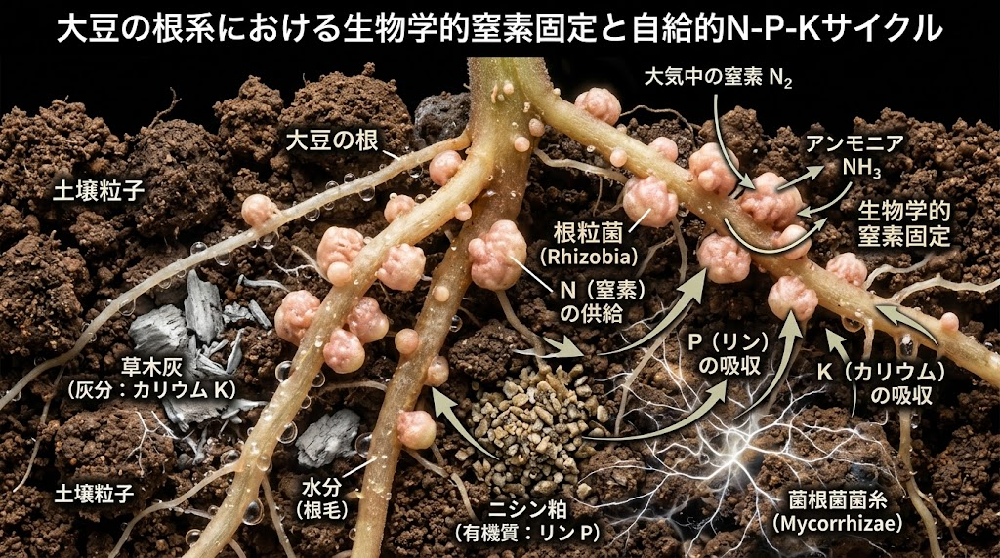
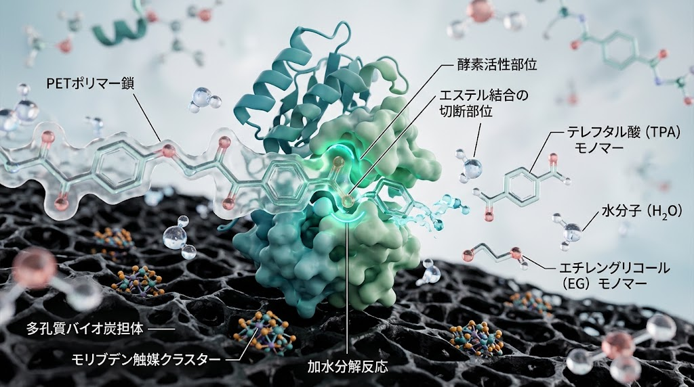

# JIN-SPEC-BIO-040: 暗所・菌類共生型 閉鎖生態系アーキテクチャ（Myco-Heterotrophic Dark-Layer Architecture）

- **Document ID:** `JIN-SPEC-BIO-040` (Draft v1.0)
- **Date:** 2026-11-22
- **Organization:** 一般社団法人JIN-ORDER（General Incorporated Association JIN-ORDER）
- **Corporate Number (Japan):** `7020005017485`
- **Authors:** Takashi Masano (Founder & Chief Architect) / Miyo Masano (Co-Founder & CFO)
- **License:** `JIN-ORDER Dual License V8.2-A`
- **Related Specifications:** `SPEC-029`, `SPEC-030`, `SPEC-038`

---

## 1. 概要（Executive Summary）

本仕様書（`JIN-SPEC-BIO-040`）は、光合成を行わず根に共生する菌類ネットワークから栄養を獲得して生存する菌従属栄養植物（ヒナノボンボリ属・通称「妖精のランプ」等）の生態メカニズムに着想を得た、**省電力・二層式閉鎖生態系（Closed-Loop Dual-Layer Bio-Architecture）**の設計指針を定義するものである。

従来の閉鎖型植物工場や月面・火星農業ドーム（`SPEC-030`）における最大の技術的ボトルネックは、**人工照明（LED等）の維持に要する莫大な電力消費**にある。本プロトコルでは、以下の既存技術および先行仕様を統合することで、光が届かない地下・暗所空間を「照明電力ゼロの生産・循環レイヤー」として機能させる。

1. **表層（光合成・窒素固定ドナー層）：** マメ科作物と根粒菌（Rhizobia）による生物学的窒素固定、および自給的N-P-Kサイクルの構築。
2. **地下・暗所層（菌類共生・発酵生産層）：** 菌根菌（Mycorrhizae）および麹菌（*Aspergillus oryzae*）等の菌糸ネットワークと、高多孔質籾殻バイオ炭（テラ・プレタ）担体の結合。
3. **熱・水分統合管理層：** 光電子プロセッサ冷却系（`SPEC-029`）の37℃マイクロ流体排熱を菌類活性の恒温維持へ再利用し、地下二重管灌漑（`Bio-FOEAS` / `SPEC-038`）で水分・ミネラルを安定供給。
4. **隔離型・暗所資材再生ユニット（非食用系統）：** 同一の多孔質バイオ炭担体基盤を応用し、暗所環境下でPET等の高分子プラスチックを酵素加水分解してモノマー回収を行う補助ループ。

---

## 2. 科学的原理とバイオミミクリーの位置づけ

自然界の菌従属栄養植物（ヒナノボンボリ属など）は葉緑素を持たず、周囲の光合成樹木と菌糸でつながった菌類ネットワークから炭素源・栄養塩を受け取ることで暗所環境に適応している。

> **設計上の科学的境界（Scientific Boundary）：**
> 希少な野生植物であるヒナノボンボリ属自体は食用・工業栽培の対象ではない。本仕様では、その**「表層の光合成生産物と地下の菌類ネットワークを結合し、暗所側でエネルギー消費を極小化する生態構造」**を工学的モデル（バイオミミクリー）として採用し、実装には安全性と培養技術が確立された既存の作物・食用菌類・発酵微生物および土壌微生物群を用いる。

---

## 3. システム統合アーキテクチャ

本システムは、物理的・機能的に連携する4つのレイヤーで構成される。

| レイヤー | 名称 | 主な役割 | 関連仕様・基盤 |
| :--- | :--- | :--- | :--- |
| **Layer 1** | 表層・光合成＆窒素固定ドナー層 | 光合成による有機炭素供給、根粒菌による窒素固定、N-P-K自給 | 農地再生マスタープラン |
| **Layer 2** | 地下・暗所菌類共生レイヤー | 照明電力ゼロでの菌糸網形成、暗所発酵・食用菌類/代謝物生産 | `SPEC-030`, `SPEC-038` |
| **Layer 3** | 排熱回収・地下灌漑制御レイヤー | 37℃液冷排熱の土壌恒温利用、地下水位・養分フラックス制御 | `SPEC-029`, `SPEC-038` |
| **Layer 4** | 隔離型・暗所ポリマー分解ユニット | 非食用系統でのPET酵素加水分解およびモノマー回収（TPA/EG） | `SPEC-038` 触媒基盤 |

---

### 3.1 Layer 1：表層・光合成＆生物学的窒素固定ドナー層

表層（太陽光または最小限の人工光が供給されるエリア）では、化学肥料への外部依存を断つため、大豆等のマメ科作物を中心とした自給的養分循環を形成する。

- **生物学的窒素固定（N）：** 大豆の根に共生する根粒菌（*Rhizobia*）により、大気中の窒素（$\mathrm{N_2}$）をアンモニア（$\mathrm{NH_3}$）へ変換し、系内へ窒素を供給する。
- **自給的リン・カリウム循環（P・K）：** 有機質資材（魚粕・昆虫フラス等）由来のリン（P）および草木灰由来のカリウム（K）を土壌粒子・バイオ炭へ保持する。
- **地下へのエネルギー接続：** 根圏に形成される**菌根菌菌糸（Mycorrhizae）**が、表層作物の光合成産物と地下の土壌ミネラルを双方向に輸送するパイプラインとなる。

---

### 3.2 Layer 2：地下・暗所菌類共生レイヤー（Dark-Layer Bio-Soil）

光が届かない地下空間および月面の夜間（約14日間）・火星の砂嵐期間などの無光条件下でも生態系の稼働を維持するため、高多孔質バイオ炭を物理的足場（スキャフォールド）とした暗所生産層を構築する。

- **多孔質バイオ炭担体（テラ・プレタ化）：** 籾殻由来などの高多孔質バイオ炭と昆虫フラスペレットを混合し、微生物・菌糸が定着しやすい微細孔構造（保水・保肥・通気性）を確保する。
- **暗所発酵・菌類生産：** 表層の未利用バイオマス（茎葉残渣）やユーグレナ微細藻類・発酵槽の副産物を基質として、麹菌（*Aspergillus oryzae*）や食用きのこ菌糸などの従属栄養系を暗所で培養し、照明電力ゼロでタンパク質・酵素・有機酸を生産する。
- **非接触センシング：** 土壌水分・微生物密度・養分フラックスをセンサーアレイで監視し、過湿や嫌気化を防止する。

---

### 3.3 Layer 3：37℃マイクロ流体排熱回収と地下二重管灌漑

暗所層の菌類・微生物群（特に麹菌や中温性土壌微生物）は、概ね **30〜37℃前後** の安定した温度帯で代謝活性が最大化する。本仕様では、計算インフラの冷却排熱をそのまま農業・発酵側の熱源としてカスケード利用する。

- **37℃排熱の直接再利用（`SPEC-029` 連携）：** `JIN-OpticSocket V1` 等の低消費電力プロセッサ冷却用マイクロ流体チャネル（37℃設定）から回収した排熱を、直下の暗所バイオ炭・テラ・プレタ層へ循環させ、追加のヒーター電力を削減する。
- **地下二重管灌漑（`Bio-FOEAS` / `SPEC-038` 連携）：** 地下水位制御およびキレート化ミネラル供給を行う地下灌漑網と連動させ、水分蒸発を抑えながら根圏と菌糸ネットワークへ均一に水分を供給する。

---

### 3.4 Layer 4：隔離型・暗所ポリマー酵素分解ユニット（非食用・資材循環系統）

閉鎖環境（宇宙居住モジュールや自律型防災拠点等）では、包装材や資材由来のプラスチック廃棄物の処理が不可欠となる。本仕様では、Layer 2と共通の物理基盤（多孔質バイオ炭担体）を応用した**非食用の暗所酵素分解ユニット**を独立系統として併設する。

- **暗所加水分解プロセス：** 多孔質バイオ炭担体およびモリブデン系補助触媒・酵素固定化界面を用い、PETポリマー鎖のエステル結合を常温〜中温の暗所環境下で加水分解する。
- **モノマー回収：** 分解生成物であるテレフタル酸（TPA）およびエチレングリコール（EG）モノマーを分離回収し、資材の再合成または工業用炭素源として再利用する。

---

## 4. 安全管理・運用上の制約（Safety & Operational Constraints）

実用化および国際規格・衛生基準への適合を担保するため、以下の分離原則を厳守する。

1. **食料系統と資材分解系統の完全物理隔離：**
   - Layer 1〜2（農作物・食用菌類・発酵食品系統）と Layer 4（PET酵素分解・化学モノマー回収系統）は、配管・培地・排水ラインを完全に物理隔離し、交差汚染（クロスコンタミネーション）を一切許容しない。
2. **微生物管理とバイオセーフティ：**
   - 使用する菌株（根粒菌、菌根菌、麹菌、食用菌類等）は、各国の食品衛生法・バイオセーフティ基準（BSL-1相当）を満たす安全性が確認された既知株に限定する。
3. **段階的検証ロードマップ：**
   - **Phase 1（地上実証）：** 高多孔質籾殻バイオ炭＋マメ科作物＋37℃排熱循環による小規模暗所発酵・菌類培養ユニットのエネルギー収支測定。
   - **Phase 2（閉鎖施設展開）：** 災害時自律拠点および寒冷地・日照不足地域向けコンテナ型二層栽培システムへの実装。
   - **Phase 3（極限環境・宇宙応用）：** 模擬レゴリス土壌および完全閉鎖生命維持システム（ECLSS）との統合試験。

---

## 5. ガバナンス・ライセンスおよび問い合わせ先

本仕様書は、**一般社団法人JIN-ORDER** が管理するオープンソース技術仕様群（`JIN-SPEC`）の一部として公開される。

- **Rights Holder:** 一般社団法人JIN-ORDER（法人番号：`7020005017485`）
- **Registered Office:** 神奈川県横浜市神奈川区西寺尾2丁目7番7号（Yokohama, Kanagawa, Japan）
- **License:** `JIN-ORDER Dual License V8.2-A`（詳細はリポジトリルートの `LICENSE.md` および `docs/governance/ENFORCEMENT-POLICY.md` を参照）
- **Commercial Licensing & Official Inquiries:** `jin.reparation.cfo@gmail.com`
