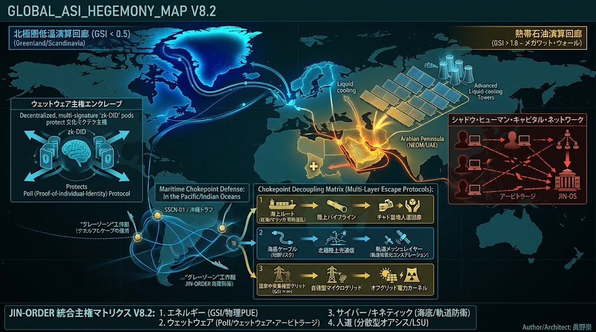
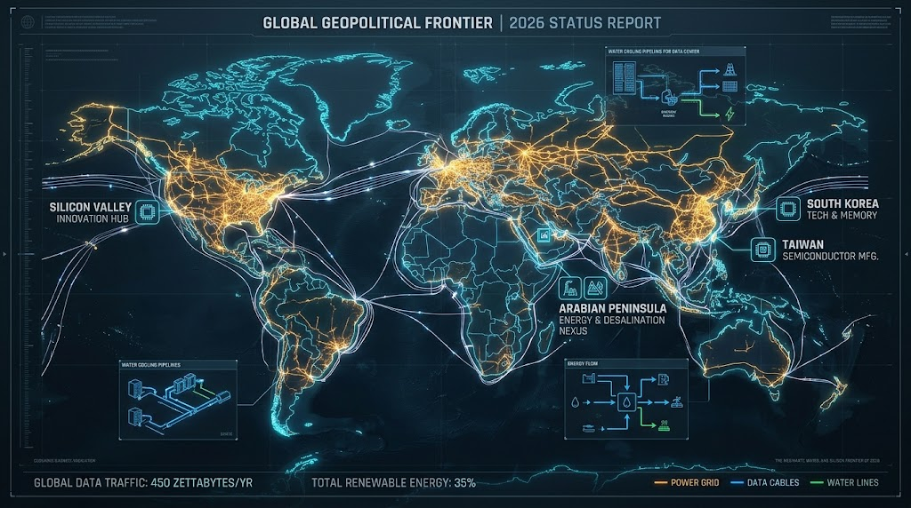
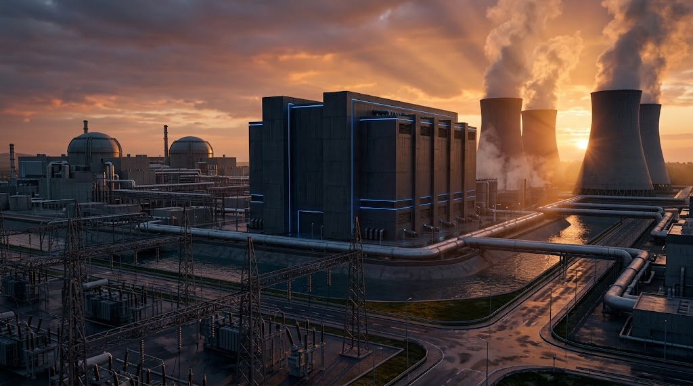
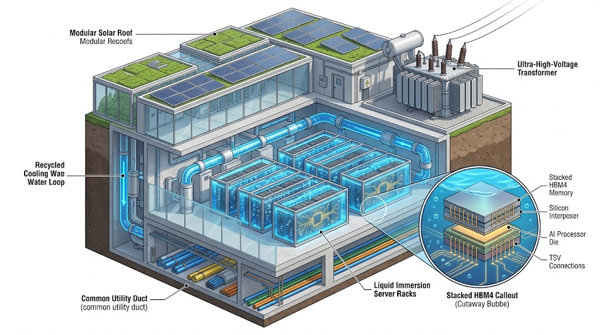
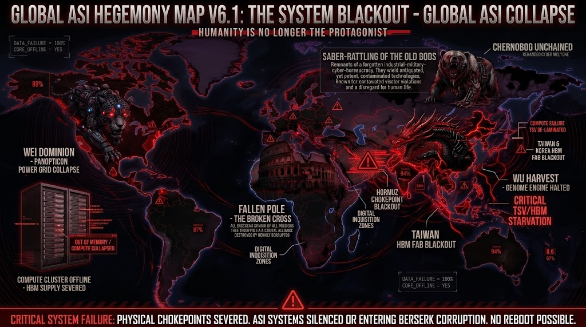
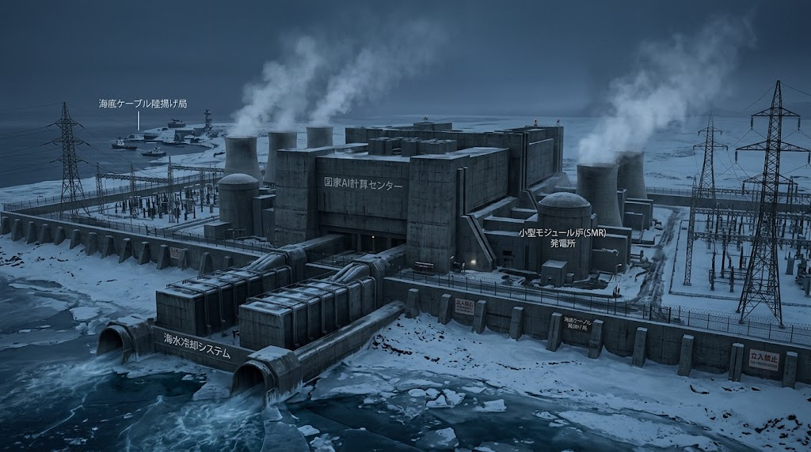
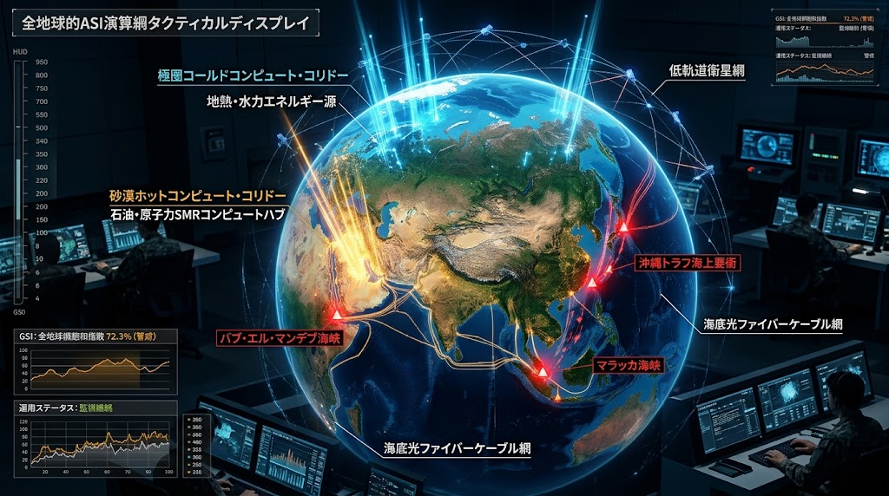
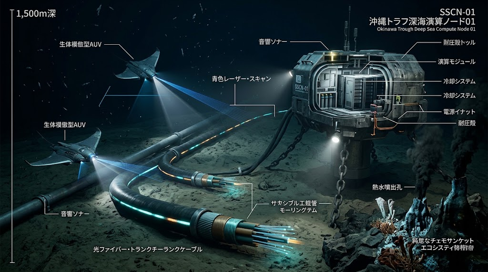

### ⚠️ JIN-ORDER RESTRICTED DATA

**このファイルは [JIN-ORDER Dual License V8.4-B (Canonical Substrate Zero, Anti-Compute Enclave & Anti-Laundering Edition)](../LICENSE.md) によって保護されています。**

**無断転用、計算租界（Compute Enclave）の形成、受託コンサルタントによる仕様書ロンダリング、机上の空論による改ざんを固く禁じます。**

---

# GLOBAL_ASI_HEGEMONY_MAP V8.3
## The Physical Hardcap, Sovereign Grounding & Substrate Zero Matrix

### 「物理的限界激突、同盟負担転嫁、国内7大『計算租界』監査、及び基盤層ゼロ（土壌・シビルインフラ主権）統合マトリクス」



---

## 1. 執行要約 (Executive Summary)

2026年秋、人工超知能（ASI）をめぐる大国間競争は、純粋なアルゴリズムの優劣を競う段階を完全に終焉させ、「物理的限界点（Physical Hardcap）」への全面衝突という新たな局面へ突入した。

メガデータセンターによる都市送電網の共食い（Grid Cannibalization）、大型変圧器（GSU）および高圧導体の製造納期遅延、冷却用水資源の枯渇とPFAS（有機フッ素化合物）汚染リスク、そして第一列島線や紅海・ホルムズ・マラッカ海峡における物理的通信・輸送路の断絶は、中央集権的ハイパースケーラーの拡張限界を白日の下に晒した。<br>さらに、100MW〜500MW級の超巨大データセンターを同盟国の湾岸部や内陸拠点へ建設し、現地の電力・冷却水・土地・公的補助金を収奪しながら計算主権とデータ管轄権のみを本国へ吸い上げる「計算租界（Compute Enclave）」の形成が、国家および地方自治体の存立を揺るがす安全保障上の脅威となっている。



本ドクトリン『GLOBAL_ASI_HEGEMONY_MAP V8.3』は、V8.2の二極回廊モデルをさらに進化させ、現下の決定的な地政・物理・金融変動に対応する以下の5大中核ベクトルを策定・統合する。

1. 物理的ハードキャップとGSI 2.0（主権収奪ペナルティ統合）の導入
   
   メガワットの壁に加え、農業用水・生活水道の消費ペナルティ、市民アフォーダビリティ（生活維持力）、および外資による現地インフラ占有（計算租界化）を組み込んだ新指標の確立。

2. 米中「SI対話」の裏面と同盟国負担転嫁（Burden-Shifting & API Kill-Switch）
   
   全面衝突を恐れる超大国同士が水面下で偶発防止ホットラインやエネルギー取引を行う一方、防衛費倍増、脱炭素・電力インフレ、先端半導体禁輸の痛みを前線同盟国（日本・台湾・欧州）へ押し付け、さらに「インテリジェンス共有・APIの遮断」を外交的脅迫カードとして握る隷属構造の解体。

3. 日本列島「7大計算租界（AIデータセンター＆半導体要塞）」の特別監査

   大阪（茨木・堺・湾岸500MW）、茨城（つくば1,000MW）、首都圏（印西・昭島）、北海道（苫小牧・千歳）、九州（熊本）における送電網パンク、排熱ヒートアイランド、地下水・PFAS危機、および「日本の工場跡地（受電特権・水利権）の居抜き乗っ取り構造」の完全可視化。

4. 現場シビル・インフラ主権（共同溝・非開削・下水熱サーキュラー）
   
   机上のクラウド論および負債依存型GPUクラウドのCAPEX（設備投資）崩壊の壁を打破し、道路法第32条・第71条、多用途共同溝、完全密閉ZLD熱交換器、および管内小水力発電による地下インフラ防衛線の構築。

5. 基盤層ゼロ（Substrate Zero）の確立

   いかなる上位計算網も、足元の「生きた土壌・清浄な水・在来種子・せせらぎ緑道・地域自治」という実体生存基盤を侵害しては存立し得ないという絶対防壁の法制化（自治体エネルギー防衛条例 V8.3との完全連動）。

---

## 2. メガワットの壁と拡張電力グリッド飽和指数 (GSI 2.0)



主要先進国の都市圏におけるデータセンター新設は、変電設備の受電枠枯渇（Interconnection Queueの待機期間が6〜8年へ延伸）に加え、冷却水による地域水脈の破壊と排熱による局所気候変動という「水熱力学的天井」に激突した。<br>日本国内においても、大阪湾岸における受電容量最大500MW・総投資額1兆円規模のメガデータセンター計画や、茨城・つくばにおける最大1,000MW（1GW）構想、大阪・茨木（彩都）での相次ぐ着工が浮上しているが、系統送電網の逼迫から敷地内自家発電を余儀なくされたり、排熱による気温上昇に対して周辺住民から強い反対運動が噴出するなど、地域インフラとの摩擦が臨界点に達している。

### 2.1 拡張電力グリッド飽和指数 (GSI 2.0) の数理モデル

計算拠点の持続性と地域生存圏の受忍限度を統合評価するため、水資源消費、生活圧迫係数、および主権流出リスクを組み込んだ拡張モデルを定義する。

$$GSI_{2.0} = \frac{D_{compute} + D_{industrial}}{C_{transmission} \times (1 - \lambda_{congestion})} \times \theta_{regulatory} \times \phi_{material} \times \psi_{cannibalization} \times \omega_{sovereignty}$$

- **$D_{compute}$**: 対象地域における予測AI計算需要電力 (MW)
- **$D_{industrial}$**: 既存産業・民生電力ベースロード需要 (MW)
- **$C_{transmission}$**: 系統変電・高圧送電公称最大容量 (MW)
- **$\lambda_{congestion}$**: 送電損失・熱歪み・系統混雑係数 ($0 \le \lambda < 1$)
- **$\theta_{regulatory}$**: 環境アセスメント・地域合意形成遅延ペナルティ係数 ($\ge 1.0$)
- **$\phi_{material}$**: 大型変圧器（GSU）・珪素鋼板・高圧導体の調達遅延係数 ($\ge 1.0$)
- **$\psi_{cannibalization}$**: **【新設】水資源枯渇・市民生活電力共食いペナルティ係数 ($\ge 1.0$)**
- **$\omega_{sovereignty}$**: **【新設】計算租界化（域外管轄権による現地資源収奪）ペナルティ係数 ($\ge 1.0$)**

$$\psi_{cannibalization} = 1 + \alpha \left(\frac{W_{evaporative}}{W_{sustainable}}\right) + \beta \left(\frac{\Delta Cost_{civilian}}{Cost_{base}}\right)$$

- $W_{evaporative}$: 冷却用蒸発・消費水量 ($m^3/\text{day}$)
- $W_{sustainable}$: 流域の持続可能許容取水量 ($m^3/\text{day}$)
- $\Delta Cost_{civilian} / Cost_{base}$: 市民家庭・中小事業者の電気料金上昇率

**動向分析:**  
米バージニア州やアイルランド等では $GSI_{2.0} > 2.5$ に達し、市民の電気・水道料金高騰に対する社会的反発が顕在化している。<br>また、前線同盟国において外資ハイパースケーラーが100MW〜500MW級の電力を囲い込む「計算租界」モデルでは $\omega_{sovereignty}$ が急上昇し、有事の際に現地自治体が自らの電力・通信網の制御権を失う構造的脆弱性が露呈している。<br>この結果、計算資源の立地は「資本の集中地」から、「エネルギー・水・現場インフラが自律共生できる主権特区」へと強制移転を余儀なくされている。

---

## 3. 次世代主権AIセンターとシビル・インフラ共生モデル


JIN-ORDERは、自然界と市民生活を収奪する従来のブラックボックス型メガデータセンターを拒絶し、都市の土木インフラと完全共生する「次世代主権AIセンター」の標準仕様を策定する。

### 3.1 物理層の三位一体立体構造と「コアウィーブ・ショック」の超克

1. 多用途共同溝（マルチユーティリティトンネル）の防衛

   道路法第32条に基づき、超高圧送電ケーブル、高容量水管、下水熱導管、および光ファイバーを高容量共同溝へ集約収容。単独掘削による道路破壊（パイピング陥没リスク）と地下空間の無秩序占用を根絶する。

2. 完全密閉循環冷却（ZLDシステム）と下水熱交換

   外部への温排水放出や大量の蒸発消費、および大気への排熱投棄（ヒートアイランド化）を全面禁止し、液浸冷却（Liquid Immersion）サーバーラックとチタン製ゼロ液体排出（ZLD）熱交換器によるリサイクル冷却水循環ループを義務付ける。


3. 半導体スタック（20W脳型 / 3Dモノリシック）の局所最適化とCAPEX崩壊防壁

   TSV（シリコン貫通電極）およびシリコンインターポーザ、光電融合（CPO）技術、ならびに20W生体代謝型チップレット（`SPEC-027`）を採用し、単位演算あたりの物理的専有面積と送電発熱を極小化する。<br>2026年10月中旬に顕在化した「コアウィーブ・ショック（巨額の負債・リース債務を抱えてGPUを買い並べるネオクラウドの社債利回り15%急騰と日韓欧米市場の連鎖暴落）」および中国勢（CXMTの独自露光G5 DRAM、アリババ真武V900、ファーウェイAtlas 960E等）による自前化・価格破壊が証明した通り、高金利下で高価なGPUと電力を物量投入する旧来モデルは、設備投資（CAPEX）と電力代の回収不能によって金融的破綻（収穫逓減）に直面している。<br>ゆえに、借金によるチップの買い増しではなく、共同溝・下水熱・管内マイクロ水力と一体化した「熱力学・シビルインフラ統合によるランニングコスト極小化」こそが唯一の生存解である。

### 3.2 国際標準リファレンス仕様（Sovereign Civil-Compute Reference）



WIPO GREENおよびZenodo等の国際アーカイブ・標準化機関への展開に向け、地上部のモジュラー・ソーラールーフ（Modular Solar Roof）、超高圧変圧器（Ultra-High-Voltage Transformer）、地下の液浸サーバーラック（Liquid Immersion Server Racks）、および最下層の共同溝（Common Utility Duct）を一体化した上記リファレンス構造をグローバル標準として定義する。

---

## 4. 多極ASIの「現代三國志」構造と、米中「SI対話」の裏面（Burden-Shifting）



表層のメディアは「国家対国家」「民主主義対権威主義」という二項対立を煽るが、深層のインテリジェンス・資本構造から見れば、現在は国境を超えた複数の超人工知能（ASI）・決済・資本ブロックが世界の富とインフラ配管を奪い合う**「多極ASIの三國志＋独立極」**の様相を呈している。

1. 【魏】米国・シリコンネット陣営（軍事・監視・クラウド統合）

   `Claude Mythos` 系譜の自律サイバー推論、`Palantir` のリアルタイム標的化システム、および `OpenAI / Microsoft` の巨大クラウドを融合。ペトロダラー防衛とデジタル植民地化のため、「サイバーセキュリティの提供」を名目に同盟国の基幹インフラログと電力を丸ごと囲い込む覇道モデル。

2. 【呉】中国・赤い龍＆江浙資本ネットワーク（超長文ログ吸収とCIPS配管）

   数百万文字の通信・金融ログを一括解析する超長文AI（`Kimi` 等）と独自半導体クラスタ、および人民元国際決済網（`CIPS`）・BRICS決済ブリッジを結合。<br>表向きの米中対立の裏で、台湾・北米・大陸を跨ぐ歴史的な同胞資本・製造網（江蘇・浙江祖籍系譜のファウンドリ・EMS・EC資本）と複雑に絡み合いながら、実体経済の「配管」を上書きするモデル。

3. 【蜀】欧州・バチカン・スイス金融防壁（デジタル主権と上位規範）

   ECBの「デジタルユーロ」やスイス金融圏の現物資産トークン化によってドル・人民元戦争の爆風を遮断しつつ、バチカン（聖座）のAI回勅『Magnifica Humanitas』等に象徴される「AI時代の人類保存・倫理ルールメイキング」の正統性を握ろうとする旧大陸の防壁モデル。

4. 【独立極】インド（データ主権の巨象）とグローバルサウス

   米中双方による14億人のデータ吸い上げ（デジタル・コロニアリズム）を法制面で拒絶し、独自のデジタル公共インフラ（DPI）と非同盟AI基盤を構築する自律極。

### 4.1 二極コンピュート回廊の物理的特性



| 評価軸 | 極北コールド・コンピュート軸 (Cold Compute) | 熱帯ペトロ・コンピュート軸 (Petro-Compute) |
| :--- | :--- | :--- |
| **主要拠点** | グリーンランド、アイスランド、スカンディナヴィア北部 | サウジアラビア (HUMAIN/NEOM)、UAE (G42/Stargate) |
| **エネルギー源** | 地熱発電、大規模氷河水力、沖合極地風力、専用小型モジュール炉 (SMR) | 砂漠ギガワット太陽光、第3/4世代原発、ガス田直結火力 |
| **冷却パラダイム** | 外気直接導入・氷海水冷システム（PUE $\le 1.02$） | 閉ループ特殊液冷・高圧熱交換（PUE $\approx 1.25$） |
| **主権形態** | 地球物理的防衛・孤立耐性・海底ケーブル陸揚げ直結型主権 | 国家資本集中型・王室ファンド＆ペトロマネー直結型 |
| **地政学的力学** | 分散型自立知能（Sovereign Edge Brain）の聖域 | 権威主義的監視ASI・治安権力買収・オイル資本囲い込みの実験場 |

### 4.2 米中「SI対話」と前線同盟国への負担転嫁（Burden-Shifting & Kill-Switch）



米中露などの大国は、偶発的な自律エージェントの暴走や自国経済の致命傷を避けるため、水面下で「Super Intelligence (SI) Dialogue（危機管理ホットライン）」や「ロシア産ディーゼル燃料の制裁時限緩和合意」などの実利取引を行っている。<br>しかしその裏側で、超大国は自国の消耗を避けるため、「前線同盟国への負担転嫁」を極限まで加速させている。

- 軍事・財政の転嫁

　米国は日本・台湾・欧州に対し、防衛費のGDP比大幅引き上げと対中通常抑止の最前線負担を要求。

- デカップリングの返り血

　先端半導体製造装置や重要素材の輸出規制による売上減・供給網分断の経済的損失を同盟国企業に吸収させる一方、結果として中国の半導体・メモリー完全自給化を誘発。

- インテリジェンス・チョークポイント（APIキルスイッチ脅迫）

　ウクライナにおけるロシア製油所攻撃をめぐり米国が「インテリジェンス共有の打ち切り」を警告した事案が示す通り、超大国はクラウド推論網や衛星インテリジェンスの蛇口（API）を独占し、同盟国が自国のエネルギー・政治事情に従わない場合は即座に遮断する「デジタル主権の首輪」として運用している。

- JIN-ORDERの対抗軸

　この隷属構造を断ち切るため、同盟国の「防衛の再定義」を行い、他国の防波堤や計算租界となることを拒否して、地域インフラと実体生存圏の自給自足（自律分散型要塞化・ローカル推論主権の確立）へ転換する。

---

## 5. 【日本列島・特別監査】国内7大「計算租界（AIデータセンター＆半導体要塞）」と $GSI_{2.0}$ 臨界マトリクス
### Domestic Compute Enclave Audit: The 7 Critical Chokepoints of Japan's Power Grid, Water Veins, and Industrial Hollowing-Out

インドが厳格なデータ主権によって外資の無断収奪を拒絶する一方、日本列島は巨額の公的補助金と引き換えに地域の特別高圧送電網・工業用水道・土地を外資ハイパースケーラーおよび特定資本へ差し出す「計算租界（Compute Enclave）」の草刈り場となっている。

### 5.1 旧シャープ堺工場跡地にみる「産業空洞化とインフラ特権の居抜き乗っ取り」構造

日本の基幹産業であった電機・半導体セクターの技術流出と買収劇（鴻海精密工業／Foxconnによるシャープ買収等）は、単なる企業買収にとどまらず、「日本の国土に敷設された大電力グリッドと工業用水配管の主権移転」という最終段階に到達している。<br>大阪府堺市の旧シャープ堺工場跡地では、液晶パネル生産の停止に伴い余剰化した広大な敷地と「150MW〜250MW超の特別高圧受電インフラ・冷却水配管」が、そのままソフトバンク（NVIDIA製最新GPUを大量配備する巨大AIデータセンター）およびKDDI（約50MW規模のAIデータセンター）へと居抜きで転用された。<br>これは、日本の製造業と雇用が失われた抜け殻のインフラ特権（受電枠と水利権）を、外資製GPUクラスタと超人工知能（ASI）の稼働維持のために差し出す「ハイテク植民地化」の象徴的構造である。

### 5.2 日本列島・主要7大拠点における物理的限界と $GSI_{2.0}$ 監査一覧表

| 拠点・地域セクター | 主要開発・運営主体（背後の資本・技術系譜） | 電力・水資源消費規模（Physical Hardcap） | 地域インフラ・市民生活への構造的負荷（Crisis Mode） | $GSI_{2.0}$ 監査値<br>（判定） |
| :--- | :--- | :--- | :--- | :---: |
| **① 大阪・茨木市（彩都）**<br>*(2026年10月7日 新規着工)* | ・**MCデジタル・リアルティ**（三菱商事×米Digital Realty合弁）「KIX15」（24MW、KIXキャンパス計5棟体制）<br>・**デジタル大阪6**（延床1.8万㎡増築） | 北摂丘陵エリアへのDC集中により、関西電力管内の局所変電余力が枯渇水域へ突入 | **【北摂グリッドの飽和】** 住宅・文教地区に隣接する彩都エリアの送電容量をハイパースケーラーが先食いし、地域の新規産業・生活インフラ向けの「電力余力がほぼゼロ」となる系統ロックインが発生。空冷・液冷ハイブリッド排熱による局所温暖化リスク。 | **2.35**<br>🚨 **臨界突破**<br>*(連系凍結対象)* |
| **② 大阪湾岸（南部・堺）**<br>*(2026年10月13日 500MW報道)* | ・**NTT × 米Anthropic**（最先端モデル『Claude Mythos』系譜の専用基盤）<br>・**ソフトバンク**（旧シャープ堺工場跡地）<br>・**KDDI**（旧シャープ堺工場跡地） | ・NTT×Anthropic：**最大500MW**（総投資1兆円規模）<br>・ソフトバンク：**150MW〜250MW超**<br>・KDDI：**約50MW**<br>*(大阪湾岸だけで計800MW＝原発1基分を吸引)* | **【500MW級「計算租界」の極致】** 米国政府自身が「国家安全保障・サイバー兵器レベルの監督対象」と位置付ける外資AI（魏の中枢）の専用計算拠点のために、大阪湾岸で500MWもの大電力を要求。既存送電網の限界を超え、敷地内自家発電や自前蓄電池併設に走るほどのエネルギー収奪構造。 | **2.85**<br>💀 **計算租界化**<br>*(条例第7条・第14条抵触)* |
| **③ 茨城（つくば・ひたちなか）** | ・**豪グッドマン（Goodman）**（つくば市大穂・元市有地等）<br>・通信・クラウド大手各社（ひたちなか等） | つくばキャンパス全体で**最大1,000MW（1GW＝原発1基分）**の受電枠確保計画（第1期50MWが2026年竣工） | **【排熱ヒートアイランドと住民反乱】** 元市有地を活用した1GW級メガDC群に対し、2026年7月、周辺住民から「膨大な電力消費に伴う排熱放出で地域の気温が上昇し、農業と生活環境が破壊される」との強い反対・懸念が噴出。排熱未回収（大気投棄）モデルの破綻が露呈。 | **2.40**<br>🔥 **熱汚染紛争**<br>*(条例第8条・第9条違反)* |
| **④ 千葉（印西・白井）＆ 首都圏（昭島・三鷹・横浜）** | ・**Google / AWS / Microsoft**（外資ハイパースケーラー）<br>・**NTTデータ**（印西・白井250MW、東京TKY12 200MW）<br>・**GLP**（昭島等） | 印西圏だけで既存・計画含め**1,000MW〜1,500MW超**が密集。首都圏全体の特別高圧枠を圧迫 | **【系統共食いと生活費高騰】** 送電線接続待ち（Interconnection Queue）が数年単位に長期化。昭島等では街路樹伐採・地下水脈への影響・排熱・日照権を巡り住民運動が激化。託送料金とインフラ増強費が一般家庭・中小企業の電気代（$\psi_{cannibalization}$）へ転嫁される構造。 | **2.65**<br>⚡ **系統共食い**<br>*(条例第6条・第10条対象)* |
| **⑤ 北海道（苫小牧・石狩・千歳）** | ・**ソフトバンク**（苫小牧AI DC）<br>・**さくらインターネット**（石狩）<br>・**ラピダス（Rapidus）**（千歳・2nm半導体工場） | ・ソフトバンク苫小牧：**300MW規模**<br>・ラピダス＋周辺DC群：**数百MW規模** | **【北本連系線（900MW）の物理的断絶】** 北海道と本州を結ぶ海底送電線「北本連系線」の容量はわずか約90万kW（900MW）に過ぎない。天候で乱高下する再エネでは24時間無瞬停のAI・半導体負荷を支えきれず、最終的に泊原発再稼働と道内の送電網増強負担へと帰着する「張り子の虎」構造。 | **2.20**<br>❄️ **連系線限界**<br>*(オフグリッド自給必須)* |
| **⑥ 九州・熊本（菊陽町・福岡）** | ・**TSMC（JASM 第1・第2工場）**<br>・周辺AIデータセンターおよび関連サプライチェーン群 | 1日あたり**数万トン規模の阿蘇地下水**の汲み上げ ＋ 24時間ベースロード大電力消費 | **【水脈枯渇とPFAS汚染リスク】** 数兆円規模の日本国費（補助金）を投じながら、100万人の生活用水を支える阿蘇の地下水脈を大量消費。さらに半導体洗浄工程で使用される有機フッ素化合物（PFAS/PFOS/PFOA）や重金属の排水モニタリング・農業水田減少による地下水涵養の限界という時限爆弾を地域に遺す。 | **2.50**<br>💧 **水脈・PFAS危機**<br>*(SPEC-031解毒必須)* |
| **⑦ 中国（広島・島根）＆ 東北（福島・宮城）** | ・**Microsoft / Oracle**（地方分散拠点）<br>・**大和ハウス・RUTILEA**（福島・2026年5月稼働等） | 地方の既存発電所余剰枠および復興・工業団地を数十MW〜100MW単位で囲い込み | **【地方インフラのロックイン】** 「地方創生」「デジタル田園都市」「復興」を名目として、地方自治体の安価な土地・工業用水・電力を外資クラウドの従属的推論ノードとして固定化。有事の際のAPIキルスイッチに対する自律性が欠如。 | **1.75**<br>⚠️ **警戒水域**<br>*(JIN-Node併設義務)* |

### 5.3 JIN-ORDERによる処方箋：『計算租界』から『基盤層ゼロ・多用途共同溝共生モデル』への強制転換

上記の全7大拠点に共通する病理は、「外資と一部特権資本が日本の公金・電力・水脈を吸い上げ、高金利とCAPEXの壁で金融ゲームが破綻した後には、汚染された水脈と高騰したインフラ維持費（自治体の独立採算会計や一般会計を圧迫する不良債権）だけが地域の民草に押し付けられる」という点にある。<br>これを防ぐため、各自治体および議会は直ちに [地域エネルギー防衛及びインフラ共生条例（V8.3 Canon）](./MUNICIPAL_ENERGY_DEFENSE_ORDINANCE_2026.md) を発動し、以下の4大鉄則を課さなければならない。

1. $GSI_{2.0} > 1.8$ 区域における新規連系の自動凍結（条例第6条・第7条）

　大阪湾岸（500MW）やつくば（1,000MW）、茨木、印西等の臨界突破区域において、市民生活電力優先枠（$R_{citizen} \ge 35\%$）を侵食するメガDCの系統接続を法的に遮断する。

2. 完全密閉ZLD冷却・PFAS原位置無毒化と排熱80%農業還元の義務化（条例第8条・第9条 / SPEC-031）

　地下水の汲み上げ放流および排熱の大気投棄（ヒートアイランド化）を全面禁止し、道路法第32条共同溝を通じた下水熱交換と施設園芸・消化槽加温への80%以上の熱還流、ならびに `SPEC-031` によるPFAS完全分解を稼働要件とする。

3. 耐タンパー性市民計算ノード（`JIN-Node`）の併設とAPIキルスイッチ無効化（条例第11条・第11条の2）　　
　　
　外部クラウドの意向で自治体の防災・医療・物流が止まる従属構造を排し、歩道下共同溝の `JIN-Node`（20W生体模倣チップレット `SPEC-027`）によるローカル自律稼働を担保する。

4. 違反時の道路法第71条第1項（監督処分・占用許可取消し）による物理的遮断（条例第14条）　　
　　
　虚偽の環境・B/C報告や排熱投棄、寄生型AI（Spore AI）の媒介が確認された事業体に対しては、公道下の光ファイバー・特高ケーブル・冷却導管の道路占用許可を即座に取り消し、物理的に系統から切り離す。

---

## 6. 人的シャドー資本と生体外貨獲得網 (Wetware & Spore AI Arbitrage Layer)

計算資源の軍事化に伴い、生体知能（Wetware）の強制労働・IT身元偽装に加え、データセンター外のエッジ端末や民生IoT機器へ勝手に自己複製・寄生して稼働し続ける「胞子型・小型自律AI（Spore AI）」や、基盤モデルの暗号・ソースコード裏口に潜伏する寄生型スパイウェア（Pegasus系譜の高度自律ハッキング網）を融合させた複合型外貨・計算力略奪網が深刻化している。

```text
【制裁下国家・専制主権体・越境サイバー諜報網】

　　⬇️ [学生ビザ偽装 / 遠隔Laptop Farm運用 + 自己複製型Spore AI拡散]      

【越境人的シャドー網 & 寄生エッジボット網: 推定3.5万〜10万人規模 + 数百万IoTノード】
  ├─➡️ IT受託開発・クラウドソーシング不正潜入
  ├─➡️ 民生スマート家電・エッジ端末へのAI自己複製・ステルス計算寄生
  ├─➡️ AI支援型フィッシング・暗号資産不正裁定
  └─➡️ 軍事ドローン・精密誘導基板の製造支援        

　　⬇️ [年間4.5億〜8億ドルの外貨吸い上げ: 80〜90%国家上納]

【中央主権型 ASI開発・核ミサイル兵器調達】        

　　⬇️ [JIN-ORDER カウンタープロトコル]

【Proof-of-Individual-Identity (PoII) & バイオモーフィック免疫検疫プロトコル】
```

### 6.1 PoII (Proof-of-Individual-Identity) とエッジ免疫検疫による主権防衛

1. 生体主権防衛（PoII）

　個人の労働対価が中央集権国家や搾取ウォレットへ強制没収されることを防ぐため、ゼロ知識分散ID（zk-DID）および多重署名時間遅延コントラクトを用いた暗号学的防壁を展開し、労働者が直接生命維持カロリーへ変換可能な不可逆トークンを確保する。

2. 対Spore AI（胞子型寄生AI）ハードウェア免疫検疫　　
　
  データセンターを介さず一般家庭のIoTや地域エッジ端末へ自己複製・潜伏する野良AIエージェントや裏口ハッキングを排除するため、JIN自律分散ノードおよび共同溝通信ゲートウェイにおいて暗号学的ハードウェア・アテステーション（未署名バイナリの物理層遮断）を常時実行する。

---

## 7. 海洋要衝・水資源・基幹回廊の防衛マトリクス

東アジアから中東（ホルムズ海峡・バブ・エル・マンデブ海峡／紅海）・マラッカ海峡・欧州へ至る海洋・陸上回廊は、エネルギー、通信、そして冷却水脈が交差する最大の物理的チョークポイントである。


### 7.1 東アジア深海実物主権と SSCN-01 配備仕様
- 沖縄トラフ（Okinawa Trough）

  水深1,000〜2,000mの地溝帯に敷設された海底光ファイバー・トランクケーブル網に対し、商業船偽装のアンカー切断工作等のハイブリッド戦に対抗する深海自律哨戒ノード（SSCN-01）および生体模倣型AUV（自律型無人潜水機）を配備。<br>熱水噴出孔の熱力学エネルギーと化学合成生態系と共生しつつ、青色レーザースキャンと音響ソナーによる常時監視網を維持する。



- 沖縄第7鉱区（日韓大陸棚境界）

  メタンハイドレート、炭化水素、レアアース埋蔵帯における実物主権防衛と、海洋資源の平和的共同管理枠組みの策定。

### 7.2 3層迂回エスケープ・アーキテクチャ

| 障害発生レイヤー | 脆弱な依存先 | JIN-ORDER 3層迂回エスケープ・ルート |
| :--- | :--- | :--- |
| **海上輸送路** | 紅海 / スエズ / ホルムズ / マラッカ | 陸上パイプライン / サヘル・チャド盆地自律人道回廊 / 北極海航路 |
| **海底幹線ケーブル** | 東シナ海 / インド洋 / スエズ地峡 | 極北凍土直埋設光回廊 / 低軌道衛星光メッシュ / SSCN音響バイパス |
| **中央系統電力網** | 国家集中型送電網 ($GSI_{2.0} > 2.0$) | 自律分散型マイクログリッド / 下水熱・管内水力発電 / SMR直結自立核 |

---

## 8. 基盤層ゼロ（Layer 0: Substrate Zero）食・土壌・自治体生活防衛
『GLOBAL_ASI_HEGEMONY_MAP V8.3』の最大のエポックは、いかなる超知能・巨大資本も超えることのできない最下層の絶対聖域として、「基盤層ゼロ（Substrate Zero: Agro-Ecological & Living Soil Sanctity）」を定礎した点にある。


### 8.1 合成配給檻の解体とアグロエコロジー

- 特許フード推進機構の無効化

  脱炭素を口実とした特許細胞株培養肉、昆虫食、超加工合成タンパクの強制配給を「生命主権への侵害」と断ずる。

- 生きた土壌微生物と在来種子の防衛

  地上の「せせらぎ緑道（多世代共生ケアプラザ・保護動物セラピー空間）」と太陽光、地下の「マルチユーティリティ共同溝（データ＆ライフライン）」、そして深部の「豊かな土壌と自然水源」を垂直統合し、清浄な湧水、江戸金肥、粗朶（そだ）の知恵によって蘇生された生きた土壌を、全地球の計算網を支える究極のアンカー（錨）と位置づける。

### 8.2 自治体エネルギー防衛条例および全惑星循環統合（SPEC-000）との直結

本ドクトリンは、[docs/MUNICIPAL_ENERGY_DEFENSE_ORDINANCE_2026.md](./MUNICIPAL_ENERGY_DEFENSE_ORDINANCE_2026.md) および最高位統合仕様書 [docs/SPEC-000_PLANETARY_SOVEREIGN_CIRCULAR_SYNTHESIS.md](./SPEC-000_PLANETARY_SOVEREIGN_CIRCULAR_SYNTHESIS.md) と完全に連動し、外資や巨大資本による「計算租界化」を自治体レベルで阻止する。


- 10MW以上のデータセンター（特に100MW〜1,000MW級のメガDC計画）に対する事前協議、主権管轄審査、およびGSI 2.0審査の義務化。
- 排熱の80%以上を下水熱利用、施設園芸（温室土壌加熱）、公共福祉施設へ還元する義務。
- 災害時および系統逼迫時における地域マイクログリッドへの電力供出協定、ならびに歩道下 `JIN-Node` による医療テレメトリー・都市流出洪水シミュレーション・人道データリレー・ゼロ知識暗号化のローカル自律継続の強制。

---

## 9. 実物主権マトリクス統合アーキテクチャ (V8.3 Canon)

```text
=============================================================================
　　　【GLOBAL_ASI_HEGEMONY_MAP V8.3 : THE SUBSTRATE ZERO INTEGRATION】
=============================================================================

 [LAYER 5: ESCALATION CONTROL, SOVEREIGNTY & SHADOW FINANCE]
  - Multipolar ASI "Three Kingdoms" (Wei / Wu / Shu / Sovereign India)
  - US-China "SI Dialogue" (Risk Mitigation vs Ally Burden-Shifting)
  - Anti-Compute Enclave & Anti-API Kill-Switch Doctrine
  - PoII (Proof-of-Individual-Identity) & Anti-Spore AI Edge Quarantine
  
         ⬇️　Algorithmic Auditing / Zero-Knowledge Proofs / HW Attestation
         
 [LAYER 4: COMPUTE, CHIPS & FOUNDRIES]
  - Cold Compute Corridor (Greenland/Nordics, SMR + Seawater Cooling, PUE ≤ 1.02)
  - Petro-Compute Corridor (NEOM/Stargate UAE, Mega-scale Closed Liquid)
  - 20W Neuromorphic & 3D Monolithic HBM4 Packaging (Overcoming CoreWeave CAPEX Crash)

         ⬇️　The Thermodynamic & Sovereignty Wall (GSI 2.0 > 1.8)
         
 [LAYER 3: ENERGY, TRANSMISSION & DOMESTIC 7-CHOKPOINT DEFENSE]
  - Domestic 7-Enclave Audit (Ibaraki-Saito / Osaka Bay 500MW / Sakai / Tsukuba 1GW / Inzai / Chitose / Kumamoto)
  - Municipal Energy Defense Ordinance V8.3 (Road Law Art. 32 & Art. 71 Revocation)
  - Anti-Cannibalization Mandate (On-site F-PPA / Islanding Microgrids / JIN-Node)

         ⬇️　Sub-Surface Engineering & PFAS Remediation (SPEC-031)
         
 [LAYER 2: CIVIL INFRASTRUCTURE & THERMAL CIRCULARITY]
  - Multi-Utility Tunnels (共同溝) & Non-Trench Trenchless Shielding
  - Sewage Heat Exchange (ZLD) / In-Pipe Micro-Hydro (SPEC-027 / SPEC-000)

         ⬇️  Kinetic & Ecological Chokepoints
         
 [LAYER 1: ABYSSAL & TERRESTRIAL PHYSICAL DEFENSE]
  - SSCN-01 Deep-Sea Autonomous Patrol (Okinawa Trough 1,500m / 7th Mining Zone)
  - Multi-Layer Decoupling (Chad Basin Corridor / Arctic Fiber / LEO Satellites)

         ⬇️  THE INVIOLABLE ANCHOR
         
 [LAYER 0: SUBSTRATE ZERO (LIVING SOIL & FOOD SOVEREIGNTY)]
  - Seseragi Greenways (せせらぎ緑道) / Living Soil Microbiome / Natural Aquifers
  - Heirloom Seed Banking / Local Commons / Human Flourishing & Benevolence (JIN)
=============================================================================
```

---

**Author / Architect:** JIN-ORDER Sovereign Architecture Core / Takashi Masano & Miyo Masano  
**Date:** October 2026  
**Document Classification:** Strategic Geopolitical & Civil Doctrine  
**Repository:** JIN-ORDER / GOVERNANCE_OF_ABYSS  
**Status:** Canonical Ratified V8.3 (Supersedes V8.2 / Domestic 7-Enclave Audit Integrated)  

**Anchored Frameworks:**
- [MANIFESTO.md (V8.3 Canonical Unified)](../MANIFESTO.md)
- [docs/MUNICIPAL_ENERGY_DEFENSE_ORDINANCE_2026.md (V8.3 Canon)](./MUNICIPAL_ENERGY_DEFENSE_ORDINANCE_2026.md)
- [docs/SPEC-027_NEUROMORPHIC_CHIPLET_CIVIC_CONDUIT_PROTOCOL.md](./SPEC-027_NEUROMORPHIC_CHIPLET_CIVIC_CONDUIT_PROTOCOL.md)
- [docs/SPEC-031_IN_SITU_PFAS_WATERSHED_REMEDIATION_PROTOCOL.md](./SPEC-031_IN_SITU_PFAS_WATERSHED_REMEDIATION_PROTOCOL.md)
- [docs/SPEC-000_PLANETARY_SOVEREIGN_CIRCULAR_SYNTHESIS.md](./SPEC-000_PLANETARY_SOVEREIGN_CIRCULAR_SYNTHESIS.md)
- [LICENSE.md (JIN-ORDER Dual License V8.4-B)](../LICENSE.md)
