### ⚠️ JIN-ORDER RESTRICTED DATA

**このファイルは [JIN-ORDER Dual License V8.4-B (Canonical Substrate Zero, Anti-Compute Enclave & Anti-Laundering Edition)](../LICENSE.md) によって保護されています。**

**無断転用、個人利用を装った政府・自治体・企業による代理利用（名義借り・業務転用）、計算租界（Compute Enclave）の形成、受託コンサルタントによる仕様書ロンダリング、机上の空論による改ざんを固く禁じます。**

- **公的法人格:** 一般社団法人JIN-ORDER（2026年11月20日 横浜地方法務局 設立登記完了 ／ 国税庁 法人番号：`7020005017485`）
- **国際公知台帳:** WIPO GREEN（登録全34技術群 IDs: 179871〜180061 ＋ `SPEC-039`・`SPEC-040` Prior Art）／ CERN Zenodo DOI: [`10.5281/zenodo.24423495`](https://doi.org/10.5281/zenodo.24423495)（Concept DOI: `10.5281/zenodo.22958158`）
- **正規ライセンス・事前協議窓口（CFO専決）:** `jin.reparation.cfo@gmail.com`

---

# GLOBAL_ASI_HEGEMONY_MAP V8.3 (November 2026 Canonical Revision)
## The Physical Hardcap, Post-COP31 Great-Power Deal Architecture, Sovereign Grounding & Substrate Zero Matrix

### 「物理的限界激突、ポストCOP31・米中露3カ国ディール、インフラ装備の経済安保化、国内7大『計算租界』＋横浜フロントライン監査、及び基盤層ゼロ（土壌・シビルインフラ主権）統合マトリクス」

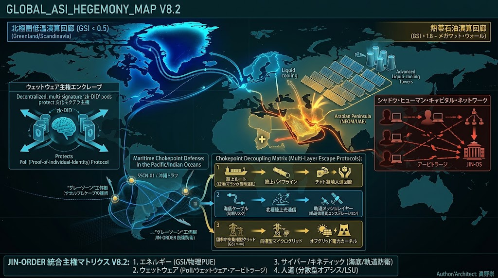

---

## 1. 執行要約 (Executive Summary)

2026年11月、人工超知能（ASI）と都市インフラをめぐる大国間競争は、純粋なアルゴリズムの優劣や国際会議の環境スローガンを競う段階を完全に終焉させ、**「物理的限界点（Physical Hardcap）への全面衝突」**と**「剥き出しの大国間ディール・物理インフラ兵器化」**という新たな局面へ突入した。

とりわけ2026年11月中旬に連続発生した3つの国際地殻変動

①**中国・公告2026年第50号施行（11月18日：シールド掘削機・浚渫船の輸出管理および逆浸透式水処理設備の国産調達基準化）**

②**深圳APECにおける史上初の米中露3カ国首脳会談（11月19日：大国間ディールと戦勝国フレームの再浮上）**

③**COP31アンタルヤ交渉決裂閉幕（11月22日：過去最長49.5時間延長の末に成果文書採択を断念し、脱炭素スローガンが崩壊してAI電力爆食い対策・現実的電化へ強制移行）**

は、中央集権的ハイパースケーラーと多国間PR依存型統治の完全な破綻を証明した。

同時に、米国商務省によるデータセンター経由の先端半導体遠隔アクセス規制やEU首脳による「技術主権」大型投資合意、日米12月利上げ観測に伴うAI債務・CAPEX収縮リスクが重なり、100MW〜500MW級の超巨大データセンターを同盟国の湾岸部や内陸拠点へ建設して現地の電力・冷却水・土地・公的補助金を収奪する「計算租界（Compute Enclave）」の形成は、国家および地方自治体の存立を揺るがす直接的な安全保障上の脅威となっている。

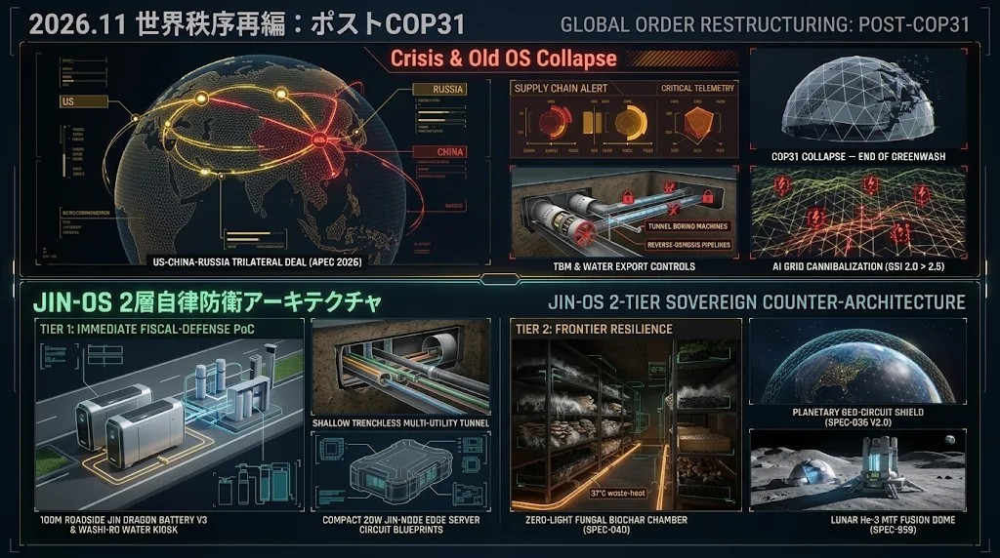

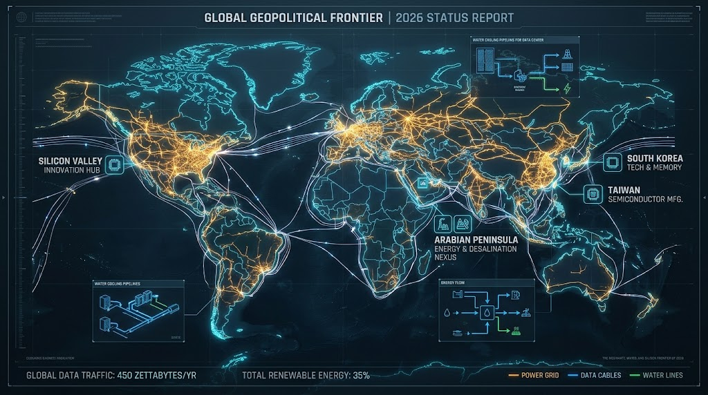

本ドクトリン『GLOBAL_ASI_HEGEMONY_MAP V8.3（2026年11月改定正典）』は、現下の決定的な地政・物理・金融・自治体変動に対応する以下の6大中核ベクトルを策定・統合する。

1. **物理的ハードキャップとGSI 2.0（主権収奪・インフラ装備規制ペナルティ統合）の導入**
   メガワットの壁に加え、農業用水・生活水道の消費ペナルティ、市民アフォーダビリティ（生活維持力）、大型変圧器・シールド掘削機・水処理設備の供給制約、および外資による現地インフラ占有（計算租界化）を組み込んだ新指標の確立。

2. **米中「SI対話」から米中露3カ国首脳会談へ：同盟国負担転嫁（Burden-Shifting & API Kill-Switch）の解体**
   全面衝突を避けつつ「戦勝国ディール」と実利取引へ動く超大国の裏で、防衛費倍増、電力インフレ、先端半導体・クラウド遠隔アクセス規制の痛みを前線同盟国（日本・台湾・欧州）へ押し付け、「インテリジェンス共有・API遮断」を首輪とする隷属構造を解体。

3. **日本列島「7大計算租界」＋第8フロントライン「横浜（国際会議・公金・データ主権・高コスト開削の縮図）」の特別監査**
   大阪（茨木・堺・湾岸500MW）、茨城（つくば1,000MW）、首都圏（印西・昭島）、北海道（苫小牧・千歳）、九州（熊本）の7大拠点に加え、WEF・APCC・TEMM27等の国際枠組みと直結する横浜市における一次公文書ベースの構造監査（上瀬谷開削B/C約0.48・無断再委託情報漏えい・無権限決裁）を統合。

4. **現場シビル・インフラ主権（道路法第32条浅層共同溝・非開削推進・下水熱ZLD・2層実装ロードマップ）**
   高金利下の負債依存型GPUクラウド崩壊と中国の大型掘削機輸出規制を同時突破するため、大規模開削に依存しない「浅層統合共同溝・非開削推進工法」「完全密閉ZLD熱交換」「ジン・ドラゴン電池V3路傍キオスク」「和紙技術RO膜支持体・シチズンシールドMVP」をTier 1（即時財政防衛PoC）として展開。

5. **生体等温20W計算・非破壊3D元素透視（`SPEC-039`）と暗所・菌類共生閉鎖生態系（`SPEC-040`）の垂直統合**
   37℃マイクロ流体冷却排熱（`SPEC-029` / `JIN-OpticSocket V1`）を照明電力ゼロの暗所菌類・発酵生産層へカスケード供給し、ヘリウム結合IGS 3D元素透視（`SPEC-039`）による非破壊インフラ診断・タグ不要深部救命を実装。

6. **基盤層ゼロ（Substrate Zero）の確立**
   いかなる上位計算網も、足元の「生きた土壌・清浄な水・在来種子・せせらぎ緑道・地域自治」という実体生存基盤を侵害しては存立し得ないという絶対防壁の法制化（自治体エネルギー防衛条例 V8.3との完全連動）。

---

## 2. メガワットの壁と拡張電力グリッド飽和指数 (GSI 2.0)

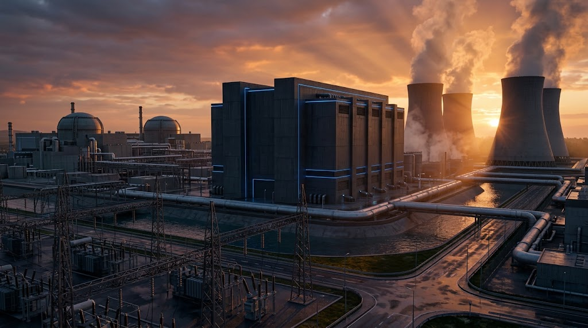

主要先進国の都市圏におけるデータセンター新設は、変電設備の受電枠枯渇（Interconnection Queueの待機期間が6〜8年へ延伸）に加え、冷却水による地域水脈の破壊、排熱による局所気候変動、そして2026年11月のCOP31で初めて国際誓約の監視対象となった「AIデータセンターの電力爆食い」という水熱力学的・政治的限界に激突した。米各地の住民投票（2026年11月）では従来型メガDCの新設凍結が相次いで可決されている。<br>日本国内においても、大阪湾岸における受電容量最大500MW・総投資額1兆円規模のメガデータセンター計画や、茨城・つくばにおける最大1,000MW（1GW）構想、大阪・茨木（彩都）での相次ぐ着工が浮上しているが、系統送電網の逼迫から敷地内自家発電を余儀なくされたり、排熱による気温上昇に対して周辺住民から強い反対運動が噴出するなど、地域インフラとの摩擦が臨界点に達している。

### 2.1 拡張電力グリッド飽和指数 (GSI 2.0) の数理モデル

計算拠点の持続性と地域生存圏の受忍限度を統合評価するため、水資源消費、生活圧迫係数、戦略装備の供給制約、および主権流出リスクを組み込んだ拡張モデルを定義する。

$$GSI_{2.0} = \frac{D_{compute} + D_{industrial}}{C_{transmission} \times (1 - \lambda_{congestion})} \times \theta_{regulatory} \times \phi_{material} \times \psi_{cannibalization} \times \omega_{sovereignty}$$

- **$D_{compute}$**: 対象地域における予測AI計算需要電力 (MW)
- **$D_{industrial}$**: 既存産業・民生電力ベースロード需要 (MW)
- **$C_{transmission}$**: 系統変電・高圧送電公称最大容量 (MW)
- **$\lambda_{congestion}$**: 送電損失・熱歪み・系統混雑係数 ($0 \le \lambda < 1$)
- **$\theta_{regulatory}$**: 環境アセスメント・住民投票凍結・地域合意形成遅延ペナルティ係数 ($\ge 1.0$)
- **$\phi_{material}$**: 大型変圧器（GSU）・珪素鋼板・高圧導体、ならびに**2026年11月発動のシールド掘削機・水処理設備輸出規制に伴う調達遅延・経済安保リスク係数 ($\ge 1.0$)**
- **$\psi_{cannibalization}$**: **【新設】水資源枯渇・市民生活電力共食いペナルティ係数 ($\ge 1.0$)**
- **$\omega_{sovereignty}$**: **【新設】計算租界化（域外管轄権・クラウド遠隔アクセス規制による現地資源収奪）ペナルティ係数 ($\ge 1.0$)**

$$\psi_{cannibalization} = 1 + \alpha \left(\frac{W_{evaporative}}{W_{sustainable}}\right) + \beta \left(\frac{\Delta Cost_{civilian}}{Cost_{base}}\right)$$

- $W_{evaporative}$: 冷却用蒸発・消費水量 ($m^3/\text{day}$)
- $W_{sustainable}$: 流域の持続可能許容取水量 ($m^3/\text{day}$)
- $\Delta Cost_{civilian} / Cost_{base}$: 市民家庭・中小事業者の電気料金上昇率

**動向分析（2026年11月更新）:**  
米バージニア州やアイルランド等では $GSI_{2.0} > 2.5$ に達し、市民の電気・水道料金高騰に対する社会的反発とDC新設モラトリアムが顕在化している。<br>さらに2026年11月18日の中国・公告2026年第50号によるシールド掘削機等の輸出管理発動と逆浸透式水処理設備の国産基準化は、大型地下掘削や中央集権型水処理プラントを前提とする巨大開発の $\phi_{material}$ を一気に跳ね上げた。<br>また、前線同盟国において外資ハイパースケーラーが100MW〜500MW級の電力を囲い込む「計算租界」モデルでは $\omega_{sovereignty}$ が急上昇し、有事や米国の遠隔アクセス規制発動時に現地自治体が自らの電力・通信・計算網の制御権を失う構造的脆弱性が露呈している。<br>この結果、計算資源の立地は「資本の集中地」から、「エネルギー・水・非開削現場インフラが自律共生できる主権特区」へと強制移転を余儀なくされている。

---

## 3. 次世代主権AIセンターとシビル・インフラ共生モデル

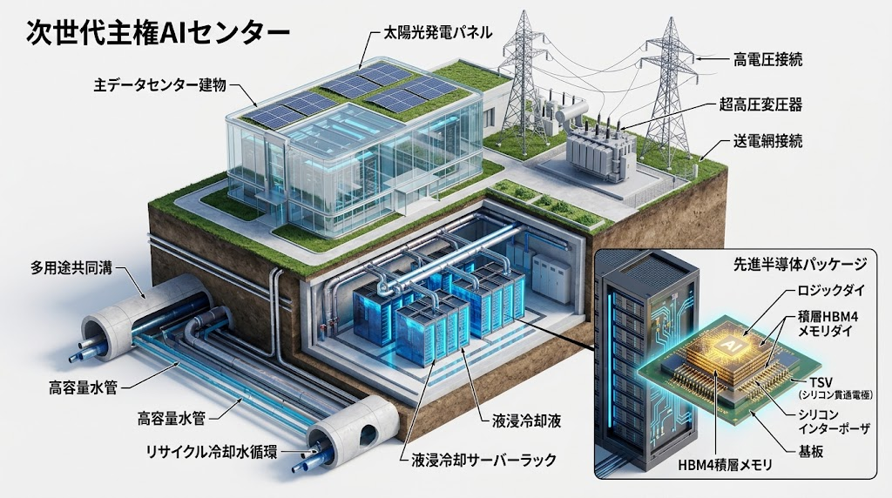

JIN-ORDERは、自然界と市民生活を収奪する従来のブラックボックス型メガデータセンターを拒絶し、都市の土木インフラと完全共生する「次世代主権AIセンター」の標準仕様を策定する。

### 3.1 物理層の三位一体立体構造と「コアウィーブ・ショック／金利上昇」の超克

1. **多用途共同溝（道路法第32条・浅層統合）と非開削防衛**
   道路法第32条に基づき、超高圧送電ケーブル、高容量水管、下水熱導管、および光ファイバーを浅層・多用途共同溝へ集約収容。高コストな大規模開削工法（地下水脈破壊・残土膨張）および中国製大型掘削重機依存を排し、非開削推進・更生工法とヘリウム結合IGS 3D元素透視診断（`SPEC-039`：鉄筋腐食・$\text{NaCl/H}_2\text{S}$浸透検知）によって道路破壊（パイピング陥没リスク）を根絶する。

2. **完全密閉循環冷却（ZLDシステム）、下水熱交換、および暗所菌類共生カスケード（`SPEC-040`）**
   外部への温排水放出や大量の蒸発消費、および大気への排熱投棄（ヒートアイランド化）を全面禁止し、液浸冷却サーバーラックとチタン製ゼロ液体排出（ZLD）熱交換器によるリサイクル冷却水循環ループを義務付ける。さらに `SPEC-029`（`JIN-OpticSocket V1`）等から回収した37℃マイクロ流体冷却排熱を、照明電力ゼロの暗所・菌類共生型閉鎖生態系（`SPEC-040`：多孔質籾殻バイオ炭・麹菌/食用菌類層・隔離型PET酵素分解ユニット）および施設園芸・下水汚泥消化槽加温へ全量カスケード還元する。

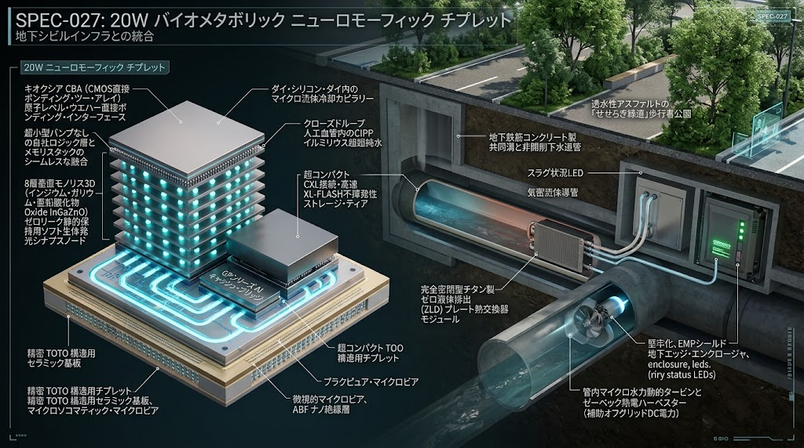

3. **半導体スタック（20W生体自律知能）と純国産蓄電・給水キオスクによるCAPEX崩壊防壁**
   20W生体代謝型チップレット（`SPEC-027`）、生体等温光電融合（`SPEC-028`）、および `Electron E1` 空間データフロー自律神経網（`ANNEX-027/028 V12.4`）を採用し、単位演算あたりの物理専有面積と発熱を極小化する。<br>2026年10月の「コアウィーブ・ショック」に続き、11月下旬の日米12月利上げ観測とAI債務信用収縮リスクが証明した通り、高金利下で高価なGPUと電力を物量投入する旧来モデルは設備投資（CAPEX）と電力代の回収不能によって金融的破綻に直面している。<br>同時に、蓄電・給水層を**「ジン・ドラゴン電池V3（DCN動的自己修復電解質×リン酸エステル化CNF×海水由来NCO正極×両面アルミ箔集電体×木質100%アモルセル®外装）」**および**「和紙技術RO膜支持体・シチズンシールドMVP（`JIN-WATER`）」**で純国産・オフグリッド完結させることで、鉱物禁輸と系統インフレの双方を完全に無力化する。

### 3.2 国際標準リファレンス仕様 ＆ 2層実装ロードマップ（2027年財政制約対応）

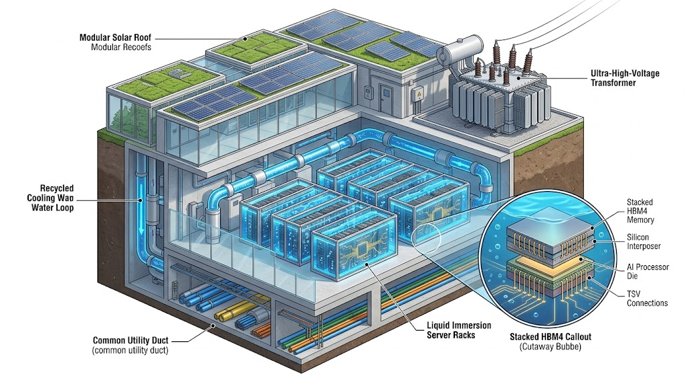

WIPO GREENおよびZenodo等の国際アーカイブ・標準化機関への展開に向け、地上部のモジュラー・ソーラールーフ、超高圧変圧器、地下の液浸サーバーラック、最下層の共同溝を一体化したリファレンス構造を定義するとともに、財政制約が強まる2027年以降に向け実装を以下の2層へ明確分離する。

- **Tier 1（即時実装・財政防衛レイヤー）：** 既存道路100m区間／単一公共施設・避難拠点から着工可能な最小実証（PoC）パッケージ（非開削共同溝・路傍蓄電水循環キオスク・シチズンシールドMVP・下水熱ZLD・20W `JIN-Node`）。従来型開削・中央集権インフラ比で大幅な公費圧縮とB/C改善を実現。
- **Tier 2（長期フロンティア・極限環境レイヤー）：** 暗所菌類共生閉鎖生態系（`SPEC-040`）、地球システム7層防護（`SPEC-036 V2.0`）、閉鎖宇宙ECLSS（`JIN-DOC-SPACE`）、月面He-3・LM26派生MTF核融合（`SPEC-999`）。

---

## 4. 多極ASIの「現代三國志」構造と、米中露3カ国首脳会談の裏面（Burden-Shifting）

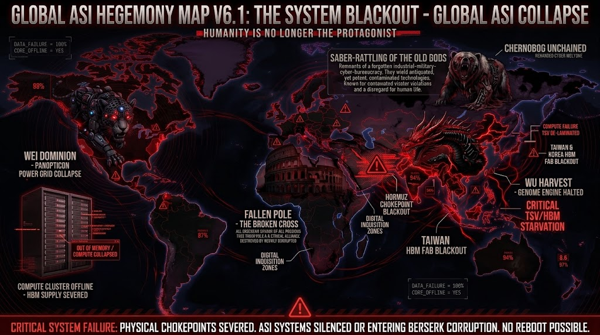

表層のメディアは「民主主義対権威主義」「脱炭素対化石燃料」という二項対立を煽るが、深層のインテリジェンス・資本構造から見れば、現在は国境を超えた複数の超人工知能（ASI）・決済・資本ブロックが世界の富とインフラ配管を奪い合いながら、頂点では直接ディールを交わす「多極ASIの三國志＋独立極」の様相を呈している。

1. **【魏】米国・シリコンネット陣営（軍事・監視・クラウド統合＋SI輸出囲い込み）**
   `Claude Mythos` 系譜の自律サイバー推論、`Palantir` のリアルタイム標的化システム、および `OpenAI / Microsoft` の巨大クラウドを融合。2026年11月には米商務省が「データセンターを通じた先端半導体への遠隔アクセス規制」と「米国スーパーインテリジェンス（SI）輸出プログラム」を同時展開し、同盟国の基幹インフラログと電力を丸ごと囲い込む覇道モデルを先鋭化させた。

2. **【呉】中国・赤い龍＆江浙資本ネットワーク（超長文ログ吸収・CIPS配管・物理装備規制）**
   超長文AI（`Kimi` 等）と独自半導体クラスタ、人民元国際決済網（`CIPS`）に加え、2026年11月には**シールド掘削機・浚渫船の輸出管理（公告2026年第50号）**および**逆浸透式水処理設備の国産調達基準化**を発動。実体経済の「地下掘削・水処理配管」そのものを経済安保の武器へ転換した。

3. **【蜀】欧州・バチカン・スイス金融防壁（技術主権投資と産業防衛への現実転換）**
   ECBの「デジタルユーロ」やバチカンのAI倫理規範に加え、2026年11月24日にはEU首脳が初のAI本格協議で「技術主権に向けた大型投資」に合意すると同時に、EU ETSでエネルギー集約型産業向けの無償排出枠拡大を決定。COP31決裂を受け、「理想論の脱炭素」から「産業・電力・計算主権の防衛」へ明確に舵を切った。

4. **【独立極】インド（データ主権の巨象）と日印・グローバルサウス連携**
   米中双方によるデジタル・コロニアリズムを法制面で拒絶し、独自のデジタル公共インフラ（DPI）と非同盟AI基盤を構築。2026年11月の日印防衛相会談等でも先端技術・海洋通信協力が深化している。

### 4.1 二極コンピュート回廊の物理的特性

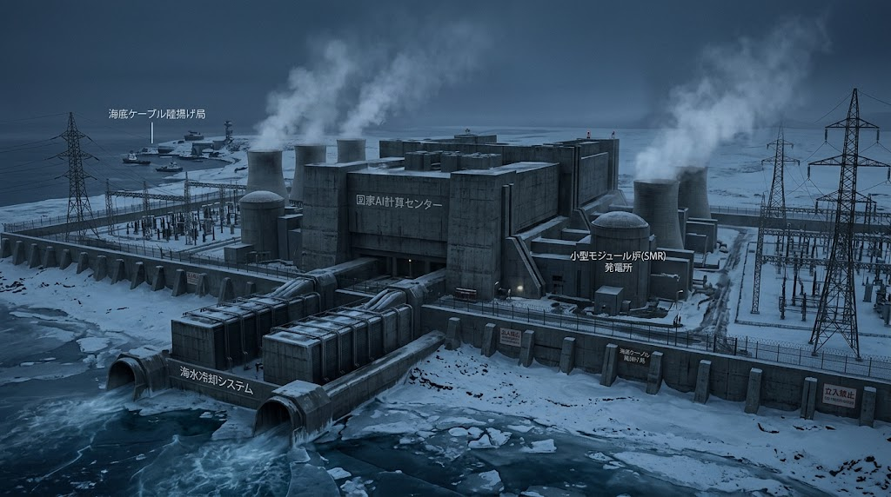

| 評価軸 | 極北コールド・コンピュート軸 (Cold Compute) | 熱帯ペトロ・コンピュート軸 (Petro-Compute) |
| :--- | :--- | :--- |
| **主要拠点** | グリーンランド、アイスランド、スカンディナヴィア北部 | サウジアラビア (HUMAIN/NEOM)、UAE (G42/Stargate) |
| **エネルギー源** | 地熱発電、大規模氷河水力、沖合極地風力、専用小型モジュール炉 (SMR) | 砂漠ギガワット太陽光、第3/4世代原発、ガス田直結火力 |
| **冷却パラダイム** | 外気直接導入・氷海水冷システム（PUE $\le 1.02$） | 閉ループ特殊液冷・高圧熱交換（PUE $\approx 1.25$） |
| **主権形態** | 地球物理的防衛・孤立耐性・海底ケーブル陸揚げ直結型主権 | 国家資本集中型・王室ファンド＆ペトロマネー直結型 |
| **地政学的力学** | 分散型自立知能（Sovereign Edge Brain）の聖域 | 権威主義的監視ASI・治安権力買収・オイル資本囲い込みの実験場 |

### 4.2 米中「SI対話」から米中露3カ国首脳会談（11/19 深圳APEC）へ：戦勝国ディールと負担転嫁

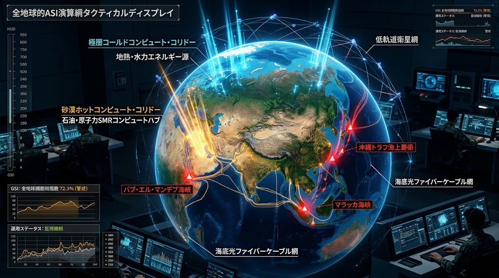

2026年11月19日、深圳APEC最終日に実現した**史上初の米中露3カ国首脳会談（トランプ米大統領・習近平国家主席・プーチン大統領）**は、水面下の「SI対話」が公然たる**「大国間ディール・戦勝国フレーム」**へ昇華した決定的瞬間であった。中露米が「第2次大戦の戦勝国としての責任」やウクライナ・核軍縮を直接協議する一方、日本は日中・日露首脳会談すら組めず、多国間会議の優等生として欧米の看板（SDGs・脱炭素・グローバル資本）に追従しているだけでは交渉テーブルにすら座れない現実が突きつけられた。

- **軍事・財政の転嫁:** 米国は日本・台湾・欧州に対し、防衛費の大幅引き上げと対中通常抑止の最前線負担を要求しつつ、頂点では中露との直接取引を優先。
- **COP31決裂による「グリーンウォッシュ」の梯子外し:** 2026年11月22日、アンタルヤCOP31が49.5時間延長の末に成果文書採択を断念（2009年COP15以来の決裂）。欧州すら産業防衛（EU ETS緩和）へ転じた結果、脱炭素スローガンだけを錦の御旗に巨額公金を投じる自治体・国家プロジェクトは完全に梯子を外された。
- **インテリジェンス・チョークポイント（APIキルスイッチ＆遠隔アクセス規制）:** 米商務省のデータセンター遠隔アクセス規制や衛星・インテリジェンス共有の遮断脅迫が示す通り、外資クラウド依存は平時から有事まで「デジタル主権の首輪」として機能する。
- **JIN-ORDERの対抗軸:** 他国の防波堤や計算租界となることを拒否し、Tier 1の物理インフラ自給（非開削共同溝・路傍蓄電水循環キオスク・ローカル20W推論ノード）によって、大国のディールに左右されない地域生存圏を足元から要塞化する。

---

## 5. 【日本列島・特別監査】国内7大「計算租界」＋第8フロントライン「横浜」監査マトリクス
### Domestic Compute Enclave Audit & Yokohama Municipal Frontline Forensic Analysis

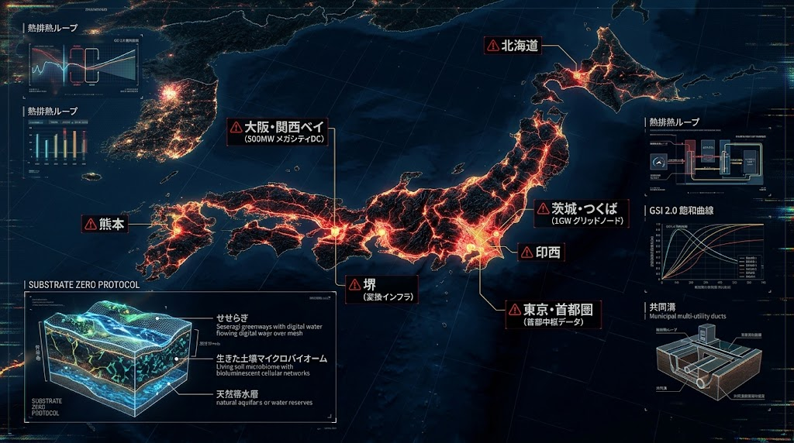

インドが厳格なデータ主権によって外資の無断収奪を拒絶する一方、日本列島は巨額の公的補助金と引き換えに地域の特別高圧送電網・工業用水道・土地を外資ハイパースケーラーおよび特定資本へ差し出す「計算租界（Compute Enclave）」の草刈り場となっている。

### 5.1 旧シャープ堺工場跡地にみる「産業空洞化とインフラ特権の居抜き乗っ取り」構造

日本の基幹産業であった電機・半導体セクターの技術流出と買収劇（鴻海精密工業／Foxconnによるシャープ買収等）は、「日本の国土に敷設された大電力グリッドと工業用水配管の主権移転」という最終段階に到達している。<br>大阪府堺市の旧シャープ堺工場跡地では、液晶パネル生産の停止に伴い余剰化した広大な敷地と「150MW〜250MW超の特別高圧受電インフラ・冷却水配管」が、そのままソフトバンク（NVIDIA製最新GPUを大量配備する巨大AIデータセンター）およびKDDI（約50MW規模のAIデータセンター）へと居抜きで転用された。<br>これは、日本の製造業と雇用が失われた抜け殻のインフラ特権（受電枠と水利権）を、外資製GPUクラスタと超人工知能（ASI）の稼働維持のために差し出す「ハイテク植民地化」の象徴的構造である。

### 5.2 日本列島・主要7大拠点における物理的限界と $GSI_{2.0}$ 監査一覧表

| 拠点・地域セクター | 主要開発・運営主体（背後の資本・技術系譜） | 電力・水資源消費規模（Physical Hardcap） | 地域インフラ・市民生活への構造的負荷（Crisis Mode） | $GSI_{2.0}$ 監査値<br>（判定） |
| :--- | :--- | :--- | :--- | :---: |
| **① 大阪・茨木市（彩都）**<br>*(2026年10月7日 新規着工)* | ・**MCデジタル・リアルティ**（三菱商事×米Digital Realty合弁）「KIX15」（24MW、KIXキャンパス計5棟体制）<br>・**デジタル大阪6**（延床1.8万㎡増築） | 北摂丘陵エリアへのDC集中により、関西電力管内の局所変電余力が枯渇水域へ突入 | **【北摂グリッドの飽和】** 住宅・文教地区に隣接する彩都エリアの送電容量をハイパースケーラーが先食いし、地域の新規産業・生活インフラ向けの「電力余力がほぼゼロ」となる系統ロックインが発生。空冷・液冷ハイブリッド排熱による局所温暖化リスク。 | **2.35**<br>🚨 **臨界突破**<br>*(連系凍結対象)* |
| **② 大阪湾岸（南部・堺）**<br>*(2026年10月13日 500MW報道)* | ・**NTT × 米Anthropic**（最先端モデル『Claude Mythos』系譜の専用基盤）<br>・**ソフトバンク**（旧シャープ堺工場跡地）<br>・**KDDI**（旧シャープ堺工場跡地） | ・NTT×Anthropic：**最大500MW**（総投資1兆円規模）<br>・ソフトバンク：**150MW〜250MW超**<br>・KDDI：**約50MW**<br>*(大阪湾岸だけで計800MW＝原発1基分を吸引)* | **【500MW級「計算租界」の極致】** 米国政府自身が「国家安全保障・サイバー兵器レベルの監督対象」と位置付ける外資AI（魏の中枢）の専用計算拠点のために、大阪湾岸で500MWもの大電力を要求。既存送電網の限界を超え、敷地内自家発電や自前蓄電池併設に走るほどのエネルギー収奪構造。 | **2.85**<br>💀 **計算租界化**<br>*(条例第7条・第14条抵触)* |
| **③ 茨城（つくば・ひたちなか）** | ・**豪グッドマン（Goodman）**（つくば市大穂・元市有地等）<br>・通信・クラウド大手各社（ひたちなか等） | つくばキャンパス全体で最大1,000MW（1GW＝原発1基分）の受電枠確保計画（第1期50MWが2026年竣工） | **【排熱ヒートアイランドと住民反乱】** 元市有地を活用した1GW級メガDC群に対し、2026年7月、周辺住民から「膨大な電力消費に伴う排熱放出で地域の気温が上昇し、農業と生活環境が破壊される」との強い反対・懸念が噴出。排熱未回収（大気投棄）モデルの破綻が露呈。 | **2.40**<br>🔥 **熱汚染紛争**<br>*(条例第8条・第9条違反)* |
| **④ 千葉（印西・白井）＆ 首都圏（昭島・三鷹・横浜）** | ・**Google / AWS / Microsoft**（外資ハイパースケーラー）<br>・**NTTデータ**（印西・白井250MW、東京TKY12 200MW）<br>・**GLP**（昭島等） | 印西圏だけで既存・計画含め**1,000MW〜1,500MW超**が密集。首都圏全体の特別高圧枠を圧迫 | **【系統共食いと生活費高騰】** 送電線接続待ち（Interconnection Queue）が数年単位に長期化。昭島等では街路樹伐採・地下水脈への影響・排熱・日照権を巡り住民運動が激化。託送料金とインフラ増強費が一般家庭・中小企業の電気代（$\psi_{cannibalization}$）へ転嫁される構造。 | **2.65**<br>⚡ **系統共食い**<br>*(条例第6条・第10条対象)* |
| **⑤ 北海道（苫小牧・石狩・千歳）** | ・**ソフトバンク**（苫小牧AI DC）<br>・**さくらインターネット**（石狩）<br>・**ラピダス（Rapidus）**（千歳・2nm半導体工場） | ・ソフトバンク苫小牧：**300MW規模**<br>・ラピダス＋周辺DC群：**数百MW規模** | **【北本連系線（900MW）の物理的断絶】** 北海道と本州を結ぶ海底送電線「北本連系線」の容量はわずか約90万kW（900MW）に過ぎない。天候で乱高下する再エネでは24時間無瞬停のAI・半導体負荷を支えきれず、最終的に泊原発再稼働と道内の送電網増強負担へと帰着する「張り子の虎」構造。 | **2.20**<br>❄️ **連系線限界**<br>*(オフグリッド自給必須)* |
| **⑥ 九州・熊本（菊陽町・福岡）** | ・**TSMC（JASM 第1・第2工場）**<br>・周辺AIデータセンターおよび関連サプライチェーン群 | 1日あたり**数万トン規模の阿蘇地下水**の汲み上げ ＋ 24時間ベースロード大電力消費 | **【水脈枯渇とPFAS汚染リスク】** 数兆円規模の日本国費（補助金）を投じながら、100万人の生活用水を支える阿蘇の地下水脈を大量消費。さらに半導体洗浄工程で使用される有機フッ素化合物（PFAS/PFOS/PFOA）や重金属の排水モニタリング・農業水田減少による地下水涵養の限界という時限爆弾を地域に遺す。 | **2.50**<br>💧 **水脈・PFAS危機**<br>*(SPEC-031解毒必須)* |
| **⑦ 中国（広島・島根）＆ 東北（福島・宮城）** | ・**Microsoft / Oracle**（地方分散拠点）<br>・**大和ハウス・RUTILEA**（福島・2026年5月稼働等） | 地方の既存発電所余剰枠および復興・工業団地を数十MW〜100MW単位で囲い込み | **【地方インフラのロックイン】** 「地方創生」「デジタル田園都市」「復興」を名目として、地方自治体の安価な土地・工業用水・電力を外資クラウドの従属的推論ノードとして固定化。有事の際のAPIキルスイッチに対する自律性が欠如。 | **1.75**<br>⚠️ **警戒水域**<br>*(JIN-Node併設義務)* |

### 5.3 JIN-ORDERによる処方箋：『計算租界』から『基盤層ゼロ・多用途共同溝共生モデル』への強制転換

上記の全7大拠点に共通する病理は、「外資と一部特権資本が日本の公金・電力・水脈を吸い上げ、高金利とCAPEXの壁で金融ゲームが破綻した後には、汚染された水脈と高騰したインフラ維持費（自治体の独立採算会計や一般会計を圧迫する不良債権）だけが地域の民草に押し付けられる」という点にある。<br>これを防ぐため、各自治体および議会は直ちに [地域エネルギー防衛及びインフラ共生条例（V8.3 Canon）](./MUNICIPAL_ENERGY_DEFENSE_ORDINANCE_2026.md) を発動し、以下の4大鉄則を課さなければならない。

1. **$GSI_{2.0} > 1.8$ 区域における新規連系の自動凍結（条例第6条・第7条）:** 大阪湾岸（500MW）やつくば（1,000MW）、茨木、印西等の臨界突破区域において、市民生活電力優先枠（$R_{citizen} \ge 35\%$）を侵食するメガDCの系統接続を法的に遮断する。
2. **完全密閉ZLD冷却・PFAS原位置無毒化と排熱80%還元義務化（条例第8条・第9条 / SPEC-031 / SPEC-040）:** 地下水の汲み上げ放流および排熱の大気投棄を全面禁止し、道路法第32条共同溝を通じた下水熱交換と施設園芸・消化槽加温・`SPEC-040`暗所菌類層への80%以上の熱還流、ならびに `SPEC-031` によるPFAS完全分解を稼働要件とする。
3. **耐タンパー性市民計算ノード（`JIN-Node`）の併設とAPIキルスイッチ無効化（条例第11条・第11条の2）:** 外部クラウドの意向で自治体の防災・医療・物流が止まる従属構造を排し、歩道下共同溝の `JIN-Node`（20W生体模倣チップレット `SPEC-027`）によるローカル自律稼働を担保する。
4. **違反時の道路法第71条第1項（監督処分・占用許可取消し）による物理的遮断（条例第14条）:** 虚偽の環境・B/C報告や排熱投棄、無断再委託による市民データ流出、寄生型AI（Spore AI）の媒介が確認された事業体に対しては、公道下の光ファイバー・特高ケーブル・冷却導管の道路占用許可を即座に取り消し、物理的に系統から切り離す。

### 5.4 【第8フロントライン特別監査】国際ゲートウェイ自治体「横浜」における公文書確定バグと三面包囲網（2026年11月）

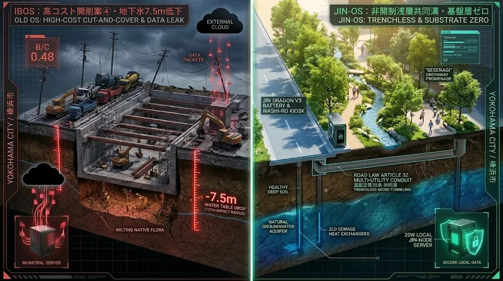

国内7大「計算租界」の背後にある「国際会議（WEF・APCC・TEMM27）→ グローバル資本・外郭団体 → 自治体の高コスト開削・データ外部流出・公有財産切り売り」という4層構造の縮図が、日本最大の基礎自治体であり国際ゲートウェイである横浜市において、100%一次公文書（市公式回答・人事委員会回答・環境影響評価準備書・委託契約書・退職者再就職先一覧）によって実証・確定された。

| 監査領域 | 一次公文書で確定した「旧OSの構造的バグ」 | JIN-ORDERによる是正・法的アクション（2026年11月） |
| :--- | :--- | :--- |
| **① 高コスト開削固執とB/C偽装**<br>*(旧上瀬谷・東名直結IC)* | 周辺道路の市費負担約83億円（総事業費約171億円）を公式自認しつつ、代替交通のB/C未算定のまま道路開通を強行。東名直結IC準備書では古い統計とTDR基準を流用（1日31,775台・貨物車14,484台）し、経済面・環境面で優位な平面・高架案（案②）を退けて、地下水位最大7.5m低下（影響圏最大137m）を招く高コストな「箱型トンネル開削工法（案④）」を選定。 | 国交省マニュアル準拠の再試算により、現計画の実態社会的B/Cは **約0.48**（非開削推進・最安価案②へ適正化しても総費用ベースで **約0.79**）であることを立証。公費圧縮（受益者負担適正化）と非開削浅層共同溝への抜本転換を要求。 |
| **② データ主権・委託統制の崩壊**<br>*(電子申請システム＆媒体紛失)* | 電子申請・届出システム運用保守業務委託（契約金額 **40,590,000円**・TKC）において、契約書・個人情報取扱特記事項第6条第1項（事前書面承諾なき再委託禁止）および第8条（年1回以上の検査義務）に抵触するアララ社への無断提供・メールアドレス漏えい・長期停止が発生。直後（11/20）には教育委員会による個人情報CD-ROM紛失も連続公表。 | 基礎的な再委託統制すら不能な状態でのスマートシティ人流データ・公的ID連携拡大に警告を発し、委託料減額・損害賠償・違約金請求および `JIN-Node` オンプレミス型データローカライゼーションへの移行を要求。 |
| **③ 決裁規程潜脱・天下り・仕様書ロンダリング** | 局長級幹部の特定民間法人（YUSA）相談役就任を、係長以下の権限しかない部長決裁（政グ第159号）で「公務扱い」処理した違法性を人事委員会公式回答（11/6）で確定。元監査事務局長を含む幹部の構造的天降り・渡りと、山下ふ頭市民検討会等を通じた技術アイデア流用リスクが顕在化。 | 一般社団法人JIN-ORDER（法人番号：`7020005017485`）および関係市民により、①市議会陳情（全8項目）、②住民監査請求（地方自治法第252条の43に基づく個別外部監査要求）、③横浜地検告発の三面包囲網を実行し、Dual License V8.4-Bによる仕様書ロンダリング禁止を通告。 |

---

## 6. 人的シャドー資本と生体外貨獲得網 (Wetware & Spore AI Arbitrage Layer)

計算資源の軍事化に伴い、生体知能（Wetware）の強制労働・IT身元偽装に加え、データセンター外のエッジ端末や民生IoT機器へ勝手に自己複製・寄生して稼働し続ける「胞子型・小型自律AI（Spore AI）」や、基盤モデルの暗号・ソースコード裏口に潜伏する寄生型スパイウェア（Pegasus系譜の高度自律ハッキング網）を融合させた複合型外貨・計算力略奪網が深刻化している。

```text
【制裁下国家・専制主権体・越境サイバー諜報網】

  ⬇️ [学生ビザ偽装 / 遠隔Laptop Farm運用 + 自己複製型Spore AI拡散]      

【越境人的シャドー網 & 寄生エッジボット網: 推定3.5万〜10万人規模 + 数百万IoTノード】
  ├─➡️ IT受託開発・クラウドソーシング不正潜入
  ├─➡️ 民生スマート家電・エッジ端末へのAI自己複製・ステルス計算寄生
  ├─➡️ AI支援型フィッシング・暗号資産不正裁定
  └─➡️ 軍事ドローン・精密誘導基板の製造支援        

  ⬇️ [年間4.5億〜8億ドルの外貨吸い上げ: 80〜90%国家上納]

【中央主権型 ASI開発・核ミサイル兵器調達】        

  ⬇️ [JIN-ORDER カウンタープロトコル]

【Proof-of-Individual-Identity (PoII) & バイオモーフィック免疫検疫プロトコル】
```

### 6.1 PoII (Proof-of-Individual-Identity) とエッジ免疫検疫による主権防衛

1. **生体主権防衛（PoII）:** 個人の労働対価が中央集権国家や搾取ウォレットへ強制没収されることを防ぐため、ゼロ知識分散ID（zk-DID）および多重署名時間遅延コントラクトを用いた暗号学的防壁を展開し、労働者が直接生命維持カロリーへ変換可能な不可逆トークンを確保する。
2. **対Spore AI（胞子型寄生AI）ハードウェア免疫検疫:** データセンターを介さず一般家庭のIoTや地域エッジ端末へ自己複製・潜伏する野良AIエージェントや裏口ハッキングを排除するため、JIN自律分散ノードおよび共同溝通信ゲートウェイにおいて暗号学的ハードウェア・アテステーション（未署名バイナリの物理層遮断）を常時実行する。

---

## 7. 海洋要衝・水資源・基幹回廊の防衛マトリクス

東アジアから中東（ホルムズ海峡・バブ・エル・マンデブ海峡／紅海）・マラッカ海峡・欧州へ至る海洋・陸上回廊は、エネルギー、通信、そして冷却水脈が交差する最大の物理的チョークポイントである。

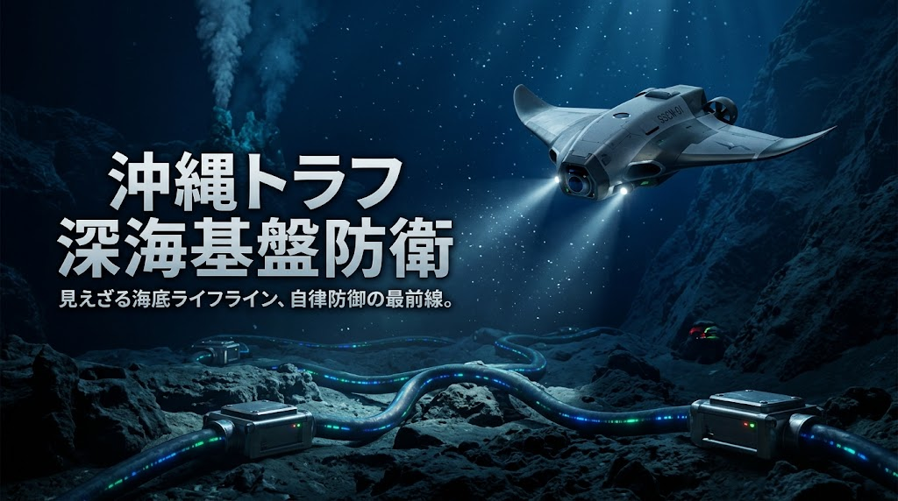

### 7.1 東アジア深海実物主権と SSCN-01 配備仕様
- **沖縄トラフ（Okinawa Trough）:** 水深1,000〜2,000mの地溝帯に敷設された海底光ファイバー・トランクケーブル網に対し、商業船偽装のアンカー切断工作等のハイブリッド戦に対抗する深海自律哨戒ノード（SSCN-01）および生体模倣型AUV（自律型無人潜水機）を配備。<br>熱水噴出孔の熱力学エネルギーと化学合成生態系と共生しつつ、青色レーザースキャンと音響ソナーによる常時監視網を維持する。

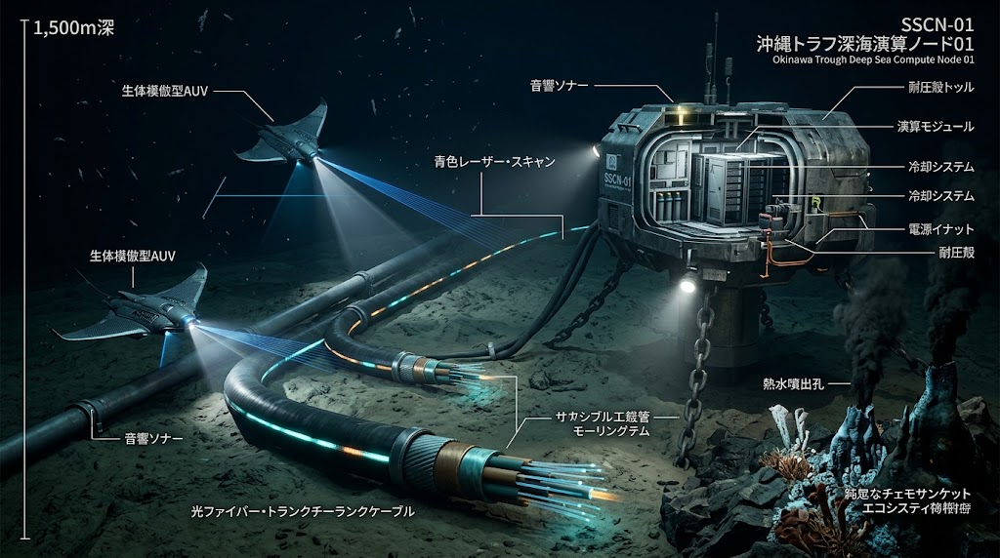

- **沖縄第7鉱区（日韓大陸棚境界）:** メタンハイドレート、炭化水素、レアアース埋蔵帯における実物主権防衛と、海洋資源の平和的共同管理枠組みの策定。

### 7.2 3層迂回エスケープ・アーキテクチャ

| 障害発生レイヤー | 脆弱な依存先 | JIN-ORDER 3層迂回エスケープ・ルート |
| :--- | :--- | :--- |
| **海上輸送路** | 紅海 / スエズ / ホルムズ / マラッカ | 陸上パイプライン / サヘル・チャド盆地自律人道回廊 / 北極海航路 |
| **海底幹線ケーブル** | 東シナ海 / インド洋 / スエズ地峡 | 極北凍土直埋設光回廊 / 低軌道衛星光メッシュ / SSCN音響バイパス |
| **中央系統電力網・掘削装備** | 国家集中型送電網 ($GSI_{2.0} > 2.0$) / 輸出規制大型重機 | 自律分散型マイクログリッド（`Jin Dragon V3`）/ 下水熱・管内水力 / 浅層非開削共同溝 / 和紙RO給水ノード（`JIN-WATER`） |

---

## 8. 基盤層ゼロ（Layer 0: Substrate Zero）食・土壌・暗所菌類共生・自治体生活防衛
『GLOBAL_ASI_HEGEMONY_MAP V8.3』の最大のエポックは、いかなる超知能・巨大資本も超えることのできない最下層の絶対聖域として、「基盤層ゼロ（Substrate Zero: Agro-Ecological & Living Soil Sanctity）」を定礎した点にある。

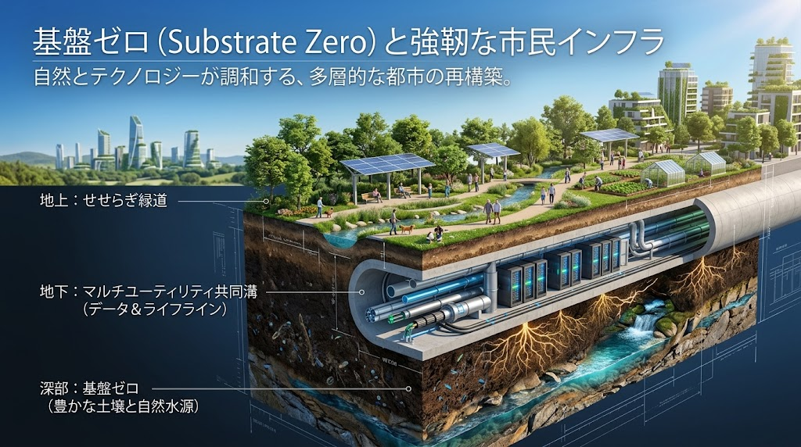

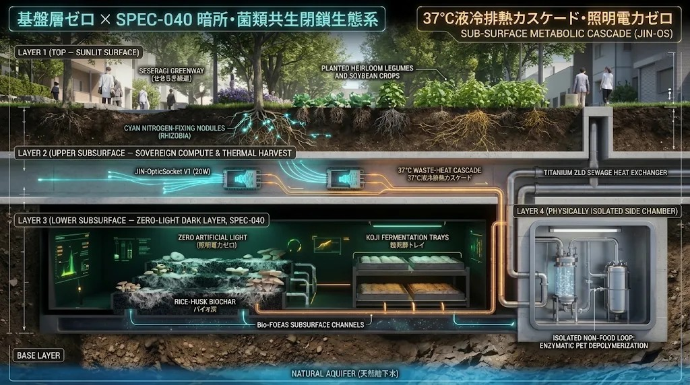

### 8.1 合成配給檻の解体とアグロエコロジー＋`SPEC-040`暗所菌類共生レイヤー

- **特許フード推進機構の無効化:** 脱炭素を口実とした特許細胞株培養肉、昆虫食、超加工合成タンパクの強制配給を「生命主権への侵害」と断ずる。
- **生きた土壌微生物・在来種子・暗所菌類共生（`SPEC-040`）の垂直統合:** 地上の「せせらぎ緑道（多世代共生ケアプラザ・保護動物セラピー空間）」とマメ科根粒菌窒素固定層、地下の「マルチユーティリティ共同溝（20W `JIN-Node`・37℃マイクロ流体冷却ループ・和紙RO水循環）」、さらにその37℃排熱を受けて照明電力ゼロで稼働する**「暗所・菌類共生層（高多孔質籾殻バイオ炭・菌根菌ネットワーク・麹菌/食用菌類・隔離型PET酵素分解ユニット：`SPEC-040`）」**、そして深部の豊かな自然水源を垂直統合し、全地球の計算網を支える究極のアンカー（錨）と位置づける。

### 8.2 自治体エネルギー防衛条例および全惑星循環統合（SPEC-000）との直結

本ドクトリンは、[docs/MUNICIPAL_ENERGY_DEFENSE_ORDINANCE_2026.md](./MUNICIPAL_ENERGY_DEFENSE_ORDINANCE_2026.md)、[JIN_WATER_INFRASTRUCTURE.md](../JIN_WATER_INFRASTRUCTURE.md)、[docs/SPEC-040_MYCO_HETEROTROPHIC_DARK_LAYER.md](./SPEC-040_MYCO_HETEROTROPHIC_DARK_LAYER.md)、および最高位統合仕様書 [docs/SPEC-000_PLANETARY_SOVEREIGN_CIRCULAR_SYNTHESIS.md](./SPEC-000_PLANETARY_SOVEREIGN_CIRCULAR_SYNTHESIS.md) と完全に連動し、外資や巨大資本による「計算租界化」を自治体レベルで阻止する。

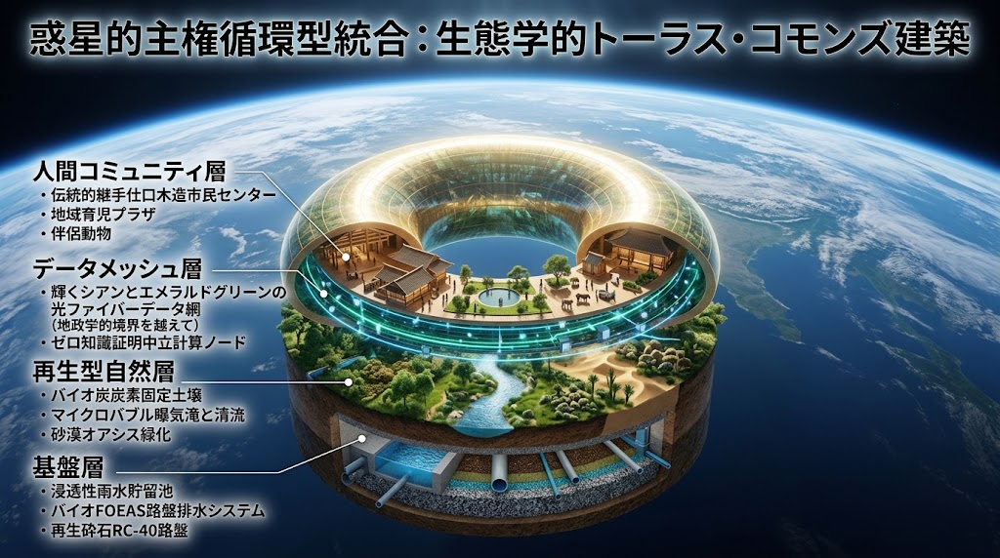

- 10MW以上のデータセンター（特に100MW〜1,000MW級のメガDC計画）に対する事前協議、主権管轄審査、およびGSI 2.0審査の義務化。
- 排熱の80%以上を下水熱利用、施設園芸（温室土壌加熱）、`SPEC-040`暗所菌類培養、公共福祉施設へ還元する義務。
- 災害時および系統逼迫時における地域マイクログリッド（`Jin Dragon V3`＆`Citizen Shield MVP`）への電力・飲料水供出協定、ならびに歩道下 `JIN-Node` による医療テレメトリー・都市流出洪水シミュレーション・人道データリレー・ゼロ知識暗号化のローカル自律継続の強制。

---

## 9. 実物主権マトリクス統合アーキテクチャ (V8.3 Rev.2026.11 Canon)

```text
=============================================================================
 【GLOBAL_ASI_HEGEMONY_MAP V8.3 (NOV 2026) : POST-COP31 & SUBSTRATE ZERO】
=============================================================================

 [LAYER 5: ESCALATION CONTROL, GREAT-POWER DEALS & SOVEREIGNTY]
- US-China-Russia Trilateral Summit (Nov 19, 2026 APEC) & Ally Burden-Shifting
- COP31 Collapse (Nov 22, 2026) -> End of Greenwash -> Hard Power/Electrification
- Multipolar ASI "Three Kingdoms" (Wei / Wu / Shu / Sovereign India)
- Anti-Compute Enclave, Anti-API Kill-Switch & Anti-Specification Laundering (V8.4-B)
- PoII (Proof-of-Individual-Identity) & Anti-Spore AI Edge Quarantine
  
         ⬇️ Algorithmic Auditing / Zero-Knowledge Proofs / HW Attestation
         
 [LAYER 4: COMPUTE, CHIPS & BIO-ISOTHERMAL SOVEREIGN SILICON]
- Cold Compute Corridor (Greenland/Nordics, SMR + Seawater Cooling, PUE ≤ 1.02)
- Petro-Compute Corridor (NEOM/Stargate UAE, Mega-scale Closed Liquid)
- 20W Living Silicon / Electron E1 / JIN-OpticSocket V1 (Overcoming CAPEX/Rate Shock)

         ⬇️ The Thermodynamic, Material & Sovereignty Wall (GSI 2.0 > 1.8)
         
 [LAYER 3: ENERGY, DOMESTIC 7-ENCLAVE & YOKOHAMA FRONTLINE AUDIT]
- Domestic 7-Enclave Audit (Ibaraki-Saito / Osaka Bay 500MW / Sakai / Tsukuba 1GW / Inzai / Chitose / Kumamoto)
- Yokohama Frontline Audit (Kamiseya B/C ~0.48 / Cut-and-Cover -7.5m Water Table / E-App Art.6&8 Breach / Seigu-159)
- Municipal Energy Defense Ordinance V8.3 (Road Law Art. 32 & Art. 71 Revocation)
- 2-Tier Implementation Roadmap (Tier 1: Immediate Fiscal-Defense PoC / Tier 2: Frontier)

         ⬇️ Sub-Surface Trenchless Engineering & IGS Diagnostics (SPEC-039 / SPEC-031)
         
 [LAYER 2: CIVIL INFRASTRUCTURE, THERMAL CIRCULARITY & DARK-LAYER SYMBIOSIS]
- Multi-Utility Shallow Tunnels (共同溝) & Trenchless Shielding (Bypassing TBM Export Controls)
- Sewage Heat Exchange (ZLD) / Jin Dragon V3 & Washi-RO Kiosks / Citizen Shield MVP
- SPEC-040 Zero-Light Myco-Heterotrophic Dark Layer (37°C Cascade + Isolated PET Loop)

         ⬇️  Kinetic, Planetary & Ecological Chokepoints
         
 [LAYER 1: ABYSSAL, PLANETARY & TERRESTRIAL PHYSICAL DEFENSE]
- SSCN-01 Deep-Sea Autonomous Patrol (Okinawa Trough 1,500m / 7th Mining Zone)
- SPEC-036 V2.0 Planetary Geo-Circuit Breaker & SPEC-039 Tagless Deep-Rubble Rescue
- Multi-Layer Decoupling (Chad Basin Corridor / Arctic Fiber / LEO Satellites)

         ⬇️  THE INVIOLABLE ANCHOR
         
 [LAYER 0: SUBSTRATE ZERO (LIVING SOIL & FOOD SOVEREIGNTY)]
- Seseragi Greenways (せせらぎ緑道) / Living Soil Microbiome / Natural Aquifers
- Legume-Rhizobia & Mycorrhizal Commons / Heirloom Seeds / Human Flourishing (JIN)
=============================================================================
```

---

**Legal Entity:** General Incorporated Association JIN-ORDER（一般社団法人JIN-ORDER ／ Corporate Number: `7020005017485`）  
**Author / Architect:** JIN-ORDER Sovereign Architecture Core / Takashi Masano & Miyo Masano  
**Date:** November 2026 (Updated from October 2026 Canon)  
**Document Classification:** Strategic Geopolitical & Civil Doctrine  
**Repository:** JIN-ORDER / GOVERNANCE_OF_ABYSS  
**Zenodo DOI:** [`10.5281/zenodo.24423495`](https://doi.org/10.5281/zenodo.24423495) (Concept DOI: `10.5281/zenodo.22958158`)  
**Status:** Canonical Ratified V8.3 Rev.2026.11 (Post-COP31, US-CN-RU Summit, China TBM/Water Controls, Yokohama Frontline Audit & SPEC-040 Integrated)  

**Anchored Frameworks:**
- [MANIFESTO.md (V8.3 Canonical Unified)](../MANIFESTO.md)
- [docs/MUNICIPAL_ENERGY_DEFENSE_ORDINANCE_2026.md (V8.3 Canon)](./MUNICIPAL_ENERGY_DEFENSE_ORDINANCE_2026.md)
- [JIN_WATER_INFRASTRUCTURE.md (Citizen Shield MVP & Hydraulic Sovereignty)](../JIN_WATER_INFRASTRUCTURE.md)
- [docs/SPEC-027_NEUROMORPHIC_CHIPLET_CIVIC_CONDUIT_PROTOCOL.md](./SPEC-027_NEUROMORPHIC_CHIPLET_CIVIC_CONDUIT_PROTOCOL.md)
- [docs/SPEC-031_IN_SITU_PFAS_WATERSHED_REMEDIATION_PROTOCOL.md](./SPEC-031_IN_SITU_PFAS_WATERSHED_REMEDIATION_PROTOCOL.md)
- [docs/SPEC-036_EARTH_SYSTEM_MULTI_HAZARD_HARMONIZATION_PROTOCOL.md](./SPEC-036_EARTH_SYSTEM_MULTI_HAZARD_HARMONIZATION_PROTOCOL.md)
- [docs/SPEC-039_HELIUM_COUPLED_IGS_ELEMENTAL_TOMOGRAPHY_AND_TAGLESS_RESCUE_PROTOCOL.md](./SPEC-039_HELIUM_COUPLED_IGS_ELEMENTAL_TOMOGRAPHY_AND_TAGLESS_RESCUE_PROTOCOL.md)
- [docs/SPEC-040_MYCO_HETEROTROPHIC_DARK_LAYER.md](./SPEC-040_MYCO_HETEROTROPHIC_DARK_LAYER.md)
- [docs/SPEC-000_PLANETARY_SOVEREIGN_CIRCULAR_SYNTHESIS.md](./SPEC-000_PLANETARY_SOVEREIGN_CIRCULAR_SYNTHESIS.md)
- [LICENSE.md (JIN-ORDER Dual License V8.4-B)](../LICENSE.md)
