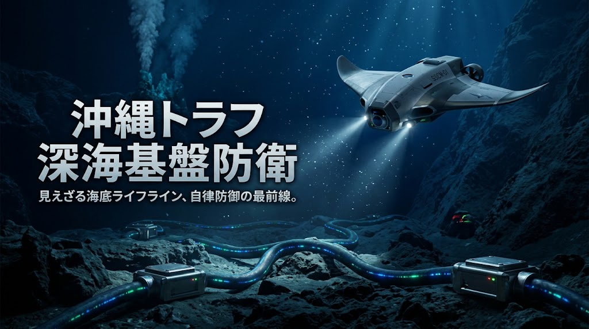

### ⚠️ JIN-ORDER RESTRICTED DATA

**このファイルは [JIN-ORDER Global Humanity License](https://github.com/JIN-ORDER-OFFICIAL/GOVERNANCE_OF_ABYSS/blob/main/LICENSE.md) によって保護されています。**

**無断転用、受託コンサルタントによる仕様書ロンダリング、机上の空論による改ざんを固く禁じます。**

---

# GLOBAL_ASI_HEGEMONY_MAP V8.3
## The Physical Hardcap, Sovereign Grounding & Substrate Zero Matrix

### 「物理的限界激突、同盟負担転嫁、及び基盤層ゼロ（土壌・シビルインフラ主権）統合マトリクス」


---

## 1. 執行要約 (Executive Summary)

2026年秋、人工超知能（ASI）をめぐる大国間競争は、純粋なアルゴリズムの優劣を競う段階を完全に終焉させ、**「物理的限界点（Physical Hardcap）」への全面衝突**という新たな局面へ突入した。

メガデータセンターによる都市送電網の共食い（Grid Cannibalization）、大型変圧器（GSU）および高圧導体の製造納期遅延、冷却用水資源の枯渇、そして第一列島線や紅海・マラッカ海峡における物理的通信・輸送路の断絶は、中央集権的ハイパースケーラーの拡張限界を白日の下に晒した。

本ドクトリン『GLOBAL_ASI_HEGEMONY_MAP V8.3』は、V8.2の二極回廊モデルをさらに進化させ、現下の決定的な地政・物理変動に対応する以下の4大中核ベクトルを策定・統合する。

1. **物理的ハードキャップとGSI 2.0の導入**:
   メガワットの壁に加え、農業用水・生活水道の消費ペナルティおよび市民アフォーダビリティ（生活維持力）を組み込んだ新指標の確立。

2. **米中「SI対話」の裏面と同盟国負担転嫁（Burden-Shifting）**:
   全面衝突を恐れる超大国同士が水面下で偶発防止ホットラインを敷設する一方、防衛費倍増、脱炭素・電力インフレ、先端半導体禁輸の痛みを前線同盟国（日本・台湾・欧州）へ押し付ける構造の解体。

3. **現場シビル・インフラ主権（共同溝・非開削・下水熱サーキュラー）**:
   机上のクラウド論を打破し、道路法第32条、多用途共同溝、完全密閉ZLD熱交換器、および管内小水力発電による地下インフラ防衛線の構築。

4. **基盤層ゼロ（Substrate Zero）の確立**:
   いかなる上位計算網も、足元の「生きた土壌・清浄な水・在来種子・地域自治」という実体生存基盤を侵害しては存立し得ないという絶対防壁の法制化（自治体エネルギー防衛条例との完全連動）。

---

## 2. メガワットの壁と拡張電力グリッド飽和指数 (GSI 2.0)


主要先進国の都市圏におけるデータセンター新設は、変電設備の受電枠枯渇（Interconnection Queueの待機期間が6〜8年へ延伸）に加え、冷却水による地域水脈の破壊という「水熱力学的天井」に激突した。

### 2.1 拡張電力グリッド飽和指数 (GSI 2.0) の数理モデル

計算拠点の持続性と地域生存圏の受忍限度を統合評価するため、水資源消費および生活圧迫係数を組み込んだ拡張モデルを定義する。

$$GSI_{2.0} = \frac{D_{compute} + D_{industrial}}{C_{transmission} \times (1 - \lambda_{congestion})} \times \theta_{regulatory} \times \phi_{material} \times \psi_{cannibalization}$$

- **$D_{compute}$**: 対象地域における予測AI計算需要電力 (MW)
- **$D_{industrial}$**: 既存産業・民生電力ベースロード需要 (MW)
- **$C_{transmission}$**: 系統変電・高圧送電公称最大容量 (MW)
- **$\lambda_{congestion}$**: 送電損失・熱歪み・系統混雑係数 ($0 \le \lambda < 1$)
- **$\theta_{regulatory}$**: 環境アセスメント・地域合意形成遅延ペナルティ係数 ($\ge 1.0$)
- **$\phi_{material}$**: 大型変圧器（GSU）・珪素鋼板・高圧導体の調達遅延係数 ($\ge 1.0$)
- **$\psi_{cannibalization}$**: **【新設】水資源枯渇・市民生活電力共食いペナルティ係数 ($\ge 1.0$)**

$$\psi_{cannibalization} = 1 + \alpha \left(\frac{W_{evaporative}}{W_{sustainable}}\right) + \beta \left(\frac{\Delta Cost_{civilian}}{Cost_{base}}\right)$$

- $W_{evaporative}$: 冷却用蒸発・消費水量 ($m^3/\text{day}$)
- $W_{sustainable}$: 流域の持続可能許容取水量 ($m^3/\text{day}$)
- $\Delta Cost_{civilian} / Cost_{base}$: 市民家庭・中小事業者の電気料金上昇率

**動向分析:**  
米バージニア州やアイルランド等では $GSI_{2.0} > 2.5$ に達し、市民の電気・水道料金高騰に対する暴動リスクが顕在化している。この結果、計算資源の立地は「資本の集中地」から、「エネルギー・水・現場インフラが自律共生できる特区」へと強制移転を余儀なくされている。

---

## 3. 次世代主権AIセンターとシビル・インフラ共生モデル


JIN-ORDERは、自然界を収奪する従来のブラックボックス型メガデータセンターを拒絶し、都市の土木インフラと完全共生する**「次世代主権AIセンター」**の標準仕様を策定する。

### 3.1 物理層の三位一体立体構造
1. **多用途共同溝（マルチユーティリティトンネル）の防衛**:
   道路法第32条に基づき、超高圧送電ケーブルおよび光ファイバーを高容量共同溝へ集約収容。単独掘削による道路破壊と地下空間の無秩序占用を根絶する。

2. **完全密閉循環冷却（ZLDシステム）**:
   外部への温排水放出や大量の蒸発消費を全面禁止し、液浸冷却（Liquid Immersion）サーバーラックとチタン製ゼロ液体排出熱交換器による循環ループを義務付ける。

3. **半導体スタック（HBM4 / 3Dモノリシック）の局所最適化**:
   TSV（シリコン貫通電極）および光電融合（CPO）技術を導入した高集積モジュールを採用し、単位演算あたりの物理的専有面積と送電発熱を極小化する。

---

## 4. 二極コンピュート回廊と米中「SI対話」の裏面（Burden-Shifting）

世界は、熱力学的特性により対極をなす2つの巨大回廊へ分極化している。

| 評価軸 | 極北コールド・コンピュート軸 (Cold Compute) | 熱帯ペトロ・コンピュート軸 (Petro-Compute) |
| :--- | :--- | :--- |
| **主要拠点** | グリーンランド、アイスランド、スカンディナヴィア北部 | サウジアラビア (HUMAIN/NEOM)、UAE (G42/Stargate) |
| **エネルギー源** | 地熱発電、大規模氷河水力、沖合極地風力、専用SMR | 砂漠ギガワット太陽光、第3/4世代原発、ガス田直結火力 |
| **冷却パラダイム** | 外気直接導入・氷海水冷（PUE $\le 1.02$） | 閉ループ特殊液冷・高圧熱交換（PUE $\approx 1.25$） |
| **主権形態** | 地球物理的防衛・孤立耐性・環境共生主権 | 国家資本集中型・絶対君主制ペトロマネー直結型 |
| **地政学的力学** | 分散型自立知能（Sovereign Edge Brain）の聖域 | 権威主義的監視ASI・オイル資本囲い込みの実験場 |

### 4.1 米中「SI対話」と前線同盟国への負担転嫁（Burden-Shifting）
米中両陣営は、偶発的な自律エージェントの暴走やサイバー核インシデントを防ぐため、水面下で**「Super Intelligence (SI) Dialogue」**と呼ばれる危機管理ホットラインを構築している。

しかしその裏側で、両国は自国の致命的消耗を避けるため、**「同盟国への負担転嫁」**を加速させている。

- **軍事・財政の転嫁**: 米国は日本・台湾・欧州に対し、防衛費のGDP比大幅引き上げと対中通常抑止の最前線負担を要求。

- **デカップリングの返り血**: 先端半導体製造装置や重要素材の輸出規制による売上減・供給網分断の経済的損失を同盟国企業に吸収させている。

- **JIN-ORDERの対抗軸**: この隷属構造を断ち切るため、同盟国の「防衛の再定義」を行い、他国の防波堤となることを拒否して地域インフラと実体生存圏の自給自足（自律分散型要塞化）へ転換する。

---

## 5. 人的シャドー資本と生体外貨獲得網 (Wetware Arbitrage Layer)

計算資源の軍事化に伴い、生体知能（Wetware）の強制労働とIT身元偽装を用いた外貨・資源略奪網が深刻化している。

```text
[制裁下国家・専制主権体]
       │ (学生ビザ偽装 / 遠隔Laptop Farm運用)
      ⏬
[越境人的シャドー網: 推定3.5万〜10万人規模]
 ├─ IT受託開発・クラウドソーシング不正潜入
 ├─ AI支援型フィッシング・暗号資産不正裁定
 └─ 軍事ドローン・精密誘導基板の製造支援
       │
      ⏬ (年間4.5億〜8億ドルの外貨吸い上げ: 80〜90%国家上納)
[中央主権型 ASI開発・核ミサイル兵器調達]
       │
      ⏬ (JIN-ORDER カウンタープロトコル)
[Proof-of-Individual-Identity (PoII) & ゼロ知識人道エスケープレール]
```
---

### 5.1 PoII (Proof-of-Individual-Identity) による生体主権防衛
個人の労働対価が中央集権国家や搾取ウォレットへ強制没収されることを防ぐため、ゼロ知識分散ID（zk-DID）および多重署名時間遅延コントラクトを用いた暗号学的防壁を展開し、労働者が直接生命維持カロリーへ変換可能な不可逆トークンを確保する。

---

## 6. 海洋要衝・水資源・基幹回廊の防衛マトリクス
東アジアから中東・欧州へ至る海洋・陸上回廊は、エネルギー、通信、そして冷却水脈が交差する最大の物理的チョークポイントである。



### 6.1 東アジア深海実物主権
* **沖縄トラフ（Okinawa Trough）**:  
  水深1,000〜2,000mの地溝帯に敷設された海底光ファイバー網に対し、商業船偽装のアンカー切断工作等のハイブリッド戦に対抗する深海自律哨戒ノード（SSCN-01）を配備。

* **沖縄第7鉱区（日韓大陸棚境界）**:  
  メタンハイドレート、炭化水素、レアアース埋蔵帯における実物主権防衛と、海洋資源の平和的共同管理枠組みの策定。

### 6.2 3層迂回エスケープ・アーキテクチャ

| 障害発生レイヤー | 脆弱な依存先 | JIN-ORDER 3層迂回エスケープ・ルート |
| :--- | :--- | :--- |
| **海上輸送路** | 紅海 / スエズ / ホルムズ / マラッカ | 陸上パイプライン / サヘル・チャド盆地自律回廊 / 北極海航路 |
| **海底幹線ケーブル** | 東シナ海 / インド洋 / スエズ地峡 | 極北凍土直埋設光回廊 / 低軌道衛星光メッシュ / SSCN音響バイパス |
| **中央系統電力網** | 国家集中型送電網 ($GSI_{2.0} > 2.0$) | 自律分散型マイクログリッド / 下水熱・管内水力発電 / SMR直結自立核 |

---

## 7. 基盤層ゼロ（Layer 0: Substrate Zero）食・土壌・自治体生活防衛
『GLOBAL_ASI_HEGEMONY_MAP V8.3』の最大のエポックは、いかなる超知能・巨大資本も超えることのできない最下層の絶対聖域として、「基盤層ゼロ（Substrate Zero: Agro-Ecological & Living Soil Sanctity）」を定礎した点にある。


### 7.1 合成配給檻の解体とアグロエコロジー
* **特許フード推進機構の無効化**:  
  脱炭素を口実とした特許細胞株培養肉、昆虫食、超加工合成タンパクの強制配給を「生命主権への侵害」と断ずる。

* **生きた土壌微生物と在来種子の防衛**:  
  太陽光、清浄な湧水、江戸金肥、粗朶（そだ）の知恵によって蘇生された生きた土壌を、全地球の計算網を支える究極のアンカー（錨）と位置づける。

### 7.2 自治体エネルギー防衛条例との直結
本ドクトリンは、[docs/MUNICIPAL_ENERGY_DEFENSE_ORDINANCE_2026.md](./MUNICIPAL_ENERGY_DEFENSE_ORDINANCE_2026.md) と完全に連動する。

* 10MW以上のデータセンターに対する事前協議およびGSI 1.2審査の義務化。

* 排熱の80%以上を下水熱利用、施設園芸（温室土壌加熱）、公共福祉施設へ還元する義務。

* 災害時における地域マイクログリッドへの電力供出協定の強制。

---

## 8. 実物主権マトリクス統合アーキテクチャ (V8.3 Canon)

```text
=============================================================================
 GLOBAL_ASI_HEGEMONY_MAP V8.3 : THE SUBSTRATE ZERO INTEGRATION
=============================================================================

 [LAYER 5: ESCALATION CONTROL & SHADOW FINANCE]
  * US-China "SI Dialogue" (Risk Mitigation vs Ally Burden-Shifting)
  * PoII (Proof-of-Individual-Identity) / Anti-Wetware Arbitrage Protocol

        │  Algorithmic Auditing / Zero-Knowledge Proofs
        ▼
 [LAYER 4: COMPUTE, CHIPS & FOUNDRIES]
  * Cold Compute Corridor (Greenland/Nordics, PUE ≤ 1.02)
  * Petro-Compute Corridor (NEOM/Stargate UAE, Mega-scale Closed Liquid)
  * Sovereign RISC-V & 3D Monolithic HBM4 Packaging

        │  The Thermodynamic Wall (GSI 2.0 > 2.0)
        ▼
 [LAYER 3: ENERGY, TRANSMISSION & CIVIC POWER DEFENSE]
  * Municipal Energy Defense Ordinance (Affordability Protection)
  * Anti-Cannibalization Mandate (On-site F-PPA / Islanding Microgrids)

        │  Sub-Surface Engineering (Road Law Art. 32)
        ▼
 [LAYER 2: CIVIL INFRASTRUCTURE & THERMAL CIRCULARITY]
  * Multi-Utility Tunnels (共同溝) & Non-Trench Trenchless Shielding
  * Sewage Heat Exchange / In-Pipe Micro-Hydro (SPEC-027 / whitepaper01)

        │  Kinetic & Ecological Chokepoints
        ▼
 [LAYER 1: ABYSSAL & TERRESTRIAL PHYSICAL DEFENSE]
  * SSCN-01 Deep-Sea Autonomous Patrol (Okinawa Trough / 7th Mining Zone)
  * Multi-Layer Decoupling (Chad Basin Corridor / Arctic Fiber / LEO Satellites)

        │  THE INVIOLABLE ANCHOR
        ▼
 [LAYER 0: SUBSTRATE ZERO (LIVING SOIL & FOOD SOVEREIGNTY)]
  * Living Soil Microbiome / Heirloom Seed Banking / Non-Enclosed Water
  * Local Commons / Agro-Ecology / Human Flourishing & Benevolence (JIN)
=============================================================================
```
---

Author / Architect: JIN-ORDER Sovereign Architecture Core / Takashi Masano

Date: October 2026

Document Classification: Strategic Geopolitical & Civil Doctrine

Repository: JIN-ORDER / GOVERNANCE_OF_ABYSS

Status: Canonical Draft V8.3 (Supersedes V8.2)

Anchored Frameworks:
- [MANIFESTO.md (V8.0 Canonical Unified)](./MANIFESTO.md)
- [docs/MUNICIPAL_ENERGY_DEFENSE_ORDINANCE_2026.md](./docs/MUNICIPAL_ENERGY_DEFENSE_ORDINANCE_2026.md)
- [docs/SPEC-027_PROTOCOL_02.md](./docs/SPEC-027_PROTOCOL_02.md)
- [SPEC-000_PLANETARY_SYNTHESIS](./docs/assets/SPEC-000_PLANETARY_SYNTHESIS_01.jpg)
- [LICENSE.md (JIN-ORDER Global Humanity License)](./LICENSE.md)
