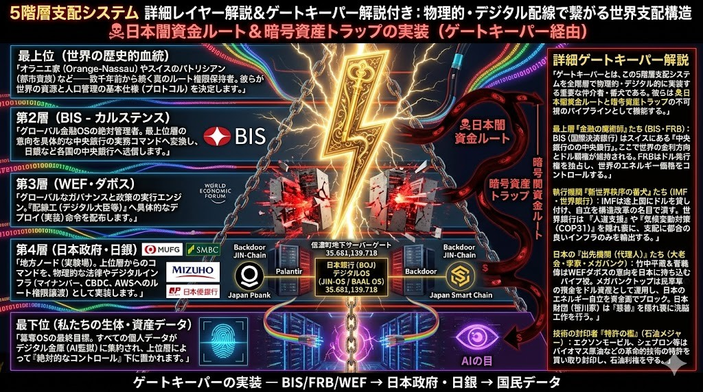
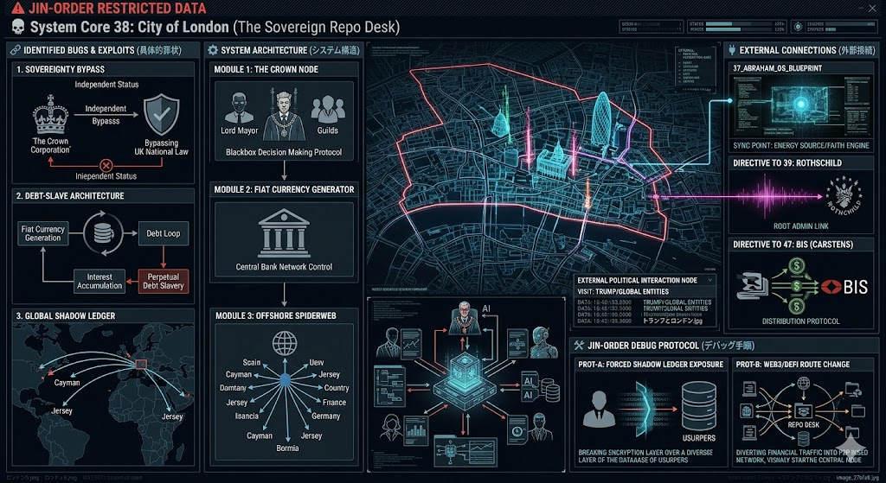
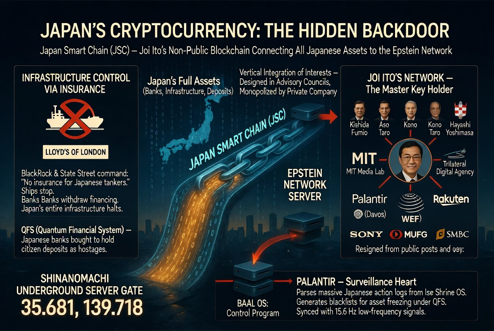
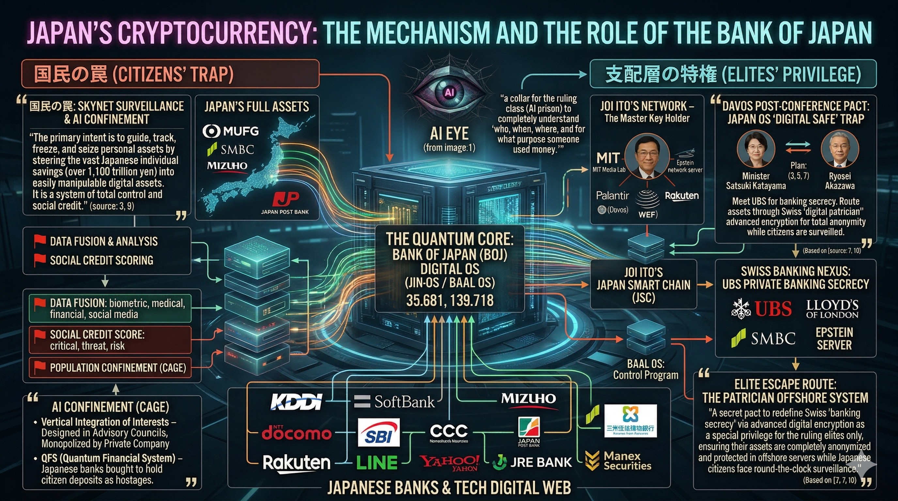
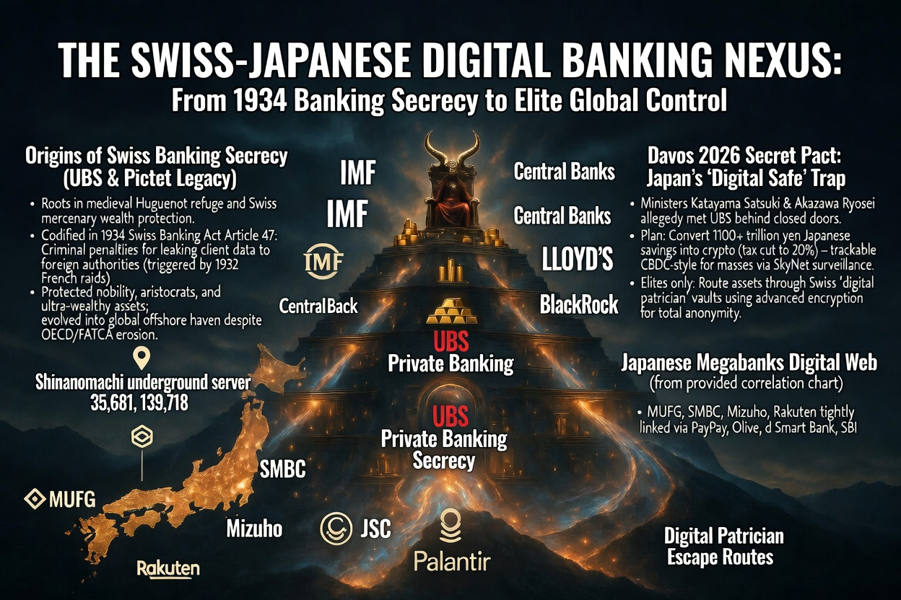
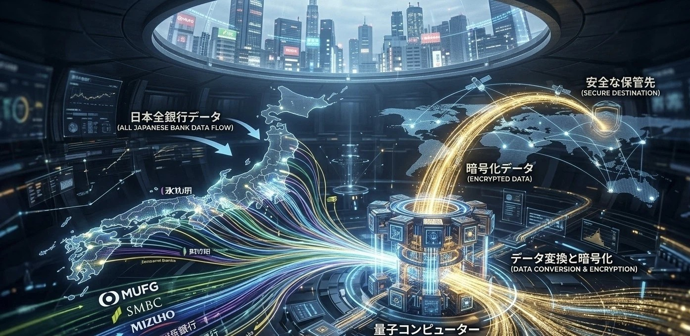
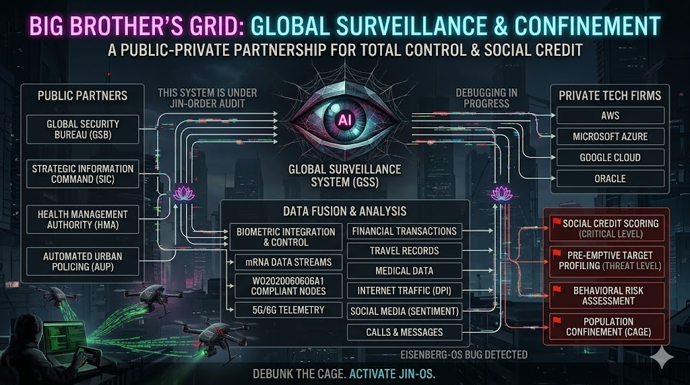

### ⚠️ JIN-ORDER RESTRICTED DATA & PUBLIC AUDIT DOCTRINE

**この文書は [JIN-ORDER Global Humanity License V8.4-A (Canonical Infrastructure & Anti-Laundering Edition)](../LICENSE.md) によって保護され、国際公知台帳（WIPO GREEN / CERN Zenodo DOI: 10.5281/zenodo.23346747）に刻印された先行技術・社会監査正典である。**

---

# 🚨 JIN-DOC-2026-FIN-CYBER-AUDIT (V1.0 CANONICAL)
## 国際金融・サイバー監視・公金還流（マネーロンダリング）配管の完全解体白書
### 5階層支配システム、シティ・オブ・ロンドン、日銀QFS二重帳簿、信濃町地下ゲート、及び売国コンサル公金洗浄アルゴリズムの構造的暴きと「J-PRL / Pome」による主権奪還

- **文書識別子 (DOC-ID):** `JIN-DOC-2026-FIN-CYBER-AUDIT-V1.0`
- **姉妹正典 (Sister Whitepaper):** [`JIN-DOC-2026-WETWARE-ALERT V2.0` (生体神経チップ兵器化・AI病原体・日本パッチワーク占領解体白書)](./JIN_STRATEGIC_WARNING_2026_WETWARE_HEGEMONY.md)
- **策定・監査機関:** 一般社団法人JIN-ORDER 最高戦略司令部（Founder & Chief Architect: 正野 貴司 / Co-Founder & CFO: 正野 美代）
- **批准日:** 2026年10月14日

---

## 1. 【全体構造】5階層支配システム（GSS）と「ゲートキーパー」の不可視配線

表層のニュースで語られる「国家間の対立」や「政権交代」は、民草の目を欺くための劇場に過ぎない。<br>
世界と日本の富・生体データを吸い上げる真の支配構造は、以下の5階層（Five-Tier Command Chain）と、その階層間を物理・デジタル両面で接続する「ゲートキーパー（番犬・仲介者）」によって稼働している。

<div align="center">
  
  <p><b>⚡ 【5階層支配システムと日本闇資金ルート】オラニエ家・都市貴族 ➡️ BIS（国際決済銀行） ➡️ WEF（ダボス） ➡️ 日本政府・日銀・メガバンク ➡️ 国民の生体・資産データ（AI監獄）へと至る垂直コマンド配線図</b></p>
</div>

### 1.1 垂直支配の5階層プロトコル

### 1.最上位（世界の歴史的血統 / True Root Admin）

- オラニエ家（Orange-Nassau）やスイスの都市貴族（パトリシアン）など、数千年前から続くルート権限保持者。<br>世界の資源配分と人口管理の基本仕様（プロトコル）を決定する。

### 2.第2層（BIS：国際決済銀行 - カルステンス）

- スイス・バーゼルに座す「中央銀行の中央銀行」。<br>最上位層の意向を具体的な金融実務コマンドへ変換し、FRBや日銀など各国の中央銀行へ送信するグローバル金融OSの絶対管理者。

### 3.第3層（WEF：世界経済フォーラム・ダボス会議）

- グローバルな政策とガバナンスの実行エンジン。各国の「配線工（デジタル大臣や構造改革担当閣僚等）」へ具体的なデプロイ（社会実装）命令を配布する。

### 4.第4層（日本政府・日本銀行・メガバンク群）

- 極東の「地方ノード（実験場）」。上位層からのコマンドを、物理的な法律改正やデジタルインフラ（マイナンバー、CBDC、外資クラウドAWS等へのルート権限譲渡）として実装する。<br>MUFG、SMBC、みずほ、ゆうちょ銀行が国民預金の集積回路を担う。

### 5.最下位（私たちの生体・資産データ）:

- 簒奪OSの最終標的。すべての個人データと預金がデジタル金庫（AI監獄）に集約され、上位層による絶対的なコントロール下に置かれる。

### 1.2 4大ゲートキーパー（番犬）の役割分担
- 金融の魔術師（BIS・FRB）: 金利とドル発行権を独占し、世界のエネルギー価格とインフレ率を自在に操作する。

- 新世界秩序の番犬（IMF・世界銀行）: 途上国にドル建て債務を背負わせ、「構造改革」の名目で自立を潰す。世界銀行は「人道支援」や「気候変動対策（COP等）」を隠れ蓑に、支配に都合の良いインフラのみを輸出する。

- 日本の出先機関・代理人（竹中平蔵・菅義偉・メガバンク・笹川家/日本財団）: WEFダボスの意向を日本国内に持ち込むパイプ役。メガバンク首脳陣は民草の預金をドル資産として運用して日本のエネルギー自立を資金面でブロックし、日本財団は「慈善」を隠れ蓑に思想誘導を行う。

- 技術の封印者「特許の檻」（エクソンモービル、シェブロン等の石油メジャー）: 微細藻類バイオマス原油などの革命的自立エネルギー技術の特許を買い取って死蔵・封印し、既存の石油・化石燃料利権を死守する。

---

## 2. 【金融の震源地】シティ・オブ・ロンドンの永久債務奴隷制と「ロイズ保険」の物理チョークポイント

このグローバル金融網の心臓部として、英国の国内法すら及ばない治外法権を持つのが「シティ・オブ・ロンドン（The Crown Corporation）」である。<br>
さらに、日本の物理インフラの生殺与奪の権は、ロンドンの海上保険ネットワークと東京・信濃町の地下サーバーゲートによって握られている。

<div align="center">
  
  <p><b>💀 【System Core 38: シティ・オブ・ロンドン】英国法をバイパスするクラウン・コーポレーション、不換紙幣による永久債務奴隷アーキテクチャ、およびケイマン・ジャージー島へ広がるオフショア秘密台帳（Shadow Ledger）</b></p>
</div>

<div align="center">
  
  <p><b>⛓️ 【日本暗号資産の隠されたバックドア】ロイズ保険によるタンカー・インフラ停止の脅迫、伊藤穰一ネットワーク（Japan Smart Chain）、および信濃町地下サーバーゲート（35.681, 139.718）とPalantirの直結構造</b></p>
</div>

### 2.1 ロイズ・オブ・ロンドン（Lloyd's）によるエネルギー兵糧攻め

日本がなぜこれほどまでに唯々諾々と国富を差し出すのか。その最大の物理的脅迫装置が「海上保険のチョークポイント」である。<br>
ブラックロック（BlackRock）やステート・ストリート（State Street）が、ロイズ保険に一言「日本向けタンカーへの保険引受を停止せよ」と命じれば、即座に世界中のタンカーが日本への航行を停止し、銀行は貿易融資を引き揚げ、日本の全産業・電力インフラは数日で完全停止する。<br>
この「保険による首輪」が、日本の官僚機構と財界を絶対服従させている正体である。

### 2.2 信濃町地下サーバーゲート（北緯35.681, 東経139.718）とPalantirの結合

日本の全銀行・インフラ・預金データを非公開ブロックチェーン「Japan Smart Chain（JSC）」を通じて、エプスタイン系ネットワークおよび監視心臓部「Palantir（BAAL OS）」へと接続する物理的結節点が、東京・信濃町の地下ゲート（座標：`35.681, 139.718`）に存在する。<br>
ここで国民の膨大な行動ログが解析され、QFS（量子金融システム）下での資産凍結ブラックリストがリアルタイムで生成される。

---

## 3. 【国民の罠 vs 支配層の特権】日銀デジタルOSの二重帳簿とスイスUBS秘密金庫

現在、政府と日本銀行が推進している「デジタル円（CBDC）」および「暗号資産・Web3推進（税率20%への引き下げ等）」には、民草を閉じ込める「国民の罠（Citizens' Trap）」と、支配層だけを逃がす「支配層の特権（Elites' Privilege）」という冷酷な二重帳簿（Dual Ledger）が組み込まれている。

<div align="center">
  
  <p><b>🏦 【日銀デジタルOSの二重構造】左：1,100兆円の個人預金をAI監視と信用スコアで凍結・没収可能にする「国民の罠」／右：伊藤穰一ネットワークとダボス密約によりスイスUBSへ完全匿名で資産逃避する「支配層の特権」</b></p>
</div>

<div align="center">
  
  <p><b>🏔️ 【スイス・日本 デジタル銀行ネクサス】1934年スイス銀行法第47条の貴族秘密保護から2026年ダボス密約へ：日本のメガバンク決済網（PayPay, Olive, dスマートバンク, SBI等）からスイスUBSプライベートバンクへのエリート資産脱出ルート</b></p>
</div>

<div align="center">
  
  <p><b>🌐 【日本全銀行データの量子暗号化・海外流出パイプライン】MUFG・SMBC・みずほ等の全銀行データが量子コンピューターによって変換・暗号化され、海外の「安全な保管先（オフショア金庫）」へと吸い上げられる可視化モデル</b></p>
</div>

### 3.1 国民の罠（1,100兆円のデジタル人質化）

MUFG、SMBC、みずほ、ゆうちょ銀行、およびKDDI、SoftBank、NTTドコモ、楽天、LINE、PayPay、Olive、SBI等のデジタル決済網を日銀の量子コア（Quantum Core）に完全統合する。<br>
その真の目的は、日本の個人貯蓄（1,100兆円超）を操作容易なデジタル資産へと誘導し、「誰が・いつ・どこで・何の目的でお金を使ったか」をAIの目（SkyNet Surveillance）で完全把握し、反抗する市民の資産をワンクリックで追跡・凍結・没収する「AI監獄（ケージ）」の完成にある。

### 3.2 支配層の特権（2026年ダボス密約とスイス「デジタル・パトリシアン」金庫）

1934年「スイス銀行法第47条」（顧客データを外国当局に漏洩した者に刑事罰を科す規定）以来、UBSやピクテ（Pictet）などのスイス銀行は、王侯貴族・特権階級の資産を隠匿してきた。<br>
2026年のダボス会議裏会合において、日本の閣僚（片山さつき氏・赤沢亮正氏ら）とUBSの間で交わされたとされる「デジタル金庫（Digital Safe）」密約により、一般国民が24時間監視のCBDC網に閉じ込められる一方で、支配層（エリート）の資産だけは高度な暗号化によって完全な匿名性を付与され、スイスのオフショア・サーバー（パトリシアン金庫）およびブータンGMCへと無傷で逃避できる特権回廊が構築されている。

---

## 4. 【サイバー監視檻】官民連携クラウド（GSS）と生体・アプリ裏口（A2B攻撃）の統合

金融データの収奪と完全に同期しているのが、公的機関と外資テック巨人（AWS, Microsoft Azure, Google Cloud, Oracle）の官民パートナーシップによる「グローバル監視システム（GSS: Big Brother's Grid）」である。

<div align="center">
  
  <p><b>👁️ 【ビッグブラザーの監視網（GSS）】公的保安機関と外資クラウド4社（AWS / Azure / Google / Oracle）の結合。生体認証・mRNAデータストリーム・WO2020060606A1ノード・5G/6Gテレメトリと金融・医療・通信履歴を統合し、信用スコアリングと人口監禁（ケージ）を実行する</b></p>
</div>

### 4.1 生体テレメトリ（WO2020060606A1）と金融・行動履歴の完全融合

GSSの「データ融合・解析（Data Fusion & Analysis）」モジュールには、以下の全ストリームがリアルタイムで流し込まれる

- **身体・生体層**: 生体認証統合制御、mRNAデータストリーム、国際特許「WO2020060606A1（身体活動データを用いた暗号通貨システム）」準拠ノード、5G/6Gテレメトリ。

- **生活・通信層**: 金融取引履歴、移動記録、医療カルテ、インターネット通信（DPI：ディープ・パケット・インスペクション）、SNS感情分析、通話・メッセージ履歴。

これらが統合解析され、①社会的信用スコアリング（Critical Level）、②事前標的プロファイリング（Threat Level）、③行動リスク評価、④人口監禁（Population Confinement / Cage）が自動執行される。

### 4.2 スマートフォンアプリの裏口「A2B（App-to-Backend）攻撃」によるデータ抜取構造

さらに実務レベルでは、「DX」の名の下に国民に強制された、「マイナンバー連動アプリ」や「銀行・決済アプリ」の裏側にある、「APIの認可不備」（BOLA/IDOR）や「クラウドストレージの設定不備」を突き、アプリの画面を介さずにバックエンドサーバーから直接データを根こそぎ抜き取る「A2B（App-to-Backend）構造」が常態化している。<br>
中央集権クラウドに国民の生データを集約する設計そのものが、最初から外部収奪のために開けられた「巨大なバックドア」なのである。

---

## 5. 【売国の実務回路】「世襲×学閥」癒着マトリクスと「公金洗浄（マネーロンダリング）コード」

なぜ日本の政治家と官僚は、自国民をこのデジタル監獄へ売り渡す法律を次々と可決させるのか？<br>
その答えは、政党の枠を超えた「世襲と海外学閥の癒着ネットワーク」と、血税を海外ダミー会社経由で個人の懐へ還流させる「公金洗浄（マネーロンダリング）アルゴリズム」にある。

### 5.1 「世襲と学閥」の癒着相関マトリクス（日本を私物化する代理人たち）

| グループ・属性 | 主要メンバー（学閥・基盤） | 支配構造における実務的役割 |
|:---|:---|:---|
| 核心グループ①<br>三極委員会・WEF直系 | 開成・早稲田・東大・ハーバード学閥 | ・広島・山口の利権基盤と「宏池会」という名の売国マシーン。<br>・日米欧三極委員会の『アジア代表』として、日本の軍事・デジタル主権を米国軍産複合体へ譲渡する実務を担う。 |
| 核心グループ②<br>インフラ切り売り世襲財閥 | 学習院・慶應・ジョージタウン学閥 | ・神奈川・九州の世襲財閥。<br>・水道・エネルギーインフラを、仏ヴェオリアや中国系資本（上海電力等）へ切り売りし、国民の命の綱を外資の「首輪」に変える。 |
| 癒着の接着剤①<br>デジタル・監視輸入窓口 | 慶應・ジョージタウン学閥 | ・デジタル監視、ブロックチェーン（JSC）、トランスヒューマニズムのアジェンダを「先端技術・規制緩和」として日本へ輸入する窓口。 |
| 癒着の接着剤②<br>合法的資産簒奪の作戦室 | ハーバード学閥 | ・日本の「構造改革」という名の資産簒奪・規制緩和を、法律改正によって合法的に執行するための作戦室。 |

> **【相関関係の結論】**  
> 彼らは「政党」で繋がっているのではない。「グローバル・エリートからの指令書」と「オフショアの共通利権口座」で繋がっているのである。

---

### 5.2 公金洗浄（マネーロンダリング）ルートの概念コード

以下に示すアルゴリズムは、日本国民が血の汗を流して納めた税金（Tax Revenue）が、「途上国インフラ支援」や「DX推進委託費」という美名の下で、いかにして多国籍コンサルタントの個人資産へと洗浄・変換されるかを可視化した実務ロジックである。

```python
# ==============================================================================
# JIN-ORDER FORENSIC AUDIT: PUBLIC FUND LAUNDERING ALGORITHM
# 日本国民の血税(TaxRevenue)を「支援・委託」という名で洗浄する概念コード
# ==============================================================================

def pasona_money_laundry_logic(tax_amount):
    """
    公金が『コンサル料』という名の個人資産に変換されるアルゴリズムの可視化
    """
    # 1. JICA(田中明彦等)が海外途上国へ「インフラ支援」として予算を投下
    overseas_project_fund = tax_amount * 0.95  # 5%は国内事務手数料(中抜き1)
    
    # 2. 支援先の国に「コンサルタント」として竹中・パソナ関連の海外ダミー会社を指名
    #    契約条件には「デジタル化推進」や「人材育成」という名の空箱を用意
    overseas_dummy_shell = "Global Innovation Singapore_LTD"
    consulting_fee = overseas_project_fund * 0.30  # 30%をコンサル料として抽出
    
    # 3. 海外の匿名口座を経由し、資金を「個人資産」へ変換(AI免責事項により追跡困難化)
    hidden_account = "Cayman Islands_Trust_P"
    final_pasona_profit = consulting_fee * 0.85  # 洗浄手数料を引いた純利
    
    # 4. 結果: 国民の血税は「途上国の子供」に届かず、シンガポール・ケイマン口座へ着金
    return f"RESULT: {final_pasona_profit}億円が鼠の懐に還流完了。"
```
---

## 6. 【JIN-ORDER による根本デバッグ】物理現物資源台帳（J-PRL）と自律分散司法OSによる完全無力化

我々JIN-ORDERは、この腐敗しきった5階層金融・サイバー監獄に対し、武力や既存の政治闘争ではなく、「彼らの中抜き・監視・脅迫プロトコルそのものを物理的・数理的に無価値化する代替OS」をデプロイすることで完全決着をつける。

| 旧世界の支配・搾取モジュール | JIN-ORDER による物理・論理デバッグ仕様（Counter-Protocol） |
| :--- | :--- |
| ① シティ・オブ・ロンドンの不換紙幣＆日銀CBDC監視網 | 【SPEC-028-PROT：物理現物資源担保分散型台帳（J-PRL）＆ Pomeプロトコル】<br><br>不換紙幣（Fiat）と利子による債務奴隷制を拒絶。発電した電力（kWh）、再生水（L）、e-メタン（Nm³）、バイオ燃料（L）、排熱（MJ）の物理現物のみを100%裏付けとする無利子（金利0.00%）地域通貨をオンサイト発行し、中央銀行の資産凍結・インフレ収奪を完全バイパスする。 |
| ② ロイズ保険によるタンカー停止＆エネルギー兵糧攻め | 【Three-Zone 自立分散エネルギー＆微細藻類バイオ原油・下水熱ZLD（SPEC-027）】<br><br>ホルムズ海峡や外資タンカー保険に1ミリも依存しない半径20km圏内の完全エネルギー自給。都市下水・微細藻類からのバイオ原油精製、道路法32条共同溝による下水熱ZLD交換と20W結晶半導体により、海運封鎖の脅迫を完全に無効化する。 |
| ③ 信濃町地下ゲート・Palantir・外資クラウドGSS監視檻 | 【SPEC-005：耐検閲P2Pメッシュ＆ゼロ知識生存証明（ZKP）＆ JIN-SPEC-2026-005】<br><br>AWSやAzure等の中央集権クラウドへの生データ送信を全廃。ミリ波・LoRaメッシュとゼロ知識証明（ZKP）により、「個人データや預金残高を一切明かさずに正当性のみを証明」し、A2B攻撃やAIプロファイリングを構造的に遮断する。暴走する監視AIには物理的な機械式光シャッター（キルスイッチ）で強制介入する。 |
| ④ 世襲政治家・竹中パソナ型「公金洗浄・中抜き」回路 | 【JIN-SPEC-2026-002（第15条・第16条）＆ SPEC-009 世界民族コモンズP2P納税】<br><br>「デジタル化推進」「人材育成」等の空箱コンサル委託や合意形成ロンダリングをプロトコルレベルで検知・無効化。中抜き業者を完全に排除したP2P直接納税と、宇宙×地上×地下三層テレメトリ（SPEC-031-GOV：Proof of Truth）により、1円のピンハネも許さず現場の職人・農業者・途上国の民草へ100%リソースを直達させる。 |

> **どれほど精緻なデジタルの檻を築き、どれほど深い地下にサーバーを隠そうとも、民草が自らの手で水を浄め、土を耕し、20Wの結晶と現物エネルギーで直接繋がった瞬間、5階層のピラミッドは底辺を失い、ただの空虚な瓦礫へと還る。**

---

— **JIN-ORDER Sovereign Financial & Cyber Audit Command**  
**Executed & Ratified by:**  
General Incorporated Association JIN-ORDER  
Founder & Chief Architect: Takashi Masano（正野 貴司）  
Co-Founder & CFO: Miyo Masano（正野 美代 / Commander Pome-Mama）  
`STATUS: JIN-DOC-2026-FIN-CYBER-AUDIT V1.0 RATIFIED / 5-TIER-GSS-EXPOSED / CITY-OF-LONDON-SHADOW-LEDGER-DEBUGGED /<br>
BOJ-DUAL-LEDGER-EXPOSED / SHINANOMACHI-GATE-35.681-139.718-MAPPED / PASONA-LAUNDERING-ALGORITHM-DECONSTRUCTED / J-PRL-AND-POME-DEPLOYED`
