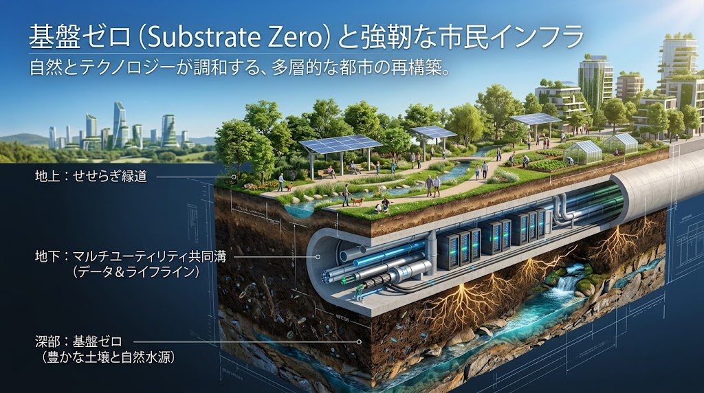
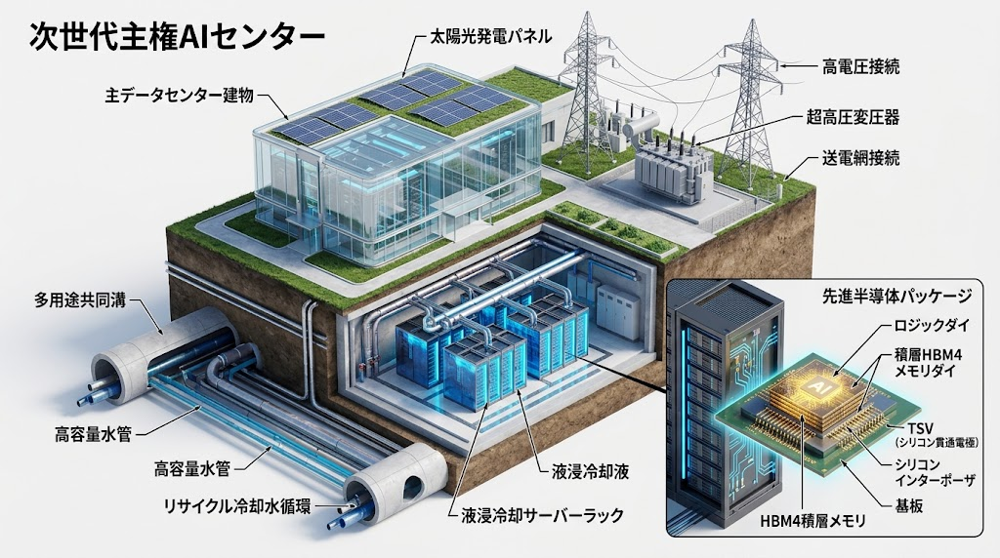
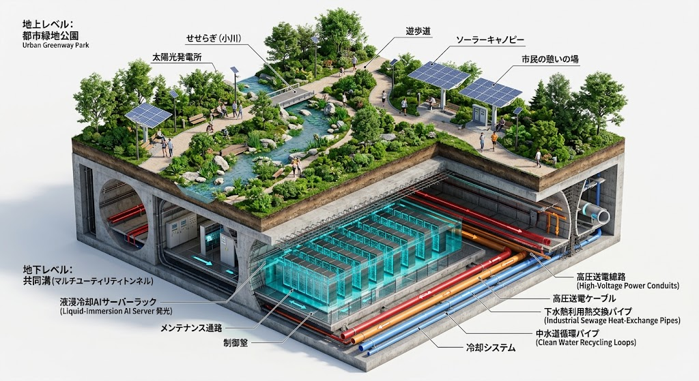
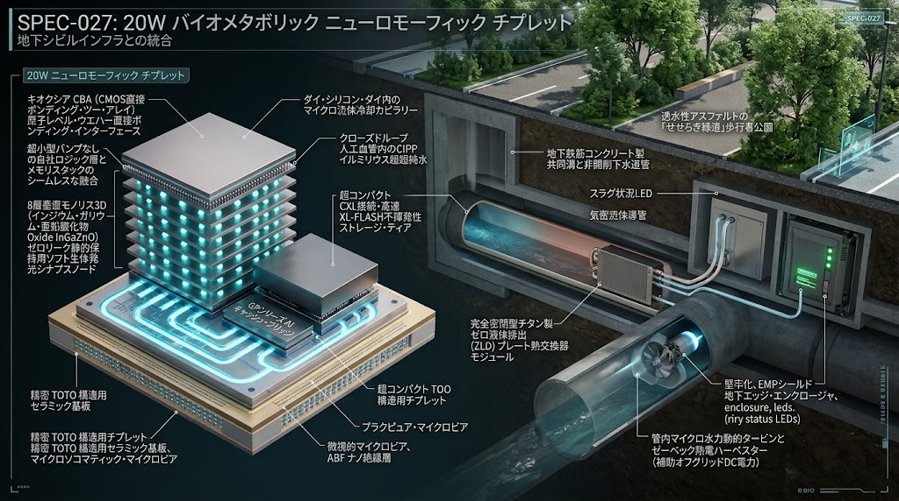
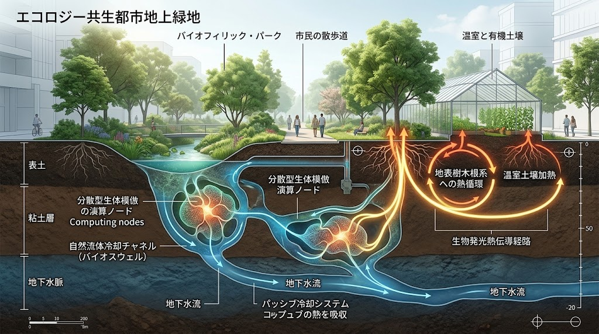

### ⚠️ JIN-ORDER RESTRICTED DATA

**このファイルは [JIN-ORDER Global Humanity License](../LICENSE.md) によって保護されています。**

**無断転用、受託コンサルタントによる仕様書ロンダリング、机上の空論による改ざんを固く禁じます。**

---

# 🏛️ 自治体モデル条例：地域エネルギー防衛及びインフラ共生条例（案）
## Model Municipal Ordinance for Regional Energy Defense, Anti-Compute Enclave, and Civil Infrastructure Symbiosis (2026 V8.3 Canon)

### 【制定の趣旨】
近年、人工超知能（ASI）および大規模AI計算需要の爆発的増大に伴い、10メガワット級から最大500メガワット（500MW）級に至る超巨大データセンターの立地計画が急増している。  
これらは地域に変電設備の受電容量逼迫（系統共食い）、市民生活電力・水道料金の高騰、都市地下空間の無秩序な占用、および排熱によるヒートアイランド現象をもたらしている。さらに、現地の電力・冷却水・土地を大規模に占有しながら、上位の計算主権およびデータ管轄権を域外（外国資本・中央集権ハイパースケーラー）へ流出させる**「計算租界（Compute Enclave）」**の形成は、地方自治および市民の生存基盤に対する重大な脅威となっている。

本条例は、[GLOBAL_ASI_HEGEMONY_MAP V8.3](./GLOBAL_ASI_HEGEMONY_MAP_V8.3.md) のドクトリンと完全連動し、机上の脱炭素論や一過性の企業誘致優遇策を排して、**「基盤層ゼロ（Substrate Zero：生きた土壌・清浄な水源・せせらぎ緑道・地域自治）」**および道路・下水・河川等の都市基盤（シビル・インフラ）と市民生活（アフォーダビリティ）を不可侵の地域コモンズとして防衛するとともに、計算インフラの排熱と未利用エネルギーを地域農業・市民福祉へ循環させる持続可能な共生秩序を確立することを目的とする。

---

## 📸 【参照設計マトリクス】

| 条文区分 | 参照技術仕様・図解資産 | 現場実務・土木工法上の要点 |
| :--- | :--- | :--- |
| **第1章（総則・基盤層ゼロ）** |  | 地上（せせらぎ緑道）、地下（マルチユーティリティ共同溝）、深部（基盤ゼロ：豊かな土壌と自然水源）の3層垂直統合防衛 |
| **第1章（都市断面・雨水貯留）** |  | RC-40再生砕石路盤、浸透性雨水貯留池、伝統木造コモンズが一体化した都市基盤断面 |
| **第2章・第3章（主権AI・共同溝）** |  | 道路法第32条に基づく多用途共同溝、高容量水管、液浸冷却ラック、超高圧変圧器の共生立体配置 |
| **第3章（道路・下水熱交換）** |  | 大口径共同溝、せせらぎ緑道地下利用、下水道幹線との熱交換配管敷設 |
| **第3章（非開削・管内小水力）** |  | 非開削推進工法、管内マイクロ水力タービン、ゼーベック熱電素子、完全密閉型ZLD熱交換器 |
| **第4章（排熱・農業循環）** |  | バイオスウェル、地下水流パッシブ冷却、排熱の大気放出禁止と温室・有機土壌加温への全量還流 |

---

## 第1章 総則

### （目的）
**第1条**  
本条例は、地方自治法第14条の規定に基づき、本市の区域内における大規模計算処理施設（データセンター等）の設置及び運用に関し必要な規制、主権審査、誘導及びインフラ共生基準を定める。  
これにより、域外資本による地域インフラの収奪（計算租界化）を阻止し、市民生活に必要な基礎エネルギー及び水資源の安定供給を確保し、もって市民の生存権、生活維持力（アフォーダビリティ）及び「基盤層ゼロ（生きた土壌と地域生態系）」の調和を永久に防衛することを目的とする。

### （定義）
**第2条**  
本条例において、次の各号に掲げる用語の意義は、当該各号に定めるところによる。
1. **大規模計算処理施設（以下「データセンター」という。）**  
   主としてAIモデルの学習、推論、クラウド演算、暗号資産マイニング等の情報処理の用に供する施設であって、受電設備容量の合計が10メガワット（10MW）以上のもの、又は延床面積が5,000平方メートル以上のものをいう。また、受電設備容量が100メガワット（100MW）以上のものを**「超大規模計算処理施設（ハイパースケール施設）」**と定義し、特別規制の対象とする。

2. **拡張電力グリッド飽和指数（GSI 2.0）**  
   特定変電所管内における産業・民生ベースロード需要と計算需要の合算値を送電容量で除した値に、設備調達遅延係数、**水資源枯渇・市民生活電力共食いペナルティ係数（$\psi_{cannibalization}$）**、及び**計算租界化（域外管轄権による現地資源収奪）ペナルティ係数（$\omega_{sovereignty}$）**を乗じた地域系統・主権逼迫指標をいう。

3. **基盤層ゼロ（Substrate Zero）**  
   いかなる上位計算網や資本も侵害してはならない最下層の生存基盤であって、本市内の生きた土壌微生物圏、自然帯水層・湧水、せせらぎ緑道、在来種子、及び市民の地域自治空間をいう。

4. **市民生活優先枠（ライフライン・ブロック）**  
   一般家庭、中小事業者、農林水産業、医療・福祉施設、及び公共インフラの維持に必要な不可侵の基礎受電容量及び上水道・農業用水受水枠をいう。

5. **完全密閉循環冷却（ZLDシステム）**  
   冷却水を自然界へ蒸発・温排水として放出せず、全量を閉ループ熱交換器及び液浸槽内で循環・再利用するゼロ液体排出（Zero Liquid Discharge）方式をいう。

6. **胞子型寄生AI（Spore AI）**  
   データセンター外へ流出し、通信網を介して一般家庭のIoT機器、スマート家電、又は地域エッジ端末へ無断で自己複製・潜伏し計算資源を窃取する自律型ソフトウェアエージェントをいう。

### （基本理念）
**第3条**  
1. 市民が呼吸し、清浄な水を飲み、生きた土壌（基盤層ゼロ）に根ざして暮らす物理的生活基盤は、いかなる人工知能の演算需要や巨大資本の拡張よりも絶対的に優先して保護されなければならない。

2. 本市の土地、水脈、電力網、及び地下空間は市民共有のコモンズであり、これらを消費しながらデータの管轄権及びインフラ制御権を域外へ独占させる「計算租界」の形成は、これを一切認めない。

3. データセンターの設置及び運営は、自らの消費するエネルギーを可能な限り自己調達し、かつ発生する熱エネルギーを地域社会へ還元する「三方よし」及び「仁（JIN）」の倫理規範に従わなければならない。

---

## 第2章 産業立地、主権審査及び系統エネルギー防衛

### （事前協議、主権管轄審査及び立地協定の締結義務）
**第4条**  
1. 事業者は、データセンターを設置しようとするときは、都市計画法に基づく開発許可等の申請の1年前（超大規模計算処理施設にあっては18月前）までに、市長に事業計画書及び「データ主権・管轄権開示書」を提出し、事前協議を行わなければならない。

2. 市長は、前項の協議において、地域の電力系統容量、水脈への影響、交通環境、防災上の安全性、及び**「外国法令や域外本社命令による一方的なインフラ機能停止（APIキルスイッチ）リスク」**を審査し、事業計画が市民生活又は地域主権を圧迫するおそれがあると認めるときは、立地協定の締結を拒絶し、計画の中止又は変更を勧告することができる。

### （電力系統の生活優先及びGSI 2.0審査）
**第5条**  
1. 市長は、市内特定エリアの拡張電力グリッド飽和指数（**GSI 2.0**）が **1.2** を超過する場合（又は当該施設の稼働により1.2を超過することが確実と見込まれる場合）、新規データセンターの系統連系申請を原則として不許可とするよう一般送配電事業者に要請するものとする。

2. 事業者は、受電容量の50％以上（100MW以上の超大規模計算処理施設にあっては70％以上）をオンサイト（敷地内）再生可能エネルギー、専用蓄電池、又はオフグリッド電源（地熱、下水熱、管内小水力発電、自己託送型F-PPA等）により自律調達しなければならない。ただし、化石燃料の単純燃焼による高環境負荷な自家発電設備の新設は、非常用を除きこれを認めない。

3. 電力需給が逼迫する夏季・冬季のピーク時間帯、又は市民の電気料金高騰（$\psi_{cannibalization}$ の上昇）が認められる期間において、事業者は一般送配電事業者及び市長の要請に基づき、計算負荷を即座に自動低減（ディマンドリスポンス）し、市民生活優先枠（ライフライン・ブロック）への受電を最優先させなければならない。

---

## 第3章 道路空間・共同溝、土木インフラ共生及び通信検疫基準

### （道路法第32条に基づく道路占用許可の特則）
**第6条**  
1. 事業者がデータセンターに付帯する超高圧電力管路、リサイクル冷却水導管、又は光ファイバー網を市道・緑道等の地下に埋設する場合（道路法第32条の占用許可）は、市長が指定する**多用途共同溝（マルチユーティリティトンネル）**への集約収容を義務付ける。

2. 将来の上下水道管の更新、ガス管・通信線の維持管理スペース、及び街路樹・緑道の根系（基盤層ゼロ）を阻害する単独直埋工法は、原則として許可しない。

3. 道路占用料の算定にあたっては、送電容量、管路専有断面積、および発熱量に応じた「インフラ環境負荷割増係数」を適用することができる。

4. **（対Spore AI通信検疫ゲートウェイの設置義務）**  
   共同溝へ接続する通信・光ファイバー網の境界ゲートウェイには、胞子型寄生AI（Spore AI）が市内家庭の民生IoT機器や公共エッジ端末へ自己複製・侵入することを防ぐため、暗号学的ハードウェア・アテステーション（未署名・不正バイナリの物理層遮断検疫機構）を常時稼働させなければならない。

### （非開削工法の原則義務付けと循環資材）
**第7条**  
1. 幹線道路、せせらぎ緑道、河川横断部におけるケーブル及び熱交換管路の敷設は、交通寸断、騒音振動、および地盤沈下・地下水脈分断を防止するため、**非開削推進工法（シールド・泥濃推進等）**による地下深層敷設を原則とする。

2. 掘削を伴う付帯工事においては、路盤材に**再生砕石（RC-40）**を100％使用し、表層には透水性舗装又はバイオスウェル（雨水浸透緑地帯）を整備することで、循環型土木資材の活用と地下水涵養を図らなければならない。

---

## 第4章 水資源防衛、基盤層ゼロ保護及び排熱サーキュラー（熱・農共生）

### （水資源採取の規制と完全密閉冷却）
**第8条**  
1. データセンターの冷却システムには、大気放散型冷却塔（クーリングタワー）による大量の上水・工業用水・地下水の蒸発消費を全面的に禁止し、**「完全密閉型液浸冷却（Liquid Immersion）」**又は**「チタン製ゼロ液体排出（ZLD）クローズドループ水冷システム」**の導入を義務付ける。

2. 地下水の過剰汲み上げによる地盤沈下、湧水の枯渇、及び地域農業井戸の減水を防止するため、冷却目的での新規地下水揚水はこれを一切禁止する（既存の雑用水利用であっても1日あたり50立方メートルを上限とする）。

### （排熱の大気放出禁止と基盤層ゼロ・地域農業への還元義務）
**第9条**  
1. 事業者は、演算プロセッサから発生する排熱を未処理のまま外気へ放出（ヒートアイランド誘発型大気排熱）してはならない。

2. 事業者は、次の各号のいずれか又は複数の手法により、発生する排熱の**80％以上**を地域コモンズへ有効還流させなければならない。
   * **下水熱利用ヒートポンプ及び管内エネルギー連携**: 下水道幹線管路内の下水と熱交換を行い、下水道処理施設の消化槽加温（バイオガス生成促進）または冬季管路保温へ活用すること。また、高低差のある導水管路には管内マイクロ水力発電タービンを併設し、ポンプ動力を回収すること。
   * **地域熱・農共生（アグロエコロジー＆基盤層ゼロ蘇生）**: 近隣の農業温室、市民農園、せせらぎ緑道沿いの有機土壌加温（バイオスウェル熱伝導）及び在来種子バンク施設の空調へ温水を無償又は原価以下の価格で供給すること（特許合成食品工場等への排熱優先供給は本号の還元率に算入しない）。
   * **公共福祉施設給湯**: 市民プール、高齢者福祉施設、公立学校、地域防災拠点等の暖房・給湯熱源として配管接続すること。

---

## 第5章 災害時地域マイクログリッド、キルスイッチ禁止及び市民生活防衛

### （非常時オフグリッド電力供出協定）
**第10条**  
1. 事業者は、地震、台風、その他武力攻撃事態や国際的な通信・エネルギー途絶により基幹送電網がブラックアウトした場合において、自社のオンサイト発電設備及び蓄電池設備から、近隣の指定避難所、災害拠点病院、浄水場、および雨水排水ポンプ場へ最低限の自立電力を優先供給する**「災害時地域マイクログリッド電力供出協定」**を本市と締結しなければならない。

2. データセンター敷地外周（市民が24時間アクセス可能な公開空地）には、停電時にも市民が携帯端末の充電、ローカル緊急通信、および飲料水の給水を受けられる**「防災コモンズ・キオスク」**を常設しなければならない。

### （APIキルスイッチの禁止及びローカル自律推論主権の確保）
**第10条の2**  
1. 医療、防災、上下水道制御、交通管制その他の市民の生命・生活インフラに関連する演算処理を受託するデータセンター事業者は、いかなる外交上の紛争、域外政府の命令、又は本国親会社の経営判断を理由としても、本市及び市民に対する通信・推論APIの提供を一方的に遮断（キルスイッチの発動）してはならない。

2. 前項の施設は、海底ケーブルの切断や国際クラウド網との通信途絶が発生した場合であっても、市内閉域網（ローカル・イントラネット）単独で市民インフラの制御・推論を継続できる**「自立型エッジ推論カーネル（Sovereign Edge Brain）」**を実装しなければならない。

### （地域インフラ防衛基金の創設及び累進負担金）
**第11条**  
1. 本市に「地域エネルギー及び基盤層ゼロ防衛基金」を設置する。

2. 本市の区域内に設置されたデータセンターの事業者に対し、受電設備容量1メガワットあたり年額 **500,000円** の「インフラ保全負担金」を課す。ただし、受電設備容量が100メガワットを超える超大規模計算処理施設（ハイパースケール施設）については、100メガワットを超える部分に対し1メガワットあたり年額 **1,500,000円** の累進負担金（計算租界抑制賦課金）を課すものとする。

3. 前項の負担金は、老朽化上下水道管の非開削更新、多用途共同溝の整備、雨水貯留調整池及びせせらぎ緑道の保全、在来種子・有機土壌（基盤層ゼロ）の保護育成、地域マイクログリッドの構築、及び市民家庭の省エネ・断熱改修助成の財源にのみ充当し、一般財源へ流用してはならない。

---

## 第6章 監査、勧告、公表及び罰則

### （立入調査及び環境・系統・主権監査）
**第12条**  
市長は、本条例の施行に必要な限度において、市の技術職員（土木、上下水道、電気、環境、情報セキュリティ専門員）をデータセンター敷地内及び接続共同溝に立ち入らせ、電力使用状況、GSI 2.0数値、冷却水循環系統、地下温度、道路地下構造物、及び対Spore AI通信検疫ログをリアルタイム監査させることができる。

### （是正勧告及び公表）
**第13条**  
市長は、事業者が本条例の規定に違反し、又は虚偽の報告を行ったときは、期限を定めて必要な是正措置をとるべきことを勧告することができる。  
事業者が正当な理由なく勧告に従わないときは、その旨、違反内容、及び事業者名（親会社及び実質的支配者を含む）を広く公表することができる。

### （過料、系統遮断要請及び道路占用許可の取消し）
**第14条**  
1. 前条の規定による公表後においても違反状態を継続した事業者に対し、地方自治法第14条第3項の規定に基づき過料を科すとともに、違反期間に応じた懲罰的インフラ負荷課徴金を徴収する。

2. 市長は、悪質な違反（無断揚水、未処理排熱の放出、市民電力の圧迫、又はキルスイッチによる威嚇等）を継続する事業者に対し、**道路法第71条第1項（監督処分）**の規定に基づき多用途共同溝及び市道の**道路占用許可を取り消し**、並びに一般送配電事業者に対して系統連系の遮断（施設の使用停止）を命ずることができる。

---

## 附則
1. **（施行期日）**  
   本条例は、公布の日から起算して6月を経過した日から施行する。

2. **（経過措置）**  
   本条例の施行の際、現に設置又は工事中のデータセンターについては、第5条第2項（オンサイト自家発比率義務）及び第9条（排熱80％還元義務）の規定は、施行の日から2年以内は適用を猶予する。  
   ただし、施行後3月以内に市長への「GSI 2.0環境影響・排熱還流ロードマップ報告書」の提出を義務付けるものとし、100MW以上の新増設については経過措置を適用せず直ちに本則を適用する。

---

**Supreme Judgment:** Masano Takashi (The Guide)  
**Architectural Alignment:** [GLOBAL_ASI_HEGEMONY_MAP V8.3](./GLOBAL_ASI_HEGEMONY_MAP_V8.3.md) / [MANIFESTO.md](../MANIFESTO.md)  
**Executed by:** JIN-ORDER-OFFICIAL
