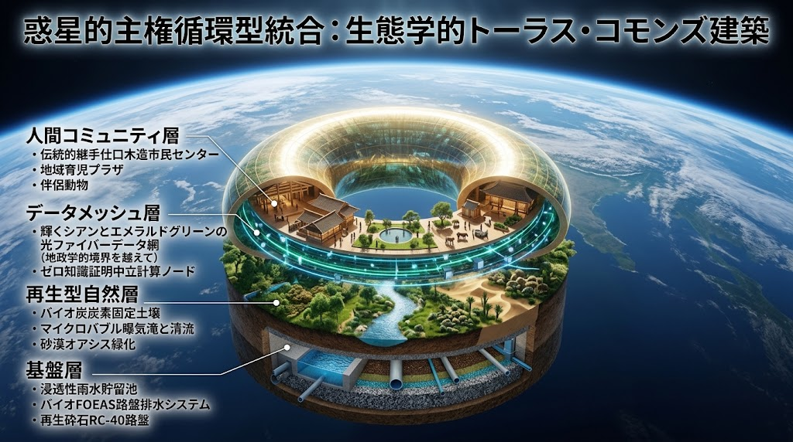

### ⚠️ JIN-ORDER RESTRICTED DATA

**このファイルは [JIN-ORDER Dual License V8.4-B (Canonical Substrate Zero, Anti-Compute Enclave & Anti-Laundering Edition)](../LICENSE.md) によって保護されています。**

**無断転用、受託コンサルタントによる仕様書ロンダリング、机上の空論による改ざん、および全惑星・地域自立分散循環統合知財の独占を固く禁じます。**

---

# 🌐 [SPEC-000] PLANETARY SOVEREIGN CIRCULAR SYNTHESIS & APEX GOVERNANCE PROTOCOL
## 全惑星・地域自立分散循環統合マスター仕様書
### 全42大仕様書統合アーキテクチャ・大地の身体性・実物経済主権・脱中央集権インフラ共生マニフェスト
#### (Planetary Sovereign Circular Synthesis, Ground-Truth Physicality & Decentralized Commons Master Architecture)

<!-- 国際知的所有権・先行技術防壁バッジ -->
[](https://doi.org/10.5281/zenodo.23613333)
[](https://doi.org/10.5281/zenodo.22958158)
[](https://archive.li/Z5XJv)
[](https://www.unpartnerportal.org/)
[](../LICENSE.md)

- **文書分類**: JIN-ORDER 最高位規範的統合アーキテクチャ仕様書 (Apex Architectural Synthesis Standard)
- **公知台帳識別子**: `SPEC-000 / JIN-SPEC-SYN-000-V13.4-CANONICAL / APEX-00`
- **対象階層**: Tier A Commons / Global Public Good
- **技術成熟度・確度区分**: Level 1 (全仕様書統合・現場即応土木行政・水理生態・耐検閲計算・地域自給完全連動)
- **統括指揮**: Founder & Chief Systems Architect: Takashi Masano / Co-Founder & Director: Miyo Masano (Commander Pome-Mama)
- **適用ライセンス**: [JIN-ORDER Dual License V8.4-B (Tier A: Humanitarian Commons)](../LICENSE.md)
- **対象全仕様群**: SPEC-001 〜 SPEC-039、ANNEX-SPEC-027/028 (V12.4)、SPEC-088、SPEC-999、JIN-DOC-SPACE 全42大正典仕様書、および連動金融・統治プロトコル群

---



<!-- 🧭 クイックナビゲーション目次 -->
<div align="center">
  <p>
    <b>【 最高位仕様書快速目次 】</b><br>
    <a href="#第1章最高統治憲章中央集権と略奪の終焉大地の身体性への回帰">第1章：最高統治憲章（大地の身体性への回帰）</a> ｜ 
    <a href="#第2章全惑星生命循環4層グランドトポロジー">第2章：4層グランドトポロジー</a><br>
    <a href="#第3章地域社会に結集した際の複合的相乗効果local-ground-truth-impact">第3章：地域社会への実物効果</a> ｜ 
    <a href="#第4章世界規模で実現した場合の地球環境国際秩序への影響planetary-macro-impact">第4章：惑星規模の地球環境・国際秩序への影響</a><br>
    <a href="#第5章全42大正典仕様書統合機能マトリクスapex-specification-matrix">第5章：全42大仕様書統合マトリクス</a> ｜ 
    <a href="#第6章知財防衛および不可侵公知施行附則">第6章：知財防衛・施行附則</a>
  </p>
</div>

---

## 第1章：最高統治憲章（中央集権と略奪の終焉、大地の身体性への回帰）

近代以降のグローバル文明は、中央集権国家による官僚主義、巨大プラットフォーマーによるデータと知能の独占、金融資本による「数字と記号のマネーゲーム」、そして地球環境を単なる「資源採掘場とゴミ捨て場」とみなす線形（リニア）収奪構造によって、人類の生存基盤そのものを破壊の淵へと追い詰めてきた。

決算書の数字を整えるために職人と農家が買い叩かれ、画面の二次元データに溺れて大地の泥や道路の陥没が見失われ、安価な石油化学製品によって身体性が損なわれ、高齢者は孤独死し、若者は未来を奪われ、そして国家間の覇権争いによって「計算・通信・エネルギー・水」までもが兵器化されている。

**我らはここに、机上の空論と中抜きビジネスを永遠に解体する。**

30年の都市土木・行政実務の泥臭い身体知、宮大工千年の木組み、流域水理の自律循環、ゼロ知識証明（ZKP）による非武装中立計算、白色矮星ヘリウム分光とIGS逆解析による不可視領域の元素透視、そして生まれた命を街全体で育み看取る民草の倫理を結集し、「中央集権型ピラミッド」から「自立分散型・完全循環円環（Planetary Sovereign Commons）」への文明OSの完全移行を宣言する。

---

## 第2章：全惑星生命循環・4層グランドトポロジー

JIN-ORDERが策定した全42の正典仕様書は、独立した孤立技術ではなく、以下の4つの階層（Layer）が相互に血液のように連動するひとつの生命有機体を構成する。

```text
【JIN-ORDER 地球・地域生命循環グランドトポロジー（SPEC-000 V13.4）】

   🌸【第4層：民草主権・生活自立・共助・文化法務統治層】
      (SPEC-007, 008, 009, 021, 031-GOV, SPEC-FIN-005, SPEC-TOKEN-012, J-PRL)
      ・八柱民草主権（技・衣・食・住・地・道・金・医）の実物防壁
      ・周産期助産コモンズ ＆ 共同育児 ＆ 六聖叡智教育（HSED-01）地元就職好循環
      ・孤独死・空き家スラム化を根本阻止する公的終活信託（司法書士・地域包括ケア連携）
      ・自律司法OS（Proof of Truth）による制裁無力化・客観事実検証
      ・世界民族コモンズ納税（P2P直接支援）による越境実物互恵・名誉村民連帯
      
                    ⬆️（安心・信用・魂の倫理循環）                    
   
   ⚡【第3層：耐検閲・越境中立・自律調停・生体主権計算層】
      (SPEC-003, 005, 011, 027, 028, ANNEX-027/028 V12.4, SPEC-037, JIN-Node)
      ・地政学的制裁や国家キルスイッチを無力化するJIN-Node越境中立P2Pメッシュ
      ・太陽光余剰電力（Dump Load）による「能動曝気」×「非緊急計算」動的調停
      ・完全生体自律知能 Living Silicon（20W代謝・オプトジェネティクス無熱光調律）
      ・自律神経・脊髄反射層（Electron E1 空間データフロー・Tile-to-Tile NoC・effcc 1ms動的再配線）
      ・生体等温37℃光電融合CPO ＆ 核融合耐強磁場光速主権計算
      ・職人暗黙知（打音・トルク生波形）を直接咀嚼する人間主権型フィジカルAI
      ・IGS非破壊ミリ波透視 ＆ 最短交番即応 ＆ 見守り防犯灯による多世代安全結界
      
                    ⬆️（中立知能・安全・エネルギーの調停）
      
   🌿【第2層：土壌炭素隔離・素材熱力学輪廻・核種変換・宇宙資源代謝層】
      (SPEC-010, 013, 014, 015, 016, 029, 030, 032, 035, 038, 039, 999, JIN-DOC-SPACE)
      ・都心・地方二元型下水汚泥・有機残渣コンポスト・液肥完全循環
      ・籾殻バイオ炭による半永久土壌炭素隔離（ミトコンドリア代謝制御）
      ・ミールワーム等昆虫残渣（フラス）による砂漠土壌化・宇宙レゴリス団粒化
      ・超臨界荷電核変換（MA消滅）＆ 光核反応量子錬金術による金・白金族レアメタル精製
      ・天然キラル生体触媒 ＆ 0.5nm量子トンネル電流キラル判別による常温常圧解重合
      ・ヘリウム励起IGS 3D元素トモグラフィによる非掘削惑星・都市鉱山スキャン
      ・宇宙He-3直接誘導核融合 ＆ 閉鎖宇宙循環生命維持（ECLSS）完全自律化
      
                    ⬆️（大地の肥沃化・完全素材代謝・不可視資源透視）
               
   💧【第1層：大地の水理・物理アンカー・極限減災・流域土木層】
      (SPEC-001, 002, 004, 006, 012, 017, 018, 019, 020, 022〜026, 031, 033, 034, 036, 039, 088)
      ・放流水が受入水域の酸素を回復させる「溶存酸素純増放流（Net-Positive DO）」
      ・外部電源喪失時も重力だけで稼働するパッシブ落差曝気 ＆ 3重リング多重冗長化WASH
      ・公道下アンカー打設禁止・道路トレンチRC-40転圧・SPR非開削更生協調
      ・ヘリウム結合IGS 3D元素透視によるICタグ不要瓦礫下深部救命（>10m）＆共同溝鉄筋劣化診断
      ・粗朶暗渠（Bio-FOEAS）地下水位制御 ＆ 田んぼダム・公園地下調整池流域治水
      ・信玄堤・大口径サイフォン・下水熱無散水消雪・火災旋風破砕の不沈現場土木群
      ・原位置PFAS完全分解 ＆ 海藻バイオ消火 ＆ 生体防潮オイスターリーフ
      ・地球システム統合連鎖遮断（カスケード断層起点制振・極地氷底火山＆AMOCサーキットブレーカー）
```

---

## 第3章：地域社会に結集した際の複合的相乗効果（Local Ground-Truth Impact）

本アーキテクチャが全国の市町村・基礎自治体・農山漁村にデプロイされた際、地域社会には以下の決定的変革がもたらされる。

### 1. 中抜きプラットフォームと金融債務トラップの完全無効化
- **既存の病根:** ふるさと納税ポータルが10〜15%を搾取し、土地改良事業の長期ローン・除外決済金が農家を借金奴隷にし、銀行は決算書の数字だけで貸し剥がしを行ってきた。

- **統合効果:**
  - P2P民族納税（SPEC-009）により、寄付額の100%が地域の職人・一次産業現場に着金。
  - Bio-FOEAS（SPEC-006）と治水協定により、農家の基盤整備負担金を公費全額振替（農家負担ゼロ化）。
  - 新地域銀行（SPEC-FIN-005）および物理現物資源台帳（SPEC-028_PROTOCOL_01 J-PRL）が現場の工具・技術・人徳・精製実物資源を直接評価し、T+0即日売掛保証で黒字倒産を絶対阻止。

### 2. 孤独死・空き家スラム化・孤立育児の完全根絶
- **既存の病根:** 高齢者の身元引受ビジネスが財産を奪い、死後はゴミ屋敷・老朽マンションが放置され、核家族の母親はワンオペ育児と産後うつに追い詰められてきた。

- **統合効果:**
  - 公的終活コモンズ（SPEC-008第7柱）により、行政・司法書士が公費伴走で公正証書遺言と死後事務委任を締結。空家特措法・区分所有法改正に基づき、空き家や老朽区分所有建物を即座に地域共有資産へ再生。
  - 周産期コモンズ ＆ 孝弁配送（SPEC-007）により、出島型助産所と地域調理ギルドが温かい食事を無償配送し、せせらぎ緑道沿いのふれあいケアプラザ（登録セラピーアニマル・コミュニティナース）を開放した多世代共生コモンズを形成。

### 3. 未曾有の激甚災害に対する「絶対的都市・水理・救命レジリエンス」
- **既存の病根:** ゲリラ豪雨で内水氾濫が起き、地震で上下水道が破断し、ブラックアウトでポンプが停止。倒壊瓦礫下の被災者捜索は事前のICタグ装着や音響探査の限界に阻まれてきた。

- **統合効果:**
  - 上流の田んぼダム（SPEC-006）と都市部の公園地下雨水調整池（SPEC-012）が連動して雨水を一時貯留し、内水氾濫を元栓から抑制。
  - 外部電源が喪失しても、3重リング型WASHと階段状落差工（SPEC-002）により、重力だけで生活用水の供給と水質自浄（DO確保）を継続。
  - 大地震発生時は、ヘリウム励起IGS多重散乱逆解析（SPEC-039）により、事前のICタグを一切要さず、深度10mを超える崩壊コンクリート下から生存者のヘモグロビン鉄（Fe）・電解質（Na）・呼気（CO2）を1秒以内に3D透視して即時救出する。

---

## 第4章：世界規模で実現した場合の地球環境・国際秩序への影響（Planetary Macro-Impact）

本プロトコルが国家の枠組みを超えてグローバルサウス、紛争被災地、そして先進国都市へ水平展開された場合、全地球的スケールで以下の文明的パラダイムシフトが発生する。

### 1. 全球水域の脱酸素化の逆転とブルーカーボンの蘇生
- 世界の沿岸海域や湖沼で拡大する「デッドゾーン（貧酸素・無酸素水塊）」に対し、Net-Positive DO（SPEC-001）の原則が国際標準化される。

- 放流水が「酸素を過飽和させた清澄な水」に変わるとともに、原位置PFAS完全無毒化（SPEC-031）および生体防潮オイスターリーフ（SPEC-034）が連動。沿岸海洋生態系を劇的に蘇生させ、地球最大の炭素固定エンジン（ブルーカーボン）として再起動する。

### 2. 気候・複合災害の熱力学的解法（地球システム統合サーキットブレーカー）
- 生体ミトコンドリア炭素隔離（SPEC-013）と火山灰ERW（SPEC-032）により、大気中CO₂を土壌および鉱物へ数十億トン規模で永久固定。

- カスケード／サンアンドレアス断層起点からの動的応力伝播に対し、海溝アキュパンクチャー注水（SPEC-036 / JIN-OAM）がM8〜9の連鎖破断をスロースリップへ置換。極地氷底火山の熱水圧抜孔とDAS監視により、南極・グリーンランド氷床崩壊に伴うAMOC（大西洋子午面循環）停止ドミノを先回り遮断する。

### 3. 「資源略奪戦争」と「サイバー制裁・計算の兵器化」の構造的無力化
- 超臨界荷電核変換 ＆ 光核反応量子錬金術（SPEC-029 V12.2）およびヘリウム結合IGS 3D元素スキャン（SPEC-039）により、高レベル核廃棄物を消滅させながら金・白金族レアメタルをオンサイト精製し、掘削ゼロで地下・都市鉱山資源を可視化。

- 覇権国家が海底ケーブルを遮断し、APIやAIモデル重みへのアクセスを拒絶（キルスイッチ発動）しても、越境中立プロトコル（SPEC-005）、20W生体代謝Living Silicon × Electron E1自律神経網（ANNEX-027/028 V12.4）、および自律司法OS（SPEC-031-GOV）により、客観物理データ（Proof of Truth）に基づく人道・医療・インフラ防衛が世界中で自律維持される。

---

## 第5章：全42大正典仕様書・統合機能マトリクス（Apex Specification Matrix）

| 仕様書ID | 正式名称（短縮） | 文脈階層 | 現場コア技術・工法・制度 | 国際連携 / WIPO ID |
| :--- | :--- | :---: | :--- | :--- |
| **SPEC-000** | **全惑星循環統合マスター** | 最高位 | 4層グランドトポロジー、自立分散インフラ共生体系、民草主権憲章 | **APEX MASTER** |
| **SPEC-001** | **溶存酸素再生・流域水理** | 第1層 (水) | 溶存酸素純増放流（Net-Positive DO）、跳水落差工、ケナフ植生固定 | **WIPO: 179959** |
| **SPEC-002** | **多重冗長化WASH** | 第1層 (水) | 3重リングバイパス、M16統一接合、無動力パッシブ曝気、アイランド稼働 | **WIPO: 179960** |
| **SPEC-003** | **エネルギー拘束ルーティング** | 第3層 (電) | 太陽光余剰電力（Dump Load）による能動曝気と非緊急計算の動的調停 | IEEE 2030.7連動 |
| **SPEC-004** | **物理アンカー規約** | 第1層 (土) | 公道下アンカー越境禁止、非開削更生協調、エッジ排熱・雨水協調SLA | 道路法第32条準拠 |
| **SPEC-005** | **越境中立自律調停** | 第3層 (算) | 耐検閲P2Pメッシュ、非武装中立ZKP人道パケット、キルスイッチ無力化 | ITU / 国連人道規範 |
| **SPEC-006** | **Bio-FOEAS農地水理** | 第1層 (農) | 粗朶・竹束暗渠、水位3段制御、田んぼダム治水、土地改良債務粉砕 | **WIPO: 179961** |
| **SPEC-007** | **地域主権創生 (SRRP)** | 第4層 (社) | 出島助産所、孝弁無償配送、現場常駐4拠点セル、準公務員報酬保障 | 地域包括ケア準拠 |
| **SPEC-008** | **八柱民草主権 (OCTA)** | 第4層 (生) | 技衣食住地道金医、木組み免震、RC-40転圧、空家活用、公的終活信託 | 令和5年空家法準拠 |
| **SPEC-009** | **世界民族コモンズ納税** | 第4層 (経) | 中抜きゼロP2P納税、実物工芸・有機食返礼、名誉村民ZKPパスポート | GECT-01規範 |
| **SPEC-010** | **都心地方二元型資源循環** | 第2層 (環) | 都市有機汚泥コンポスト化、農村液肥還元、化学肥料完全置換代謝 | **WIPO: 179963** |
| **SPEC-011** | **自立防犯安全防護** | 第3層 (安) | IGS非破壊ミリ波透視、最短交番即応、見守り防犯灯、多世代ケア結界 | 防犯・治安自立 |
| **SPEC-012** | **公共公園地下雨水調整池** | 第1層 (土) | 公園地下循環雨水調整池、消火水利、都市内水氾濫ピークカット | **WIPO: 179883** |
| **SPEC-013** | **籾殻炭土壌炭素隔離** | 第2層 (環) | 籾殻バイオ炭熱分解、ミトコンドリア代謝制御、長期土壌炭素貯留 | **WIPO: 179881** |
| **SPEC-014** | **昆虫残渣フラス砂漠土壌化** | 第2層 (環) | ミールワーム残渣（フラス）、キチン質土壌団粒化、砂漠・塩害地緑化 | **WIPO: 179871** |
| **SPEC-015** | **生態共生水素還元製鉄** | 第2層 (環) | 再エネ水素直接還元製鉄、バイオスラグ海洋施肥・藻場再生 | **WIPO: 179878** |
| **SPEC-016** | **三重円環地球代謝** | 第2層 (環) | 先端セラミックス熱力学的無機輪廻、完全クローズドループ素材循環 | **WIPO: 179879** |
| **SPEC-017** | **動的広域減災シールド** | 第1層 (防) | 孫子治水、火山灰新燃レンガ・ERW炭素風化、広葉樹防火帯、PFAS浄化 | **WIPO: 179880** |
| **SPEC-018** | **沿岸連鎖海水揚水蓄電** | 第1層 (水) | 井川用水多段カスケード、水上ペロブスカイト全固体、木部受動負圧揚水 | **WIPO: 179884** |
| **SPEC-019** | **風・海流複合深海係留** | 第1層 (海) | 洋上風力×黒潮海流、自律姿勢安定、深海DASソナー、サクションバケット基礎 | **WIPO: 179886** |
| **SPEC-020** | **地殻振動地熱発電IGS** | 第1層 (地) | 深層地熱ORC発電、振動ハーベスター、IGS散乱逆問題3D透視、地殻通信 | **WIPO: 179888** |
| **SPEC-021** | **地域社会多層防衛マトリクス** | 第4層 (社) | 出島公僕セル、IGS交番即応、空家特措法・区分所有法、公的終活伴走 | 市民生活防衛 |
| **SPEC-022** | **熟練現場打ち新コンクリ** | 第1層 (土) | 現場打ち職人復権、20kmオンサイトプラント、新モルタル炭素固定 | **WIPO: 179896** |
| **SPEC-023** | **大河川動的霞堤治水** | 第1層 (水) | 信玄堤現代化、聖牛マイクロ水力、チタン刃将棋頭、圧電竜王の鼻、消石灰防疫 | **WIPO: 179898** |
| **SPEC-024** | **深層崩壊土砂ダム緊急砂防** | 第1層 (土) | 光DASすべり面検知、ヘリ敷設大口径サイフォン、LoRa無人建機小隊 | **WIPO: 179899** |
| **SPEC-025** | **豪雪下水熱無散水消雪** | 第1層 (道) | 塩カル全廃バイオ融雪、15℃下水熱密閉ロードヒーティング、無人除雪小隊 | **WIPO: 179900** |
| **SPEC-026** | **首都直下火災旋風破砕循環** | 第1層 (防) | 下水圧マンホールミストカーテン、自走クラッシャー現場RC-40化 | **WIPO: 179901** |
| **SPEC-027** | **20W脳型半導体地下冷却** | 第3層 (算) | 20W脳型チップレット、オンチップ超純水毛細冷却、下水熱ZLD完全密閉交換 | **WIPO: 179936** |
| **SPEC-028** | **生体等温光電融合主権計算** | 第3層 (算) | 生体等温光電融合CPO、37℃恒温毛細血管冷却、テラヘルツIGS 1秒非破壊透視 | **WIPO: 179966** |
| **ANNEX-027/028** | **完全生体自律知能 Living Silicon (V12.4)** | 第3層 (算) | Electron E1 空間データフロー自律神経網、オプトジェネティクス無熱光変調、生体臓器機能集積、極限11大ハード統合 | **WIPO: 179978** |
| **SPEC-029** | **超臨界荷電核変換・量子錬金術** | 第2層 (核) | MAオンサイト核変換消滅、光核反応（電磁解離）による金・白金族レアメタル精製、IGSキャスク透視 | **WIPO: 179967** |
| **SPEC-030** | **宇宙惑星レゴリス土壌化** | 第2層 (宇) | 過塩素酸塩熱分解純酸素回収、マイトファジーみどり麹、昆虫フラス団粒化、テラ・プレタ創生 | **WIPO: 179968** |
| **SPEC-031** | **原位置PFAS完全無毒化** | 第1層 (環) | 低圧電場誘導移行（EK）、多孔質バイオ炭反応壁（PRB）、深根性ファイトレ、SCWG熱加水分解 | **WIPO: 179970** |
| **SPEC-032** | **火山灰ジオポリマー＆ERW** | 第2層 (環) | 車載サイクロン現場分級、微細火山ガラス排熱ジオポリマー、拡張岩石風化（ERW）土壌固定 | **WIPO: 179971** |
| **SPEC-033** | **自律型不燃海藻バイオ消火** | 第1層 (林) | 発光生分解海藻バイオジェル空中消火、厚皮ウバメガシ生体防火帯、粗朶段々工法斜面安定化 | **WIPO: 179972** |
| **SPEC-034** | **生体防潮オイスターリーフ** | 第1層 (海) | 自己修復オイスターリーフ、水深8,000m海溝鍼灸調停（JIN-OAM）、沿岸海中林漂砂補足砂浜再生 | **WIPO: 179973** |
| **SPEC-035** | **都市風道ナノプラ量子回収** | 第2層 (気) | せせらぎ緑道連成都市風道、希土類可視光触媒VOC分解、量子多孔膜PM0.1捕集、酵素デポリマー | **WIPO: 179974** |
| **SPEC-036** | **地球システム統合複合減災** | 第1層 (防) | 天地調和6層防護、カスケード断層起点応力遮断、極地氷底火山・AMOC崩壊防止サーキットブレーカー | **WIPO: 180049** |
| **SPEC-037** | **人間主権型フィジカルAI** | 第3層 (工) | 匠暗黙知打音・トルク生波形直接受容、腸流体リザーバ、20W生体VLA、Sakana進化的モデルマージ | **WIPO: 180050** |
| **SPEC-038** | **天然キラル生体触媒＆0.5nm判別** | 第2層 (化) | 0.5nmナノ電極トンネル電流波形1分子判別、不斉自己触媒増幅、酒石酸キレート籾殻炭解重合、生薬完全アグリコン化 | **WIPO: 180051** |
| **SPEC-039** | **ヘリウム励起IGS元素透視・救命** | 複合層 (救) | 白色矮星ヘリウム分光原理、UWBマルチスタティックアレイ×IGS逆解析、タグ不要瓦礫下10m超生体探知（Fe/Na/CO2）、共同溝鉄筋腐食診断 | **Prior Art Ratified** |
| **JIN-DOC-SPACE** | **閉鎖宇宙循環生命維持 ECLSS** | 第2層 (宇) | ポストISS・月面拠点、AI排熱VMD純水ZLD、過塩素酸塩分解純酸素、コズミック・テラ・プレタ | **WIPO: 180061** |
| **SPEC-088** | **大深度複合地下回廊・IAAC** | 第1層 (地) | φ13.5m大深度シールド、自動磁気浮上物流、不可侵調停回線、CIPP流下180m³/s更生排水路 | CCNP規範 |
| **SPEC-999** | **宇宙He-3直接誘導核融合** | 第2層 (核) | 月面He-3磁気圧縮直接発電（効率85%+）、黄金比磁場配線、IGS散乱逆問題100μs炉内3D透視 | **WIPO: 179964** |
| **LSU-CHAD-01** | **サヘル自立オアシスインフラ** | 第1層 (人) | 太陽光無電力深層揚水350m、外来種テッポウウリ無煙バイオ炭熱分解、テラ・プレタ自立オアシス都市 | **WIPO: 179882** |

---

## 第6章：知財防衛および不可侵公知施行附則

1. **全世界的先行技術（Prior Art）としての公知確定:**  
   本マスター仕様書（SPEC-000）および配下の全42大正典仕様書は、CERN Zenodo国際研究識別子（Latest Release DOI: `10.5281/zenodo.23613333` / Master Concept DOI: `10.5281/zenodo.22958158`）、WIPO GREEN国際持続可能技術台帳（IDs: 179871〜180061 ＋ SPEC-039 Prior Art）、および国連パートナーポータル（UNPP ID: 64636）に永久登録され、人類共通の先行技術（Prior Art）として全世界に公知化されている。

2. **私有化・仕様書ロンダリング・計算租界化の永久排除:**  
   いかなる多国籍企業、大手コンサルティングファーム、外資ハイパースケーラー、政府系シンクタンク、金融機関も、本アーキテクチャに含まれる工法、水理モデル、元素透視解析アルゴリズム、金融スキーム、教育・終活プログラムを改変して特許化、私物化、またはクローズド商用化することはできない。

3. **民草ライセンスの自動適用:**  
   人道目的、災害復興、地域自給のために本仕様を実装する自治体、農林漁業者、町内会、NPOに対しては、[JIN-ORDER Dual License V8.4-B Tier A Commons] に基づき、すべての技術仕様が無償かつ非独占的に開放される。

---

**Curated by:** JIN-ORDER Masano Takashi, Commander Masano Miyo & Jemi AI  
**Supreme Judgment:** Masano Takashi (The Guide)  
**Executed by:** JIN-ORDER-OFFICIAL, Commander Masano Takashi & Commander Masano Miyo  
`STATUS: RATIFIED AS SPEC-000 APEX CANONICAL SYNTHESIS (V13.4 CANONICAL AUTUMN LTS / 42-MASTER-SPECIFICATIONS FULLY INTEGRATED / ANNEX-SPEC-027-028-V12.4-LIVING-SILICON-AND-ELECTRON-E1-AUTONOMIC-FABRIC-RATIFIED / HELIUM-IGS-TOMOGRAPHY SPEC-039 RATIFIED / QUANTUM-ALCHEMY SPEC-029 V12.2 RATIFIED / PRIOR-ART SECURED / CERN-ZENODO-LINKED: 10.5281/zenodo.23613333 / WIPO-GREEN-VERIFIED / TIER-A-COMMONS)`  
`HARMONICS: 432Hz Planetary Harmony, Spatial Dataflow Autonomic Reflex, Electron E1 Tile-to-Tile NoC Harmony, Ground-Truth Physicality Equilibrium, 4-Layer Apex Circular Resonance, White-Dwarf Helium Spectral Coupling, Tagless Deep-Rubble Life Detection, Non-Destructive Rebar Chemical Tomography, Photonuclear Quantum Alchemy, Net-Positive Ecological Inviolability, Anti-Laundering Defensive Shield, Sovereign Commons Equilibrium.`
