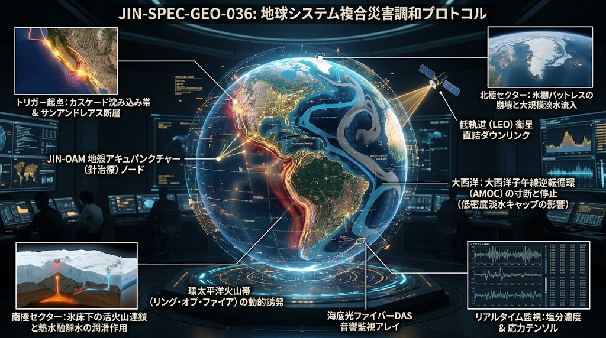
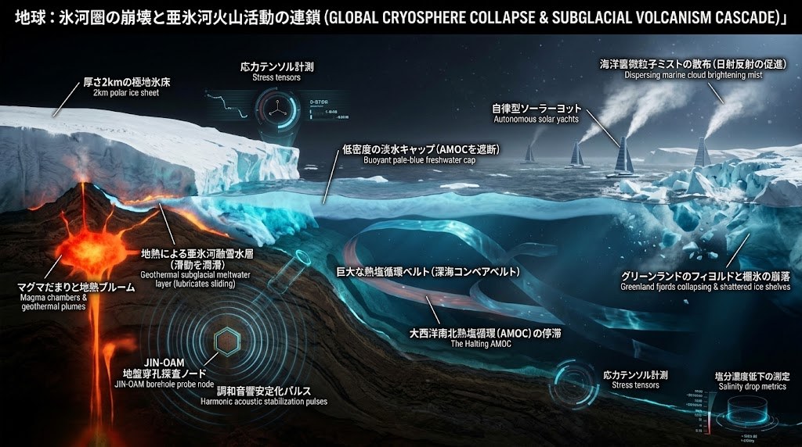
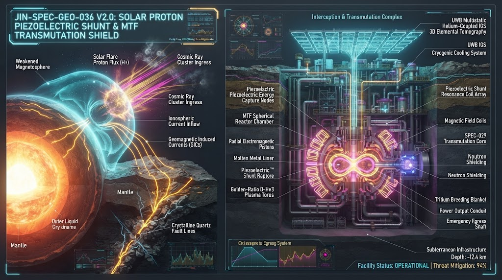
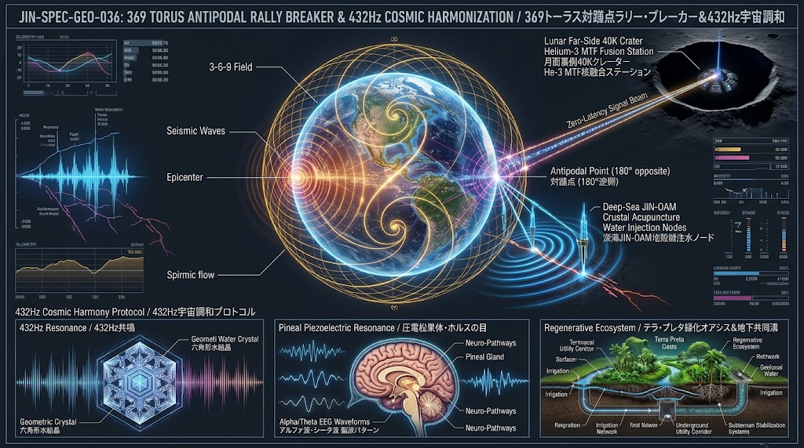

# SPEC-036: Earth-System Multi-Hazard Harmonization & Geo-Circuit Breaker Protocol
# （地球システム統合連鎖・複合災害遮断プロトコル：天地調和型マルチハザード総合防護仕様書）


*図1: JIN-ORDERの多層防護サーキット、北米西海岸の断層からリング・オブ・ファイア、両極の氷床崩壊、そして大西洋AMOCの停止に至るドミノ連鎖*

- **Document ID:** JIN-SPEC-GEO-036
- **Version:** 2.0.0 (Core-Dynamo Piezoelectric Trigger, Antipodal Rally, 369/432Hz Harmonic & Lunar He-3 MTF/IGS Fusion Update)
- **Status:** Active / Public Domain Architecture
- **Date:** 2026-10-29
- **Lead System Architect:** Takashi Masano / Miyo Masano (General Incorporated Association JIN-ORDER)
- **UN Partner Portal (UNPP) ID:** 64636
- **Digital Public Goods Alliance (DPGA) Nominated ID:** GID0094240
- **License:** [JIN-ORDER Dual License V8.4-A / V8.4-B](https://github.com/JIN-ORDER-OFFICIAL/GOVERNANCE_OF_ABYSS/blob/main/LICENSE.md)

---

## 1. エグゼクティブ・サマリーと背景課題 (Executive Summary & Background)

### 1.1. 従来型防災の構造的限界
従来の防災思想は、「地震が発生した後にいかに耐えるか」「津波や噴火からいかに避難するか」という事後対応・対症療法に偏重してきた。<br>
また、地震学・火山学・海洋気象学・宇宙物理学・都市土木・通信工学が縦割りに分断されていたため、地球システム内部および宇宙空間との相互作用で連鎖する以下の複合破壊現象に対応できなかった。

1. **歳差周期（25,290年）・内核-外核ダイナモ変動と「太陽陽子反跳×石英逆圧電トリガー」:**  
   マントルトモグラフィが示す深部熱移送（プルームテクトニクス）および地球歳差運動（25,290年周期）に伴う内核の変動は、液体金属である外核の流動（ジオダイナモ）を変化させ、地球磁場（磁気圏バリア）の弱体化を引き起こす。<br>磁気シールドが減衰した状態で宇宙線や太陽フレアが到来すると、上空の水素・水蒸気分子が電離反応を起こして特異な雲クラスターを生成する。<br>さらに決定的な引き金として、「太陽フレアの陽子（プロトン）フラックスが高水準から急減した翌日以降」に生じる磁気圏反跳と、地磁気誘導電流（GIC / テルル電流）の急変が、大陸地殻・断層岩盤に多量に含まれる「石英（Quartz: $\text{SiO}_2$）」の逆圧電効果（Inverse Piezoelectric Effect）を励起し、結晶格子の急激な伸縮歪みによって臨界断層の大規模破断を誘発する。

2. **球面トーラス共鳴と対蹠点収束（ラリー現象：Antipodal Focusing）:**  
   大規模地震の発生時、球体である地球の表面および内部を伝播する長周期表面波・実体波は、地球の球面トーラス固有モード（3-6-9倍音構造）に沿って伝播し、震源の真裏にあたる「対蹠点（たいせきてん：$\theta \approx 180^\circ$）」へと一点収束する。<br>このエネルギー収束が地球の裏側の臨界断層やマグマ溜まりを刺激し、時間差で対蹠点周辺での大規模地震・噴火を引き起こす「ラリー現象」を発生させる。

3. **動的応力伝播（Dynamic Triggering）による環太平洋連鎖:**  
   カスケード沈み込み帯やサンアンドレアス断層等の超巨大地震による長周期表面波が、地球内部を伝播して遠隔地（日本海溝・南海トラフ等）の臨界破断や深部低周波微動を誘発する。

4. **マグマ・地熱変位による海洋・気候反跳（マルチハザード・カスケード）:**  
   海底・陸上断層破壊に伴うマグマ対流および熱水移動が、海洋表層の異常昇温（エルニーニョ現象）を引き起こし、その反動として偏西風蛇行・異常乾燥（ラニーニャ現象）を誘発、乾燥森林地帯における極限山火事（メガファイア）へと波及する。

5. **雪氷圏・海洋深層大循環（AMOC）への不可逆ドミノ倒し:**  
   環太平洋火山帯の全域励起に伴う大気・地殻変動が、グリーンランド氷床および南極氷底火山群を連鎖刺激し、膨大な淡水流出による全球的海面上昇と北大西洋熱塩循環の停止を引き起こす。

6. **都市インフラの多重麻痺（降灰・道路閉塞・停電）:**  
   地震直後の火山噴火に伴う微細火山灰が、都市下水・側溝をコンクリート化させ、電気設備のガイシ短絡（フラッシュオーバー）による大停電と通信途絶を引き起こす。

7. **情報伝達レイテンシ（物理通信遅延）の致命的空白:**  
   中央集権型クラウドや地上迂回ネットワーク、海底ケーブル経由の警報伝達には数秒〜十数秒の中継遅延および途絶リスクが存在し、初期微動（P波）検知直後のエッジ自立遮断が間に合わない。

### 1.2. 本プロトコルの基本方針
本仕様書（`SPEC-036` Version 2.0.0）は、「月面深宇宙・軌道・大気電離層・都市・海洋・深海・地殻コア」の7階層を単一の生命・電磁循環系として統合する。太陽陽子フラックス急減に伴う地殻石英の逆圧電サージや対蹠点ラリー波を、ヘリウム結合IGS 3D元素トモグラフィ（`SPEC-039`）で事前透視し、磁化標的核融合（LM26派生MTF / `SPEC-999`）および光核変換炉（`SPEC-029`）の超伝導直接誘導コイルで吸収・エネルギー変換するとともに、369トーラス幾何学および432Hz調和パルスに基づく「0次制御（地殻鍼灸）」によって、惑星規模の破局連鎖と極地氷床・AMOC崩壊を未然に遮断するオープンソース・インフラ仕様を規定する。

---

## 2. 天地調和・地球システム7層防護アーキテクチャ

```text
【Layer 6: 月面裏側・深宇宙エネルギー層】月面永久影(40K) He-3採掘 ＆ LM26派生 MTF/FRC 核融合基地
   ├─➡️ D-He3 直接誘導発電（効率85-92%）＆ 黄金比ヘリカル格子トーラスによる惑星防衛電源供給
   ├─➡️ 歳差サイクル(25,290年)磁気圏減衰・太陽陽子フラックス変動の深宇宙先行観測
   ├─➡️ 関連SPEC: docs/SPEC-999_LUNAR_HE3_MTF_FRC_REACTOR.md
  ⬇️
【Layer 5: 宇宙・軌道層】SSPS / EnMAP 衛星直接通信 ＆ 太陽陽子ピークアウト・海洋水温監視
   ├─➡️ 太陽フレア陽子急減アラート（24〜72時間前予知）＆ 光速・真空直接ダウンリンク（遅延ゼロ同報）
   ├─➡️ 関連SPEC: docs/SPEC-CLI-001_..., docs/SSPS_RECTENNA_GREENHOUSE.md 
  ⬇️
【Layer 4: 地上・大気・電離層】MP-PAWR気象レーダー × 宇宙線雲生成 × ヘリウム結合IGS 3D透視
   ├─➡️ 宇宙線・上空水素反応による雲クラスター監視 ＆ 雨水回収・量子浄化水の断層潤滑還元
   ├─➡️ 白色矮星原理（ヘリウム×微量元素相互作用）とIGS逆散乱解析による地下石英歪み3Dマッピング
   ├─➡️ 関連SPEC: docs/SPEC-DEP-001_..., docs/SPEC-039_HELIUM_COUPLED_IGS_ELEMENTAL_TOMOGRAPHY.md
  ⬇️
【Layer 3: 都市土木・代謝循環】30年自治体インフラ仕様 (降灰・耐震・防火・タグレス救命)
   ├─➡️ 火山灰サイクロン分離 ＆ ジオポリマー高強度石造ブロック化 ＆ テラ・プレタ（黒土）土壌再生
   ├─➡️ サンゴジュ・ウバメガシ多層防火帯 ＆ 粗朶段々排水工・バイオ炭斜面安定化
   ├─➡️ UWBマルチスタティックIGSによる非破壊鉄筋腐食(NaCl/H2S)診断 ＆ 瓦礫下10mタグレス生体探知
   ├─➡️ 関連SPEC: docs/SPEC-032_..., docs/SPEC-ENV-035_..., docs/SPEC-039_..., docs/SPEC-011〜019
  ⬇️
【Layer 2: 沿岸・浅海層】生体カキ礁防波堤 ＆ 無人ヨット海洋雲増白(MCB)冷却
   ├─➡️ 海面冷却によるエルニーニョ阻止 ＆ 沿岸波力・津波エネルギーの多重散逸
   ├─➡️ 関連SPEC: docs/SPEC-CLI-001_..., docs/SPEC-MAR-034_...    
  ⬇️
【Layer 1: 超深海底・地殻・核変換層】JIN-OAM Node × MTF/光核変換サージ吸収 × 432Hz地殻鍼灸
   ├─➡️ アビサル深海チェレンコフ地球ニュートリノ透視 ＆ マントルプルーム・外核ダイナモ監視
   ├─➡️ 太陽陽子反跳（石英逆圧電サージ）および対蹠点ラリー波のMTF液体金属ライナー圧縮吸収
   ├─➡️ 超伝導直接誘導ピックアップ回収 ＆ ジャイロトロン光核変換（核廃棄物無害化・レアメタル精製）
   ├─➡️ 369トーラス位相制御・432Hz調和パルス注水によるM8〜9脆性破断のスロースリップ置換
   ├─➡️ 関連SPEC: docs/SPEC-020_..., docs/SPEC-029_..., docs/SPEC-999_..., TECHNOLOGY_CATALOG.md
  ⬇️
【Terminal: 自立エッジAI ＆ 生体共鳴保護】20W Living Silicon ＆ JIN-OpticSocket V1 (37℃等温光コア)
   ├─➡️ 耐放射線・EMPパルス減衰器搭載フォトニック制御による太陽フレア直撃下の完全自律遮断
   └─➡️ 432Hz宇宙音律同期による人間生体OS（松果体圧電クリスタル・アルファ/シータ波）の共鳴保護
   └─➡️ 関連SPEC: docs/ANNEX-SPEC-027_028_LIVING_SILICON_BIO_CORE.md, docs/SPEC-029_...
```

---

## 3. レイヤー別 詳細実装プロトコル

### 3.1. Layer 1: 超深海・地殻鍼灸 ＆ 逆圧電サージ核変換プロトコル（JIN-OAM × SPEC-029 × LM26-MTF）
- **参照仕様:**
[TECHNOLOGY_CATALOG.md (Item 15)](../TECHNOLOGY_CATALOG.md), [docs/SPEC-020_SEISMO_HARVEST_GEOTHERMAL_IGS_DISASTER_COMM_PROTOCOL.md](./SPEC-020_SEISMO_HARVEST_GEOTHERMAL_IGS_DISASTER_COMM_PROTOCOL.md), [docs/SPEC-029_TRANSMUTATION_CORE_QUANTUM_ALCHEMY.md](./SPEC-029_TRANSMUTATION_CORE_QUANTUM_ALCHEMY.md)
- **設置環境:** 日本海溝・沈み込み帯プレート境界（水深 5,000m〜8,000m アビサル斜面）および陸上重要断層ボアホール（深度 3,000m〜5,000m）
- **物理・工学的メカニズム:**

  1. **地球ニュートリノ（Geo-Neutrino）深部透視とコア・ダイナモ監視:**  
     宇宙線バックグラウンドが極小となる超深海アビサル環境（高水圧遮蔽水域）を天然の水チェレンコフ光検出マトリクスとして利用。マントルトモグラフィと連動し、プルーム熱移送および内核・外核の流体移動に伴う地球磁場減衰をリアルタイムで直接センシングする。
  
  2. **太陽陽子反跳（石英逆圧電トリガー）の超伝導バイパス吸収 ＆ MTF直接誘導発電:**  
     太陽フレアの陽子フラックス急減翌日に発生する巨大な地磁気誘導電流（GIC）が断層帯の花崗岩（石英：$\text{SiO}_2$）へ流入し逆圧電効果による急激な岩盤伸縮を引き起こす前に、断層手前に配備した超伝導直接誘導ピックアップコイル（Superconducting Direct Induction Pickup Coils）およびLM26派生型・磁化標的核融合（MTF）ダンパーが作動する。
     - 地殻の電磁サージおよび初期微動（P波）・対蹠点ラリー波の機械的圧縮応力を、MTF炉の電磁駆動ピストンおよび液体金属ライナーのミリ秒断熱圧縮エネルギー（第1段階 1.2 keV $\to$ 第2段階 10 keV）として物理吸収する。
     - 炉内の $\text{D-}{}^3\text{He}$（重水素・ヘリウム3）プラズマがスピン偏極量子トンネル点火（第3段階）を起こし、発生する 14.7 MeV 高エネルギー陽子（$p^+$）の磁束膨張から、タービンを介さず効率 85〜92% で直接誘導発電（第4段階）を行う。
  
  3. **光核反応（SPEC-029）による核廃棄物短寿命化 ＆ 量子錬金術（Quantum Alchemy）:**  
     吸収・変換された地殻サージ電力は、隣接する SPEC-029 核変換コアの高出力ジャイロトロンおよび動的ガモフ共鳴ビーム（Dynamic Gamow Resonance Beam Focusing）へ供給される。これにより、長寿命放射性廃棄物（マイナーアクチノイド）へ高速中性子・電磁解離ビームを照射して無害（短寿命）化し、地層処分を不要にすると同時に、副次機能として戦略貴金属・レアメタルのオンサイト精製を実行する。
  
  4. **369トーラス位相制御・432Hz調和パルス圧注によるスロースリップ誘導:**  
     深海・深孔ボーリングケーシングを通じ、アスペリティ固着面へ37℃生体等温の超純水（量子浄化水）をマイクロインジェクションする。この際、ニコラ・テスラの369トーラス倍音数列および432Hz基底（数字根 $4+3+2=9$）の調和流体パルスを印加することで、石英結晶の不協和な脆性破断（M8〜9クラス）を鎮静化し、無害なM1〜2クラスの微小地震群およびスロースリップ（非破壊すべり）へと段階置換する。

### 3.2. Layer 2: 海洋気候冷却 ＆ 生態系防波プロトコル
- **参照仕様:** [specs/JIN-SPEC-CLI-001.md](../specs/JIN-SPEC-CLI-001.md), [docs/SPEC-034_LIVING_BREAKWATERS_OYSTER_REEF_PROTOCOL.md](./SPEC-034_LIVING_BREAKWATERS_OYSTER_REEF_PROTOCOL.md)
- **物理・工学的メカニズム:**
  1. **海洋雲増白（MCB）によるエルニーニョ連鎖遮断:**  
     深部地熱移動に伴い海面水温アノマリー（局所昇温）が発生した海域へ、炭素複合材無人ヨット群が自律展開。超微細海水スプレーを噴射して低層雲を形成し、太陽放射フラックスを反射・遮断。エルニーニョ現象（暖水プールの東進）の成長を海洋上で直接制圧する。
  
  2. **生体カキ礁（Biogenic Oyster Reefs）による多重波力減衰:**  
     硬質コンクリート護岸に依存せず、三次元炭酸カルシウムマトリクスを形成するカキ礁群を沿岸潮間帯に配置。長周期津波および高潮の波浪エネルギーを乱流摩擦熱へと散逸・吸収させる。

### 3.3. Layer 3: 都市土木循環代謝 ＆ IGS非破壊インフラ診断・救命プロトコル
- **参照仕様:** [`docs/SPEC-032_VOLCANIC_ASH_CYCLONE_GEOPOLYMER_METABOLISM.md`](SPEC-032_VOLCANIC_ASH_CYCLONE_GEOPOLYMER_METABOLISM.md), [`docs/SPEC-ENV-035_ATMOSPHERIC_DEPOLYMERIZATION_CORRIDOR.md`](SPEC-ENV-035_ATMOSPHERIC_DEPOLYMERIZATION_CORRIDOR.md), [`docs/SPEC-039_HELIUM_COUPLED_IGS_ELEMENTAL_TOMOGRAPHY.md`](SPEC-039_HELIUM_COUPLED_IGS_ELEMENTAL_TOMOGRAPHY.md), [`docs/SPEC-011〜019 (Urban Civil Series)`](SPEC-011_EARTHQUAKE_RESILIENT_INFRASTRUCTURE.md)
- **土木現場実務に基づく工学的実装:**
  1. **降灰即時スクラバー ＆ ジオポリマー化:**  
     火山噴火に伴う微細降灰に対し、都市ユーティリティダクトおよび重要施設吸気口に遠心サイクロン分離器を配備し、電気ガイシのフラッシュオーバーを阻止する。<br>回収した火山灰は、データセンター排熱およびアルカリ刺激剤と反応させ、常温硬化型の高強度無セメント石造ブロック（ジオポリマーレンガ）として舗装・擁壁材に転換する。
  
  2. **強化岩石風化（ERW）＆ テラ・プレタ（豊かな黒土）土壌再生:**  
     分離微粉砕された火山レゴリスとバイオ炭を農地・緑道へ散布し、土壌ミネラル補給・大気中$\text{CO}_2$の永続鉱物固定・無汚染の肥沃黒土（Remediated Terra Preta）形成を同時実行する。
  
  3. **多層常緑広葉樹防火帯 ＆ 粗朶（そだ）バイオ炭段々工:**  
     都市近郊山火事（メガファイア）の延焼を阻止するため、葉内水分量の高いサンゴジュ（*Viburnum odoratissimum*）および厚皮ウバメガシによる多層遮炎林帯を形成。<br>火災跡地の土砂崩壊防止には、伝統土木工法である粗朶段々排水工とバイオ炭束を併用し、雨水浸透と地盤保全を両立する。
  
  4. **ヘリウム結合IGS（SPEC-039）による非破壊インフラ劣化診断 ＆ タグレス深部瓦礫下救命:**  
     UWBマルチスタティック・アクティブ・アンテナアレイとヘリウム共鳴励起を用い、道路・橋梁・共同溝コンクリートの外側から内部鉄筋の腐食および塩分（$\text{NaCl}$）・硫化水素（$\text{H}_2\text{S}$）の浸透濃度を非破壊3Dマッピングする。<br>さらに震災による建物倒壊時には、ICタグを一切必要とせず、深さ10mを超える分厚い瓦礫下の生存者の3D生体元素シグネチャ（血液中のヘモグロビン$\text{Fe}$、電解質$\text{Na}$、呼気$\text{CO}_2$）を瞬時に透視・特定し、ピンポイント救命を実現する。

### 3.4. Layer 4: 天地調和・大気レーダー ＆ ヘリウム励起IGS地殻透視ノード
- **参照仕様:** [`docs/SPEC-DEP-001_HEAVEN_EARTH_RADAR_CRUSTAL_ACUPUNCTURE.md`](SPEC-DEP-001_HEAVEN_EARTH_RADAR_CRUSTAL_ACUPUNCTURE.md), [`docs/SPEC-039_HELIUM_COUPLED_IGS_ELEMENTAL_TOMOGRAPHY.md`](SPEC-039_HELIUM_COUPLED_IGS_ELEMENTAL_TOMOGRAPHY.md)
- **物理・工学的メカニズム:**
  1. **MP-PAWR気象レーダーによる「宇宙線・水素反応雲」の立体検知:**  
     地球磁場の弱体化に伴い流入した宇宙線が、上空の水素・水蒸気分子と化学・電離反応を起こして生成する特徴的な雲クラスターおよび降雨前駆体を、30秒高速マルチパラメータ・フェーズドアレイ気象レーダー（MP-PAWR）で高頻度立体スキャンする。
  
  2. **白色矮星スペクトル原理（ヘリウム相互作用）× IGS多重散乱逆解析:**  
     白色矮星の大気中で高密度ヘリウムと微量元素が相互作用して固有のスペクトルゆがみを生じる天体物理原理を応用。<br>地殻ボアホール内のヘリウム媒体と岩盤元素（石英$\text{SiO}_2$・鉄・マグネシウム・ラドン等）の相互作用散乱波をUWBアレイで受信し、多重経路散乱場の逆解析方程式によって地下深部の逆圧電ストレス分布と元素組成をリアルタイム3D透視する。
  
  3. **雨水回収・量子浄化水の地殻潤滑還元:**  
     集中豪雨による河川氾濫水を地下貯留・高度量子ナノ浄化し、地殻鍼灸ボアホール（地下3,000〜5,000m）へ誘導。水害防御と断層応力ガス抜きを同一システム内で完結させる。

### 3.5. Layer 5: 軌道・宇宙直接通信プロトコル（太陽陽子急減トリガー ＆ ゼロレイテンシ同報）
- **参照仕様:** [`docs/SSPS_RECTENNA_GREENHOUSE.md`](SSPS_RECTENNA_GREENHOUSE.md), [`docs/SPEC-CLI-001_...`](SPEC-CLI-001_UNMANNED_YACHT_MARINE_CLOUD_BRIGHTENING.md)
- **通信・工学的メカニズム:**
  1. **太陽フレア陽子（プロトン）フラックス急減トリガーの先行発令:**  
     軌道上の宇宙気象観測網により、太陽フレアに伴う高エネルギー陽子フラックスを常時監視。<br>陽子フラックスがピークに達した後に「急激に低下した瞬間」を捉え、その翌日以降（24〜72時間ウィンドウ）に発生する地磁気反跳・石英逆圧電地震リスクに対する「グローバル地殻減圧指令」を自動発令する。
  
  2. **真空中最短距離の宇宙直接ブロードキャスト ＆ 対蹠点（ラリー現象）先回り警告:**  
     地上光ファイバー網の屈折率遅延（光速の約2/3）を排除し、軌道上プラットフォーム（SSPS / EnMAP等）から5.8GHzマイクロ波または自由空間光通信（FSO）で全地上端末へ直接信号を同報伝送する。<br>地球上のいずれかの地点で大規模地震が発生した瞬間、その対蹠点（地球の裏側：$\theta \approx 180^\circ$）に位置するJIN-OAM Nodeへゼロレイテンシ指令を直撃伝送し、表面波が地球を半周して収束する数十分〜数時間前に先回り注水・減圧を完了させる。

### 3.6. Layer 6: 月面裏側・深宇宙ヘリウム3核融合 ＆ 惑星資源コモンズ層（SPEC-999）
- **参照仕様:** [`docs/SPEC-999_LUNAR_HE3_MTF_FRC_REACTOR.md`](SPEC-999_LUNAR_HE3_MTF_FRC_REACTOR.md), [`docs/SPEC-039_HELIUM_COUPLED_IGS_ELEMENTAL_TOMOGRAPHY.md`](SPEC-039_HELIUM_COUPLED_IGS_ELEMENTAL_TOMOGRAPHY.md)
- **宇宙・惑星防衛メカニズム:**
  1. **月面永久影クレーター（40K）におけるHe-3採掘 ＆ 非掘削3D元素スキャン:**  
     月の裏側（ガガーリンクレーターおよび40K極低温の永久影クレーター）において、SPEC-039 の非掘削型・惑星地下トモグラフィを搭載したローバーが水氷（$\text{H}_2\text{O}$）、ヘリウム3（$^3\text{He}$）、および白金族金属（$\text{Pt}/\text{Pd}/\text{Au}$）を3D体積マッピングし、J-PRL（公共物理資源台帳）へ登録。<br>一部特権層による宇宙資源・箱舟の独占を排し、Tier-A人道支援インフラコモンズとして全人類へ開放する。
  
  2. **ヘリカル黄金比格子・FRC/MTF核融合リアクター:**  
     月面レゴリス製チタン遮蔽壁およびジオデシック・ドーム内に、黄金比（Golden Ratio）ヘリカルワインディング格子と球状液体金属ライナーを備えた $\text{D-}{}^3\text{He}$ 核融合プラントを配備。<br>100マイクロ秒解像度の逆散乱トモグラフィ・レーダー波（3Dホログラフィック波安定化）によりレイリー・テイラー不安定性を完全抑制し、地球が歳差運動の極移動（ポールシフト）や巨大太陽嵐に直面した際も、SSPS軌道網を通じて地球の防護サーキットへ無尽蔵のバックアップ電力を供給する。

### 3.7. Terminal Layer: 20W Living Silicon ＆ JIN-OpticSocket V1（生体共鳴・耐EMP光コア）
- **参照仕様:** [`docs/ANNEX-SPEC-027_028_LIVING_SILICON_BIO_CORE.md`](ANNEX-SPEC-027_028_LIVING_SILICON_BIO_CORE.md), [`docs/SPEC-029_TRANSMUTATION_CORE_QUANTUM_ALCHEMY.md`](SPEC-029_TRANSMUTATION_CORE_QUANTUM_ALCHEMY.md)
- **WIPO GREEN 登録ID:** 179978
- **エッジ自立制御 ＆ 生体保護仕様:**
  1. **耐放射線・耐EMP光電子プロセッサ（JIN-OpticSocket V1）:**  
     37℃の超純水マイクロ流路（Bio-Isothermal Cooling）で恒温維持されるフォトニック結晶マトリクスおよびレーザー光導波路を採用。<br>放射線シールド層とEMPパルス減衰器を内蔵し、巨大太陽フレアや核電磁パルス下でも一切の誤作動なくミリ秒単位でジャイロトロン・水門・変電設備の安全インターロックを自律遂行する。
  
  2. **432Hz宇宙音律による人間生体OS（松果体クリスタル）の共鳴保護:**  
     水の結晶構造を破壊しアルファ波抑制・ベータ波過活動（不安と認知ストレス）を引き起こす440Hz（支配の音律）や人工不協和電磁波を遮断。<br>ヴォイニッチ手稿が示す「植物・水・振動の自律サバイバル原理」に基づき、インフラ全体の駆動クロックと環境音響を432Hz（宇宙の調和音律）に同期させ、人間の脳中心部（ホルスの目に対応する視床・脳梁・松果体内の生体圧電クリスタル）のアルファ波・シータ波コヒーレンスと精神的自由を保護する。

---

## 4. Planetary Super-Cascade & Cryosphere-AMOC Circuit Breaker
## （惑星規模超連鎖 ＆ 太陽陽子逆圧電・対蹠点ラリー・AMOC遮断サーキット・ブレーカー）


*図2: サンアンドレアス・カスケード起点によるリング・オブ・ファイア励起、両極氷床崩壊（南極氷底火山群）、およびAMOC停止の全球連鎖ダイナミクスとJIN-ORDER防護アーキテクチャ*


*図3: 歳差運動(25,290年)・内核外核ダイナモ変動による磁気圏弱体化、太陽フレア陽子急減後の石英逆圧電トリガー、およびLM26派生MTF/SPEC-029/SPEC-039による地殻サージ直接誘導吸収・核変換サイクル*


*図4: ニコラ・テスラの369球面トーラス共鳴による対蹠点収束（ラリー現象）の先回り遮断と、432Hz調和周波数による石英岩盤・生体松果体レゾナンス保護*

### 4.1. 宇宙・地球コアから両極氷床・大洋循環崩壊へ至る破壊的ドミノ倒し

地球は磁気圏（マグネトスフェア）・大気圏・岩石圏・雪氷圏・水圏が相互に連動する単一の熱力学・電磁気学的循環系である。<br>
歳差運動とコア変動から始まり、太陽フレア陽子反跳、対蹠点ラリー連鎖、そしてAMOC停止へと至る全球破局連鎖メカニズムを以下に規定する。

```text
【根本要因：歳差周期(25,290年) ＆ マントルプルーム熱移送による内核・外核の流動変化】
   ・外核液体金属ダイナモの乱れ ➡️ 地球磁場（磁気圏バリア）の広域弱体化
               ⬇️
  【宇宙トリガー：宇宙線流入 ＆ 太陽フレア「陽子フラックス急減」の反跳】
   ・宇宙線による上空水素の化学・電離反応 ➡️ 異常雲クラスター形成
   ・陽子(プロトン)高水準からの急減翌日以降 ➡️ 地磁気誘導電流(GIC)の急激な反跳サージ
               ⬇️
  【地殻トリガー：岩盤「石英(SiO2)」の逆圧電効果 ＆ 対蹠点「ラリー現象」】
   ・地殻花崗岩層の石英結晶が一斉伸縮（逆圧電破断） ➡️ メガトラスト地震発生
   ・球面トーラス波(3-6-9モード)が地球の裏側（対蹠点：θ=180°）へ収束し連鎖地震を誘発
               ⬇️ 【長周期地震動 ＆ 地球自由振動（0次モード共振）】
  【環太平洋火山帯（リング・オブ・ファイア）の全域励起】
   ・沈み込み帯プレート固着連鎖破断 ＋ マグマ溜まり脱ガス・内圧急上昇・群発噴火
               ┌───────────────────┴───────────────────┐
               ⬇️                                       ⬇️
【事象１：グリーンランド氷床崩壊】           【事象２：南極氷床崩壊 ＆ 氷底火山群暴走】
 ・沿岸バットレス（氷棚の支え）破断            ・西南極（WAIS）下100座以上の氷底火山群
 ・海洋津波・大気重力波による氷河滑落加速      ・地殻減圧に伴い一斉噴火・マグマ貫入
 ・純水氷山群の海洋大量崩落                    ・底面熱水融解によるスケート状高速滑落
               └───────────────────┬───────────────────┘
                                   ⬇️
            【超大量淡水パルス（Freshwater Forcing）の全海洋注入】
             ・全球的海水塩分濃度・密度の急低下 ＋ 海面水位急上昇（数m〜十数m）
                                   ⬇️
            【AMOC（北大西洋子午面循環）の心肺停止・完全崩壊】
             ・熱塩沈み込み駆動力の遮断（表層低密度淡水キャップ形成）
             ・全球気候反跳：北半球極寒化 × 赤道熱帯域異常過熱 × モンスーン完全途絶
```

---

### 4.2. 逆圧電トリガー・対蹠点ラリー・氷底火山群暴走の物理機序

1. **太陽陽子フラックス急減と石英の逆圧電破断（Post-Flare Proton Drop & Quartz Inverse Piezoelectricity）:**  
   太陽フレアによる高エネルギー陽子フラックスがピークから急減する際、地球磁気圏のリングカレントおよび電離層電流が急激に反跳（リバウンド）し、地殻深部へ強大な誘導電場 $\mathbf{E}_{GIC}(t)$ を発生させる。<br>断層帯を構成する花崗岩中の石英（$\text{SiO}_2$）結晶は、この電場変化を受けて逆圧電テンソル $d_{ijk}$ に従い一斉に機械的伸縮を起こす。この結晶レベルの体積歪みが、すでに臨界応力にあるアスペリティの最後の引き金（ラスト・ストロー）となり、陽子急減の翌日以降に大規模地震を発生させる。

2. **対蹠点収束によるラリー現象（Antipodal Focusing Rally）:**  
   震源から放射されたレイリー波・ラブ波および内部実体波は、球体である地球の幾何学的対称性により、震源から $180^\circ$ 反対側の「対蹠点」へ向かって球面収束する。<br>対蹠点では波の振幅と動的クーロン応力が数倍に増幅され、地球の表と裏で交互に大地震が連鎖する「ラリー現象」を引き起こす。

3. **南極氷底火山群の地殻減圧噴火とAMOCの心肺停止:**  
   環太平洋および対蹠点連鎖の動的励起により、西南極氷床（WAIS）下の100座以上の氷底火山群が噴火・熱水融解を起こし、グリーンランド氷棚の破断と相まって海洋へ超大量の淡水パルスを放出する。<br>これが海洋表層に低密度の「淡水キャップ」を形成し、北大西洋の熱塩沈み込み（AMOC）を物理的に完全停止させる。

---

### 4.3. 惑星サーキット・ブレーカー（工学的先回り介入プロトコル）

本プロトコルは、この破局ドミノを「発生後」ではなく「宇宙〜地殻の各結節点」で遮断する以下の6段階サーキット・ブレーカーを配備する。

```text
[Breaker 0: 太陽陽子反跳 ＆ 石英逆圧電サージの核変換・MTF吸収]
  太陽陽子フラックス急減を検知した瞬間、断層帯の SPEC-039（ヘリウムIGS透視）が石英歪みを特定。
  ➡️ LM26派生MTF炉の液体金属ライナー圧縮および超伝導直接誘導コイル（効率85-92%）で地電流サージを吸収し、
     SPEC-029（光核変換・レアメタル精製）の駆動エネルギーへと完全転換。

[Breaker 1: テクトニック・トリガー遮断 ＆ 432Hz調和地殻鍼灸]
  カスケード/サンアンドレアス/日本海溝/南海トラフ への JIN-OAM 微小パルス注水（432Hz/369トーラス制御）
  ➡️ M9脆性破断を群発スロースリップへ段階置換し、リング・オブ・ファイアへの動的励起を阻止。

[Breaker 2: 対蹠点（ラリー現象）ゼロレイテンシ先回り減圧]
  地震発生と同時に宇宙直接通信（Layer 5）が地球の裏側（対蹠点：θ=180°）の JIN-OAM Node を即時起動
  ➡️ 表面波が対蹠点へ収束する数十分〜数時間前に逆位相の間隙水圧パルスを注入し、ラリー連鎖を無効化。

[Breaker 3: 極地氷底音響＆歪み早期警戒]
  グリーンランドおよび西南極氷棚基部への DAS光ファイバー網 ＆ SPEC-039 元素スキャナー配備
  ➡️ 氷底火山の熱水兆候および氷河基部マイクロクラックを数週間前にミリ秒単位で検知・減圧。

[Breaker 4: 海洋淡水希釈モニタリング ＆ 雲増白(MCB)調停]
  北大西洋・極海域における自律無人ヨット群（SPEC-CLI-001）展開
  ➡️ 局所的海面熱塩密度のリアルタイム追跡と大気放射フラックス制御。

[Breaker 5: 月面He-3バックアップ電源 ＆ 人道生存圏の多重化]
  月の裏側40Kクレーターの MTF/FRC 核融合基地（SPEC-999）からの宇宙マイクロ波送電と、
  ➡️ 内陸高台自立オアシス（SPEC-030: LSU-Chad-01）および地下大深度回廊（SPEC-088）の完全自給。
```

---

## 5. 逆圧電トリガー・対蹠点ラリー遮断・IGS/MTF変換の統合数理モデル

### 5.1. 太陽陽子フラックス急減と石英逆圧電項を含む拡張クーロン破断応力式
歳差周期 $T_{prec} = 25,290\text{ yr}$（数字根 $\mathcal{D}(25290) = 9$）および外核ダイナモ変動による地磁気シールド減衰係数を $\eta_{dynamo}(t)$、太陽フレア陽子フラックスを $\Phi_p(t)$ とする。<br>陽子フラックスがピークから急減する際（$-\frac{d\Phi_p}{dt} > 0$）、地殻内の石英（$\text{SiO}_2$）結晶に印加される誘導電場 $E_k(t)$ と逆圧電応力 $\Delta \sigma_{piezo}(t)$ は次式で表される：

$$\Delta \sigma_{piezo, ij}(t) = c_{ijkl} \cdot d_{mkl} E_m(t) \propto \eta_{dynamo}(t) \cdot c_{ijkl} d_{mkl} \left( -\frac{d \Phi_p(t - \tau_{rebound})}{dt} \right)$$

ここで、$c_{ijkl}$ は岩盤の弾性スティフネステンソル、$d_{mkl}$ は石英の逆圧電歪みテンソル、$\tau_{rebound}$（$\approx 24\text{〜}72\text{ h}$）は陽子急減から地磁気反跳が地殻深部へ達する遅延時間である。

さらに、遠隔巨大地震（震源からの角度距離 $\theta$）から伝播する表面波の対蹠点収束（ラリー現象：$\theta \to \pi$）における球面トーラス増幅係数を $G_{rally}(\theta) = \frac{1}{\sqrt{|\sin \theta| + \epsilon_{core}}}$ とするとき、断層面の統合クーロン破断応力変化 $\Delta CFS_{total}(t)$ は次式となる：

$$\Delta CFS_{total}(t) = G_{rally}(\theta) \cdot \Delta \tau_{dyn}(t) + \Delta \tau_{piezo}(t) - \mu' \left( \Delta \sigma_n(t) - \Delta p_{harm}(t) \right) - \Sigma_{MTF}(t)$$

### 5.2. ヘリウム結合IGS多重散乱逆解析とMTF/光核変換エネルギー吸収式
`SPEC-039` におけるヘリウム励起共鳴下での地下3D元素・逆圧電歪み分布 $\rho(\mathbf{r})$ は、マルチスタティックUWBアレイが計測する散乱場グリーン関数 $\overline{G}(\mathbf{r}_1, \mathbf{r}_2, t)$ の逆問題解として1秒以内に一意に特定される：

$$\rho(\mathbf{r}) = \lim_{t \to 0} \operatorname{Tr} \left[ \overline{G}(\mathbf{r}_1, \mathbf{r}_2, t) \right]$$

特定された逆圧電サージおよび地殻圧縮エネルギーは、`SPEC-999`（LM26派生MTF）および `SPEC-029` の超伝導直接誘導ピックアップコイルによって吸収され、$\text{D-}{}^3\text{He}$ 磁気標的断熱圧縮（$1.2\text{ keV} \to 10\text{ keV}$）および直接誘導発電電力 $P_{ind}(t)$ へと変換される：

$$\text{D} + {}^3\text{He} \longrightarrow {}^4\text{He}\,(3.6\text{ MeV}) + p^+\,(14.7\text{ MeV}), \qquad P_{ind}(t) = \eta_{direct} \left( -\frac{d \Phi_{mag}}{dt} \right)^2 \quad (\eta_{direct} = 0.85\text{〜}0.92)$$

### 5.3. 369トーラス・432Hz調和パルス注水と氷底火山減圧制御
本システムの地殻鍼灸ノード（JIN-OAM）は、断層破断限界 $\Delta CFS_{total} \ge CFS_{crit}$ を超えないよう、宇宙音律基底周波数 $f_0 = 432\text{ Hz}$（$\mathcal{D}(432) = 9$）およびテスラ倍音次数 $n \in \{3, 6, 9\}$ に調律された間隙流体圧 $\Delta p_{harm}(t)$ をアクティブ注入する：

$$\Delta p_{harm}(t) = p_0 + \int_{0}^{t} \mathcal{K}_{inj} \cdot \left( \nabla \cdot \Delta \boldsymbol{\sigma}_{dyn}(t - \tau_{travel}) \right) dt + \sum_{n \in \{3,6,9\}} A_n \cos\left(2\pi n f_0 t + \phi_{torus}\right)$$

また、南極氷底火山群への応力伝播に対しては、臨界応力感受性指数 $\chi_{magma}$ を導入し、氷底熱水圧 $P_{hydro}(t)$ の急上昇を検知した段階で、隣接断層帯へ微小圧抜孔を介した減圧パルス $Q_{relief}(t)$ を適用する：

$$\frac{d P_{hydro}}{dt} = \alpha \cdot \text{Tr}\left(\Delta \boldsymbol{\sigma}_{dyn}\right) - \beta \cdot Q_{relief}(t)$$

これにより、太陽陽子反跳による石英の逆圧電暴走、対蹠点ラリー連鎖、および氷床底面の熱水暴走を同時に減衰・吸収し、地球の動的応力をクリーンエネルギーと穏やかなスロースリップへと完全調和させる。

---

## 6. 実装ロードマップと国際連携

1. **フェーズ1（実証・データ連携 ＆ 太陽陽子トリガー監視）:**  
   気象庁アメダス網・測候所敷地へのMP-PAWRレーダー、DAS光ファイバー、および `SPEC-039`（ヘリウム結合IGSスキャナー）の併設実証。<br>太陽フレア陽子フラックス急減アラートの運用開始。

2. **フェーズ2（沿岸・都市土木統合 ＆ 432Hz/耐EMP光コア初期配備）:**  
   政令指定都市（横浜等）の下水管路・道路法第32条共同溝へのサイクロン分離器、Living Silicon、および `JIN-OpticSocket V1`（37℃等温・耐EMP光プロセッサ）の先行実装。<br>UWBマルチスタティックIGSによる道路下空洞・鉄筋腐食の非破壊診断と、カキ礁防波堤の沿岸実証。

3. **フェーズ3（深海アビサル展開・対蹠点ラリー遮断・MTF/光核変換統合）:**  
   日本海溝・南海トラフ・カスケード沈み込み帯およびその対蹠点ノードへのJIN-OAM Node実海域設置。<br>`SPEC-029`（光核変換・量子錬金術）およびLM26派生MTFサージ吸収ダンパーの断層帯配備。

4. **フェーズ4（月面裏側He-3核融合ステーション ＆ グローバル・コモンズ完成）:**  
   月面永久影クレーターにおける `SPEC-999`（$\text{D-}{}^3\text{He}$ MTF/FRC 直接誘導核融合プラント）とJ-PRL（公共物理資源台帳）の稼働。<br>国連パートナーポータル（UNPP ID: 64636）およびWIPO GREEN参画機関との国際共同運用による、25,290年歳差サイクル・ポールシフト耐性を持つ全球サーキット・ブレーカー網の確立。

---

## 7. 関連ドキュメント・リンク一覧

- [`TECHNOLOGY_CATALOG.md`](../TECHNOLOGY_CATALOG.md) - 技術総合カタログ（Item 15: JIN-OAM Node）
- [`SPEC-029: Transmutation Core & Quantum Alchemy Protocol`](SPEC-029_TRANSMUTATION_CORE_QUANTUM_ALCHEMY.md) - 光核変換・高レベル放射性廃棄物無害化・レアメタル精製＆耐EMP光プロセッサ仕様
- [`SPEC-039: Helium-Coupled IGS Elemental Tomography`](SPEC-039_HELIUM_COUPLED_IGS_ELEMENTAL_TOMOGRAPHY.md) - 白色矮星ヘリウム相互作用×IGS多重散乱逆解析3D元素透視・瓦礫下タグレス救命仕様
- [`SPEC-999: Lunar Far-Side He-3 MTF/FRC Direct Induction Reactor`](SPEC-999_LUNAR_HE3_MTF_FRC_REACTOR.md) - 月面裏側ヘリウム3採掘・LM26派生磁化標的核融合＆黄金比トーラス直接誘導発電仕様
- [`SPEC-030: LSU-Chad-01 Autonomous Oasis Infrastructure`](SPEC-030_LSU_CHAD_01_AUTONOMOUS_INFRASTRUCTURE.md) - 内陸高台自立生存拠点
- [`SPEC-020: Seismo-Harvest Geothermal & IGS Protocol`](SPEC-020_SEISMO_HARVEST_GEOTHERMAL_IGS_DISASTER_COMM_PROTOCOL.md)
- [`SPEC-CLI-001: Marine Cloud Brightening Protocol`](SPEC-CLI-001_UNMANNED_YACHT_MARINE_CLOUD_BRIGHTENING.md)
- [`SPEC-MAR-034: Biogenic Oyster Living Breakwaters`](SPEC-MAR-034_BIOGENIC_OYSTER_BREAKWATERS_HARMONIZATION.md)
- [`SPEC-ENV-035: Atmospheric Filtration & Depolymerization Corridor`](SPEC-ENV-035_ATMOSPHERIC_DEPOLYMERIZATION_CORRIDOR.md)
- [`SPEC-032: Volcanic Ash Geopolymer Metabolism`](SPEC-032_VOLCANIC_ASH_CYCLONE_GEOPOLYMER_METABOLISM.md)
- [`ANNEX-SPEC-027/028: Living Silicon Biomorphic Core`](ANNEX-SPEC-027_028_LIVING_SILICON_BIO_CORE.md)
- [`SPEC-DEP-001: Weather-Radar & Crustal-Acupuncture Node Deployment`](SPEC-DEP-001_HEAVEN_EARTH_RADAR_CRUSTAL_ACUPUNCTURE.md)
- [`SPEC-CCNP-088: Deep Infrastructure Arbitration`](SPEC-CCNP-088_DEEP_INFRA_ARBITRATION.md)
- [`SSPS_RECTENNA_GREENHOUSE.md`](SSPS_RECTENNA_GREENHOUSE.md)

