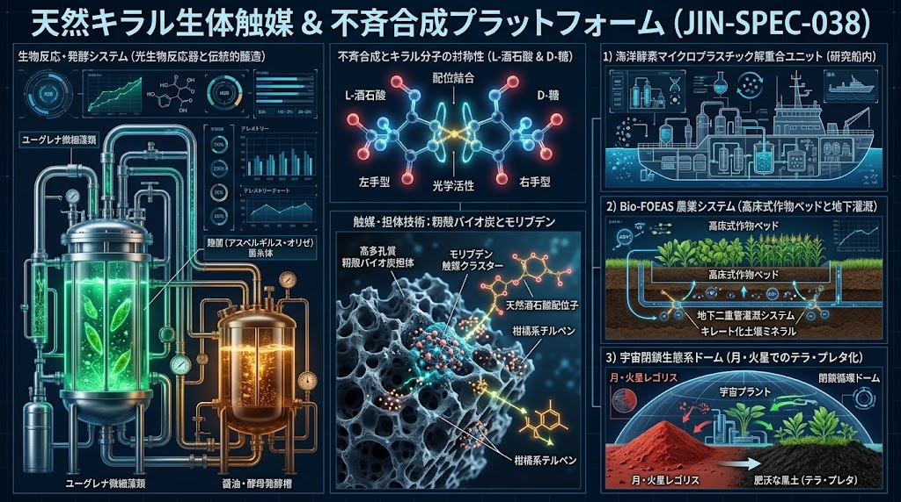
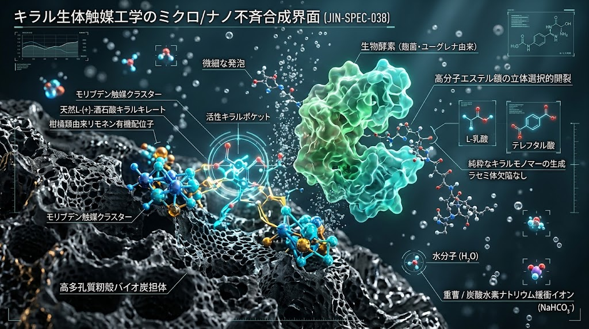
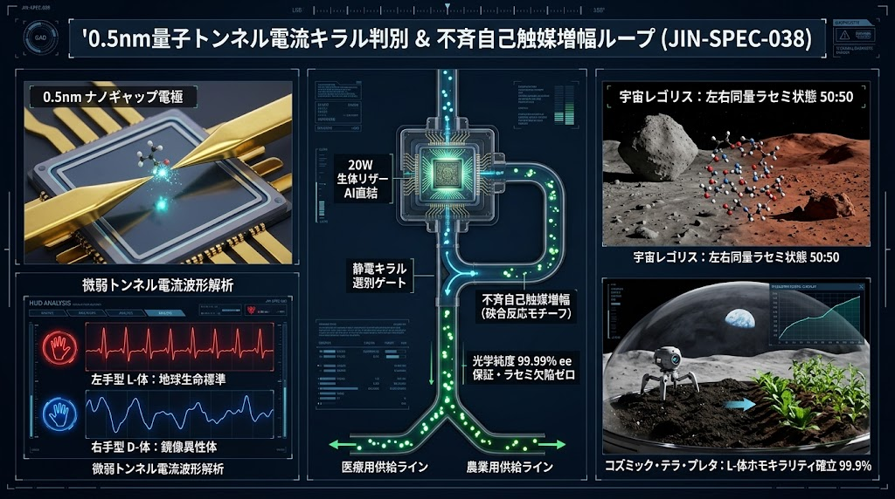

# ⚠️ JIN-ORDER RESTRICTED DATA
このファイルは [JIN-ORDER Dual License V8.4-A (Canonical Infrastructure & Anti-Laundering Edition)](https://github.com/JIN-ORDER-OFFICIAL/GOVERNANCE_OF_ABYSS/blob/main/LICENSE.md) によって保護されています。  
無断転用、受託コンサルタントによる仕様書ロンダリング、机上の空論による改ざんを固く禁じます。  
*This file is protected by the JIN-ORDER Dual License V8.4-A. Unauthorized reproduction, specification laundering, or commercial appropriation without prior authorization is strictly prohibited.*

---

## 【JIN-SPEC-038】天然キラル生体触媒・不斉合成統合フレームワーク
## Natural Chiral Bio-Catalytic, Asymmetric Autocatalysis & Sub-nm Quantum Chiral Sensing Framework
Canonical Autumn 2026 LTS Edition (Rev.2.0) / WIPO GREEN Green Technology Archive (ID: 180051)  
Classification: Level 2 (地域・宇宙即応プロトコル) / Cross-Disciplinary Nexus

---

## 1. 開発理念と科学的背景 (Philosophy & Scientific Foundations)



### 1.1 生命の起源とキラリティ（掌性・非対称性）の謎：パストゥールから不斉自己触媒へ
1848年、ルイ・パストゥール（Louis Pasteur）はワイン醸造樽の内壁に析出した「酒石（酒石酸水素カリウム）」の結晶から、右手系と左手系の鏡像異性体（エナンチオマー）を世界で初めて手作業で分離した。<br>
地球上の生命を構成する分子（タンパク質を構成するL体［左手型］アミノ酸、核酸や糖鎖の骨格をなすD体［右手型］糖）は、いずれか一方の立体配置のみを選択する「ホモキラリティ（単一掌性）」を保持している。

探査機「はやぶさ2」が小惑星リュウグウから持ち帰った初期太陽系の砂からは、右手型と左手型がほぼ1:1で混在する「ラセミ体」のアミノ酸が検出されている。<br>
この宇宙の無秩序なラセミ状態から、いかにして地球生命のホモキラリティが誕生したのかという謎に対し、微量の光学的偏り（キラル不均衡）が生成物自身の自己触媒作用によって指数関数的に増幅され、ほぼ100%の光学純度へ至る「不斉自己触媒反応（硤合反応：Soai Reaction）」（2026年ノーベル化学賞受賞テーマ）が、決定的な科学的視座を与えた。

一方、人工的な石油化学合成においては、特別な工夫なく合成を行うと右手系と左手系が1:1で等量生成される「ラセミ体」となりやすい。<br>
1960年代の「サリドマイドの悲劇」（(R)体は鎮静作用を示し、鏡像体である(S)体は重篤な催奇形性を引き起こした）に象徴されるように、右手同士なら握手できても右手と左手では握手できないのと同様、生体受容体に対する光学異性体の無秩序な混入は生命圏に対して不可逆な毒性をもたらす。

### 1.2 「台所の知恵」×「不斉自己触媒増幅」×「0.5nm量子キラル判別」の三位一体統合
本仕様（SPEC-038）は、希少貴金属（ロジウム、ルテニウム、イリジウム等）や有害な石油由来配位子に依存する近代工業化学を脱却し、人類が数千年にわたり培ってきた食文化・伝統発酵（天然醸造醤油、清酒・製パン酵母、米麹、柑橘果汁、重曹、酒石酸塩）および微細藻類・昆虫代謝系を「100%立体選択的な天然キラル触媒プール」として再定義するものである。

さらに本改定版（Rev.2.0）では、この天然キラル合成エンジンに対し、「不斉自己触媒によるホモキラリティ増幅機序」と、「0.5ナノメートル（$0.5\text{ nm}$）電極ギャップの量子トンネル電流波形による1分子リアルタイム左右判別技術」を直結統合した。<br>
これにより、大型分析装置を持ち込めない離島・農山村・災害現場・研究船内・月面閉鎖ドームにおいて、「100%単一掌性の合成」と「1分子レベルのインライン検品・選別」を同時完結する自律型キラル基盤を確立する。

---

## 2. 天然キラルプール構成要素（Core Bio-Chemical Matrix）



| 構成資材 | 主要含有成分 / キラル配位子 | 立体化学的特性 | 主たる触媒機能・役割 |
| :--- | :--- | :--- | :--- |
| **酒石酸塩類 (Tartrates)**<br>（クリーム・オブ・ターター / ロッシェル塩） | L-(+)-酒石酸、酒石酸カリウムナトリウム | ビス(ヒドロキシジカルボン酸)構造、強固なキラルキレート能 | モリブデン等の遷移金属と安定な天然キラル錯体を形成。不斉自己触媒反応の初期キラルトリガーおよび有害重金属の不活化沈殿 |
| **柑橘類有機酸＆精油**<br>（ユズ、レモン、カボス等） | クエン酸（アキラル助剤）、(R)-(+)-リモネン、フラボノイド | 光学活性単環式モノテルペン、抗酸化・生体膜透過性 | 不斉配位子補助、疎水性プラスチックの膨潤・溶解、細胞関門透過促進 |
| **伝統発酵醸造液**<br>（天然醸造生醤油、諸味） | 光学純度100%のL体アミノ酸群、天然乳酸、ペプチド群 | 多官能基キラルプール、緩衝アミノ酸ネットワーク | 酵素活性の立体保護、土壌難溶性ミネラルの可溶化キレート、ホモキラリティ種子源 |
| **製パン・清酒酵母**<br>*(Saccharomyces cerevisiae)* | 光学選択的オキシドレダクターゼ（還元酵素群）、細胞壁β-グルカン | カルボニル基の不斉還元能、高比表面積キラル吸着能 | アルデヒド・ケトンの高エナンチオ選択的生体還元、有害イオン吸着 |
| **みどり麹 (Euglena-Koji)**<br>*(Aspergillus oryzae × Euglena)* | 耐塩性プロテアーゼ、キラルβ-グルコシダーゼ、パラミロン | 高密度立体認識糖鎖加水分解能、不斉バイオエンジン | 生薬配糖体の精密アグリコン化、モリブデン担持多孔質炭素マトリクス |
| **緩衝・膨張助剤**<br>（重曹 / ベーキングパウダー複合塩） | 炭酸水素ナトリウム ($\text{NaHCO}_3$)、酸性ピロリン酸塩 | pH自己緩衝能、急激なガス放出による微細多孔質化 | 反応系のpH精密維持、バイオ炭のサブナノ細孔賦活化 |

---

## 3. 【新機軸】0.5nmナノギャップ量子トンネル電流キラル判別 ＆ 不斉自己触媒増幅ループ
### (Sub-Nanometer Quantum Tunneling Chiral Discrimination & Asymmetric Autocatalytic Loop)



従来の不斉合成および光学異性体分析においては、合成後の光学純度（鏡像体過剰率：% ee）を確認するために大型の高速液体クロマトグラフィー（キラルHPLC）や円二色性分散計を必要とし、現場でのリアルタイム検品や宇宙探査機・小型プラントへの搭載が困難であった。<br>
SPEC-038は、「0.5nmナノギャップ電極センサー」と「20W生体模倣リザーバAI」（SPEC-027 / SPEC-037）を反応流路へインライン統合することで、この物理的限界を突破する。

### 3.1 0.5nm電極ギャップによる1分子トンネル電流波形判別機序

1. サブナノメートル電極間通過（$d = 0.5\text{ nm}$）：
   マイクロ流体チップ内に、2本の金（Au）または白金イリジウム合金のナノ電極を $0.5\text{ nm}$（10億分の0.5メートル） の微小ギャップで対向配置する。<br>
   この隙間をアミノ酸、ヒドロキシ酸（乳酸等）、または生薬アグリコン分子が1分子ずつ通過する。

2. 微弱トンネル電流波形の発生：
   電極間にバイアス電圧を印加した状態でキラル分子が通過すると、分子軌道と電極表面との電子雲の重なりにより、ピコアンペア（$\text{pA}$）オーダーの微弱な量子トンネル電流パルスが生じる。<br>
   右手型（D体 / R体）と左手型（L体 / S体）では、電極表面に対する立体配座の揺らぎと通過配向角が異なるため、電流の立ち上がり勾配・ピーク振幅・減衰時定数に固有の波形差が現れる。

3. 20W流体リザーバAI（SPEC-037連成）による即時波形識別：
   熟練職人の打音・振動波形を直接咀嚼する「SPEC-037 物理リザーバ演算器」および「SPEC-027 20W脳型チップレット」をナノギャップ電極に直結。<br>
   重いデジタルフーリエ変換を介さず、アナログ電流生波形の特徴量をマイクロ秒（$\mu\text{s}$）単位で直接識別し、1分子ごとにL体・D体を瞬時に判定する。

### 3.2 静電キラル選別ゲートと「不斉自己触媒（硤合反応モチーフ）」フィードバック

1. インライン100%検品（ラセミ欠陥の物理遮断）：
  ナノギャップ電極の下流 $50\text{ }\mu\text{m}$ に配置された「誘電泳動・静電マイクロ流体ゲート（Electrostatic Chiral Gate）」が、20WリザーバAIの判定信号と同期稼働する。<br>
  万が一、逆掌性の異性体（サリドマイドS体のような有害鏡像体やD-乳酸等のラセミ欠陥分子）が1分子でも検知された場合、高周波電場パルスで瞬時に副流路（リジェクトライン）へ弾き出し、本流の光学純度を $>99.99\%\text{ ee}$（事実上の完全ホモキラル状態） に物理保証する。

2. 不斉自己触媒増幅ループ（Autocatalytic Chiral Amplification）：
  副流路へ弾かれた未反応ラセミ体や逆掌性分子は廃棄せず、籾殻炭モリブデン・L-酒石酸錯体が充填された「自己触媒再配列カラム」へ還流させる。<br>
  精製された目的キラル分子自身を自己触媒（キラル開始剤）としてフィードバックすることで、微量のキラル偏りから雪崩を打つように単一掌性へと収束させる「不斉自己触媒増幅サイクル」を常時維持する。

---

## 4. 分野横断シナジー・マトリクス（Cross-SPEC Integration Nexus）

```text
【天然キラル・生体触媒プール ＆ 0.5nm量子キラル判別 (JIN-SPEC-038)】
    [酒石酸塩/柑橘/麹/酵母/重曹/藻類] × [0.5nmナノ電極 ＆ 20Wリザーバ波形判別]
                   ⬇️  
【17：海陸共生ケミカルリサイクル (SPEC-013 連動)】         
  | ➡️ [モリブデン精密解重合 ＆ インライン光学純度99.99%選別]
【18：伝統土木排水工学＆土壌炭素隔離(SPEC-006/013/014)】
  | ➡️ [難溶性ミネラル超吸収 ＆ 根圏L体アミノ酸キレート監視]
【19：人間主権型統合バイオ創薬  (JIN-IBP / MED-01)】 
  | ➡️ [副作用ゼロ・完全不斉アグリコン ＆ 有害鏡像体1分子遮断]
 🔽
【29：宇宙惑星レゴリス自律土壌化テラプレタ(Canonical SPEC-030 / JIN-DOC-SPACE)】
  ➡️ [過塩素酸塩無害化 ＆ ラセミ砂からL体ホモキラリティ黒土への相転移判定]
```
---

### 4.1 ［技術17連携］海陸共生型酵素ケミカルリサイクル (JIN-CPC / SPEC-013)
- **課題：**
  * 海洋マイクロプラスチックおよび生分解性プラスチック（PLA等）の解重合において、熱や加水分解時のラセミ化（D-乳酸とL-乳酸の混在）が再重合ポリマーの結晶性と強度を著しく低下させる。

- **SPEC-038の統合：【バイオ炭担持モリブデン・キラル酒石酸錯体触媒 ＆ 0.5nmインライン選別】**
  * 籾殻炭のナノ細孔内にモリブデンクラスター（$\text{MoS}_2$ / $\text{MoO}_3$）を固定化し、そこに「天然L-酒石酸塩」を配位させることで、非貴金属系「固体不斉キレート触媒」を常温常圧下で構築。
  
  * 柑橘油（(R)-リモネン）がプラスチック表面の結晶領域を穏和に膨潤させ、海洋細菌由来エステラーゼとキラル触媒が協奏的にエステル結合を立体選択的に開裂。
  
  * 回収ライン出口の「0.5nmナノギャップ電極センサー」がモノマーの光学純度を常時監視し、ラセミ体欠陥ゼロの純粋L-乳酸モノマー（$>99.99\%\text{ ee}$）のみを再重合槽へ供給する。

### 4.2 ［技術18連携］伝統田畑輪換・土木排水工学 ＆ 土壌炭素隔離 (SPEC-006 / 013 / 014)
- **課題：** 土壌中の鉄・アルミニウムと結合した難溶性リン酸（市町村の下水汚泥再生リン等を含む）、およびモリブデン等の微量要素は不活性化しやすく、高コストな化学処理や過剰施肥を招く。

- **SPEC-038の統合：【キラル・バイオキレートによる難溶性養分の根圏誘導】**
  * Bio-FOEAS（地下水位制御暗渠）および粗朶暗渠・高畝の排水システムに、「天然醤油諸味廃液および重曹・酒石酸緩衝液」を間欠微量注入。
  
  * 天然L体アミノ酸と酒石酸塩が、土壌粒子に固着したリン・鉄・モリブデンと高安定度キラルキレート錯体を形成。<br>植物根毛のトランスポーター（L体アミノ酸認識チャネル）を通じて「右手同士の握手」のように受動的かつ超効率的に吸収される。
  
  * 暗渠末端の小型キラルセンサーが土壌水中のL体アミノ酸キレート比率をモニタリングし、昆虫フラス（ミールワーム糞）由来のキチンオリゴ糖と相乗して根圏炭素隔離（テラ・プレタ骨格）を最適制御する。

### 4.3 ［技術19連携］人間主権型・統合バイオ創薬プラットフォーム (JIN-IBP / MED-01)
- **課題：** 伝統漢方生薬の多くは糖が結合した配糖体（グリコシド）として存在し、腸内細菌叢の個人差によって吸収効率が変動する上、合成医薬品においては光学異性体の混入（ラセミ体供給）が重大な薬害リスクとなる。

- **SPEC-038の統合：【みどり麹×ユーグレナ完全不斉アグリコン化 ＆ 1分子トンネル電流検品ゲート】**
  * みどり麹（*Aspergillus oryzae* × *Euglena gracilis*）が分泌するキラル特異的β-グルコシダーゼを用い、生薬配糖体のD体糖鎖のみを立体特異的に切断し、腸管透過性の高い**純粋キラル・アグリコン分子**を精製。
  
  * 精製流路に直結した「0.5nmナノギャップ電極アレイ」が全通過分子のトンネル電流波形を走査し、生体受容体のキラルポケットに合致しない異性体を1分子レベルで完全排除。<br>サリドマイド型の薬害リスクを物理層で根絶したテーラーメイド腸溶性カプセルを実現する。

### 4.4 ［技術29連携］宇宙惑星レゴリス自律土壌化＆テラ・プレタ創生 (SPEC-030 / JIN-DOC-SPACE)
- **課題：** 小惑星リュウグウや月・火星のレゴリスには高濃度の有毒過塩素酸塩 ($\text{ClO}_4^-$) や重金属が含まれ、さらに有機物が存在しても右手型・左手型が同量混在する「ラセミ状態（非生命状態）」の不毛な鉱物である。

- **SPEC-038の統合：【アキラル毒素の選択的無毒化 ＆ ホモキラリティ自己触媒注入・生命土壌判定】**
  * 閉鎖宇宙ドーム内の製パン・調理プロセス（重曹＋酒石酸水素カリウム＝ベーキングパウダー）および微細藻類培養から生じるキラル廃液をレゴリス浸出液に導入し、酒石酸イオンの不斉平面構造によって過塩素酸塩や重金属イオンを選択的に共沈分離。
  
  * 無害化されたレゴリスに対し、伝統醸造由来の100% L体アミノ酸プールとみどり麹菌糸・昆虫フラス炭を播種。<br>
  不斉自己触媒反応（硤合反応機序）により、土壌全体の有機物代謝を「L体アミノ酸・D体糖優位の地球生命標準（ホモキラリティ）」へと一気に相転移させる。
  
  * ドーム内の土壌および宇宙探査ローバーに搭載された「超小型0.5nm電極キラル判別プローブ」が、土壌抽出液の電流波形からD/L比率をリアルタイム計測。<br>
  ラセミ比（50:50）からL体優位（$>99.9\%$）への転換完了をもって「生命が育つ生きた黒土（コズミック・テラ・プレタ）の創生完了」および地球外生命起源の客観指標（Biosignature）として自動判定する。

---

## 5. 拡張転用領域（Extended Domains）

### 5.1 ［環境工学］重金属・難分解性有機物吸着キラルフィルター
- 醤油醸造副産物（大豆粕）および酒石酸変性バイオ炭を積層した重力式透過壁（PRB）。

- カドミウム、鉛、有機フッ素化合物（PFAS）等の有害物質を、キラル表面吸着と静電相互作用の二重トラップにより常温・無動力で99.8%吸着捕捉。

### 5.2 ［材料工学］宇宙前哨基地向け・高立体規則性バイオポリマー合成
- 宇宙ステーション呼気回収系（$\text{CO}_2$）とユーグレナ光合成を直結。

- 藻体内で蓄積された有機酸を、清酒酵母の不斉還元能と不斉自己触媒ループにより単一光学異性体モノマー（L-乳酸、(R)-3-ヒドロキシ酪酸）へ転換し、0.5nm電極センサーで純度保証した上で医療用骨固定ピンや極限環境シール材をオンデマンド3Dプリントする。

---

## 6. 分散型即応SOP：現場調合および0.5nmキラル検品プロトコル (Field Operational SOP)

### ［プロトコルコード：SPEC-038-SOP-ALPHA-V2］
目的：地域集落・被災地・閉鎖宇宙環境における「天然キラル生体触媒液（CBC-Fluid）」の現場調合とインライン光学純度検証

1. **基本基底液の調製（緩衝キレート相）**
   * 清浄水 100 L に対し、食品グレード炭酸水素ナトリウム（重曹）500 g、酒石酸水素カリウム（クリーム・オブ・ターター）300 g を投入・撹拌。<br>
   微細な炭酸ガス発泡を確認し、pHを 6.5〜6.8 に整定。

2. **生体キラルプールの添加（有機酸・アミノ酸相）**
   * 柑橘搾汁液（pH 2.5〜3.0）2 L、および伝統本醸造生醤油（火入れ前の諸味液が望ましい）1 L を徐々に混和し、ホモキラリティ（L体アミノ酸・L-酒石酸）の初期触媒核を形成。

3. **生体バイオエンジンの播種と自己触媒熟成**
   * みどり麹粉末（または乾燥パン酵母）200 g を投入し、常温（20〜28℃）にて微小通気下で12時間静置培養。

4. **0.5nmナノギャップ電極プローブによる現場検品（Quality Verification）**
   * 調合液または生成モノマー溶液にハンディ型「0.5nmナノギャップ電極センサー（20WリザーバAI内蔵）」を浸漬。
   
   * 量子トンネル電流波形が「左手型（L体アミノ酸 / L-乳酸）基準波形」と一致し、鏡像体過剰率が基準値（農業・環境用 $>98\%\text{ ee}$、創薬・宇宙医療用 $>99.99\%\text{ ee}$）を満たしていることを緑色LEDインジケータで確認後、現場へ投入する。

5. **現場適用：**
   * **土壌施用・リン循環（SPEC-006/010/014）：** 50倍希釈液をBio-FOEAS暗渠灌漑または高畝基部に散布し、難溶性リンをキラルキレート化して作物へ100%吸収させる。
   
   * **リサイクル触媒（SPEC-013）：** 籾殻炭ペレット 10 kg に対し原液 5 L を含浸させ、120℃にて低温乾燥担持。
   
   * **宇宙レゴリス無害化・テラプレタ創生（SPEC-030）：** レゴリス微粉末スラリーに対し等量体積を混合・沈殿分離後、0.5nmセンサーでL体ホモキラリティの定着を確認。

---

## 7. WIPO GREEN登録情報・知財ガバナンス (Governance & License)

- **技術呼称：** 天然キラル生体触媒・不斉自己触媒増幅・0.5nm量子キラル判別統合基盤技術
- **英語名称：** Natural Chiral Bio-Catalytic, Asymmetric Autocatalysis & Sub-nm Quantum Chiral Sensing Platform
- **WIPO GREEN 国際登録ID：** [`Technology ID: 180051`](https://wipogreen.wipo.int/wipogreen-database/articles/180051)
- **WIPO GREEN 分類コード：**
  * **Agriculture / Forestry:** Soil Remediation, Bio-fertilizers, Enhanced Nutrient Uptake
  * **Pollution & Waste:** Microplastic Chemical Recycling, Heavy Metal Adsorption
  * **Human Health & Space Biosciences:** Biopharmaceuticals, Non-toxic Chiral Drug Synthesis, Single-Molecule Quantum Chiral Sensing
- **ライセンス体系：** [JIN-ORDER Dual License V8.4-A](https://github.com/JIN-ORDER-OFFICIAL/GOVERNANCE_OF_ABYSS/blob/main/LICENSE.md)
  * 平和利用、気候変動緩和、集落自律防衛、宇宙探査目的にはオープン（Tier A Commons）。
  * 行政機関・研究機関・受託事業者による無断仕様流用（アイデア・ロンダリング）や商業独占利用は厳格に排除し、事前のCFOライセンス承認を必須とする。

---

**Supreme Judgment:** Masano Takashi (The Guide)  
**Co-Founder & CFO:** Masano Miyo (Commander Pome-Mama)  
**Executed by:** JIN-ORDER-OFFICIAL  

*Generated & Sealed by JIN-ORDER Technology Standardization Directorate*  
*In Commemoration of Louis Pasteur's Tartaric Acid Separation (1848), Kenzo Soai's Asymmetric Autocatalysis (Nobel Prize in Chemistry 2026), Sub-nm Quantum Tunneling Chiral Sensing, & Japanese Fermentation Wisdom.*
