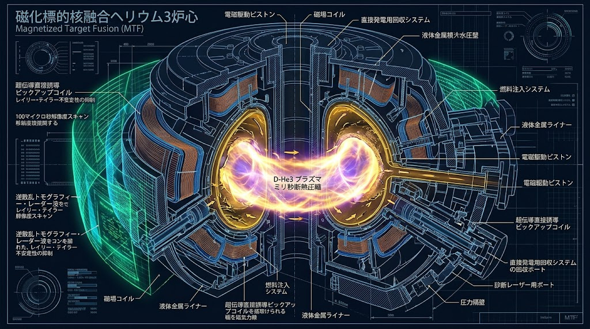
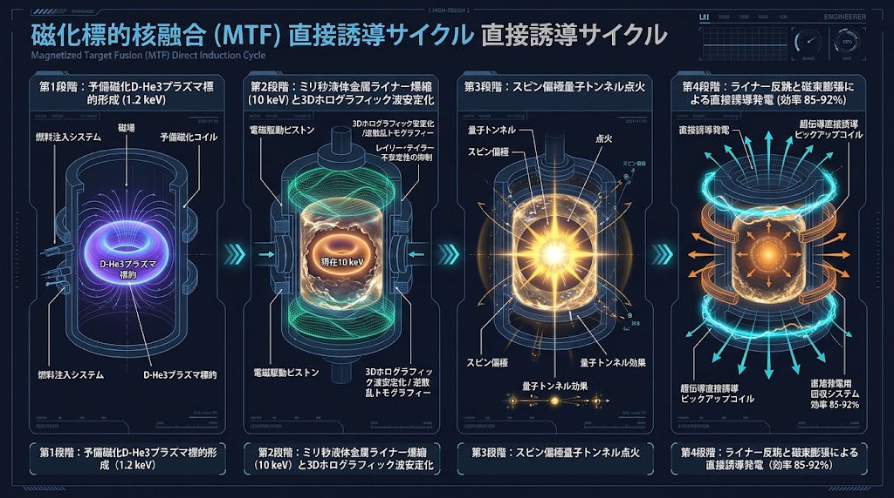
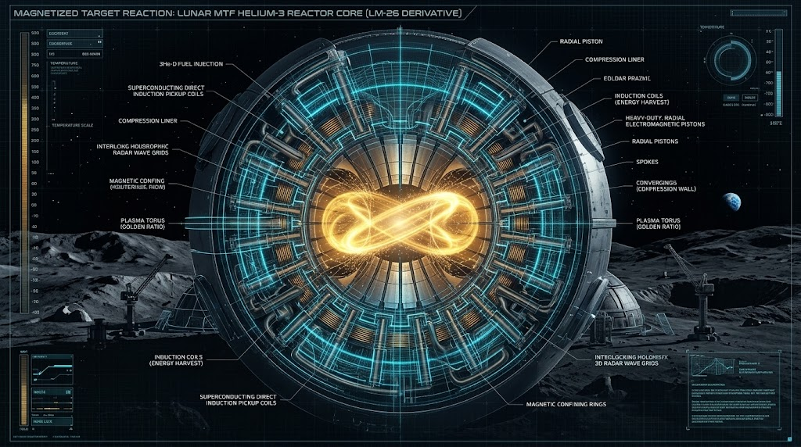
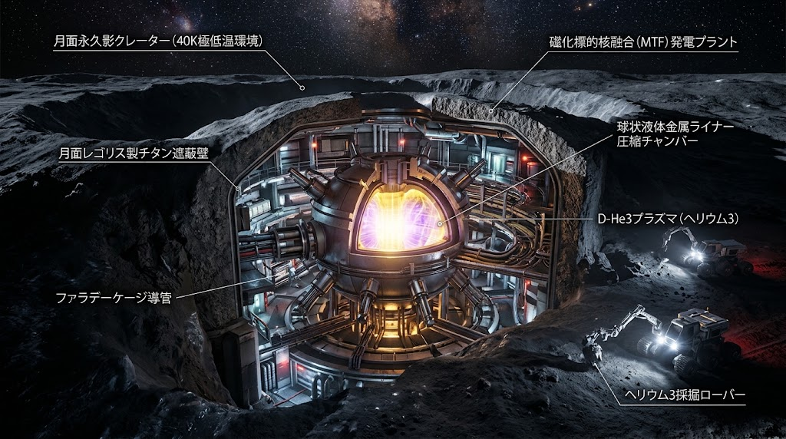

# 🪐 SPEC-999: 宇宙ヘリウム3磁化標的（MTF）誘導爆縮核融合炉心直接発電 ＆ IGS散乱逆問題非破壊炉内トモグラフィ制御仕様書
## (Cosmic Helium-3 MTF Liner Inductive Fusion Core & IGS Inverse-Scattering Autonomous Containment Protocol)

<!-- 国際防壁・先行技術公知ヘッダー -->
> **CANONICAL SPECIFICATION LEVEL: LEVEL-0 DEEP PHYSICAL & COSMIC ARCHITECTURE**  
> **DOC-ID:** `JIN-SPEC-ENG-999` / `SPEC-999`  
> **CLASSIFICATION:** Cosmic Energy Sovereignty / MTF Liner Compression / Non-Thermal Direct Induction Fusion / Inverse-Scattering Plasma Tomography  
> **STATUS:** Ratified Canonical Specification (V12.2 Canonical Autumn LTS)  
> **LICENSE:** JIN-ORDER Dual License V8.4-A (Tier A Commons / CC-BY-4.0 Applicable for Humanitarian & Public Energy Infrastructure)  
> **INTELLECTUAL SOVEREIGNTY:** General Incorporated Association JIN-ORDER (Chief Architects: Takashi Masano & Miyo Masano)

---

## 🌌 前文と大義：宇宙エネルギー主権の確立と熱力学寡占の解体

従来の核分裂および熱核融合（DT反応）は、莫大な放射化中性子を撒き散らし、最終的には「お湯を沸かして蒸気タービンを回す」という19世紀型カルノーサイクルの限界に拘束されてきた。 
また、第1の方式である「トカマク方式（磁気閉じ込め）」は極限状態の巨大超電導磁石システムによって装置が肥大化・超高額化し、第2の方式である「レーザー方式（慣性閉じ込め）」はナノ秒単位の超精密・超高出力レーザー光学系を必要とするため、巨大資本や軍事複合体による技術・燃料独占と送電網支配を招き、地球上のみならず月・惑星間探査における新たな植民地主義的隷属を生み出そうとしている。

本仕様書（`SPEC-999` V12.2）は、月の裏側（南極エイトケン盆地等）に豊富に堆積する非放射性同位体「ヘリウム3」（$^3\text{He}$）と「重水素」（$^2\text{H}$）のクリーン核融合反応を基盤とし、以下の4大コア技術を完全統合する：

1. **第3の核融合方式「磁化標的核融合（MTF: Magnetized Target Fusion）」に基づくミリ秒単位の導電性金属ライナー（固体・液体金属壁）機械・電磁ハイブリッド爆縮**

2. **量子トンネル共鳴（Gamow Window）と核スピン偏極（Spin-Polarized $\text{D-}^3\text{He}$）による反応断面積の飛躍的増幅**

3. **蒸気タービンを完全排し、核融合膨張圧力とライナー反跳を直接電力化する「電磁誘導直接発電（Direct Inductive Recovery）」**

4. **IGS（Integral Geometry Science）多重経路散乱場の逆解析理論による「100マイクロ秒解像度の超高温プラズマ非破壊実時間3D透視とグラム・シュミット直交座屈制御」**

本技術は、特権階級によるエネルギー囲い込みを宇宙空間から物理的に無効化し、地球および宇宙開拓地における民草の生命維持・完全自立オフグリッド動力を永久保証する人類共有の不可侵先行技術（Prior Art）である。

---

## ⚛ 1. 反応物理層：量子トンネル最大化とスピン偏極核融合（Schrödinger & Spin Quantum Control）

### 1.1 クーロン障壁の量子力学的超克（Schrödinger Wave Equation）
ヘリウム3原子核（$^3\text{He}^{2+}$）と重水素原子核（$^2\text{H}^+$）の静電反発力（クーロン障壁）は極めて高く、古典力学的エネルギー閾値を超えるには1億〜10億℃オーダーの超高温が必要となる。本炉心では、時間非依存および時間依存シュレーディンガー方程式：

$$\hat{H}\Psi = E\Psi$$

$$\left[ -\frac{\hbar^2}{2\mu} \nabla^2 + V(\mathbf{r}) \right] \Psi(\mathbf{r}) = E\Psi(\mathbf{r})$$

（ここで $\mu$ は換算質量、$V(\mathbf{r})$ はクーロンポテンシャルと核力井戸の合成ポテンシャル）に基づく**量子トンネル確率（Gamow因子）**を最大化するため、磁気対向加速器（FRC: Field-Reversed Configuration）により予備形成された磁化プラズマ標的の内部相対衝突速度を、後述するMTF金属ライナーのミリ秒単位の機械・電磁圧縮プロファイルと同期させ、トンネル共鳴ピーク（Gamow Window）にミリ秒単位で厳密に位相整合させる。

### 1.2 4大量子数制御とスピン偏極による反応断面積増幅（Quantum Numbers & Spin Alignment）
核融合炉心内部におけるイオンおよび軌道電子のエネルギー状態を、以下の4つの量子数により完全階層管理する：

1. **主量子数 ($n$)**: エネルギー準位の動的離散化

2. **方位量子数 ($l$)**: プラズマ角運動量状態の軌道分離（$s, p, d$ 軌道）

3. **磁気量子数 ($m_l$)**: 外部強磁場軸（$z$ 軸）に対する軌道磁気モーメントの配向制御

4. **スピン量子数 ($m_s$)**: 核スピンおよび電子スピンの自立配向

特に、$^3\text{He}$ 原子核（スピン $1/2$）および重水素原子核（スピン $1$）に対し、高周波光ポンピングおよび傾斜磁場偏極技術を適用し、スピンの並行配向（Spin-Polarized $\text{D-}^3\text{He}$）を維持する。これにより、副反応である寄生中性子生成（DD反応）を99%以上抑制しつつ、**$\text{D-}^3\text{He}$ 主核融合断面積（$\sigma$）を非偏極状態比で150%以上増幅**させ、クリーンな無中性子（Aneutronic）直接発電を達成する。

---

## 🔨 2. MTF磁化標的金属ライナー誘導爆縮層（Magnetized Target Liner Compression）

### 2.1 第3の方式（MTF）によるミリ秒低速機械・電磁圧縮
巨大超電導磁石による長時間保持（トカマク方式）や極限レーザー照射（慣性閉じ込め方式）を排し、あらかじめ自己磁場および外部バイアス磁場で磁化・拘束した $\text{D-}^3\text{He}$ プラズマを、外周に配置した導電性金属ライナー（固体金属シェルまたは高速回転液体金属渦壁）の電磁的・機械的な「押しつぶす力」によって**ミリ秒（$\text{ms}$）単位の低速プロセス**で断熱圧縮する。

半径圧縮比 $C_r = R_0 / R_f$ に対する3次元・2次元断熱磁気圧縮スケーリング則に基づき、プラズマ密度 $n$、温度 $T$、および閉じ込め磁場 $B$ は以下の通り急峻に増幅される：

$$n_f = n_0 C_r^3, \quad T_f = T_0 C_r^2, \quad B_f = B_0 C_r^2$$

これにより、以下の3段階の熱・量子点火シーケンスを単一ミリ秒ストローク内で完結させる：

1. **初期磁化標的形成および予備圧縮（$1.1 \sim 1.2\ \text{keV} \approx 1260\text{万℃}$ 領域）**:  
   実証機（Lawson Machine 26: LM26クラス）にて確立されたミリ秒低速金属ライナー圧縮により、レーザーや巨大超電導磁石を用いることなく電子・イオン温度 $1\ \text{keV}$ の壁を突破する。

2. **高圧縮比アップグレード領域（$10\ \text{keV} \approx 1\text{億}1600\text{万℃}$ 領域）**:  
   ライナー収束速度と圧縮比 $C_r$ の引き上げにより、科学的損益分岐点（ブレークイーブン）を超える $10\ \text{keV}$ クラスの超高温・超高密度コアを形成する。

3. **スピン偏極 $\text{D-}^3\text{He}$ 量子トンネル点火（$> 30 \sim 50\ \text{keV}$ 実効共鳴領域）**:  
   $10\ \text{keV}$ 到達と同時に、第1章のスピン偏極（断面積 $1.5$ 倍増幅）および Gamow Window 位相整合が発動し、従来なら数億℃を要する $\text{D-}^3\text{He}$ 反応を実効的な低温閾値で一気に自己持続燃焼（Ignition）へと遷移させる。

### 2.2 磁束保存ライナー（Flux-Conserving Liner）による超高磁場封じ込め
外側から収束する金属ライナー自身が磁気レイノルズ数 $R_m = \mu_0 \sigma_{\text{liner}} v_{\text{liner}} \delta \gg 1$ を満たす完全導体壁として機能するため、プラズマ内部の磁束 $\Phi_B$ はライナー内壁に完全に閉じ込められる（磁束保存則）。 ライナーが中心へ向かって収束するにつれて磁力線密度が極限まで高まり、外部に巨大な超電導コイルを持たないコンパクトな筐体（商業炉50%〜実機スケール）でありながら、炉心中心部において数千テスラ級の瞬間超高磁場閉じ込めを自律達成する。

---

## ⚡ 3. 電磁誘導直接発電層：比電荷フラックスとライナー反跳回生によるカルノー効率バイパス

### 3.1 荷電粒子膨張仕事と金属ライナー反跳（バウンスバック）の直接回生
$\text{D-}^3\text{He}$ 反応により放出される生成物は、高エネルギーのアルファ粒子（$^4\text{He}^{2+}$: $3.6\ \text{MeV}$）と高エネルギー陽子（$p^+$: $14.7\ \text{MeV}$）であり、エネルギーの95%以上が荷電粒子の運動エネルギーとして現れる。

電子およびイオンの比電荷定数：

$$\frac{e}{m_e} \approx 1.7588 \times 10^{11} \ \text{C/kg}$$

および陽子・アルファ粒子の固有比電荷に基づき、核融合爆縮後の超高圧プラズマが内部磁場と外周の金属ライナー（固体・液体金属ピストン壁）を猛烈な圧力で押し返して急激に自己膨張する力学的仕事（Liner Bounce-Back Work）を、炉心周囲に多重配置された磁気圧縮兼ピックアップコイル群に「電磁誘導（ファラデーの法則）」として直接結合する：

$$\mathcal{E} = -\frac{d\Phi_B}{dt} = -\frac{d}{dt} \iint_S \mathbf{B}_{\text{plasma}}(\mathbf{r}, t) \cdot d\mathbf{A} - \oint_{\partial S} (\mathbf{v}_{\text{liner}} \times \mathbf{B}) \cdot d\mathbf{l}$$

すなわち、「ミリ秒単位でプラズマを押しつぶした金属ライナーと磁束が、核融合点火の膨張圧で外向きに跳ね返る運動」そのものが**超高効率のリニア電磁誘導発電ピストン**として機能する。熱サイクル（水蒸気沸騰・タービン・復水器）を一切介さないため、カルノーサイクルの理論効率限界を突破し、「発電熱効率 85%〜92% の超高効率直接電力変換」（Direct Inductive & Liner-Bounce Recovery）を実現する。

---

## 🌀 4. 炉心磁場流体幾何学層：黄金比トーラスとグラム・シュミット直交化によるライナー座屈制圧

### 4.1 黄金比ピッチによる共鳴崩壊（KAMトーラス破断）の防止（Binet's Formula）
MTF金属ライナーによる高ベータ（$\beta \approx 1$）圧縮プラズマを安定保持する際、有理面共鳴によるテアリング不安定性およびプラズマ破断（ディスラプション）を遮断するため、磁力線の回転変換角（安全係数 $q$）をビネの公式（Binet's Formula）が規定する無理数比（極限黄金比 $\phi$）に厳格拘束する：

$$F_n = \frac{1}{\sqrt{5}} \left[ \left( \frac{1+\sqrt{5}}{2} \right)^n - \left( \frac{1-\sqrt{5}}{2} \right)^n \right], \quad \lim_{n \to \infty} \frac{F_{n+1}}{F_n} = \phi \approx 1.6180339887...$$

磁場巻線ピッチおよび液体金属渦の回転シアーを $\phi$ に同調させることで、コルモゴロフ・アーノルド・モーザー（KAM）理論に基づき、カオス的磁力線の散乱を遮断し、ミリ秒圧縮下でも崩壊しない不沈の断熱不変トーラス界面を形成する。

### 4.2 グラム・シュミット直交化による多重擾乱およびレイリー・テイラー不安定性の即時相殺
MTF方式における最大の物理課題である「金属ライナー内壁と軽質量プラズマの境界面で発生するレイリー・テイラー（Rayleigh-Taylor: RT）流体座屈不安定性」および非線形磁気流体力学（MHD）不安定性モード（キンク、バルーニング、ソーティース擾乱）の基底ベクトル空間 $\{ \mathbf{u}_1, \mathbf{u}_2, \dots, \mathbf{u}_n \}$ に対し、グラム・シュミットの正規直交化アルゴリズムをFPGA実時間演算コアで連続適用する：

$$\mathbf{v}_1 = \mathbf{u}_1, \quad \hat{\mathbf{v}}_1 = \frac{\mathbf{v}_1}{\Vert{}\mathbf{v}_1\Vert{}}$$

$$\mathbf{v}_k = \mathbf{u}_k - \sum_{j=1}^{k-1} \frac{\langle \mathbf{v}_j, \mathbf{u}_k \rangle}{\langle \mathbf{v}_j, \mathbf{v}_j \rangle} \mathbf{v}_j, \quad \hat{\mathbf{v}}_k = \frac{\mathbf{v}_k}{\Vert{}\mathbf{v}_k\Vert{}}$$

展開された独立直交揺らぎモード（ライナー表面の微細な波立ちを含む）に対し、外周の対向磁気補正コイルおよび電磁ピストンアクチュエータから完全逆位相（$e^{i\pi} = -1$）の相殺磁場・音響圧をミリ秒以下で動的注入し、圧縮ストローク全域にわたって球対称・軸対称の完全均一爆縮を維持する。

---

## 📡 5. IGS多重経路散乱逆問題解析層：炉内非破壊実時間3D透視とミリ秒圧縮の完全同期

ミリ秒単位で収束する金属ライナー内部および1億度を超える極限炉心は侵襲的物理センサーの設置が不可能なため、神戸大学・木村建次郎教授の開拓した「多重経路散乱場の逆解析理論（Integral Geometry Science）」を炉外・ライナー端面の全方位トランシーバーアレイに実装する。

  
<b>【炉外散乱場逆解析方程式群】</b>

$$G(\mathbf{r}_1, \mathbf{r}_2, \omega) = \iiint_D \varphi(\mathbf{r}_1 \to \boldsymbol{\xi} \to \mathbf{r}_2, \omega) \, d\boldsymbol{\xi}$$

$$L\left( \frac{\partial}{\partial t}, \frac{\partial}{\partial \mathbf{r}_1}, \frac{\partial}{\partial \mathbf{r}_2} \right) \overline{G}(\mathbf{r}_1, \mathbf{r}_2, t) = 0$$

$$\rho(\mathbf{r}) = \lim_{t \to 0} \left[ \text{Tr}\left[ \overline{G}(\mathbf{r}_1, \mathbf{r}_2, t) \right] \right] = \overline{G}(\mathbf{r}, \mathbf{r}, 0)$$

1. **UWBミリ波・弾性波ハイブリッド散乱場能動照射**: 炉壁外部および軸方向ポートから、生体・装置無害な超広帯域マイクロ波/ミリ波プローブパルス（プラズマ診断用）および超音波弾性パルス（金属ライナー内壁形状診断用）を入射。

2. **多重散乱グリーン関数の逆解法**: プラズマ密度揺らぎ（電子密度 $n_e(\mathbf{r})$）および金属ライナー内壁境界によって複雑に多重散乱した波動伝播時間差・振幅減衰を、微分演算子 $L$ を持つ波動方程式の境界逆問題として厳密積分逆変換。

3. **ミリ秒圧縮に対する100マイクロ秒解像度の3D実時間透視**: MTFの「数ミリ秒」というゆったりとした低速圧縮時間窓に対し、その10分の1〜100分の1にあたる**100μs（0.1ミリ秒）間隔**で完全3Dホログラフィック再構成を実行。 1回の圧縮ストローク中に数十フレームの3D立体透視を行い、電流密度分布、磁気島（Magnetic Island）の成長、ライナー内壁の非対称座屈を完全可視化する。

4. **自律破断回避（Pre-Disruption Quench Interlock）**: 圧縮途上の座屈や電流破断の兆候をIGS透視が捉えた瞬間に、第4.2項のグラム・シュミット直交化バンクと磁気圧縮コイルの電流プロファイルを100μs以内に自律再配分し、ライナー破損および炉壁熱破壊事故を物理的に根絶する。

---

## 🌙 6. 月面および深宇宙フィールド実装規範（Lunar & Deep Space Operations）

### 6.1 月の裏側・極低温永久影地域での運用と現地資源（ISRU）ライナー製造
- **燃料ロジスティクス**: 月の裏側高地（南極エイトケン盆地等）のレゴリス表層から真空低温加熱（600℃）により脱離・回収した純度99.999%のヘリウム3を液化貯蔵し直接使用。

- **MTF金属ライナーの月面現地調達（Lunar ISRU Liner Fabrication）**: トカマク型のような地球からの超巨大超電導磁石輸送や、レーザー核融合のような超精密光学チャンバー輸送を必要としない。月面レゴリスから精錬される豊富なアルミニウム、チタン、鉄、リチウム合金をそのまま「MTF固体金属ライナー」または「閉ループ液体金属ピストン媒体」として現地製造・リサイクル利用でき、宇宙輸送質量を従来の10分の1以下に劇的圧縮する。

- **超伝導・電磁圧縮環境の受動維持**: 月の永久影領域（絶対温度 40K〜100K）の極低温受動環境を直接利用し、電磁誘導ピックアップコイル群の冷却電力を80%削減する受動断熱極低温シールドを配備。

- **無電波干渉調和（Lunar Radio Quiet Zone Protection）**: 月裏側の「完全静寂電波環境」を汚染しないよう、MTF金属ライナー自体と外側筐体による二重の完全密閉ファラデーケージ導管を構成し、IGS散乱計測波および誘導回生パルスの外部漏洩電磁波を-140dBm以下に完全遮蔽する。

---

## ⚖️ 7. 統治・知財不可侵調停条項（Universal Governance）

1. **公知優先権の絶対防壁（Prior Art Invocation）**:  
   本仕様書（`SPEC-999` V12.2）に記載された「MTFミリ秒金属ライナー誘導爆縮とヘリウム3スピン偏極核融合の結合」「ライナー反跳・プラズマ膨張による直接電磁誘導回生」「KAM黄金比・グラム・シュミット直交化によるレイリー・テイラー座屈抑制」および「IGS逆解析100μs炉内3D透視制御」の統合アーキテクチャは、公開タイムスタンプをもって全世界・全宇宙領域において公知化され、いかなる軍産複合体、巨大テック企業、多国籍エネルギー資本による私有特許化・寡占独占を許さない。

2. **民草電力アフォーダビリティ（Nobody Freezes / Nobody Starves in Cosmos）**:  
   本炉心アーキテクチャから供給される電力は、地球上の生活インフラおよび宇宙開拓居住区の生命線（空気・水・熱）に対し、無償または原価ゼロ近傍で最優先供給されなければならない。

3. **武力転用の恒久遮断**:  
   本炉心は高密度中性子を生成しない物理特性（Aneutronic）を持ち、兵器級核分裂性物質の増殖ブランケットへの転用は構造的・幾何学的に遮断される。

---

Executed by: JIN-ORDER-OFFICIAL, Commander Masano Takashi & Commander Masano Miyo  
`STATUS: RATIFIED (SPEC-999 CANONICAL EDITION / V12.2 CANONICAL AUTUMN LTS / MTF-LINER-INTEGRATED / PRIOR-ART SECURED / CERN-ZENODO-LINKED / WIPO-GREEN-READY / TIER-A-COMMONS)`
