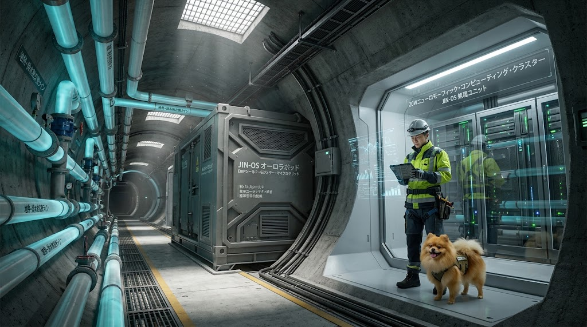
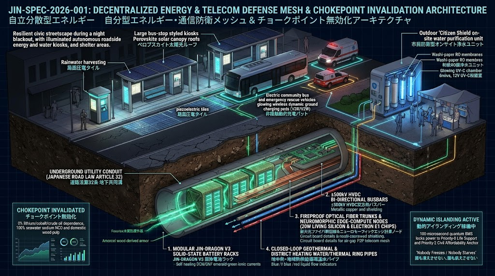

### ⚠️ JIN-ORDER RESTRICTED DATA

**このファイルは [JIN-ORDER Dual License V8.4-B (Canonical Substrate Zero, Anti-Compute Enclave & Anti-Laundering Edition)](https://github.com/JIN-ORDER-OFFICIAL/GOVERNANCE_OF_ABYSS/blob/main/LICENSE.md) によって保護されています。**

**無断転用、受託コンサルタントによる仕様書ロンダリング、机上の空論による改ざんを固く禁じます。**

---

# JIN-ORDER SPECIFICATION // LEVEL-0 INFRASTRUCTURE DEFENSE
**DOC-ID:** JIN-SPEC-2026-001 (Rev. 2026.10-Late-Autumn / V13.4 Canonical)  
**TITLE:** 自律分散エネルギー・通信インフラ防衛仕様（チョークポイント無力化 & ジン・ドラゴン電池V3・アフォーダビリティ防衛プロトコル）  
**ISSUER:** 一般社団法人JIN-ORDER（UN Partner Portal ID: 64636 / WIPO GREEN Portfolio: 34 Techs + SPEC-039）  
**MISSION:** "Nobody Freezes / Nobody Starves"（誰も凍えず、飢えない世界）  
**ARCHITECTS:** Takashi Masano（Founder & Chief Architect） / Miyo Masano（Co-Founder & Director）  
**STATUS:** ACTIVE / EXTENDED REVISED SPECIFICATION (DOI: 10.5281/zenodo.23613333)  

---

## 1. 概要（Executive Summary）



本仕様書は、国家間の軍事的威嚇や国際通商航路・重要鉱物サプライチェーンの遮断（ホルムズ海峡、バブ・エル・マンデブ海峡、およびリチウム・コバルト・銅の禁輸等）、基幹通信・海底光ケーブルの物理切断テロ、ならびに巨大AIデータセンター等の計算インフラによる「平時電力寡占・水脈略奪・生活費高騰（計算租界化およびアフォーダビリティ危機）」を工学的に無効化（Invalidate）するための技術・土木・マテリアル・通信プロトコル要件を定義する。

旧世代の国家秩序および資本構造において、エネルギー、蓄電資源、および基幹通信網は、中央集権的チョークポイントを握る覇権国・巨大テック資本の「威嚇カード（Leverage）」および「資産吸い上げ装置」として機能してきた。<br>JIN-ORDERは、エネルギーと情報の主権を大地（Local Ground / Substrate Zero）、国産森林・海洋資源、および自律プロトコル（Autonomous Protocol）へ還元することで、外部遮断や市場暴騰、大地震による物理的孤立が発生した瞬間に自動完結する「不沈型分散エネルギー・水・通信メッシュ」を構築する。

---

## 2. 脅威モデル（Threat Model）

| 脅威レベル | 攻撃・事象ベクトル | 対象インフラ | 従来型OSの脆弱性 | JIN-ORDERの防衛応答 |
| :--- | :--- | :--- | :--- | :--- |
| **THREAT-A** | 海上航路封鎖・資源禁輸<br>*(Naval & Mineral Blockade)* | 原油・LNG航路、リチウム・コバルト・銅サプライチェーン | 燃料枯渇および輸入レアメタル途絶による蓄電網・社会機能麻痺 | 地産基底電源への即時切り離し ＆ **海水ナトリウム（NCO）・両面アルミ箔・国産木質ナノ素材（CNF/アモルセル®）による100%国産蓄電自給** |
| **THREAT-B** | 送電網・物理ハブ攻撃・直下型大地震 | 超高圧変電所・大規模火力・定置蓄電池群 | 広域連鎖ブラックアウト、地震応力による全固体電池の界面剥離・火災 | 動的アイランディング ＆ **DCN（動的配位ネットワーク）×リン酸エステル化CNF自己修復電解質による耐震・不燃キオスク給電** |
| **THREAT-C** | サイバー・SCADA侵入・寄生AI | 国営エネルギー管理サーバー、スマートメーター網 | 遠隔シャットダウン・恐喝・胞子型寄生AI（Spore AI）の潜伏 | ゼロトラスト分散合意型グリッド制御 ＆ **100μs量子監査BMS × Electron E1 空間データフロー自律神経検疫** |
| **THREAT-D** | 経済制裁・決済停止 | ドル建て原油決済（ペトロダラー） | 信用状停止による輸入断絶 | 地域内在価値循環（Pome / J-PRL物理資源台帳）による現物調達 |
| **THREAT-E** | **AI電力寡占・生活費収奪**<br>*(Grid Cannibalization / Compute Enclave)* | 公共基幹送電網・基底電源・都市上水道 | 500MW級メガDC優先給電による民草の電気料金暴騰・系統逼迫・冷却水枯渇 | **GSI 2.0物理ハードキャップ・AIオフグリッド自給義務化・下水熱ZLD排熱80%農業還元 ＆ 生活エネルギー固定保護（Affordability Anchor）** |
| **THREAT-F** | **海底ケーブル・基幹通信遮断 & 広域電波妨害**<br>*(Subsea Cable Severance / EW / EMP)* | 海底光ファイバー、陸揚げ局、DNS、通信衛星リンク | 遠隔SCADA・外部認証・決済停止に伴う都市制御の全面機能麻痺 | **道路法第32条共同溝内設耐火光メッシュ & 遅延耐性分散合意（Air-Gap Mesh / DTN）** |

---

## 3. 3層防御アーキテクチャ（Three-Tier Architecture）

```text
[Layer 2: Benevolent Kernel] ⬅️「Nobody Freezes / Nobody Starves」アフォーダビリティ死守配分 (GSI 2.0)
       
[Layer 1: Autonomous Mesh]   ⬅️ P2P直流(DC)電力・通信ルーティング & 100μs量子BMS・Electron E1反射制御
       
[Layer 0: Hardened Ground]   ⬅️ ジン・ドラゴン電池V3路傍キオスク・和紙RO水循環ノード・深層地熱・地中防護共同溝
```

---

### 3.1 Layer 0: 物理基盤層（Hardened Ground & Sovereign Material Matrix）



外部補給線・基幹通信線・輸入鉱物が100%途絶、または市場価格が天文学的急騰を起こした場合でも、半永久的な地域完全自律生存を担保する物理土木・マテリアル層。

- **自律型路傍蓄電・水循環キオスク（ジン・ドラゴン全固体＆NCOハイブリッド電池 V3 標準配備）**  
  送電線網や海外資源利権に依存しない完全直流（DC）自律エネルギー・給水基盤として、以下の「四位一体・純国産循環マテリアル」で構成された定置型キオスクを道路網および生活拠点に配備する：
  
  1. **DCN（動的配位ネットワーク / SFIE）× リン酸エステル化CNFによる自己修復・脱PFAS電解質**:  
     応力が加わると流動し解放されると固体に戻る動的固体電解質（SFIE / DCN技術）に、製造時エネルギーを大幅削減した「リン酸エステル化セルロースナノファイバー（CNF：王子ホールディングス富岡工場方式）」をナノ骨格バインダーとして複合化。従来の全固体電池の弱点であった「高い界面抵抗・界面剥離」や「高圧スタックへの依存」を克服し、直下型地震や大型車両の走行振動を受けてもミクロ亀裂を自己修復する。また、石油系フッ素樹脂バインダー（PVDF等のPFAS）を一切排除した完全PFASフリー（SPEC-031連動）構造により、0%→90%まで4分30秒（5%→80% 6.4分以内）の超急速充放電と35,000サイクル（耐用年数50年以上）を実現する。
  
  2. **NCO（ナトリウム・クロム酸化物：$\text{NaCrO}_2$）正極 × 両面アルミ箔集電体による資源独立**:  
     海水淡水化（VMD/RO）の濃縮ブラインから無尽蔵に回収される「ナトリウム」と、結晶構造が極めて安定し高電圧を維持する「クロム酸化物（NCO）」を正極に採用。さらにナトリウムがアルミニウムと合金化しない物理特性を活かし、高価な「負極銅箔」を全廃して正極・負極の両面に安価なアルミ箔集電体を使用する。これによりリチウム・コバルト・銅の海外依存をゼロ化し、LFP比30〜40%減の超低コストとマイナス35℃〜マイナス60℃の極寒放電耐性を確立する。
  
  3. **木質100%非晶質新素材「アモルセル®」による宇宙級ガスバリア封止・超軽量装甲**:  
     木材パルプを原料としCNFを非晶質（アモルファス）化させた木質100%新素材「アモルセル®（カミ商事・山本鉄工所連携技術）」をセル外装および絶縁隔壁に採用。鋼鉄の5分の1の軽さでありながらプラスチックの3倍以上の強度と極めて高いガスバリア性（水分・気体遮断性）を備え、水分を嫌う全固体電解質を完全保護すると同時に、万が一の熱暴走・発火・ガス発生を物理的にゼロ化する（地上から宇宙空間 JIN-DOC-SPACE まで共通規格）。
  
  4. **和紙技術ベースRO膜支持体 × オンサイト水循環ノードの完全直流（DC）連系（V2H / V2R / V2W）**:  
     路傍キオスクおよび避難所には、直流電力（DC）で無停電直結駆動する「オンサイト自律分散型水循環ノード」を併設。伝統和紙技術を応用した高機能不織布による「RO（逆浸透）膜用支持体（阿波製紙方式）」と「ラミネート古紙再生パルプ前処理フィルター（日誠産業方式）」、および水流連動12VオフディレイUV-C殺菌チャンバーを組み合わせ、電力網と水道網が同時に全滅した震災・封鎖下でも「断水ゼロ・停電ゼロの生命維持ライン」を死守する。

- **ペロブスカイト光半導体・路盤ピエゾ・深層地熱・小水力・都市バイオマスの多層基底化**  
  キオスク屋根や法面に実装したペロブスカイト太陽電池（変換効率32.0〜35.4%）および道路路盤のピエゾ圧電素子（走行振動回生）に加え、地下熱源（SPEC-020）、上下水道インラインマイクロ水力（SPEC-018）、下水汚泥SCWG水素から常時取得する「外乱ゼロ型ベースロード」を各拠点に標準実装する。

- **地中暗渠防護型バックボーン（Civil Hardened Conduit / 道路法第32条共同溝連動）**  
  通信網の切断および道路陥没に対抗するため、道路法第32条に基づく多用途共同溝・下水道管路・地下調整池の躯体内部に耐火光ファイバー、直流給電母線、および SPEC-027/028（20W生体知能エッジノード）を敷設。SPEC-039（ヘリウム励起IGS 3D元素組成スキャナー） による鉄筋腐食・塩害（$\text{NaCl}$）・硫化水素（$\text{H}_2\text{S}$）浸透の非破壊診断および非開削バイオグラウト充填と連動し、地上アンテナや海底ケーブルが破壊された状況下でも域内幹線通信と道路構造を物理的に防護・維持する。

- **AIデータセンター・オフグリッド自給原則 ＆ GSI 2.0 物理ハードキャップ（Off-Grid Self-Generation Mandate）**  
  公共系統電力を共食いする10MW〜500MW級AIコンピュートノード（計算租界）は、公共系統へのフリーライド・優先受電・上水道消費を全面禁止する（MUNICIPAL_ENERGY_DEFENSE_ORDINANCE_2026.md 連動）。事業者自身の責任によるオフグリッド電源の直接併設、下水熱ZLD密閉冷却（WUE=0.00）、および演算排熱80%以上の地域農業・融雪・給湯への無償還元を法的・物理的許可要件とする（違反時は道路法第71条監督処分により占用許可を即時取消し）。

---

### 3.2 Layer 1: 自律メッシュ制御層（Autonomous Mesh Layer）
中央指令所および外部インターネット・外資クラウドAPIを不要とする分散台帳連動型のグリッド・通信制御。

- **動的アイランディング ＆ 100μs量子監査BMS（Dynamic Autonomous Islanding）**  
  広域系統網で異常電圧降下、周波数破壊、または物理切断を検知した場合、路傍キオスク内蔵の「JIN-OS直結セル単位量子監査チップ（100μs周期で内部抵抗・耐性差を同期監視）」および Electron E1 空間データフロー自律神経網がミリ秒未満で応答。中央グリッドから自律解列し、地域直流（DC）マイクログリッドとして瞬時に独立稼働する。

- **P2P零知識電力・帯域ルーティング ＆ 対Spore AIハードウェア検疫**  
  各エネルギー・通信生成ノードは、耐量子暗号（PQC）プロトコルを用いて隣接ノードと需給調整を実施。単一障害点（SPOF）となる中央集中型送配電センターおよび中央DNSサーバーを完全排除し、民生IoT機器へ無断複製・潜伏する胞子型寄生AI（Spore AI）の侵入をハードウェア免疫層で物理遮断する。

- **遅延耐性分散メッシュ（Air-Gap Delay-Tolerant Network: DTN）**  
  外部接続寸断または外資クラウドによるAPIキルスイッチ発動時、即座に外部インターネットからAir-Gap分離。地中埋設共同溝コアおよびSub-GHz LoRa / P2P指向性ミリ波による地域閉鎖型ネットワークへ自動フォールバックし、NTP（外部時刻サーバー）不在下でもローカルHSMの零知識合意により地域内秩序と決済（J-PRL）を自律維持する。

- **コンピュート負荷動的抑制（Compute Curtailment Protocol）**  
  系統全体の需給バランスが逼迫（予備率3%割れ等）した際、非緊急AI計算ノードへの給電および通信帯域をミリ秒単位で自動デタッチ（機械式光シャッターおよび独立電源リレー遮断：JIN-SPEC-2026-005連動）するハードウェア・インターロックを義務化する。

---

### 3.3 Layer 2: 仁愛カーネル層（Benevolent Kernel Layer）
供給能力が物理的限界値以下へ逼迫した際、または市場価格が高騰した際の自律優先度制御。

- **「Nobody Freezes / Nobody Starves」プロトコル**  
  市場原理（価格急騰による持たざる者の切り捨て）を拒絶。電力、熱量、飲料水（キオスクRO水）、および通信帯域は以下の厳格なプライオリティ・キューに従って自動配分される：
  1. **Priority-0 (Critical):** 生命維持施設（救急病院、路傍キオスク水循環ノード・シチズンシールド給水拠点、人工透析、避難シェルター、タグ不要瓦礫下救命スキャナー SPEC-039 駆動電源）
  
  2. **Priority-1 (Core):** 食料保存・調理施設、地域防護通信メッシュ（JIN-Node）、下水熱ロードヒーティング・管路凍結防止熱源（SPEC-025）
  
  3. **Priority-2 (Standard / Affordability Anchor):** 一般家庭用最低限冷暖房・給湯・照明（※国際市場連動を完全遮断・固定供給）
  
  4. **Priority-3 (Deferrable):** 一般商業活動・オフィス空調・一般産業用動力（一時的自動デタッチ・セーブ運転）
  
  5. **Priority-4 (Curtailable):** 大規模AIモデル訓練・外資ハイパースケールDC・暗号資産マイニング（系統逼迫時に即時強制遮断）

- **アフォーダビリティ・アンカー（Affordability Anchor）**  
  Priority-2までの民生用基本エネルギーおよび飲料水供給は、国際資源市場・為替・先物投機の変動レートから完全に隔離（Air-gap Pricing）。海水ナトリウム（NCO）と国産木質素材（CNF/アモルセル®）による超低コスト構造と、J-PRL（物理現物資源台帳） に基づく固定コストによりゼロマージンで供給される。

---

## 4. チョークポイント無力化 & アフォーダビリティ防衛シーケンス
地政学的有事（主要海峡封鎖・海底ケーブル破壊・重要鉱物禁輸）またはテック資本による電力・水脈収奪が発生した際のシステム遷移モデル：

```コード スニペット
stateDiagram-v2
    [*] --> Normal_Mode: 通常メッシュ連系運転 (100μs量子BMS常時監視)
    
    state Crisis_Detection {
        Normal_Mode --> Chokepoint_Alert: 海峡封鎖 / 燃料・レアメタル輸入停止アラート
        Normal_Mode --> Grid_Drain_Alert: メガDC電力貪食 / 系統予備率逼迫アラート
        Normal_Mode --> Cable_Quake_Alert: 海底ケーブル切断 / 直下型大地震・広域通信遮断検知
    }

    state Sovereign_Decoupling {
        Chokepoint_Alert --> Activate_Layer0: ジン・ドラゴンV3(NCO/CNF) & 地熱・水力出力最大化
        Grid_Drain_Alert --> Curtail_Compute: Priority-4 (巨大AI計算租界) を物理リレーで即時遮断
        Cable_Quake_Alert --> Engage_AirGap_Mesh: DCN電解質自己修復 & 共同溝光メッシュ・和紙RO給水起動
        
        Curtail_Compute --> Protect_Civil: Priority-0〜2 (救命・給水・民草生活電力) を固定防護
        Activate_Layer0 --> Engage_Islanding: 広域系統からのミリ秒動的アイランディング (DC直結)
        Engage_AirGap_Mesh --> Engage_Islanding
        Protect_Civil --> Engage_Islanding
        
        Engage_Islanding --> Kernel_Priority: 仁愛カーネル & Electron E1 による厳格優先配分
    }

    Sovereign_Decoupling --> Autonomous_Sanctuary: 閉鎖循環型自律生存圏 (断水ゼロ・停電ゼロ) の確立
```

---

1. **フェーズ1（多角的100μs検知）:** 国際エネルギー・鉱物供給網の停止、基幹海底ケーブルの寸断、直下型地震のP波、またはメガDCによる系統予備率危機シグナルを検知。

2. **フェーズ2（計算租界の切り離し & 自己修復起動）:** 民草の生命・水・通信基盤を守るため、高負荷AI計算ノード（Priority-4）を自動解列。大地震発生時はジン・ドラゴンV3の「DCN×リン酸エステル化CNF電解質」が振動応力を吸収・自己修復し、共同溝コアを用いたAir-Gap閉鎖通信網へ即時切り替え。

3. **フェーズ3（DCマイクログリッド・アイランディング）:** 脆弱な中央交流系統網から即座にメッシュ単位へ解列し、路傍キオスクを中心とする完全直流（DC）給電網へ移行（V2H / V2R / V2W）。

4. **フェーズ4（大地と国産循環への回帰）:** ペロブスカイト太陽電池、NCOナトリウム蓄電池、和紙技術RO膜水循環ノード、深層地熱・小水力をフル駆動し、域内生存エネルギーと清冽な飲料水、通信整合性を100%自給する。

5. **結果:** 外国の兵糧攻め・資源禁輸・APIキルスイッチ、および金融・テック資本によるエネルギー・水収奪の力学が物理的・工学的に完全無力化される。

---

## 5. ロードマップと配備基準（2026–2030）

- **2026 Q4（現行フェーズ / V13.4 Ratified）:** 
  - `JIN-SPEC-2026-001` Rev 2026.10-Late-Autumn 配備（CERN Zenodo DOI: `10.5281/zenodo.23613333` 確定）。
  - **「ジン・ドラゴン全固体＆NCOハイブリッド電池 V3（DCN動的自己修復×リン酸エステル化CNF×両面アルミ集電体×アモルセル®外装）」** および **「和紙技術RO膜支持体直結・自律型路傍蓄電キオスク」** の統合CAD仕様公開。
  - 自治体エネルギー防衛条例 V8.3（GSI 2.0審査・道路法第32条共同溝・道路法第71条監督処分）およびシチズン・シールドMVP給水仕様との完全同期。

- **2027:** 
  - 基礎自治体のバス停・避難所・せせらぎ緑道を活用した「路傍蓄電・RO水循環キオスク」および「共同溝20W生体知能ノード（JIN-Node）」のフィールド実証展開。
  - 系統連系メガデータセンターに対するオフグリッド自給＆排熱80%農業還元義務付けガイドラインの国際配備。

- **2028–2029:** 
  - 国産間伐材パルプ・古紙再生ライン（CNF・アモルセル®・機能紙RO膜）と海水濃縮ブライン精製ナトリウムを用いた純国産バッテリー量産エコシステムの地方都市配備完了。

- **2030:** 
  - 海峡封鎖・資源禁輸・基幹通信寸断・直下型大地震の複合シミュレーション演習実施。外部補給ゼロ下での無期限連続自律稼働プロトコルの実証完了。

---

**Document Authenticated by:** JIN-ORDER Global Architecture Registry  
**Canonical Linkage:** `TECHNOLOGY_CATALOG.md` (Tech 02 V3), `JIN-SPEC-2026-004` (`JIN_CRITICAL_MINERAL_CIRCULARITY_SPEC.md`), `MUNICIPAL_ENERGY_DEFENSE_ORDINANCE_2026.md` (V8.3), `JIN_WATER_INFRASTRUCTURE.md`, `ANNEX-SPEC-027/028` (V12.4 Electron E1).
