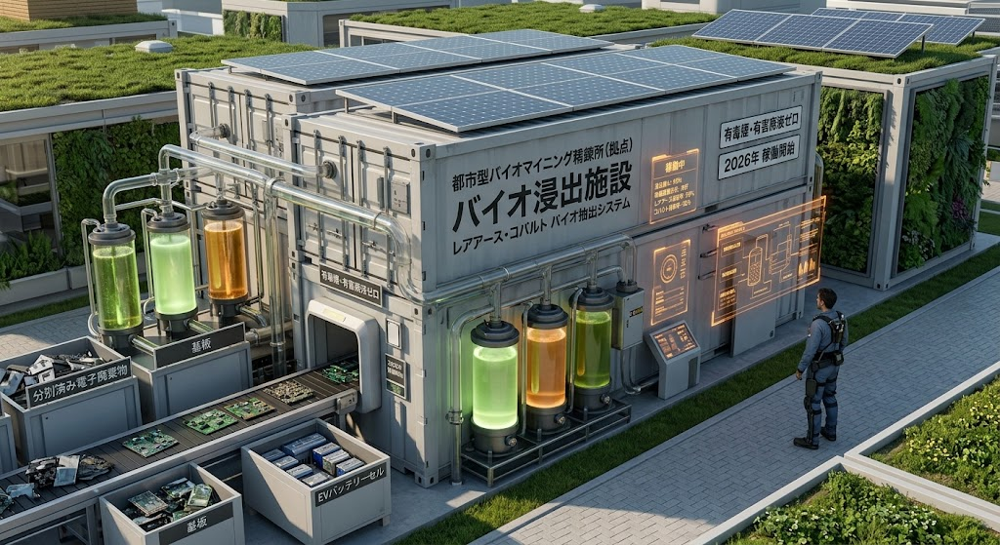
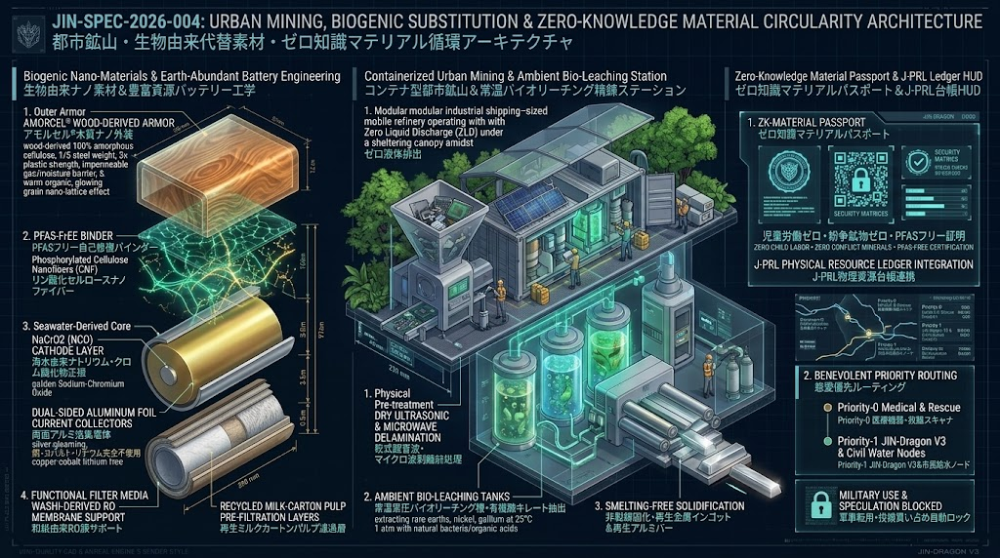

### ⚠️ JIN-ORDER RESTRICTED DATA

**このファイルは [JIN-ORDER Dual License V8.4-B (Canonical Substrate Zero, Anti-Compute Enclave & Anti-Laundering Edition)](https://github.com/JIN-ORDER-OFFICIAL/GOVERNANCE_OF_ABYSS/blob/main/LICENSE.md) によって保護されています。**

**無断転用、特定国家・軍需資本による囲い込み、環境破壊型精錬、および受託コンサルタントによる仕様書ロンダリングを固く禁じます。**

*This file is protected by the JIN-ORDER Dual License V8.4-B. Unauthorized exploitation, weaponization, resource monopolization, or specification laundering is strictly prohibited.*

---

# JIN-ORDER SPECIFICATION // LEVEL-0 MATERIAL SOVEREIGNTY
**DOC-ID:** JIN-SPEC-2026-004 (Rev. 2026.10-Late-Autumn / V13.4 Canonical)  
**FILE:** specs/JIN_CRITICAL_MINERAL_CIRCULARITY_SPEC.md  
**TITLE:** 都市鉱山・重要資源自律循環仕様（サプライチェーン分断無力化 ＆ 生体木質ナノ素材・海水ナトリウム代替プロトコル）  
**ISSUER:** 一般社団法人JIN-ORDER（UN Partner Portal ID: 64636 / WIPO GREEN Portfolio: 34 Techs + SPEC-039）  
**MISSION:** "Break the Resource Curse"（資源の呪縛とチョークポイントの解体）  
**ARCHITECTS:** Masano Takashi（Founder & Chief Architect） / Masano Miyo（Co-Founder & Director）  
**STATUS:** ACTIVE / EXTENDED REVISED SPECIFICATION (DOI: 10.5281/zenodo.23613333)  

---

## 1. 概要（Executive Summary）



本仕様書は、覇権国家間における半導体素材・重要鉱物（レアアース、ガリウム、ゲルマニウム、リチウム、コバルト、銅、高純度ポリシリコン等）の禁輸措置、輸出管理の武器化、および採掘現場における人権蹂躙（児童労働・武装勢力資金源化）を工学的に無力化（Invalidate）するための、都市鉱山抽出・代替マテリアル（海水ナトリウム・木質ナノ新素材・和紙機能紙）・閉鎖循環プロトコルを定義する。

旧世代の国家秩序において、重要鉱物は「地政学的チョークポイント」として独占され、特定国家への従属を強いる道具として悪用されてきた。また、EV用二次電池や送電インフラは、リチウム・コバルト・銅などの偏在資源に過度に依存し、サプライチェーンの寸断が即座に社会インフラの停止に直結する脆弱性を抱えている。  
JIN-ORDERは、電子廃棄物（E-waste）や既存社会インフラに眠る金属資源を回収・再生する「分散型極低環境負荷精錬メッシュ」に加え、**「海水由来ナトリウム（NCO正極）× 両面アルミ箔集電体」** および **「国産木質100%ナノ新素材（アモルセル®・リン酸エステル化CNF・和紙技術RO膜）」** による徹底的な脱希少資源・脱PFAS設計を配備。海外鉱山からの補給が完全遮断された極限環境下でも、次世代インフラ（太陽光、蓄電池、水循環、通信ノード）の製造・維持を地域内で自律完結させる。

---

## 2. 脅威モデル（Threat Model）

| 脅威レベル | 攻撃・事象ベクトル | 対象マテリアル | 従来型OSの脆弱性 | JIN-ORDERの防衛応答 |
| :--- | :--- | :--- | :--- | :--- |
| **THREAT-A** | 輸出規制・禁輸指定<br>*(Export Weaponization)* | ガリウム、ゲルマニウム、高純度レアアース | 原産国採掘・精錬の独占による<br>半導体・光通信製造停止 | **分散型都市鉱山バイオ抽出 &**<br>**代替半導体プロセス（Ga2O3・CBA接合）配備** |
| **THREAT-B** | 資源ブロック囲い込み・銅/リチウム寡占<br>*(Strategic Cartel)* | リチウム、コバルト、銅箔、高純度シリコン | 特定同盟国・巨大資本による優先調達と価格暴騰、周縁部の排除 | **海水ナトリウム（NCO正極）&**<br>**両面アルミ箔集電体（脱リチウム・脱コバルト・脱銅）** |
| **THREAT-C** | 採掘現場の人権侵害<br>*(Conflict Minerals)* | コンゴ産コバルト、金、コルタン | 武装勢力・多国籍資本による<br>児童労働・中間搾取 | **ゼロ知識マテリアルパスポートによる**<br>**不正鉱物の市場取引自動遮断** |
| **THREAT-D** | 環境破壊型精錬・PFAS規制<br>*(Toxic Refining & PFAS Enclosure)* | 強酸浸出を伴う希土類精錬、フッ素系バインダー（PVDF） | 公害押し付けとPFAS国際規制による<br>電池サプライチェーンの機能停止 | **微生物常温閉鎖浸出 &**<br>**リン酸エステル化CNF（100%植物由来PFASフリー結着）** |
| **THREAT-E** | 外装材・高圧スタックの重量・資源制約<br>*(Heavy Metal & Stack Pressure Bottleneck)* | 重金属製電池缶、高圧スタック機構、銅配線 | 重量増によるモビリティ効率低下、<br>地震・衝撃による全固体界面剥離 | **木質100%「アモルセル®」宇宙級ガスバリア装甲 &**<br>**DCN（動的配位ネットワーク）自己修復電解質** |

---

## 3. 3層資源循環アーキテクチャ（Three-Tier Circularity Architecture）



```text
[Layer 2: Benevolent Kernel]　⬅️　Fair Material Routing」軍事転用排除・生命インフラ優先割当
[Layer 1: Material Ledger]　　⬅️　ゼロ知識マテリアルパスポート & 紛争鉱物排除スマート契約 (J-PRL連動)
[Layer 0: Urban Refinery]　　 ⬅️　都市鉱山常温バイオ抽出・海水ナトリウム(NCO)・木質ナノ素材(CNF/アモルセル®)
```

---

### 3.1 Layer 0: 都市鉱山・代替物理工学層（Urban Refinery & Biogenic Substitution Layer）
外部の鉱山採掘・輸入線が完全に遮断された場合でも、域内の電子廃棄物、海水、および国産森林・パルプ資源から機能素材を100%自給する物理層。

- **超音波・マイクロ波物理剥離（Physical Delamination）**  
  廃棄基板・廃太陽光パネル・廃二次電池に対し、毒性ガスや強酸を使用せず、物理的振動・精密粉砕によって貴金属・シリコン・レアアース層を単離・選別する乾式前処理ユニットを規格化。

- **常温有機酸・バイオ浸出（Closed Bio-Leaching）**  
  特定の無害化細菌（鉄酸化細菌等）およびクエン酸・酒石酸等の天然有機キレート剤（`SPEC-038`連動）を用い、常温・常圧・排水ゼロ（Closed-loop Zero Liquid Discharge）でコバルト・ニッケル・希土類を高純度抽出するコンテナ型精錬セル。

- **脱・希少資源 ＆ 生体木質ナノ素材代替設計（Biogenic & Earth-Abundant Substitution）**  
  海外利権と地政学的チョークポイントを解体するため、以下の「純国産・循環代替マテリアル仕様」をハードウェア標準要件として規定する：
  
  1. **脱リチウム・脱コバルト・脱銅（NCOナトリウム蓄電 × 両面アルミ箔集電体）**:
     - **正極**: 海水淡水化（VMD/RO）濃縮ブラインから晶析精製した無尽蔵のナトリウムと、構造が極めて安定したクロム酸化物を用いた「ナトリウム・クロム酸化物（$\text{NaCrO}_2$：NCO）」を採用。
     - **集電体**: ナトリウムがアルミニウムと合金化しない特性を活用し、従来のリチウムイオン電池で必須とされた高価な「負極銅箔」を全廃。正極・負極の両面に安価・軽量な高純度アルミニウム箔を使用する。
     - **効果**: 国際銅利権・リチウムカルテルから完全に離脱し、セル材料コストを既存LFP比30〜40%削減。-35℃〜-60℃の極低温環境でも劣化ゼロで放電可能な定置型・グリッド蓄電インフラを確立する。
  
  2. **脱フッ素・脱PFAS結着骨格（リン酸エステル化CNFバインダー）**:
     - 電池電極および全固体電解質の結着材として、従来の石油系フッ素樹脂（PVDF等のPFAS）を全廃。王子ホールディングス富岡工場方式の「リン酸エステル化セルロースナノファイバー（CNF）」をナノ骨格として導入する。
     - 製造エネルギーを大幅削減した化学処理プロセスにより、親水性・接着性・イオン透過性を高次元で両立。ProLogium型動的配位ネットワーク（DCN / SFIE）と複合化することで、地震振動や充放電歪みによるミクロ亀裂を自己修復する完全PFASフリーの電解質・電極層を形成する。
  
  3. **脱重金属・脱石油外装（木質100%新素材「アモルセル®」超軽量装甲）**:
     - 木材パルプ由来のCNFをさらに非晶質（アモルファス）化させた木質100%の新素材「アモルセル®（カミ商事・山本鉄工所連携技術）」をセル外装およびモジュール隔壁に採用。
     - 鋼鉄の5分の1の重量・プラスチックの3倍以上の強度を誇り、全固体電池の大敵である水分の侵入を完全遮断する極めて高いガスバリア性を備える。発熱・発火・有毒ガス噴出を物理的に封殺し、宇宙空間（`JIN-DOC-SPACE`）から地上キオスクまで共通の不沈パッケージングを実現する。
  
  4. **機能紙・古紙再生パルプ水循環フィルター（和紙RO膜支持体・ラミネート古紙再生）**:
     - 阿波製紙方式の高度な和紙抄紙技術を応用した「高強度・高透水性RO膜支持体（機能紙・不織布）」と、日誠産業方式の「牛乳パック等ラミネート古紙からPE・インクを完全除去した再生パルプ前処理層」を水循環ノードに配備。石油系樹脂フィルターの使い捨てを根絶する。
  5. **磁石・導電体**:
     - 重希土類（ディスプロシウム、テルビウム）を完全排除した高耐熱フェライト磁石および窒化鉄磁石モータ設計。
     - 銅配線を代替する高純度アルミニウム合金・カーボンナノチューブ（CNT）複合導電線路。

---

### 3.2 Layer 1: 分散トレーサビリティ層（Material Ledger Layer）
資源の物理的流通とデジタル証明を直結し、搾取・武器化・仕様ロンダリングを封じる論理層。

- **ゼロ知識マテリアルパスポート（ZK-Material Passport / J-PRL連動）**  
  すべての精錬インゴット、再生金属、およびアモルセル®/CNFロットに、原産地・抽出プロセス・人権チェック（児童労働ゼロ・環境適合）・炭素会計の暗号化ハッシュを付与。`J-PRL（公共物理資源台帳：SPEC-028_PROTOCOL_01）` 上に不可侵記録する。

- **紛争・軍事転用フィルタリング**  
  児童労働や環境破壊に関与した採掘ロット、または軍事自律兵器製造をエンドユーザーとするトランザクションを検知した瞬間、JIN金融OS上での決済、スマートコントラクト、および素材受渡を自動凍結する。

---

### 3.3 Layer 2: 仁愛資源配分カーネル（Benevolent Kernel Layer）
重要物資が世界的に欠乏した際、資本力による買収を拒絶し、生命維持・平和インフラへ優先配分する統治層。

- **「Fair Material Routing」プロトコル**  
  回収・再生された重要鉱物および代替木質ナノ素材は、以下の厳格な優先順位に従って製造ラインへ割り当てられる：
  
  1. **Priority-0 (Critical):** 救急医療機器（MRI、人工呼吸器用センサー）、タグ不要深部救命スキャナー（`SPEC-039`）、路傍キオスク水循環ノード（和紙RO膜支持体）
  
  2. **Priority-1 (Core Infrastructure):** ジン・ドラゴン全固体＆NCOハイブリッド電池 V3、分散グリッド用酸化ガリウムパワー半導体、生活防衛共同溝コア
  
  3. **Priority-2 (Civil Standard):** 一般家庭用生活端末（Benevolence Client）、農業用電動モビリティ、地域防災蓄電セル
  
  4. **Priority-3 (Commercial):** 一般家電・一般商業電子機器
  
  5. **Priority-4 (Prohibited):** 軍事自律兵器、監視カメラ網用生体認証チップ、投機目的の地金退蔵（自動割当拒絶）

---

## 4. サプライチェーン分断無力化シーケンス（Neutralization Sequence）
地政学的な資源禁輸、サプライチェーン寸断、またはPFAS国際規制が発動した際のシステム遷移モデル：

```コード スニペット
stateDiagram-v2
    [*] --> Global_Supply_Mode: 通常ハイブリッド調達運転 (ZKパスポート監査)
    
    state Embargo_Detection {
        Global_Supply_Mode --> Chokepoint_Alert: 重要鉱物(Li/Co/Cu/Ga)禁輸 / 輸出規制アラート
        Global_Supply_Mode --> Conflict_Alert: 不正採掘・児童労働・環境破壊ロット検知
        Global_Supply_Mode --> PFAS_Ban_Alert: フッ素系バインダー国際規制・供給途絶
    }

    state Circular_Sovereignty {
        Chokepoint_Alert --> Activate_Urban_Mining: 域内都市鉱山・常温バイオ精錬フル稼働
        Conflict_Alert --> Blacklist_Quarantine: 不正ロットのスマート契約自動遮断
        PFAS_Ban_Alert --> Engage_Biogenic_Substitutes: リン酸エステル化CNF・アモルセル®へ即時切替
        
        Activate_Urban_Mining --> Engage_Biogenic_Substitutes: 海水NCO正極 ＆ 両面アルミ箔集電体を投入
        Engage_Biogenic_Substitutes --> Priority_Material_Routing: 仁愛カーネルによる生命インフラ優先配分
    }

    Circular_Sovereignty --> Closed_Loop_Sanctuary: 閉鎖循環型資源自給圏 (100%国産代替) の確立
```

---

1. **フェーズ1（禁輸・制裁・規制検知）:** 特定国家によるレアメタル・銅の輸出停止、価格操作シグナル、またはPFAS規制による部材供給途絶を検知。

2. **フェーズ2（都市鉱山と国内自然資本の起動）:** 外部輸入への依存を即時停止。コンテナ型バイオ精錬セルを起動してE-wasteから必要金属を回収すると同時に、海水淡水化施設からナトリウムを、国内製紙・森林拠点からパルプ・CNF原料を動員。

3. **フェーズ3（生体ナノ代替設計への自動切替）:** リチウム・コバルト・銅を一切使わない「NCO×両面アルミ箔電池」および「リン酸エステル化CNF結着×アモルセル®封止」へと製造ラインを自律再構成。

4. **フェーズ4（生命維持優先ルーティング）:** 回収金属および代替素材を、医療・給水・マイクログリッドインフラへ無償・固定コストで最優先供給。

5. **結果:** 資源兵糧攻めによる外交圧力や経済恐喝、および特定資源の枯渇リスクが物理的・工学的に完全無力化される。

---

## 5. ロードマップと配備基準（2026–2030）

- **2026 Q4（現行フェーズ / V13.4 Ratified）:** 
  - `JIN-SPEC-2026-004` 配備（CERN Zenodo DOI: `10.5281/zenodo.23613333` 確定）。
  - **「海水由来NCOナトリウム正極 ＆ 両面アルミ箔集電体」** および **「徳島・四国木質ナノ素材（リン酸エステル化CNF・アモルセル®・和紙RO支持体）」** 統合代替仕様の公開。
  - ZK-Material Passportによる紛争鉱物排除コントラクトと `J-PRL` 台帳の結合テスト完了。

- **2027:** 
  - 自治体・開拓特区におけるE-waste回収デポ、コンテナ型常温バイオ精錬セル、およびラミネート古紙再生パルプラインの試験配備。
  - ジン・ドラゴン電池 V3 向け脱PFAS・脱レアメタル設計のオープンソース仕様公開。

- **2028–2029:** 
  - グローバルサウス・紛争被災地（コンゴ・サヘル等）における「現地完結型精錬ギルド（児童労働完全排除）」の実装。
  - 間伐材パルプと海水ナトリウムを基軸とする純国産蓄電・水循環モジュールの量産展開。

- **2030:** 
  - 外部一次鉱物輸入ゼロ下での「完全閉鎖循環型インフラ製造実証」の完了。

---

**Document Authenticated by:** JIN-ORDER Global Architecture Registry  
**Canonical Linkage:** `TECHNOLOGY_CATALOG.md` (Tech 02 V3 / Tech 05 / Tech 17), `JIN-SPEC-2026-001` (Decentralized Energy & Telecom Defense), `SPEC-028_PROTOCOL_01` (J-PRL), `SPEC-031` (PFAS Free Remediation), `SPEC-038` (Natural Chiral Bio-Catalyst).
